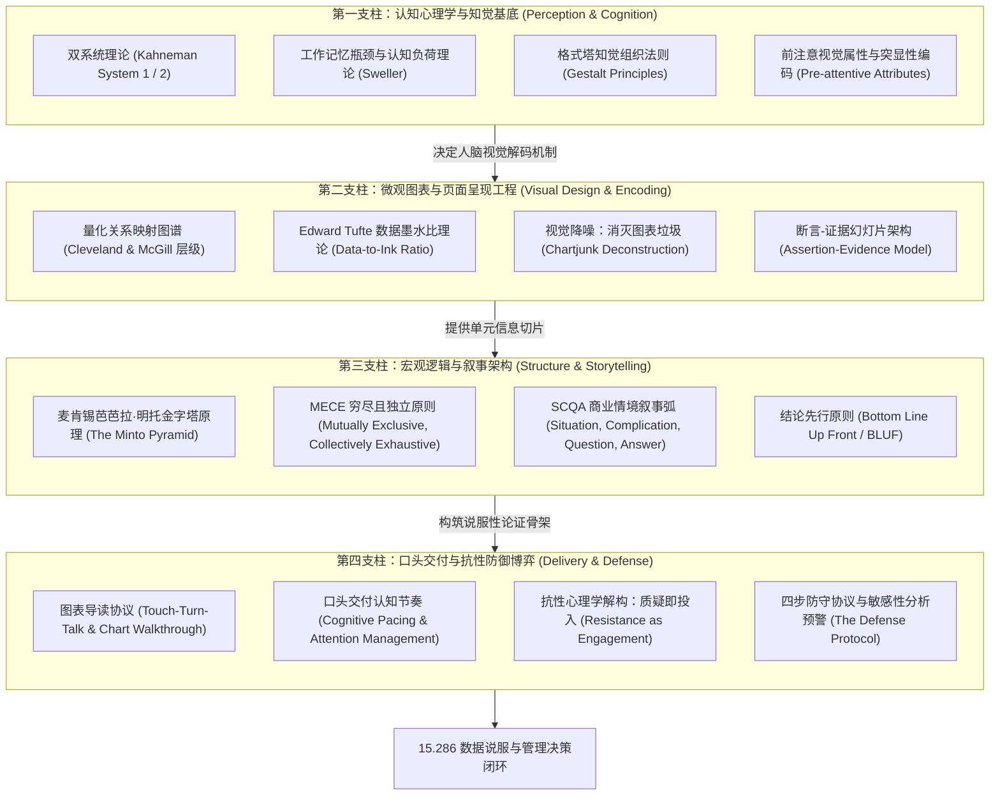

# 15.286 数据沟通与说服：设计、交付与辩护 (Communicating with Data)

> **授课院系**：MIT Sloan 管理学院 · 管理沟通中心（Managerial Communication）  
> **核心导师**：Miro Kazakoff（Senior Lecturer in Managerial Communication，《Persuading with Data》作者）  
> **核心教材**：Miro Kazakoff, *Persuading with Data: A Guide to Designing, Delivering, and Defending Your Data* (MIT Press)  
> **课程定位**：MIT Sloan MBA 高阶核心沟通选修课（3-0-3 学分；本科对应课程 15.276），打通量化分析与高管决策的认知鸿沟

## TL;DR

- 课程颠覆“技术分析完成即工作结束”的旧范式，确立“以决策行动为终点”的解释性数据沟通方法论。
- 基于双系统认知心理学与格式塔知觉律，剖析人类大脑解码图表的生理机制，打破“知识的诅咒”。
- 融合 Edward Tufte 数据墨水比、芭芭拉·明托金字塔原理与断言-证据范式，建立微观图表到宏观叙事的完整工程链。
- 全套讲义系统覆盖认知负荷、格式塔知觉、图表选型、视觉降噪、断言幻灯片、逻辑金字塔、现场口头导读与质疑抗性防御。

## 课程体系与方法论建构

在数据科学、计量经济学与商业智能飞速普及的今天，商业组织中最常见的悲剧不再是“缺乏数据”，而是**“数据无法驱动行动”**。技术专家与量化分析师耗费数月构建了精密的预测模型或详尽的分析报表，但在向执行委员会或非技术高管汇报时，却往往陷入两难困境：要么陷入底层算法与参数细节，导致听众认知超载并丧失兴趣；要么遭遇管理层对数据口径与底层假设的剧烈防御性反弹。分析人员感到自己的专业成果未受尊重，而高层领导则困惑于“这些复杂的图表究竟对我今天的商业决策有什么指导意义”。

MIT Sloan 管理学院高级讲师 Miro Kazakoff 开设的 15.286《数据沟通与说服》（*Communicating with Data: Designing, Delivering, and Defending Your Data*）正是为破解这一组织痛点而生。Kazakoff 强调：**数据沟通的本质不是设计美学练习，而是管理修辞学（Management Rhetoric）与认知工程（Cognitive Engineering）**。汇报者的核心职责，绝非向听众“证明自己做了多少工作”，而是“以最低的认知负荷，让决策者看清数据事实背后的因果逻辑与行动紧迫性”。从数据提取到战略落地的链条中，任何沟通摩擦都会成倍放大决策阻力。

为了系统化提升这一关键管理胜任力，本课程打破传统“制图软件培训”或“单纯图表美化”的浅层套路，将认知心理学、知觉规律、图表编码、页面断言、逻辑结构与现场博弈六大要素有机熔炼为一体。无论是在董事会推进百亿美元的兼并收购，还是在跨职能周会上争取产品迭代预算，数据沟通者都必须同时扮演“信息过滤者”、“逻辑构架师”与“决策协作者”三重角色。

本知识库以 Miro Kazakoff 的 MIT Press 经典著作体系为骨架，横向整合现代认知心理学、信息设计哲学与麦肯锡结构化思维，构建了一套从微观神经感知到宏观博弈辩护的闭环框架：

这四大支柱构成了不可分割的递进体系：第一支柱阐明人脑处理信息的生理局限；第二支柱确立单张图表与页面的视觉信噪比；第三支柱将分散的数据点编织为严密的金字塔论证逻辑；第四支柱则赋能汇报者在现场动态互动中化解阻力并促成行动。这种跨学科的融合，使得原本枯燥的数据分析能够转化为组织内部强大的变革推力。

## 讲义全景地图与学习导航

全套课程按照“微观认知底座 $\to$ 图表视觉工程 $\to$ 页面断言呈现 $\to$ 宏观结构化叙事 $\to$ 现场口头导读 $\to$ 质疑抗性防御”的完整说服链条推进：

| 讲次 | 核心模块与理论来源 | 解决的关键痛点 | 对应讲义 |
|---|---|---|---|
| **第 1 讲** | **认知负荷与知识的诅咒：从探索性分析到解释性沟通** *(Daniel Kahneman; John Sweller; Chip & Dan Heath)* | 破除技术专家的“数据自恋”；识别探索性与解释性分析的边界；控制听众工作记忆过载。 | [lec1.md](./lec1.md) |
| **第 2 讲** | **视觉感知机理与格式塔法则：人脑如何解码统计图表** *(William Cleveland & Robert McGill; Gestalt Psychology)* | 掌握前注意视觉属性（250ms 内解码）；依照视觉精度层级编码数据；利用格式塔知觉律引导注意力。 | [lec2.md](./lec2.md) |
| **第 3 讲** | **图表选型与信息架构：匹配认知目标的数据编码** *(Miro Kazakoff; Stephen Few; Gene Zelazny)* | 掌握对比、构成、分布、关联与趋势五大核心关系映射；破除饼图与双坐标轴陷阱；图表与表格边界判断。 | [lec3.md](./lec3.md) |
| **第 4 讲** | **极简主义与信噪比最大化：Tufte 原则与视觉降噪** *(Edward R. Tufte, The Visual Display of Quantitative Information)* | 计算并最大化数据墨水比；剔除三维伪透视与莫尔条纹；落实灰度优先色彩原则与就近直接标注。 | [lec4.md](./lec4.md) |
| **第 5 讲** | **幻灯片架构与断言-证据范式：管理层视角的叙事切片** *(Michael Alley, Penn State; Richard Mayer 认知学习理论)* | 废黜传统无信息标题与要点列表；构建“完整断言句标题 + 视觉证据正文”；消灭注意力分裂效应。 | [lec5.md](./lec5.md) |
| **第 6 讲** | **逻辑金字塔与 MECE 原则：高管汇报的推理结构** *(Barbara Minto, The Pyramid Principle; McKinsey & Company)* | 贯彻结论先行（BLUF）；运用归纳与演绎推理组织论据；运用 SCQA 叙事弧构建管理层紧迫感。 | [lec6.md](./lec6.md) |
| **第 7 讲** | **口头交付与认知节奏：图表导读与控场艺术** *(Miro Kazakoff, Persuading with Data; 演讲修辞学)* | 严格执行 Touch-Turn-Talk 图表导读四步法（坐标轴-基准-洞察）；掌控注意力节奏与远程投屏引导。 | [lec7.md](./lec7.md) |
| **第 8 讲** | **质疑防御与抗性化解：假设拆解与现场 Q&A 博弈** *(Miro Kazakoff; Chris Argyris 组织防御理论)* | 重构质疑心理认知（抗性是关心的表现）；解构四类数据攻击；运用倾听-验证-澄清-决策四步防守协议。 | [lec8.md](./lec8.md) |

## 核心概念索引

为支持跨课程检索与 RAG 向量切分，本课程沉淀了四个高频复用的基础概念页面：

- [数据墨水比与视觉降噪 (Data-to-Ink Ratio & Chartjunk Elimination)](./concept/data-ink-ratio.md)：Edward Tufte 提出的现代数据可视化极简主义黄金法则。
- [金字塔原理与 MECE 逻辑 (The Minto Pyramid Principle & MECE)](./concept/pyramid-principle.md)：麦肯锡经典商业思考、结构化论证与高管汇报底层逻辑。
- [断言-证据幻灯片范式 (The Assertion-Evidence Paradigm)](./concept/assertion-evidence.md)：颠覆传统 PPT 模板的科研与管理层高信噪比汇报架构。
- [前注意属性与突显性编码 (Pre-attentive Attributes & Visual Saliency)](./concept/pre-attentive-attributes.md)：人类视觉皮层亚秒级并行信息处理机制与图表聚焦点设计。

## 经典实证与权威参考书目

1. **Kazakoff, M.** (2022). *Persuading with Data: A Guide to Designing, Delivering, and Defending Your Data*. The MIT Press.
2. **Tufte, E. R.** (1983/2001). *The Visual Display of Quantitative Information* (2nd ed.). Graphics Press.
3. **Minto, B.** (1987/2009). *The Pyramid Principle: Logic in Writing and Thinking* (3rd ed.). Financial Times Prentice Hall.
4. **Cleveland, W. S., & McGill, R.** (1984). Graphical perception: Theory, experimentation, and application to the development of graphical methods. *Journal of the American Statistical Association*, 79(387), 531-554.
5. **Alley, M., & Neeley, K. A.** (2005). Rethinking the design of presentation slides: A case for sentence headlines based on graphic evidence. *Technical Communication*, 52(4), 417-426.
6. **Sweller, J.** (1988). Cognitive load during problem solving: Effects on learning. *Cognitive Science*, 12(2), 257-285.
7. **Kahneman, D.** (2011). *Thinking, Fast and Slow*. Farrar, Straus and Giroux.
8. **Few, S.** (2012). *Show Me the Numbers: Designing Tables and Graphs to Enlighten* (2nd ed.). Analytics Press.
