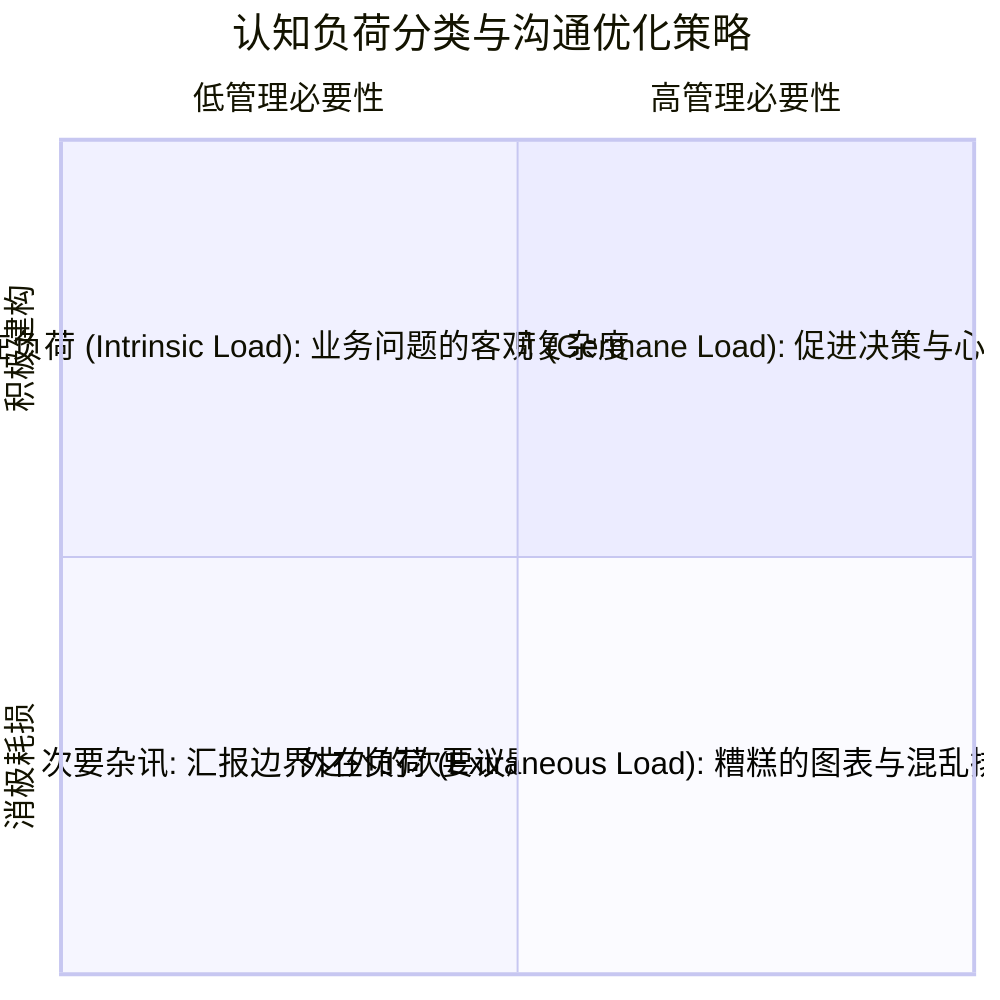

# Lec 1 认知负荷与知识的诅咒：从探索性分析到解释性沟通 (Cognitive Load & The Curse of Knowledge)

> MIT Sloan 15.286 · Communicating with Data · 数据沟通与说服

## TL;DR

- 阐明数据沟通的核心范式跃迁：从个人摸索数据的“探索性分析”彻底转向驱动受众决策的“解释性沟通”。
- 揭示技术汇报者的核心认知陷阱“知识的诅咒”——因自身对细节极度熟悉而严重低估受众解码信息的认知摩擦。
- 基于 Kahneman 双系统理论与 Sweller 认知负荷模型，指出人类工作记忆极度脆弱，沟通必须坚决消灭外在认知负荷。
- 确立以“受众决策行动”取代“自我工作量证明”的专业汇报伦理，从底层根除数据堆砌与无效信息过载。

## 范式跃迁：探索性分析 vs. 解释性沟通

在数据驱动型组织中，分析人员、量化研究员与技术专家最常犯的根本性错误，是将**数据处理的思考过程**直接等同于**汇报呈现的交付物**。当一个人花费数周甚至数月清洗数据、训练模型、测试数百个特征变量并遭遇无数次死胡同后，他本能地希望向管理层展示这段波澜壮阔的探索历程，以证明自身工作的专业性与艰辛程度。然而，这种“数据倾倒（Data Dump）”几乎必然导致灾难性的沟通失败。

Miro Kazakoff 在 MIT Sloan 明确界定了两类截然不同的数据活动之间的刚性边界：

```mermaid
flowchart LR
    subgraph S1["阶段一：探索性分析 (Exploratory Analysis)"]
        direction TB
        A1["海量原始数据清洗与筛选"]
        A2["尝试 100+ 种假设与切片"]
        A3["95% 的分析路径被证伪或无效"]
        A4["目标：为自己寻找答案 (Find the Pearls)"]
    end

    subgraph S2["转换鸿沟 (The Chasm)"]
        direction TB
        B1["知识蒸馏与过滤"]
        B2["受众同理心与目标对齐"]
        B3["剔除沉没成本自恋"]
    end

    subgraph S3["阶段二：解释性沟通 (Explanatory Communication)"]
        direction TB
        C1["仅提炼 2-3 个核心商业洞察"]
        C2["基于金字塔结构组织支撑论据"]
        C3["消除杂讯，驱动决策与行动"]
        C4["目标：向他人交付珍珠 (Deliver the Pearls)"]
    end

    S1 --> S2 --> S3
```

::: definition 探索性分析 vs. 解释性沟通
- **探索性分析（Exploratory Analysis）**：分析者与数据之间的单向探索互动。其本质是在海量的不确定性中寻找模式、验证假设、排除干扰，受众是**分析者本人**。在这个阶段，制作 100 张粗糙的散点图以排查异常值是必要且高效的。
- **解释性沟通（Explanatory Communication）**：沟通者与决策者之间的双向认知互动。其本质是将经过提炼的特定事实转化为受众可理解、可评估、可决策的逻辑叙事，受众是**外部决策者**。在这个阶段，强迫受众浏览那 98 张无意义的背景图表属于严重的沟通失职。
:::

::: example “寻珠与授珠”隐喻
正如商业沟通学者 Cole Nussbaumer Knaflic 所言：探索性分析就像是在沙滩上撬开成千上万个生蚝去寻找珍珠；而解释性沟通则是将你找到的那两颗璀璨的珍珠精心清洗、打磨并呈递给买家。很多技术汇报者却把一整桶发臭的生蚝泥沙直接倒在高管的办公桌上，并要求高管“欣赏自己撬生蚝的辛勤付出”。
:::

## 知识的诅咒：专家为什么难以讲清常识

为什么高智商、技术精湛的分析师极难做好解释性沟通？这并非源于口才或性格缺陷，而是一个深植于人类大脑神经机制的认知偏误——**知识的诅咒（The Curse of Knowledge）**。

::: definition 知识的诅咒 (The Curse of Knowledge)
一旦一个人深入掌握了某项复杂的专业知识、业务逻辑或技术细节，他就**再也无法真正想象那些尚未掌握该知识的人的心理状态**。他在思考该领域时，大脑会自动调用高度压缩的专业表征与隐性假设，并将这种“理所当然”投射给受众。
:::

斯坦福大学心理学研究者 Elizabeth Newton 曾设计过一个著名的“敲击者与倾听者（Tappers and Listeners）”实验：
1. 敲击者被要求挑选一首家喻户晓的歌曲（如《祝你生日快乐》），并通过手指敲击桌面的节奏将其展示给倾听者；
2. 敲击者被要求预测倾听者猜出歌名的概率，敲击者的平均预测成功率高达 **50%**；
3. 然而实验的实际结果是：倾听者在数百次尝试中，猜对的概率仅有 **2.5%**（120 次尝试中仅猜中 3 次）。

::: insight 敲击者困境的神经认知本质
为什么预测值（50%）与真实值（2.5%）存在 20 倍的鸿沟？因为敲击者在手指敲击桌面的同时，其大脑皮层正在清晰地同步回放着该歌曲的完整旋律、和弦与歌词——在他脑中，那是一首完整的交响乐；而在倾听者耳中，听到的仅仅是断断续续、毫无规律的“咚、咚、咚”敲桌声。  
在商业汇报中，分析师看一张充满专业缩写与密集散点的图表时，脑中自动回放着背后三个月的业务背景与因果链；而决策者看到的，仅仅是完全不可理喻的噪点。**沟通者的第一修养，是清醒意识到受众脑中没有你的背景旋律**。
:::

## 人类信息加工机制：双系统与工作记忆极限

为了构建高效的数据呈现，沟通者必须深刻理解人脑处理量化信息的物理硬件限制。认知心理学提供了两个关键支撑理论：

### 1. 双系统理论（System 1 & System 2）

Daniel Kahneman 在认知心理学研究中将人类的心智运作划分为两套系统：

- **系统 1（快思考 / 自动化模式）**：无意识运作、反应极快、几乎不消耗认知能量、擅长模式识别与视觉突显性捕捉。
- **系统 2（慢思考 / 深思熟虑模式）**：有意识运作、速度缓慢、高度耗费脑力代谢资源、容易疲劳，负责复杂的逻辑演绎、概率推理与数值验算。

::: theorem 系统分配原则
优秀的统计图表与数据呈现，其核心目标是**最大化动用受众的系统 1**（通过直观的视觉编码瞬时识别主趋势与异常值），**从而将极其有限的系统 2 宝贵算力，完全保留给核心商业决策与战略利弊权衡**。如果受众必须动用系统 2 去痛苦地辨认图例颜色、换算双坐标轴比例尺，他们就没有剩余脑力来评估你的战略提案。
:::

### 2. 认知负荷理论（Cognitive Load Theory）

John Sweller 构建的认知负荷模型揭示：人类的**工作记忆（Working Memory）**容量极其狭窄（George Miller 经典的 $7 \pm 2$ 组块，现代神经科学甚至认为仅为 $4 \pm 1$ 个活跃信息项）。在任何沟通场景中，受众承受的总体认知负荷由三个部分相加而成：

$$\text{Total Cognitive Load} = \text{Intrinsic Load} + \text{Germane Load} + \text{Extraneous Load}$$

- **内在负荷（Intrinsic Load）**：由问题本身的固有复杂度决定。例如评估一项涉及多国税率与汇率波动的跨国并购案，其业务本身就具有很高的内在复杂度。这部分负荷不可随意删减，否则会导致决策信息失真。
- **关联负荷（Germane Load）**：受众用于理解材料、重构心智模型、将新数据与既有战略经验进行联结整合的有益脑力活动。这是沟通者最希望激发的高价值认知消耗。
- **外在负荷（Extraneous Load）**：由**低劣的信息呈现方式**额外强加给受众的无谓脑力浪费。例如不清晰的坐标轴标签、花哨的 3D 柱状图、分散在不同页面的图例、无逻辑顺序的混乱排版。

::: pitfall “全面性”借口下的认知谋杀
许多分析师认为：“把所有可能相关的参数、附表和模型残差都放在幻灯片正文里，才能展现严谨与客观，不替领导预设结论”。  
**这是极其严重的认知陷阱**。当外在负荷撑爆受众的工作记忆上限时，受众的大脑会自动触发自我保护机制——要么选择性忽略关键数据，要么感到烦躁受挫并直接否决提案。把未过滤的杂讯塞入主视觉，不是客观，而是偷懒。
:::

## 解释性沟通的专业伦理：决策带宽守护者

数据沟通者不仅是技术输出者，更是组织有限“注意力与决策带宽”的守护者。在进入后续图表设计与结构化叙事之前，必须确立三条铁律：

1. **受众中心原则（Audience-Centric）**：始终从受众的视角反推需求——“他们需要解决什么问题？他们需要基于这组数据做出的核心决策是什么？他们原有的信念是什么？”
2. **行动导向原则（Action-Oriented）**：任何进入正式汇报的数据，都必须回答“So What?（那又如何？）”。如果删除某张图表或某个指标对最终的商业决策毫无影响，那么它就应当立即被移入备用附录或彻底删除。
3. **消除外在负荷原则（Zero-Extraneous-Load）**：通过严密的视觉编码与格式塔知觉设计，让数据的阅读流完全顺应人类视觉系统的本能惯性，不让受众在图例解码、单位换算或页面定位上浪费半秒脑力。
