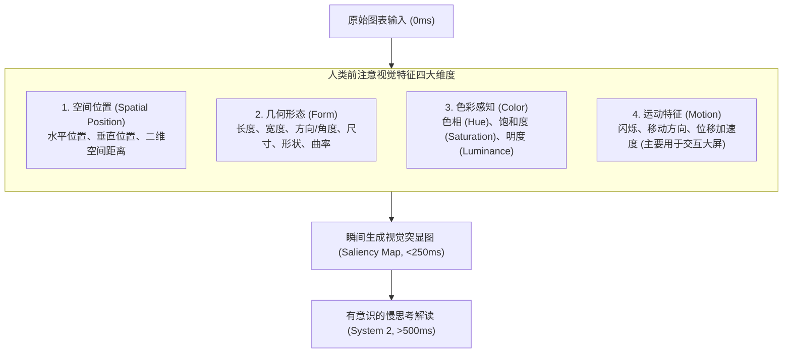
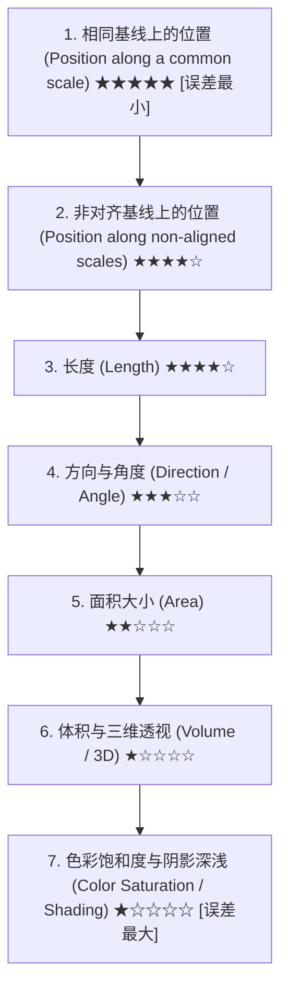
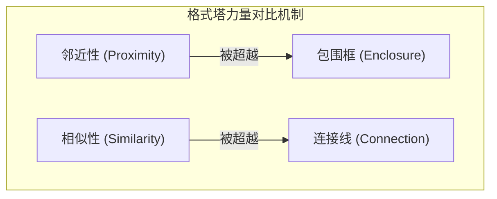

# Lec 2 视觉感知机理与格式塔法则：人脑如何解码统计图表 (Visual Perception & Gestalt Principles)

> MIT Sloan 15.286 · Communicating with Data · 数据沟通与说服

## TL;DR

- 揭示人类视觉系统在 250ms 内完成的前注意（Pre-attentive）并行信息处理机制及其在图表设计中的战略价值。
- 剖析 Cleveland & McGill 图形感知精度层级，论证位置编码（Position）对长度、角度和面积编码的绝对认知优势。
- 运用格式塔六大知觉组织法则（邻近、相似、包围、连接、对称、连续），引导受众视线按照预设逻辑自动归组。
- 确立视觉突显性（Visual Saliency）的信噪比设计原则：通过克制且唯一的视觉锚点，精准操纵管理层注意力的第一落点。

## 前注意属性：视觉系统的“超光速”通道

人类处理文字与数字时采用的是**串行顺序扫描（Sequential Processing）**：眼睛必须从左到右、逐字逐行聚焦，并在大脑语言中枢中依次转译。当向管理层呈现一个包含 5 行 6 列数据的纯数字表格时，受众必须进行 30 次单独的注视点停留与脑内验算，才能找到最大值或异常波动。

然而，人类视觉系统在演化过程中形成了一种完全不同的感知模式——**前注意处理（Pre-attentive Processing）**。

::: definition 前注意属性 (Pre-attentive Attributes)
前注意属性是指在人眼初次接触视觉刺激后的 **200 至 250 毫秒** 内，在大脑意识甚至尚未主动介入之前，由初级视觉皮层（V1/V2 区域）以**大规模高度并行（Massively Parallel）**的方式自动捕获和辨析的特定低维视觉特征。受众不需要进行有意识的眼动搜索，大脑就已经本能地锁定了目标。
:::

在统计图表设计中，前注意属性是沟通者手里最强大的“视线制导导弹”。Miro Kazakoff 指出，核心前注意特征可以归结为四大维度：

::: example 数字矩阵中的视觉搜寻实验
假设屏幕上有一组密密麻麻的 50 个灰色数字“3”，若其中潜藏着一个灰色数字“8”，受众必须逐行进行系统 2 的串行扫描，平均耗时 2.5 至 4 秒；但若将这个“8”改为高饱和度的**珊瑚红**，或者将其**字体放大 3 倍**，受众将在 200 毫秒内瞬间锁定它，搜寻耗时与背景数字的数量完全无关（搜索斜率为零）。
:::

## 图形感知精度层级：Cleveland & McGill 实证研究

并非所有视觉编码在人类大脑中都具有相同的解析精度。1984 年，贝尔实验室统计学家 William S. Cleveland 与 Robert McGill 在《Journal of the American Statistical Association》上发表了一篇奠基性实证论文《Graphical Perception: Theory, Experimentation, and Application to the Development of Graphical Methods》，通过严格的人类心理物理学实验，测量了受众判断不同几何视觉变量时的感知误差率。

实验结果确立了不可动摇的**图形感知精度递减层级（Perceptual Hierarchy）**：

::: theorem 认知精度守恒与编码法则
图表编码的精确度，取决于数据点映射到的几何属性在感知层级中的位置：
1. **最高精度（定量数值精确比较）**：必须使用**相同基线上的位置**（如标准折线图的点、对齐柱状图的顶端）；
2. **中等精度（宏观分布与趋势观察）**：可使用**长度**（如条形图）或**方向**（如折线斜率）；
3. **极低精度（定性分组与相对排序）**：**严禁将关键决策变量编码为面积、角度、体积或色彩深浅**。人脑在估计二维面积和三维体积时存在严重的非线性压缩低估效应（Stevens 幂律）。
:::

::: insight 为什么 3D 柱状图与饼图在科学上是不及格的？
Cleveland & McGill 的实证数据从生理感知层面彻底判处了“3D 柱状图”的死刑：
- 传统的 2D 柱状图利用的是“相同基线上的位置”与“长度”编码（精度层级第 1 与第 3 位）；
- 一旦软件添加了 3D 倾斜透视效果，柱体高度变成了受伪透视变形折磨的“角度与体积”（精度暴跌至第 4 与第 6 位），甚至由于近大远小的透视遮挡，后排柱子被前排彻底遮蔽；
- 饼图则强迫受众去比较圆心角的**角度**与切片的**曲面面积**（精度层级第 4 与第 5 位）。人类大脑对角度的微小差异极度迟钝，两块分别占比 23% 与 27% 的扇区在不标数字的情况下根本无法肉眼区分。
:::

## 格式塔知觉组织法则在图表中的工程化应用

格式塔心理学（Gestalt Psychology）揭示：人类大脑天生反感孤立的感知零散项，而是本能地倾向于根据刺激的相对空间与形态关系，将视觉元素**自动组合为整体（Grouping into Wholes）**。掌握格式塔规律，沟通者就能在不增加任何文字解释的前提下，利用排版物理学“无声地”向受众宣告哪些数据属于同一类别、哪些数据存在对比关系。

在统计图表与数据版面设计中，最核心的六大格式塔定律为：

| 格式塔法则 | 心理感知机理 | 数据沟通中的具体设计策略 |
|---|---|---|
| **邻近原则 (Proximity)** | 空间距离越近的物体，越被大脑视为同一组或具有强因果关系。 | 柱状图中同一年份的“实际值”与“目标值”必须成对紧密贴合，组间间距保持组内间距的 2 倍以上。 |
| **相似原则 (Similarity)** | 共享相同颜色、形状或尺寸的元素，被自动归类为同质实体。 | 相同业务指标（如“净利润率”）在整套汇报的不同图表中必须保持统一的深蓝色编码，严禁混用。 |
| **包围/围合原则 (Enclosure)** | 被视觉边界（阴影底色块、微弱虚线框）包围的区域形成独立心理容器。 | 使用浅灰色底色块高亮“受疫情冲击的关键季度”或“新产品试运营阶段”，瞬间隔离异常区间。 |
| **连接原则 (Connection)** | 由物理线条物理相连的点，其被感知为同组的强度甚至超越邻近与相似。 | 折线图通过实线将离散的时间点物理连接，受众大脑自动将其解释为一个连续的历史变迁因果流。 |
| **闭合原则 (Closure)** | 人脑倾向于自动补全不完整的轮廓，感知为一个闭合的规则几何图形。 | 彻底删除图表的外框线与重度网格线，人脑根据刻度标签的自然分布自动感知图表边界。 |
| **连续性原则 (Continuity)** | 视线倾向于沿着平滑、连续的路径流动，尽量避免突兀的方向转向。 | 趋势预测图中，将历史真实走势用实线绘制，未来预测区间用同方向延伸的虚线无缝延续。 |

::: theorem 视觉联结压倒性定理
在格式塔法则的层级冲突中：**连接（Connection）与包围（Enclosure）的感知力量显著强于单纯的相似（Similarity）与邻近（Proximity）**。如果你在一群排列紧密的蓝点中，用一条细线将相距较远的两个红点和一个蓝点连结起来，受众的视线会毫不犹豫地优先追踪这条连接线所构建的关系网。
:::

## 视觉突显性与信息层级工程

在任何单页图表或数据展示中，信息绝不能是“平铺直叙、权重均等”的。设计者必须在受众视线落下的第 0.1 秒，就建立清晰的**视觉层级（Visual Hierarchy）**。

### 突显性设计的三项铁律

1. **唯一聚焦点（Single Focal Point）**：一张图表只能有一个主前注意刺激锚点（如唯一的高饱和度红色柱子）。如果页面上既有红色柱子、黄色折线、闪烁图标，又有粗体下划线大字，受众的大脑就会陷入多焦点冲突，最终导致认知瘫痪。
2. **灰度基底（Greyscale Canvas）**：所有背景元素、参考轴线、次要基准数据与历史背景项，一律采用无情绪的低对比度浅灰色（Neutral Greys）绘制。只有承担核心说服任务的关键数据点，才被赋予高对比度的强调色。
3. **消除拉斯维加斯效应（Eliminate the Las Vegas Effect）**：

::: pitfall 拉斯维加斯霓虹灯陷阱
许多刚入门的数据分析师习惯使用软件默认的调色板（例如 Excel 或 Tableau 默认的 10 色彩虹配色），将每一根柱子都涂成红、橙、黄、绿、青、蓝、紫。  
**“当所有东西都在大声喊叫时，没有任何声音能被听见”**。花哨的多色不仅没有提供额外的信息，反而向受众脑中强行灌入了无尽的分类噪音，迫使受众反复在图表和图例之间来回折返比对。
:::
