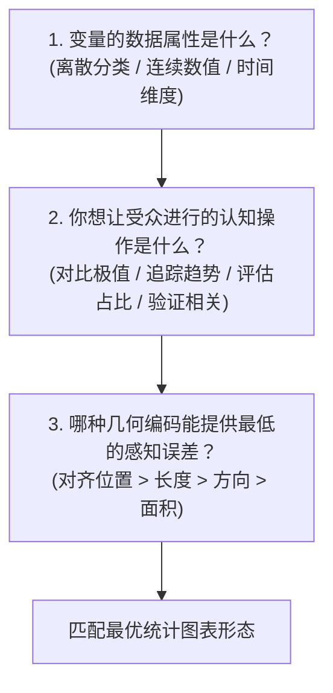
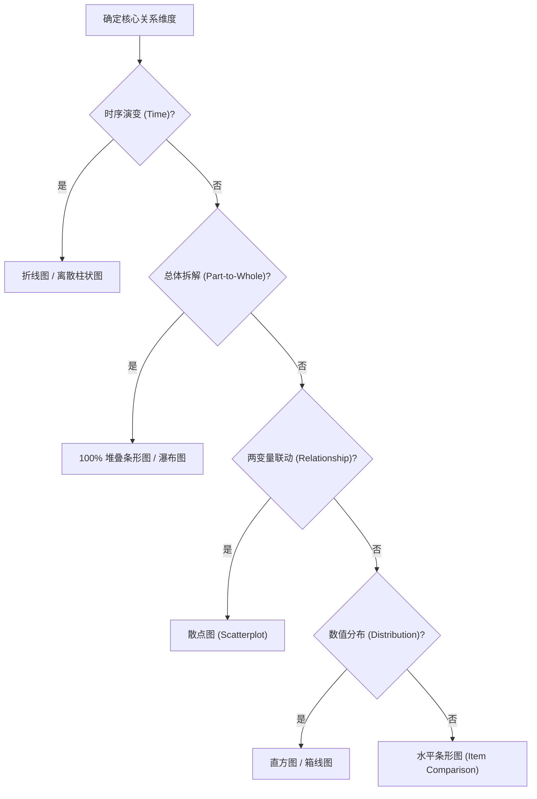

# Lec 3 图表选型与信息架构：匹配认知目标的数据编码 (Chart Selection & Visual Encoding)

> MIT Sloan 15.286 · Communicating with Data · 数据沟通与说服

## TL;DR

- 确立以“受众认知目标”而非“数据软件默认推荐”为导向的图表科学选型体系。
- 解构商业量化分析的五大核心关系：项目对比、时间序列趋势、构成占比、频率分布与变量关联。
- 严厉剖析三大致命图表误区：饼图滥用、双坐标轴虚假相关、以及非零基准轴截断引起的比例欺骗。
- 建立图表（Charts）与表格（Tables）的精确边界判断：定性趋势与宏观对比用图，高精度数值检索与绝对定位用表。

## 图表选型的根本哲学：认知意图驱动

在日常商业汇报中，最常见的图表失误往往发生在“选择哪种图表形式”这一最源头的环节。很多分析人员选图的依据是“哪种图表在 Excel 模板里看起来更新颖”、“我最近新学了哪种图表库”，或者是“软件一键生成的推荐结果”。这种脱离受众认知目标的制图方式，从一开始就注定了沟通摩擦。

Miro Kazakoff 强调：**图表类型不是艺术风格的选择，而是严谨的认知逻辑映射**。选型决策必须从以下三个递进问题反推得出：

## 商业分析的五大核心关系与标准视觉映射

根据麦肯锡沟通经典专家 Gene Zelazny 与 Stephen Few 的系统总结，99% 的管理决策数据都可以抽象为以下五大核心关系。每一类关系都有其最优的物理视觉载体：

| 关系类型 | 汇报核心要回答的问题 | 最优推荐图表 | 次选/特殊场景替代 |
|---|---|---|---|
| **1. 项目对比 (Comparison)** | “谁在同类实体中排名第一？差距有多大？” | **水平条形图 (Horizontal Bar Chart)** | 哑铃图 (Dumbbell) / 坡度图 (Slope) 用于前后对比 |
| **2. 时间趋势 (Time Series)** | “指标随时间是如何演变的？是否存在周期或拐点？” | **折线图 (Line Chart)** | 柱状图（离散离散时间点且重视绝对量） |
| **3. 构成占比 (Composition)** | “总体由哪些部分拆解构成？各部分份额如何？” | **100% 堆叠条形图 / 瀑布图 (Waterfall)** | 树状图 (Treemap) 表达多层级大颗粒拆解 |
| **4. 频率分布 (Distribution)** | “数值在不同区间的分布形态是什么？是否存在长尾？” | **直方图 (Histogram)** | 箱线图 (Boxplot) 适用于多组样本对比 |
| **5. 变量关联 (Correlation)** | “两个量化指标之间是否存在协同联动或因果关系？” | **散点图 (Scatterplot)** | 气泡图 (Bubble) 引入第三维度变量 |

::: insight 为什么商业对比强烈推荐“水平条形图”而非“垂直柱状图”？
在对比不同业务线或国家地区的数据时，水平条形图（Horizontal Bar）具有无可比拟的工程优势：
1. **符合人类阅读自然习惯**：人类文字从左向右阅读，条形图的标签位于左侧垂直对齐，受众视线可以自然扫读完整的长名称（如“大中华区企业级云服务部”），无需像垂直柱状图那样将文字倾斜 45 度旋转甚至垂直截断；
2. **长尾排序天生契合**：水平条形图天然支持按照数值从大到小严格从上到下排序，最大的一目了然地位于顶部，受众感知极为顺畅。
:::

## 商业图表的三大致命误区与反向操纵解毒

在非规范的商业演示中，有三类图表错误极其高频，它们轻则造成严重的认知混乱，重则构成学术伦理与商业欺诈：

### 1. 饼图的认知破产（The Anti-Pie Doctrine）

饼图（Pie Chart）是商业幻灯片中被滥用最深、但也是在信息设计领域被彻底批判最多的图表形态。

::: pitfall 饼图的四大原罪
1. **角度与面积估计的生理缺陷**：如 Lec 2 中 Cleveland & McGill 实验所示，人脑在解码弧度与二维面积时误差巨大。若一个饼图切分成 6 个份额，受众根本无法肉眼分辨 18% 和 22% 谁大谁小；
2. **三维透视的严重扭曲**：一旦给饼图加上 3D 旋转透视，离视线近的下半部分扇区因透视投影被极度放大，一个实际上只有 20% 份额的项目在视觉上看起来比后方 35% 的项目还要庞大；
3. **标签标注的灾难**：切片过薄时长文本标签无法容纳，迫使设计者拉出极其凌乱的指示折线，或者依赖庞大的色块图例；
4. **多时间序列对比彻底失效**：比较两个时期的饼图，必须让受众在两个圆盘的各个对应切片之间进行痛苦的脑内角度比对，而直接使用 100% 堆叠条形图或斜率图即可瞬时看清份额变迁。
:::

### 2. 双 Y 轴（Dual-Axis）带来的虚假因果陷阱

许多汇报者喜欢将两组不同量纲的指标画在同一张图内（例如左轴为“广告投放金额”，右轴为“网站注册用户数”），并故意通过调整两边坐标轴的最大最小值比例尺，让两条折线在中间形成极其完美的重合或交叉。

::: theorem 比例尺任意性定理
在双 Y 轴图表中，**两条曲线的相对位置、交叉点以及相对斜率完全是人为任意操纵的假象**。设计者只需随意修改其中一条轴的上限或下限，就能让原本看起来“紧密相关”的两条曲线瞬间分离，或者让一条曲线的波动看起来比另一条平缓 10 倍。
:::

::: example 双 Y 轴的替代方案
如果要展示广告投入与获客增长的关系，科学的方案是：
- **方案 A（分面并排图 Small Multiples）**：上下并排放置两张共享水平时间轴、但各自独立拥有单 Y 轴的折线图，观察拐点是否同步；
- **方案 B（指数归一化图 Indexed Chart）**：将两组数据均以初始基期设定为 100，统一转化为“百分比增长率”，在单一坐标轴上客观对比增长速度；
- **方案 C（散点回归图）**：以广告投入为 X 轴，注册量为 Y 轴，绘制散点图并计算皮尔逊相关系数与拟合优度 $R^2$。
:::

### 3. 非零基准轴截断（Truncated Baseline）与诚信底线

柱状图（Bar Chart）的核心视觉编码是**柱体的物理长度**。柱体的像素长度必须与它所代表的真实数值成严格的正比例关系。

::: definition 零基线铁律 (The Zero-Baseline Rule)
对于任何基于**长度编码**的图表（柱状图、条形图），**数值基准轴必须严格从 0 开始**。如果将纵轴从 90 开始截断（展示 90 到 100 的区间），那么一个 98 的柱子在高度上看起来将是一个 92 柱子的 4 倍（长度比例 $8:2$），从而人为制造出“400% 暴涨”的虚假视觉冲击。这在商业伦理中属于典型的误导性图表造假。
:::

::: insight 什么时候可以不从零开始？
**折线图（Line Chart）允许在明确标注的情况下不从零开始**。因为折线图的核心编码是“点在坐标系中的位置”与“线条的斜率（方向）”，其感知目的在于捕捉局部波动的微小边际变化（如人类体温 36.5℃ 到 39.0℃ 的变化，若从 0℃ 开始绘制将变成一条毫无波动的水平死线）。但前提是必须在坐标轴上显式标注断轴符号或明确刻度范围。
:::

## 图表 vs 表格：精确性与模式感的权衡

数据沟通中并非所有场景都要强行制图。表格（Tables）与图表（Charts）各自服务于完全不同的大脑认知加工通道：

| 维度 | 表格 (Tables) | 统计图表 (Charts) |
|---|---|---|
| **大脑加工通道** | 言语/文字系统（系统 2 串行解读） | 视觉皮层（系统 1 前注意并行感知） |
| **首要认知目标** | 查找具体的精确数值、核对单点指标 | 识别宏观形态、整体趋势、相对异常点与聚类模式 |
| **受众互动场景** | 财报明细核对、个股报价、技术参数索引 | 执行委员会高管汇报、战略定调、商业演讲 |
| **数据密度容忍度** | 极高（容纳多维度、多量纲原始数据） | 中低（必须过滤次要杂讯，提炼核心关系） |

::: definition 查特-表格边界准则 (Chart-Table Boundary)
- 当受众需要知道**“是多少（Exact Number）”**时，使用结构清晰、对齐考究的表格；
- 当受众需要知道**“这意味着什么（So What / Pattern）”**时，毫不犹豫地将数据转化为具有强视觉层级的图表。
:::
