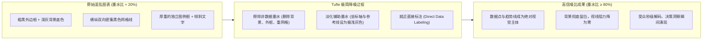
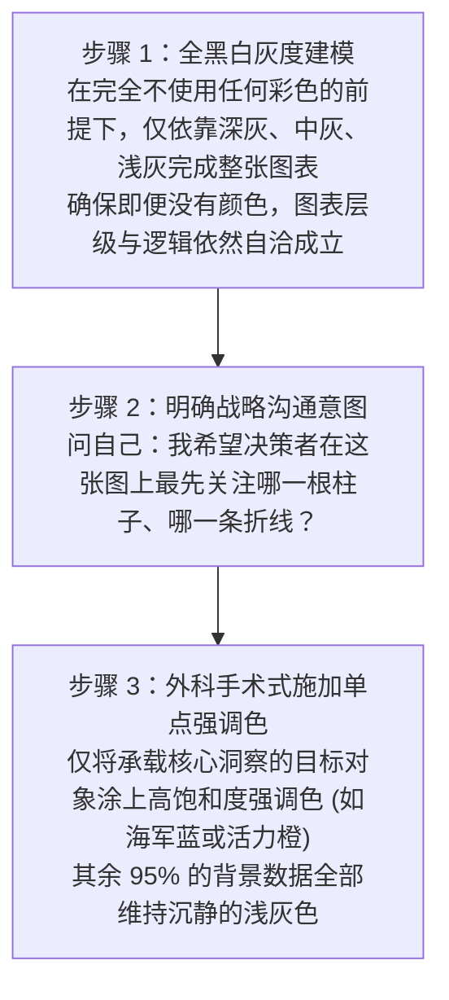

# Lec 4 极简主义与信噪比最大化：Tufte 原则与视觉降噪 (Simplify to Amplify: Tufte's Data-to-Ink Ratio & Visual Decluttering)

> MIT Sloan 15.286 · Communicating with Data · 数据沟通与说服

## TL;DR

- 确立 Edward Tufte 数据墨水比理论，以定量公式驱动图表视觉元素的极致精简与信噪比最大化。
- 彻底解构三类图表垃圾（Chartjunk）：伪 3D 浮夸装饰、莫尔条纹视觉震颤、以及繁冗网格线与重度外边框。
- 实践灰度优先（Greyscale-First）调色哲学，将色彩严格限制为引导决策意图的战略语义工具。
- 普及就近直接标注（Direct Labeling）工程，消灭视线在图表与图例之间来回往返的分裂注意力效应。

## Edward Tufte 与数据墨水比数学模型

耶鲁大学统计学与政治学名誉教授 Edward R. Tufte 在 1983 年出版的经典巨著《The Visual Display of Quantitative Information》中，奠定了现代量化信息设计的基石。Tufte 提出了一个极为优美且具有严格操作性的度量标准——**数据墨水比（Data-to-Ink Ratio）**。

在纸质印刷时代，“墨水”代表打印图形所耗费的油墨总量；在数字显示时代，它精确对应于屏幕上被激活的有效像素数量。

::: definition 数据墨水比 (Data-to-Ink Ratio)
数据墨水比是指图表中用于**直接传达真实数据信息的不可替代墨水**，占**图表所耗费的总墨水**的比例：

$$\text{Data-Ink Ratio} = \frac{\text{Data-Ink}}{\text{Total Ink Used by Graphic}} = 1.0 - \text{Proportion of Non-Data-Ink}$$

其中：
- **数据墨水（Data-Ink）**：代表数值核心几何形态的墨水（如折线本身的拐点与线段、条形图的柱体、散点图中的数据点）。如果擦除这部分墨水，数据信息将立即遭受实质性破坏；
- **非数据墨水（Non-Data-Ink）**：纯属装饰性或辅助性的冗余墨水（如厚重的外边框、粗黑的网格线、多余的背景填充色、无意义的 3D 阴影）。
:::

基于这一公式，Tufte 推导出了信息图表设计的**两大基本公理**：
1. **合理擦除非数据墨水（Erase non-data-ink, within reason）**；
2. **合理擦除冗余数据墨水（Erase redundant data-ink, within reason）**。

## 图表垃圾（Chartjunk）深度解构

Tufte 将所有不传达数据信息、反而消耗视觉注意力并造成视网膜疲劳的装饰元素统称为**图表垃圾（Chartjunk）**。在商业演示中，最臭名昭著的图表垃圾包括以下三类：

### 1. 莫尔条纹视觉震颤（Moiré Vibration）

当图表填充了高密度的平行斜线、密集的交叉网格或交错斑点时，人眼视网膜上的感光细胞与周期性几何条纹发生共振，会产生一种仿佛图案在闪烁、抖动或漂移的生理错觉。这种生理震颤直接阻碍大脑对柱体真实高度的判断。**现代图表应一律采用纯平单色填充，彻底废黜排线纹理**。

### 2. 网格线牢笼（Grid Prison）

许多软件默认每隔一个单位就绘制一条深黑色或深灰色的实线网格。这些网格在视觉上构建了一个牢不可破的“铁笼”，把真正重要的数据曲线牢牢锁死在牢笼深处。
- **降噪法则**：大部分情况下彻底删除水平与垂直网格线；若图表极宽且受众确实需要横向目测绝对值，只保留间距稀疏的**极浅灰色虚线（Opacity 15-20%）**。

### 3. 鸭子式装饰（The Duck）

建筑学界曾用“鸭子（The Duck）”来讽刺那些把整座建筑本身修成一只巨大烤鸭形状的粗俗设计——建筑的形式完全凌驾于功能之上。在商业汇报中，那些为了展示图表绚丽而强行添加的水滴反射高光、倒影、渐变渐隐、发光阴影与卡通剪贴画，就是典型的数据“鸭子”。

::: example 极简主义案例：消除表格中的斑马纹与竖线
许多人在排版多行多列的财务数据表格时，习惯给每一列加上竖线，并给奇偶行交替涂上深浅相间的“斑马纹（Zebra Stripes）”。  
事实上，文字与数字的**对齐（Alignment）本身就构成了肉眼不可见的优雅网格**：
- 文本左对齐，数字严格按小数点右对齐；
- 彻底删除所有垂直竖线，仅在表头下方与表格底端各保留一条极细浅灰横线；
- 依靠行间距（Whitespace）自然引导横向阅读，表格的专业度与信噪比瞬间提升数倍。
:::

## 意图导向的色彩科学：灰度优先工作流

色彩绝不是美化界面的化妆品，而是**引导人类注意力的高能量认知武器**。使用色彩的第一法则是极度的克制。

Miro Kazakoff 在 MIT 课程中推行严格的**“灰度优先工作流（Greyscale-First Workflow）”**：

### 三大类调色板的严格语义适用

在数据可视化中，调色板被严格分为三类数学语义，严禁混淆：

1. **定性/分类调色板（Categorical Palette）**：用于没有任何大小、顺序关系的离散类别（如中国、美国、欧洲）。不同颜色代表不同类别，但在饱和度和明度上应保持感知平衡，避免无端赋予某一类别更高的心理权重。
2. **渐变/连续调色板（Sequential Palette）**：用于表示同一种量化指标从低到高的连续变化（如温度 0℃ 到 100℃、贫困率 5% 到 45%）。使用单一色相（如蓝色）从极浅（接近白）平滑过渡到极深（浓蓝）。
3. **发散调色板（Diverging Palette）**：用于存在**明确中性参考基准点（Zero Point / Mean）**的两极数据（如营业利润从负到正、民调支持率相对 50% 基线的偏离）。中性基准使用无情绪的浅灰色，向负偏离端渐变至砖红色，向正偏离端渐变至深海蓝色。

::: pitfall 红绿配色的可访问性死穴
全球男性中有约 **8%** 患有不同程度的红绿色觉障碍（红绿色盲/色弱）。在商业图表中使用纯正的“大红 vs 大绿”来代表“亏损 vs 盈利”，会导致这部分高管眼中两者全部呈现为混沌的暗黄色。  
**工业级标准**：使用**橙色（Orange）与蓝色（Blue）**替代红绿；若必须使用红绿，必须在饱和度、明度上拉开显著差异，或者同时辅以形态编码（如实线 vs 虚线、带符号的文字标注），实现双重冗余编码（Dual-Coding）。
:::

## 就近直接标注：消灭分裂注意力效应

传统的制图软件默认将图例（Legend）单独做成一个小框，孤零零地挂在图表右上角或正下方。

根据 John Sweller 的认知负荷理论，这种分离式布局会触发致命的**分裂注意力效应（Split-Attention Effect）**：
1. 决策者的视线先看到右侧的绿色折线；
2. 视线被迫向右下方移动到图例框，在 5 个颜色方块中比对寻找“绿色”对应哪家竞争对手；
3. 发现绿色代表“竞品 B”后，大脑必须在工作记忆中暂存这一对应关系；
4. 视线再次跳回折线图，重新寻找刚才看到的拐点。

这种反复来回往返的“乒乓球式”眼动搜索，对受众的工作记忆构成了无谓的严重损耗。

::: theorem 就近直接标注法则 (Direct Data Labeling)
彻底删除孤立的图例框。将类别名称与关键数值，**直接紧贴在对应折线的末端、或者直接印在条形图的柱体内部/顶端**。受众的视线聚焦在趋势线的同时，瞬间就能读出主体名称，实现眼动聚焦与逻辑理解的完全合一。
:::

::: insight 极简主义的边界：警惕“过度擦除”
Tufte 强调擦除非数据墨水的前提是“在合理范围内（Within Reason）”。  
极简主义的终极目标是**提升理解速度**，而不是追求白纸一张。如果为了追求极端的数据墨水比，把坐标轴的量纲单位（如“百万美元”）、必要的置信区间阴影、或者作为商业基准线的行业及格线也一并擦除，导致受众无法理解数值的绝对物理意义，这种“过度极简”就走向了反面，变成了新的沟通灾难。
:::
