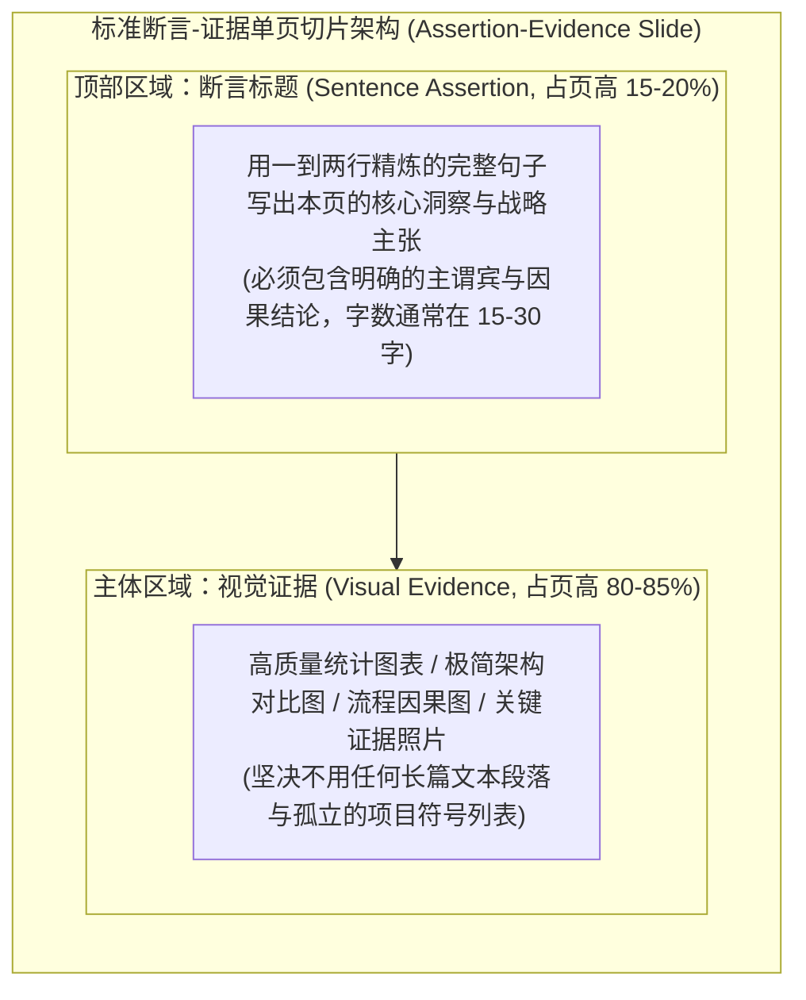
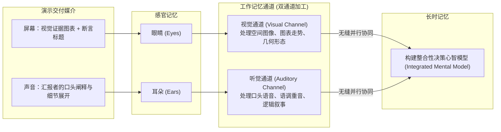

# Lec 5 幻灯片架构与断言-证据范式：管理层视角的叙事切片 (Slide Architecture & The Assertion-Evidence Paradigm)

> MIT Sloan 15.286 · Communicating with Data · 数据沟通与说服

## TL;DR

- 彻底颠覆传统“抽象名词标题 + 散乱项目符号列表”的低效幻灯片模板。
- 确立宾州州立大学 Michael Alley 开创的“断言-证据（Assertion-Evidence）”幻灯片黄金架构。
- 强制实行完整句断言标题（Takeaway Headline），让高管在 3 秒扫读内完成核心战略逻辑摄取。
- 运用多媒体认知学习理论，实现视觉证据与口头讲解的协同共振，根除“照读 PPT”的组织沉疴。

## 传统幻灯片范式的系统性破产

在绝大多数企业和学术机构中，幻灯片（PowerPoint / Keynote）的设计默认沿用着 1990 年代遗留的陈旧模板：
- 顶部放置一个毫无信息量的短语标题（如“第三季度市场概况”、“研发进展”、“销售数据”）；
- 正文区域填充由 4 到 6 个圆点引导的**项目符号列表（Bullet Points）**；
- 汇报者站在屏幕前，逐字逐句照读幻灯片上的要点文字。

Edward Tufte 在其影响深远的批判长文《The Cognitive Style of PowerPoint: Pitching Out Corrupts Thought》中直截了当地指出：**这种传统的幻灯片设计范式在认知科学上是彻底破产的**。它不仅严重稀释了复杂问题的因果深度，而且将听众的工作记忆置于极度痛苦的内耗之中。

::: pitfall 传统“项目符号列表”的三大认知原罪
1. **阻断深度因果推理**：项目符号列表在语法上将所有要点视为“扁平并列”的碎片，无法表达变量之间的先后时序、因果依赖、主次逻辑与反馈回路；
2. **诱发视听认知冲突（The Redundancy Effect）**：当代认知心理学专家 Richard Mayer 的多媒体学习实证证明：人类大脑处理文字视觉输入与口语听觉输入使用的是同一套工作记忆通道（语音回路 Phonological Loop）。当屏幕上写满完整段落、而汇报者同时在口头朗读时，听众的大脑会陷入严重的解码冲突与信息阻塞；
3. **彻底丧失独立阅读价值**：离开现场汇报者的解说，脱节的名词短语标题无法传递任何实质性的战略主张。
:::

## 断言-证据范式（Assertion-Evidence Model）核心架构

为了从根本上治愈幻灯片导致的认知灾难，宾夕法尼亚州立大学工程沟通教授 Michael Alley 与弗吉尼亚大学学者 Kathryn Neeley 创立了**断言-证据范式（Assertion-Evidence Model）**。经过在波音、洛克希德·马丁以及哈佛、MIT 等顶尖商学院的长期对照测试证明，该范式能够将受众对复杂技术与商业方案的理解度与长效记忆保留率提升 **40% 至 70%**。

Miro Kazakoff 将该范式确立为 MIT 15.286 数据汇报的唯一标准架构：

::: definition 断言-证据范式 (Assertion-Evidence Paradigm)
断言-证据范式主张每一页演示切片必须由且仅由两个严密耦合的部分构成：
1. **断言标题（Assertion Headline）**：位于页面顶部，以**完整的陈述句（Complete Sentence）**直接断言本页数据所支持的核心论点或战略行动推论；
2. **视觉证据（Visual Evidence）**：占据页面主体，通过**高信息密度的图表、架构模型或对比实证**，为顶部的断言提供不可辩驳的直观客观支撑。
:::

## 完整句断言标题的工程化编写

标题是幻灯片上最宝贵的认知不动产。断言标题不是对图表的简单“客观描述”，而是对数据含义的**深度战略定调（Takeaway）**。

### 标题撰写的三级演进阶梯

| 标题层级 | 标题范例 | 认知价值评级 | 受众心理反馈 |
|---|---|---|---|
| **第 1 级：话题标签 (Topic Label)** | “第二季度营销回报率” | ★☆☆☆☆ (垃圾级) | “所以呢？数据是好是坏？你想告诉我什么？” |
| **第 2 级：客观描述 (Descriptive)** | “第二季度四大渠道的获客成本与投入产出比” | ★★☆☆☆ (平庸级) | “我知道你在看这四个渠道了，然后呢？” |
| **第 3 级：行动断言 (Assertion-Evidence)** | **“短视频广告 ROI 达到搜索广告的 3.2 倍，驱动了二季度 65% 的新客增长”** | ★★★★★ (决策级) | “核心结论极其清晰，让我看看图表证据如何支撑。” |

::: theorem 高管“三秒扫读”测试 (The 3-Second Skim Test)
衡量一份 20 页商业数据提案是否合格的黄金标准：**如果一位日理万机的 CEO 仅翻阅每一页的顶部断言标题，完全不看任何正文图表和口头汇报，她是否能够在 60 秒内完整掌握你的核心现状、问题根因、数据证据与最终推荐行动？**  
如果把标题串联起来只是一堆名词清单，这份汇报就是不合格的；如果标题串联起来构成了一篇逻辑严密、论证完整的商业备忘录，这份演示就具备了极高的穿透力。
:::

::: example 医药商业汇报的断言升级
- **错误示范（话题标签）**：新药 Alpha 第三阶段临床数据
- **中庸示范（客观描述）**：Alpha 组与安慰剂组在 12 周后的生化指标对比
- **卓越示范（断言-证据）**：**“在连续给药 12 周后，Alpha 组患者核心炎症因子水平下降 42%，疗效显著优于现有标准疗法（p < 0.001）。”**
:::

## 多媒体认知学习理论与视觉-口头协同

断言-证据范式的底层物理学支撑，来自于加州大学圣塔芭芭拉分校著名心理学家 Richard E. Mayer 的**多媒体学习认知理论（Cognitive Theory of Multimedia Learning）**：

Mayer 通过数十组严谨的对照实验确立了两大关键效应：

1. **通道分离原则（The Modality Principle）**：当同时利用**受众的眼睛看图形**和**受众的耳朵听解释**时，学习和决策效果达到峰值。因为这同时充分调用了大脑的视觉通道和听觉通道，实现了认知带宽的最大化利用；
2. **冗余消除原则（The Redundancy Principle）**：如果屏幕上同时存在长篇打印文字和口头讲解，大脑的听觉回路会因为试图同时处理读音与听音而发生拥塞，导致决策理解度急剧下降。

::: insight 根除“提词器型汇报者”
断言-证据范式在组织心理学上产生了一个巨大的副产品：它彻底根除了汇报者“转身背对受众、照读 PPT 文字”的恶习。  
因为屏幕正文不再有成段的文本可读，汇报者被迫将目光转向台下的决策者，用口语自信地向大家解释图表的深层内涵与业务影响。**幻灯片变成了论据的画廊，而汇报者成为了全场不可替代的思想引领者**。
:::
