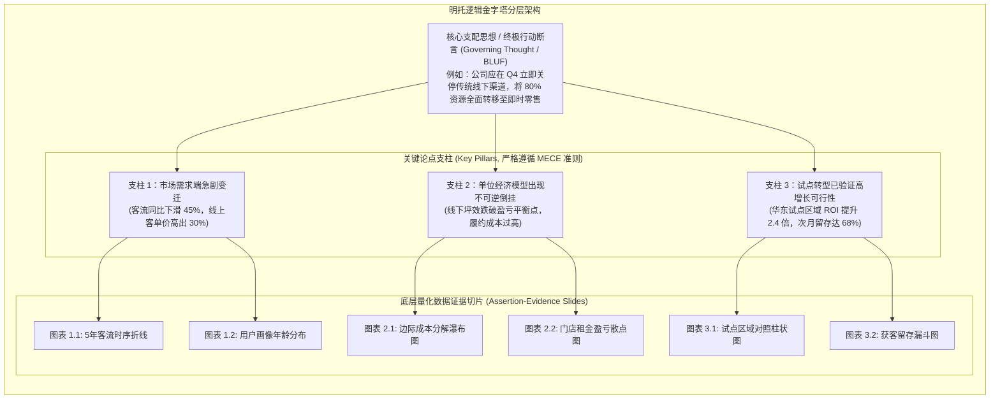
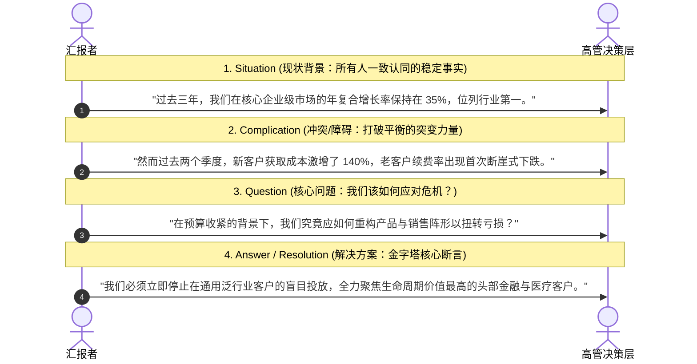

# Lec 6 逻辑金字塔与 MECE 原则：高管汇报的推理结构 (The Minto Pyramid Principle & MECE)

> MIT Sloan 15.286 · Communicating with Data · 数据沟通与说服

## TL;DR

- 确立麦肯锡芭芭拉·明托金字塔原理，重构管理层高难度数据汇报的宏观论证与推理骨架。
- 强制实行“结论先行（Bottom Line Up Front / BLUF）”原则，消除传统归纳铺垫带来的受众焦虑。
- 严密贯彻 MECE 准则（相互独立、完全穷尽），确保横向论据无重叠漏洞与归因盲区。
- 运用 SCQA 经典商业情境叙事模型，将冰冷的统计量化结论无缝嵌入组织战略决策流。

## 高管思维特质与结论先行原则

在完成单张图表的视觉降噪（Lec 4）与单页幻灯片的断言提炼（Lec 5）之后，数据沟通者必须面对最关键的宏观整合任务：**如何将 10 到 20 个分散的数据证据，串联为一个坚不可摧、能直接驱动组织变革的逻辑大厦？**

许多来自技术背景的汇报者习惯沿用学术论文的“侦探小说式”推理方式：
1. 先交代庞大的背景调查与文献综述；
2. 再详细展示数据采样的繁杂过程与算法清洗细节；
3. 接着罗列 10 组假设检验与交叉验证；
4. 直到汇报的最后两分钟，才小心翼翼地揭晓“凶手”——最终的商业结论。

然而，企业高管与董事会成员的心智状态与学术期刊评审存在本质差异：
- **时间高度碎片化**：高管每小时都在应对不同的危机，注意力带宽极度稀缺；
- **焦虑驱动型倾听**：如果听众在汇报的前三分钟不知道你的终极结论是什么，他们的大脑会被迫陷入持续的猜谜状态（“他到底想说什么？这是否意味着我们要削减预算？”），从而产生严重的防御性焦虑。

::: definition 结论先行原则 (Bottom Line Up Front / BLUF)
结论先行原则源于军事与现代顶级战略咨询公司的沟通纪律。在任何正式沟通中，**在开篇的第一分钟内，就必须毫无保留地给出最终的结论、核心判断或具体的战略行动建议**。随后的所有图表与数据，均作为支撑该结论的结构化论据展开。
:::

## 芭芭拉·明托金字塔原理的三大结构性法则

麦肯锡公司首位女性合伙人芭芭拉·明托（Barbara Minto）在《The Pyramid Principle》中提出的金字塔模型，被公认为现代商业思考、逻辑论证与战略说服的行业金科玉律。明托敏锐地观察到：人类大脑在接收外部信息时，天生不具备同时处理十几个无序并列要点的生理容量。无论汇报者最初用何种杂乱的顺序组织材料，受众的大脑都会下意识地试图把它们归类为某种具有上下层级的树状结构。如果汇报者自身没有预先建立清晰的层级，受众就必须耗费大量宝贵的认知算力去自行拼凑猜测，从而导致信息传递严重走样。

金字塔结构的核心魅力，在于它完美映射了人类认知系统处理分层复杂系统的方式——自上而下阅读、自下而上支撑。它将庞杂琐碎的底层运营与技术数据，通过严格的逻辑提炼，升华为支撑管理决策的清晰立柱：

明托金字塔由三大刚性结构定律统治：

1. **纵向统领定律（Vertical Summarization）**：金字塔中任一层次的思想，必须是对其下一层次思想的抽象概括与归纳提炼。上面的节点是下面节点的因果结论，下面的节点是上面节点的实证证据；
2. **横向同质定律（Horizontal Congruence）**：同一分组中的各个思想，必须属于同一个逻辑范畴。严禁将“市场竞争态势（宏观外部环境）”与“客服系统服务器宕机（微观内部运维）”平级并列；
3. **逻辑递进定律（Logical Ordering）**：同一分组中的思想必须按照严格的逻辑顺序排列：
   - **时间顺序（Chronological）**：如业务发展的三大阶段；
   - **结构顺序（Structural）**：如按公司组织架构、地理区域或价值链环节切分；
   - **程度顺序（Importance / Ranking）**：从影响最大的核心因素排至次要因素。

::: insight 金字塔原理不是僵化的填空教条
许多刚接触金字塔原理的人，容易将其误解为一种冷冰冰的教条式模板，甚至在每场汇报中都机械地套用“第一点、第二点、第三点”。  
**金字塔原理的精髓在于对思维边界的诚实验证**。构建金字塔的过程，本质上是汇报者倒逼自己进行自我拷问的过滤器：“这三个分支是否真的能百分之百推导出顶层结论？中间是否存在逻辑跳跃？底层的数据图表是否提供了充分必要的实证支撑？”当你的思考在金字塔中经历了自洽性检验，你的商业汇报就会具备令质疑者无法轻易击穿的坚韧防御力。
:::

## MECE 原则在数据归因中的严格落地

金字塔横向分组的核心灵魂是 **MECE 原则（Mutually Exclusive, Collectively Exhaustive）**。

::: definition MECE 原则
- **相互独立（Mutually Exclusive）**：各分支论据之间界限分明、互不重叠、绝无交叉。不存在同一个数据点或原因被反复双重计算（Double-Counting）的情况；
- **完全穷尽（Collectively Exhaustive）**：所有分支论据的并集，完整覆盖了该议题的全部空间，没有任何遗漏或盲区。
:::

::: example 销售下滑归因分析的 MECE 拆解
- **非 MECE 错误示范（混乱清单）**：
  “我们销售额下滑是因为：1. 华东区推广不力；2. 竞品降价促销；3. 销售团队激励不足；4. 移动端 App 频繁闪退；5. 消费市场大环境疲软。”  
  *缺陷剖析*：华东区是地理维度，竞品降价是竞争维度，App 闪退是产品体验维度，大环境是宏观经济维度。维度混乱、严重交叉重叠，且完全无法证明是否还有其他遗漏因素。
- **严格 MECE 规范示范（公式化因式分解树）**：
  $$\text{总收入} = \sum (\text{活跃买家数} \times \text{平均购买频次} \times \text{客单价})$$
  将下滑归因严格拆解为三个互斥且穷尽的数学分支：
  1. **用户规模（买家数）是否下降？**（量化图表证据排查新增获客与流失率）；
  2. **消费频次（复购率）是否萎缩？**（量化图表证据排查生命周期价值 LTV）；
  3. **单均消费（客单价）是否跌落？**（量化图表证据排查品类结构与折扣率）。  
  公式树自然保证了逻辑上的绝对独立与彻底穷尽。
:::

## 商业情境叙事弧：SCQA / SCR 框架

即便拥有了严密的逻辑金字塔，单纯抛出冰冷的数字依然可能引发受众的心理排斥。为了让管理层从情感与战略层面迅速进入议题，明托提出了经典的 **SCQA 序言引入模型**（在快节奏高管场景中常精简为 **SCR 框架**）：

::: theorem SCQA 的认知心理学魔力
SCQA 的本质是**在受众脑中制造一个认知缺口（Cognitive Gap）**：
- **Situation（现状）**：建立心理安全感与信任（“我们对现状的看法是一致的”）；
- **Complication（冲突）**：引发适度的紧迫感与痛点唤醒（“原有的平衡已被外力打破，不行动将导致重大损失”）；
- **Question（问题）**：明确本次会议唯一的讨论议题；
- **Answer（答案）**：顺理成章地呈递你的金字塔顶端核心主张。  
这一叙事弧将数据从“无聊的报表”升华成了“拯救组织危机的战略路线图”。
:::
