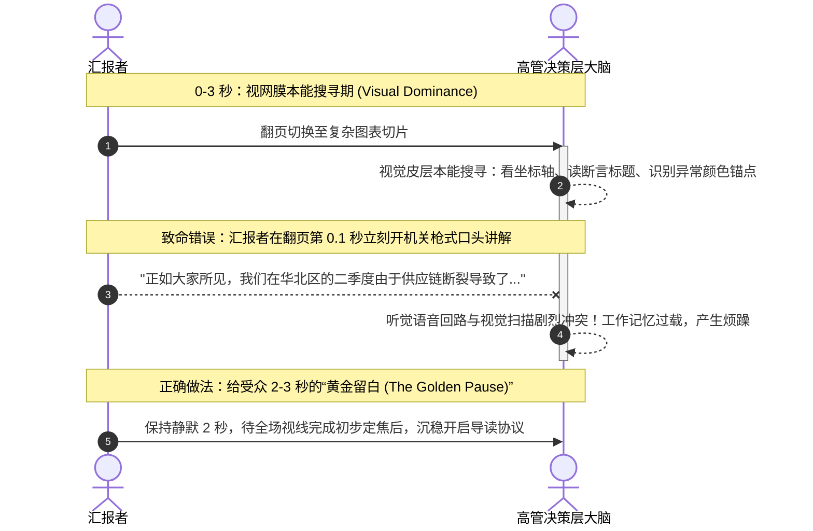
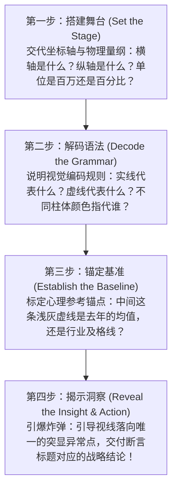

# Lec 7 口头交付与认知节奏：图表导读与控场艺术 (Delivering Data Presentations: Cognitive Pacing & Chart Walkthrough)

> MIT Sloan 15.286 · Communicating with Data · 数据沟通与说服

## TL;DR

- 突破静态页面设计边界，建立面向决策现场的动态口头交付与注意力引导规范。
- 强制实行 Miro Kazakoff 经典的“Touch-Turn-Talk”与图表导读四步协议（坐标轴-图例-基准-洞察）。
- 掌控高难度数据展示的认知节奏（Cognitive Pacing），运用战略留白消解受众视网膜摄取与脑内核算的瞬时过载。
- 规范现场肢体语言、激光笔与远程会议投屏指针动作，消灭盲人摸象式的混乱视线漂移。

## 动态交付的现场物理学：视听双通道的竞争

即便拥有了极致极简的图表（Lec 4）、完美的断言-证据切片（Lec 5）和严谨的金字塔逻辑（Lec 6），如果现场口头交付混乱无序，整场汇报依然会功亏一篑。许多技术汇报者误以为“幻灯片翻过去，观众自然就会明白”。这种天真的假设忽视了现场沟通中严苛的物理与神经生理学约束。

当汇报者按动翻页笔、一张全新的数据图表瞬间投射在巨幅屏幕上时，现场会立刻触发一场激烈的**注意力争夺战**：

::: theorem 视听争夺第一公理 (Visual Dominance Axiom)
人类视觉处理图像的本能优先级，远远高于听觉解析语流的优先级。**当一张新图表出现的最初 2 至 3 秒内，受众根本“听不见”你在说什么**——他们的全副脑力都在贪婪地试图识别屏幕上的视觉几何结构。如果在这一瞬间滔滔不绝，你的声音只会退化为令人厌烦的背景噪音。
:::

## Kazakoff 图表导读四步协议 (Chart Walkthrough Protocol)

为了将受众的注意力像精密仪器一样精准对齐，Miro Kazakoff 在 MIT 课堂中严厉训练学生的**图表导读协议（Chart Walkthrough Protocol）**。沟通者绝不能假设高管“已经看懂了坐标轴”。在抛出任何高深推论之前，必须用 30 秒严格执行四步引导：

### 导读协议的标准口头脚本示范

::: example 销售增长与客诉率交叉分析的导读实录
“各位请看大屏幕上的这张图表：
1. **坐标轴**：水平横轴代表过去 8 个季度的连续时间，垂直纵轴代表客户退款申诉率（百分比）；
2. **编码语法**：实心深蓝色折线代表我们自营核心产品的走势，浅灰色虚线代表第三方开放平台商家的走势；
3. **基准线**：中间红色的水平基准线是董事会设定的 2.5% 风控警戒红线；
4. **核心洞察**：请大家特别关注今年 Q2 这个拐点——自营产品依然稳居警戒线以下，但第三方商家的客诉率在引入新入驻政策后，垂直飙升至 5.8%，直接吞噬了我们 40% 的客服算力。这就是为什么我们今天提议必须立即提高第三方入驻质检门槛。”
:::

### Kazakoff 的肢体铁律：Touch-Turn-Talk

在面对面现场汇报中，Kazakoff 提出了著名的“三 T 原则”：
1. **Touch（接触/定位）**：身体半转向屏幕，用手臂或手势沉稳明确地指向屏幕上的特定坐标区域或关键拐点（确定空间锚点）；
2. **Turn（转回）**：将头部与视线果断转回台下，重新与核心决策者建立眼神接触（Eye Contact）；
3. **Talk（开口阐述）**：在直视对方眼睛的状态下，从容讲出该数据背后的战略洞察。

::: pitfall 永恒的面壁者陷阱
许多汇报者因为紧张或对数据不够自信，整场汇报有 80% 的时间将后背对着高管，死死盯着投影大屏幕自言自语。  
在管理心理学中，**回避眼神接触被潜意识解读为“心虚”、“不确定”或“对推论缺乏担当”**。屏幕是论据的展板，决策者才是沟通的灵魂。
:::

## 认知节奏（Cognitive Pacing）与有声留白

在汇报海量数据时，语速越快，说服力越弱。高阶数据沟通者懂得像交响乐指挥家一样控制现场的**认知节奏（Cognitive Pacing）**。

- **数字后的战略停顿（The Power of Pause）**：当你口中报出一个极具冲击力或极其沉重的核心数字时（例如：“这项隐性安全缺陷将导致我们面临 1.2 亿美元的合规罚款”），**必须强制自己彻底闭嘴静默整整 2 秒钟**。这 2 秒钟是让震撼性的量化事实从听众的短期工作记忆沉降为长期风险评估的必要生化反应时间；
- **观察微表情以动态变速**：
  - 如果发现 CEO 眉头紧锁、微微向前倾斜身体，说明她在核算数据逻辑，此时应立即放缓语速，主动询问：“张总，关于这个口径拆解，需要我补充一下样本来源吗？”
  - 如果发现管理层纷纷快速点头或视线移向下一页，说明该点已被完全接受，应立即跳过剩余解释，直奔下一项论点。

## 指针与交互介质控制：消灭视线漂移

在多媒体汇报中，辅助指示工具如果使用不当，会成为极具破坏性的视觉噪音源。

### 1. 激光笔的“帕金森震颤”灾难

手持激光笔在屏幕上乱晃是现场汇报的大忌。当人处于轻微紧张状态时，手部的微小生理抖动在投射到 10 米外的大屏幕上时会被放大数十倍，一个红色光点像狂躁的苍蝇一样在数字周围疯狂打转或高速画圈。
- **正规规范**：完全停用激光笔。使用整只手掌平举（Open-Hand Gesture）明确指向图表区域，或者在制作 PPT 时直接用半透明色块或虚线框将重点数据做在切片内（软件内嵌焦点）。

### 2. 远程视频会议（Zoom / Teams）的指针管理

在远程在线汇报中，听众的注意力更容易涣散。
- **严禁无意识乱晃鼠标**：许多人在思考时习惯用鼠标指针在屏幕上画同心圆，听众的眼睛会被被迫强行追踪这个无意义的晃动点；
- **聚光灯与画笔模式**：在讲解图表时，开启会议软件自带的“聚光灯光标（Spotlight Cursor）”，指到哪里停在哪里；利用数字化荧光笔在图表的关键拐点处画一条清晰的横向划线，帮助全员视线与讲解进度精准同步。

::: insight 掌控会场的最高境界：成为数据的解释者而非奴隶
现场口头交付的终极成熟度，体现在你对数据的态度上。如果一个汇报者在数据面前战战兢兢、生怕念错小数点后两位，受众会感到这个模型比人更重要。  
**真正的高级管理者姿态，是站在数据之上**。数据只是你用来照亮商业真相的一面镜子。你之所以自信，是因为你不仅清楚每一个数字是如何计算出来的，更深刻洞悉数字背后的商业人性、业务博弈与组织未来。
:::
