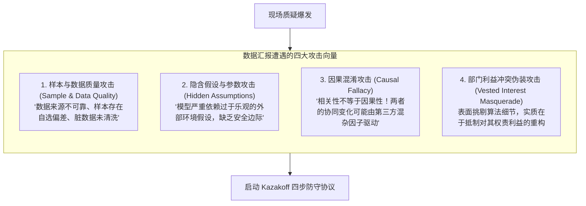
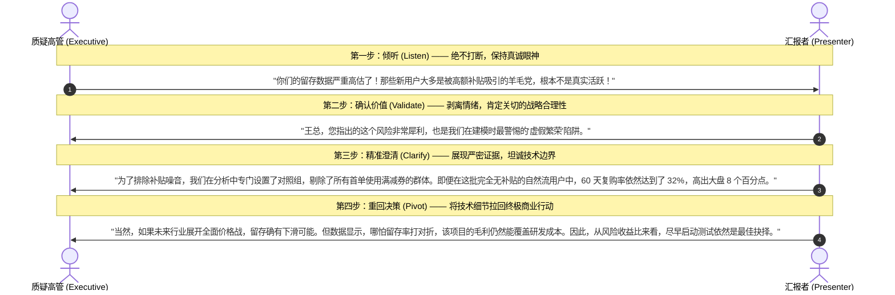

# Lec 8 质疑防御与抗性化解：假设拆解与现场 Q&A 博弈 (Defending Data & Managing Resistance)

> MIT Sloan 15.286 · Communicating with Data · 数据沟通与说服

## TL;DR

- 重塑对现场质疑的认知范式：抗性（Resistance）不是敌意进攻，而是决策者深度投入与严肃评估的标志。
- 解构针对量化数据的四大攻击维度：样本抽样偏差、底层隐含假设、相关性与因果性混淆、以及利益冲突。
- 严格落实 Miro Kazakoff 四步防御协议（倾听-确认价值-精准澄清-重回决策），化解现场对抗性冲突。
- 运用敏感性分析（Sensitivity Analysis）与情景推演预设防御护城河，打造不可击穿的高管汇报备用附录。

## 抗性心理学：为什么利益攸关者必然质疑数据？

在企业战略会议或投委会现场，最让数据分析师与产品团队感到挫败的时刻，莫过于精心准备的汇报遭遇高管一连串尖锐、甚至略带攻击性的盘问：“你这个样本量能代表全市场吗？”、“你的清洗逻辑是不是剔除了对你们不利的异常值？”、“这个因果关系在统计学上根本立不住脚！”

许多年轻沟通者本能地将这种质疑视为**人身攻击、对自身专业度的羞辱、或是对方故意刁难**。这种心态会瞬间激发战斗或逃跑反应（Fight or Flight），导致汇报者要么面红耳赤地与高管激烈争辩，要么唯唯诺诺、全面丧失自信。

Miro Kazakoff 在《Persuading with Data》中提出了一个至关重要的心理认知重构：

::: definition 抗性即投入假说 (Resistance Shows They Care)
**质疑与抗性，绝不是敌意，而是决策者深度卷入并认真对待你提案的最有力证明**。  
如果一个决策者对你的项目毫无兴趣，或者已经决定否决你的预算，他最省力的做法是保持礼貌的微笑与沉默，然后在会后默默将文件扔进垃圾桶。高管之所以花时间挑战你的数据口径与底层假设，是因为**他们真正肩负着数十亿美元或几千名员工的现实责任**。质疑是他们将外部输入与自身经营风险进行校准的必经机制。
:::

根据哈佛商学院 Chris Argyris 的组织防御理论（Organizational Defensive Routines），当数据揭示的客观现实与管理者长期坚信的心智模型相违背、甚至威胁到其业务部门的既得利益时，大脑会产生剧烈的**认知失调（Cognitive Dissonance）**。此时，挑战“计算这个数字的方法是否科学”，是人类心理本能最顺理成章的自卫反应。

## 量化数据遭遇的四大典型攻击向量

现场抛来的质疑看似千奇百怪，但在统计与逻辑层面，基本都可以归纳为以下四类攻击向量：

| 攻击类型 | 典型现场发问话术 | 底层逻辑漏洞与攻防本质 |
|---|---|---|
| **1. 样本质量偏差** | “你们做用户调研只访谈了 50 个人，怎么能代表我们两千万大盘用户？” | 攻击统计推断的外部有效性（External Validity）。汇报者需说明抽样分层设计的置信度。 |
| **2. 隐含假设脱靶** | “你的财务预测假设未来三年行业增速保持在 15%，如果经济下行怎么办？” | 攻击模型参数的脆弱性。汇报者需通过**敏感性分析**证明临界点（Breakeven）。 |
| **3. 相关与因果混淆** | “使用新功能的用户留存高，难道不是因为他们本来就是重度高粘性用户吗？” | 攻击内生性（Endogeneity）与选择性偏差。汇报者需说明是否有对照组（A/B Testing）或准实验设计。 |
| **4. 利益伪装挑刺** | “这个指标口径跟财务部的历史定义不一致，数据不准没法讨论。” | 借技术合规性拖延决策。核心在于私下对齐利益，而非在公屏比拼公式。 |

## Miro Kazakoff 四步防御协议 (The Defense Protocol)

当高管或关键利益相关方在汇报现场发起尖锐质疑时，绝大多数未经专门训练的汇报者都会下意识地启动本能的“抗辩程序”——在对方话音未落时急忙插话解释，或者立即用一堆晦涩的统计术语试图堵住对方的嘴。这种仓促的应对，不仅无法解除对方的疑虑，反而向全场传递出一种明显的防御性恐慌与不成熟。

为了在刀光剑影的高管会议现场保持绝对的战略定力，Miro Kazakoff 在 MIT Sloan 课堂中提炼并推行了一套高度结构化的**四步防御防守协议（The Defense Protocol）**。该协议将心理学的“降维拆弹技术”与管理修辞学紧密结合，将每一场潜在的冲突转化为巩固专业权威的展示舞台：

这四个步骤环环相扣，构成了严密的心理与认知应对防线：

1. **第一步：主动倾听（Listen Actively）**：坚决管住自己的嘴，在对方陈述完毕之前保持绝对静默，身体微微前倾并保持沉稳的目光注视。这向全场宣告：你对自己的数据有十足的底气，你完全不害怕任何挑战；
2. **第二步：确认价值（Validate the Concern）**：在给出任何技术性辩护之前，首先用最真诚的语言肯定对方关切的商业合理性。这一步的奇迹在于迅速解除对方的防御姿态，让原本剑拔弩张的对抗瞬间降温；
3. **第三步：精准澄清（Clarify with Precision）**：调用预先准备好的事实、对照组或清洗逻辑，冷静客观地回答技术细节，同时坦然承认已知的前提局限，绝不强词夺理；
4. **第四步：重回决策（Pivot to the Decision）**：牢记数据沟通的终极使命是驱动行动。在澄清完单点数据口径后，必须在两句话之内将话题果断拉回宏观的战略收益与决策利弊之上，绝不在技术死胡同里无休止纠缠。

::: theorem 防御协议的核心心法：借力打力
四步防守协议的精髓在于：**绝不与质疑者站在对立面搏击，而是立即走到质疑者身旁，与其站在同一条战线上共同审视数据**。当你真诚地说出“您提出的这个风险至关重要，我们在第一轮分析中也极其担心这一点”时，现场的火药味瞬间被瓦解，对抗性的争辩变成了高阶管理者的协同研讨。
:::

## 前置防御装甲：敏感性分析与“What-If”备用附录

顶级的数据汇报者，决胜往往不在正文的 10 页断言切片，而在随身携带的**备用附录（The Appendix Deck）**。

### 1. 敏感性分析龙卷风图（Sensitivity Tornado Diagram）

任何预测模型都基于一系列假设变量（如转化率、流失率、客单价、服务器算力成本）。向高管交付确定性结论时，必须随身附带敏感性分析：

$$\Delta \text{NPV} = f(\Delta \text{Churn Rate}, \Delta \text{CAC}, \Delta \text{Pricing})$$

- 清楚呈现当关键变量向不利方向波动 10%、20%、50% 时，核心商业结论是否依然稳健（Robustness）；
- 标定生死临界点：“转化率跌至多少时，该项目会陷入净亏损？”这为管理层提供了极其宝贵的**心理安全垫（Margin of Safety）**。

### 2. 备用附录的“外科手术式检索”

正文幻灯片保持极致精简（仅展示核心断言与降噪后的主图表）；而所有可能遭遇盘问的“数据清洗代码、详细样本分布、多重共线性排查表、行业历史基准”，一律按编号编排在附录中。
- 当高管提问“你们如何排查不同地域的季节性影响？”时，汇报者沉稳微笑，直接输入编号跳转至附录第 23 页：“王总请看，我们在这里通过面板固定效应回归对 31 个省份的季节性冲击进行了完整剥离，这是回归系数与显著性检验表。”
- 这种“胸有成竹、有备而来”的严谨姿态，能在瞬间彻底粉碎全场对数据质量的任何疑虑。

::: insight 坦诚未知的最高勇气
在面对某些极端冷门的细节追问时，最糟糕的做法是不懂装懂或信口开河。  
**真正顶级的专业度，敢于从容承认知识边界**：“李总，您提到的这个特定渠道的流失归因，我们在本次分析中受限于第三方接口权限未能捕获，我们不会在没有确凿数据支撑的前提下给您一个猜测的答案。我会在会后协同数据工程团队在 24 小时内拉取底层日志，通过邮件向您单独提交专题核算简报。”这种对数据的诚敬，远比勉强编造答案更能赢得高管的终身信任。
:::
