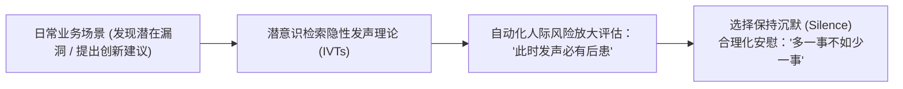

# 隐性发声理论 (Implicit Voice Theories)

> 知识定位：组织沉默与员工自审查的认知心理学根源 · 提出者：James R. Detert & Amy C. Edmondson (2011, AMJ)

## TL;DR

- 隐性发声理论揭示，员工脑海中普遍储存着一系列无需反思即可触发的自审查认知脚本，主导着“何时闭嘴”的本能反应。
- 即使身处宽容开放、强调创新的现代组织，这些潜意识假定仍会驱使员工将正常的业务质疑和前瞻预警强行压制。
- 管理者仅宣布“开门政策”无法消除沉默，必须主动识别并制度化打破五大典型自审查预设。

## 概念定义与发现背景

企业管理中最耐人寻味的谜题之一，是为何许多宣称重视民主、领导和蔼可亲的团队，在关键业务失误面前依然保持集体沉默。2011 年，James Detert 与 Amy Edmondson 在顶级期刊《Academy of Management Journal》上发表实证研究，提出了**隐性发声理论（Implicit Voice Theories, IVTs）**。

::: definition 隐性发声理论 (Implicit Voice Theories, IVTs)
个体在社会化过程中内化形成的一套关于“在层级组织中向上发声何时是不安全或不适宜的”隐性信念系统（Implicit Beliefs）。这些信念如同潜意识运行的认知微码，在员工面临发声情境时自动产生威胁评估，诱发自发性自我审查（Self-Censorship）。
:::

## 五大典型隐性发声脚本

Detert 与 Edmondson 的实证调研提炼出职场中普遍存在的五大核心假定：

1. **绝对证据假定 (Need for Solid Evidence)**：*“除非我有无可挑剔的完备数据支撑，否则我绝不该开口。”* ——导致重大风险在尚处于微弱信号阶段时被硬性压制。
2. **老板权威脆弱假定 (Don't Challenge the Boss in Public)**：*“当众反驳老板或指出其逻辑缺陷，等同于羞辱领导威信。”*
3. **越级汇报禁忌 (Don't Bypass the Boss)**：*“绝不可越过直接主管向上反应问题，哪怕主管自身就是该问题的核心阻碍。”*
4. **负面标签恐惧 (Don't be a Complainer)**：*“提出流程隐患或不合规问题的人，会被管理层判定为充满负能量、不顾大局的‘刺头’。”*
5. **既得利益防卫假定 (Presumption of Career Defensiveness)**：*“既有策略必定凝结着决策者的自尊，挑战策略就是挑战决策者的权力和职业安全。”*

## 实践意义与破局路径

::: insight 组织文化重塑的实质是重写员工的“潜意识脚本”
许多管理者抱怨“现在的年轻人缺乏主动担当与主人翁精神”，这完全是对人类组织心理学的无知。自审查不是道德懒惰，而是在漫长进化与层级压迫中形成的生存适应性本能。  
要打破 IVTs，管理者必须采取逆向矫枉过正的行动：主动在公开会议上邀请反对意见（“请大家帮我挑出这个方案的三个致命缺陷”）、公开奖励指出漏洞的初级员工、将发声的风险由员工承担转化为“由领导者主动承担暴露脆弱的风险”。
:::

- **关联课程讲义**：[Lec 3 组织中的发声困境：心理安全感与隐性发声理论](../lec3.md)
- **相邻管理概念**：[三层对话模型](./three-conversations.md)、[微不公与微肯定](./micro-inequities.md)
