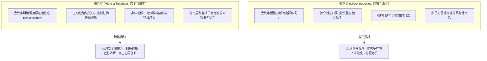

# 微不公与微肯定 (Micro-inequities & Micro-affirmations)

> 知识定位：跨文化、性别与社会身份职场互动的微观机制 · 提出者：Mary P. Rowe (MIT Sloan / MIT Ombudsperson)

## TL;DR

- 微不公指职场中通过细微表情、语气、遗漏或区别对待向特定群体传递的无意识排斥，具有难以举证却累积破坏巨大的特征。
- 微不公会大幅侵蚀被边缘群体的心理安全感与归属感，诱发严重的刻板印象威胁与认知负荷。
- 微肯定作为其积极对应物，通过有意识的细微认可、发言权放大和尊严维护，成为重塑多元包容性组织文化的有力杠杆。

## 概念溯源与定义

1973 年，作为麻省理工学院（MIT）首任监察专员（Ombudsperson）以及 MIT Sloan 管理学院资深教职，Mary P. Rowe 在处理了数千起涉及女性与少数族裔的投诉后，敏锐洞察到：在公开的显性歧视被法律明令禁止之后，职场歧视并未消失，而是转入了一种更加隐蔽、微观且难以追踪的形态。Rowe 创造性地提出了**微不公（Micro-inequities）**的概念。

::: definition 微不公 (Micro-inequities)
指个体在人际交往中，往往无意识地通过极其细微的言行举止、肢体语言、语调变化、眼神回避或程序性疏忽，向那些因种族、性别、年龄、性取向或背景而被视为“非主流/外人”的成员传达的贬低、排除、不信任或不尊重。
:::

微不公的特征在于其“显微镜效应”：单次发生时，行为极其微弱，受害者若提出抗议，极易被指责为“过度敏感”或“捕风捉影”；但日复一日的反复累积，会造成不可逆的职业天花板与心理耗竭。

## 微肯定（Micro-affirmations）的反作用力

面对微不公的弥散性，Mary Rowe 后来提出了对应的解药机制——**微肯定（Micro-affirmations）**。

::: definition 微肯定 (Micro-affirmations)
指在日常微观交往中，有意识地践行的微小但明确的积极行为。它向他人传递“你属于这里、你受到尊重、你的能力与贡献被高度看见”的强烈信号。
:::

### 微肯定的四大实践支柱

1. **公开功劳归属（Attribution & Amplification）**：当某位曾被边缘化的成员提出好点子时，管理者必须立即公开强化：“正如王工刚才所指出的关键瓶颈，这个构想非常具有突破性。”
2. **主动包容性探询（Inclusive Inquiry）**：在多数派主导的讨论中，主动开辟安全通道：“张老师在这个领域拥有独特背景，我们非常想听听你的评估。”
3. **肢体注意力投入（Presence & Attention）**：当少数族裔或年轻员工发言时，彻底放下手机，身体前倾，保持眼神接触，给予完整的认知带宽。
4. **公开背书与机会通道（Visible Sponsorship）**：在核心项目派工与晋升讨论中，主动向决策层展示边缘群体的硬核战绩。

## 概念边界与制度结合

::: insight 从人际善意上升为组织制度免疫力
微肯定绝不仅是个人修养层面的“有礼貌”。在 Mary Rowe 的构想中，微肯定必须与**无障碍争议解决系统（Zero-barrier Dispute Resolution Systems）**以及包容性绩效评价深度绑定。  
当一个团队的日常互动充满微肯定时，微不公就失去了滋生的温床；员工在面临高难度对话时，其身份认同不再处于警报状态，整个系统因而具备了极高的抗震韧性。
:::

- **关联课程讲义**：[Lec 4 敏感议题与社会身份：微不公、特权与刻板印象威胁](../lec4.md)、[Lec 5 冲突动力学与博弈策略](../lec5.md)
- **相邻管理概念**：[三层对话模型](./three-conversations.md)、[隐性发声理论](./implicit-voice-theories.md)
