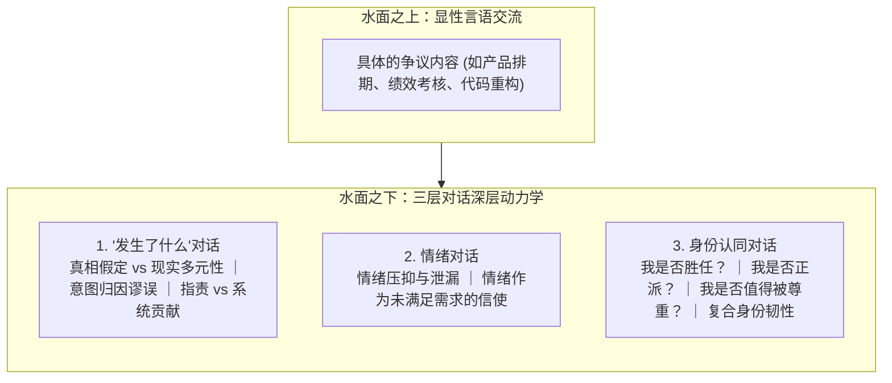

# 三层对话模型 (The Three Conversations)

> 知识定位：人际冲突与高风险沟通的底层认知架构 · 提出者：Douglas Stone, Bruce Patton, Sheila Heen (Harvard Negotiation Project)

## TL;DR

- 三层对话模型揭示，任何艰难对话的表面言语之下，都必然同时并发着“发生了什么”、“情绪”与“身份认同”三个独立维度的博弈。
- 沟通受挫的根源在于忽视了水面下的潜流：人们试图用事实逻辑解决问题，而真正阻碍理解的是未被承认的情绪与遭受威胁的自我价值。
- 该模型指导沟通者将姿态从单向说服的“传递姿态”转为双向理解的“学习姿态”，系统性瓦解防御心智。

## 概念定义与核心架构

三层对话模型是哈佛谈判项目（Harvard Negotiation Project）在对数千起商业争议、劳资谈判与家庭危机深度复盘后总结出的认知解剖学框架。

::: definition 三层对话模型 (The Three Conversations Framework)
该理论断言：无论对话的具体业务主题为何，所有导致当事人焦虑、回避或防御的高风险对话，都可以解构为三个在不同心理层面上同时发生的分支对话：
1. **“发生了什么”对话 (The "What Happened?" Conversation)**：关于事实认定、行为意图与责任归属的分歧；
2. **情绪对话 (The Feelings Conversation)**：关于情绪是否正当、是否被倾听与尊重的心理暗流；
3. **身份认同对话 (The Identity Conversation)**：关于这场对话对当事人自我认知、胜任力与道德形象构成的潜在威胁。
:::

## 三层维度的认知机制与陷阱

### 1. “发生了什么”对话的解构
在这个维度，参与者极易陷入**真相假定**（认为自己掌握唯一事实）、**意图-影响混淆**（将自身受到的伤害直接推断为对方的恶意策划）以及**指责陷阱**（试图证明谁是过错方）。解药是将指责转化为“系统贡献模型（Contribution System）”，探究双方如何共同促成了当前局面的发生。

### 2. 情绪对话的解构
职场人常误以为“情绪是不专业的表现”，试图压抑情绪。然而，未言说的情绪会以嘲讽、冷暴力、微表情泄漏或突然爆发的形式破坏对话。解决之道是将情绪视为“核心事实”本身予以识别、命名并合法化，而非作为副产品加以压制。

### 3. 身份认同对话的解构
这是对话中最隐蔽却最致命的引擎。当反馈动摇了个体的三大核心自我概念（胜任力、善意、自尊）时，会触发杏仁核劫持，引发激烈的生理防御。必须打破“全或无（All-or-Nothing）”的完美主义二元认知，构建能够接纳自身过失与局限的复合型身份认同。

## 概念边界与应用链接

::: insight 沟通调试器与心理韧性
三层对话模型的最高境界，是将它内化为一种本能的元认知防御机制。许多技术领导者在沟通中容易被对方的攻击性话语刺痛，其根本原因在于把表层的言语碰撞直接等同于对自己专业人格的否定。  
一旦掌握三层对话模型，你就会明白：对方的咆哮往往并不证明你做错了什么，而仅仅表明对方自身的情绪正在失控，或者对方的某种核心身份认同正在遭受威胁。这种认知解耦，赋予了领导者在狂风暴雨中保持平和与探究姿态的顶级心理韧性。
:::

::: pitfall 机械套用三层模型的误区
三层对话模型不是一份按部就班的台词清单。如果在对话中生硬地宣称“我们现在进入情绪对话阶段”，会显得虚伪并加剧对方的防备。三层模型是沟通者在脑海中运行的**实时调试器（Real-time Debugger）**：当你发现对方突然愤怒反击时，它提醒你“这不是逻辑问题，对方的身份认同或情绪受到了威胁，必须立即暂停逻辑辩论，切入情感与尊严保护”。
:::

- **前置与同源课程**：[Lec 1 艰难对话的解构：哈佛三层对话模型与学习姿态转向](../lec1.md)、[Lec 2 情绪动力学与身份认同防御](../lec2.md)
- **相邻管理概念**：[隐性发声理论](./implicit-voice-theories.md)、[微不公与微肯定](./micro-inequities.md)
