# 15.288 艰难对话：职场发声的艺术与科学 (Tough Conversations)

> **授课院系**：MIT Sloan 管理学院 · 管理沟通中心（Managerial Communication）  
> **授课教师**：Kara Blackburn（Senior Lecturer in Managerial Communication）  
> **核心主题**：艰难对话结构解构、对话动力学研究、种族/性别与社会身份、职场发声与权力落差应对  
> **课程定位**：MIT Sloan MBA 高阶体验式选修课（3-0-3 学分），融合行为科学、组织心理学与哈佛冲突管理体系

## TL;DR

- 课程专为未来管理者设计，系统攻克职场中涉及权力差异、业绩冲突、种族、性别及社会身份认同的高难度沟通困境。
- 整合哈佛谈判项目（Stone, Heen & Patton）“三层对话”模型与行为科学实证，实现从“说服/对抗立场”向“探究/学习立场”的范式转变。
- 深度融合 MIT 15.667（Mary Rowe）微不公机制、Amy Edmondson 心理安全感与 James Detert 隐性发声理论，填补公开课件缺失的理论拼图。
- 全套讲义覆盖三层对话解构、情绪与身份防御、组织沉默与发声博弈、敏感议题微干预、冲突管理与结构化行动工具箱。

## 课程定位与替代建构体系

MIT 15.288（*Tough Conversations: Science, Strategies & Skills*，亦以 *Difficult Conversations: The Art and Science of Speaking Up* 为名开展教学）并非传统的商务演讲或人际技巧浅层培训，而是直击当代复杂组织中**最高风险的交往界面**：当涉及绩效问责、特权冲突、敏感社会身份（种族、性别、文化背景）、以及面临权力不对称的向上发声时，个体为何极易陷入防御与沉默？管理者又该如何将破坏性的冲突转化为团队协同与学习契机？

由于 15.288 属于 MIT Sloan 面向二年级 MBA 的高互动研讨与模拟课，官方未在 MIT OpenCourseWare (OCW) 开放完整公开课件。为了确保自学者获得同等乃至超越课堂原貌的知识深度，本知识库基于 Kara Blackburn 的课程大纲要求，以**最顶尖的组织行为学与冲突解决实证文献**为骨架，构建了一套全景替代与深度深化体系：

1. **对话微观解剖学（Micro-Anatomy）**：直接继承哈佛谈判项目（Harvard Negotiation Project）经典著作《Difficult Conversations》的理论底座。Douglas Stone 与 Sheila Heen 提出的“发生了什么、情绪对话、身份认同对话”三层模型，打破了传统沟通训练中“就事论事”的浅层教条，从认知心理学层面剖析人际防御的生理与心理机制。
2. **组织动力学与发声机制（Voice & Safety）**：深度整合哈佛商学院 Amy Edmondson 的团队心理安全感理论（Psychological Safety）与达顿商学院 James Detert 的隐性发声理论（Implicit Voice Theories）。这一模块攻克了 15.288 最核心的组织现实问题——为什么“门常开”的领导依然听不到下属的真话，以及如何在权力不对称情境下打破自审查脚本。
3. **社会身份与微不公治理（Identity & Inclusion）**：无缝链接 MIT Sloan 传奇教授、MIT 首任监察专员 Mary Rowe 的开创性实证。Rowe 于 1973 年首次提出的“微不公（Micro-inequities）”与“微肯定（Micro-affirmations）”，配合 Claude Steele 的刻板印象威胁（Stereotype Threat），构成了理解职场中种族、性别与多元特权摩擦的最坚实学术基石。
4. **博弈协商与制度化调解（Dispute Systems & Negotiation）**：完整汲取 MIT 15.667《谈判与冲突管理》（Negotiation and Conflict Management）的核心精髓，将 Thomas-Kilmann 冲突处理矩阵（TKI）、哈佛原则谈判法（Fisher & Ury）与多层级争议解决机制设计（Dispute Resolution Systems）融入实战方案。

```mermaid
flowchart TD
    subgraph S1["第一支柱：对话微观结构解构 (The Anatomy)"]
        direction TB
        A1["哈佛谈判项目 (Harvard Negotiation Project)"]
        A2["Douglas Stone & Sheila Heen 三层对话模型"]
        A3["真相假定、意图-影响鸿沟、贡献系统"]
    end

    subgraph S2["第二支柱：组织动力学与发声机制 (Voice & Safety)"]
        direction TB
        B1["Amy Edmondson 团队心理安全感 (Psychological Safety)"]
        B2["James Detert & Edmondson 隐性发声理论 (Implicit Voice Theories)"]
        B3["打破恐惧默认设置与自我审查"]
    end

    subgraph S3["第三支柱：社会身份与制度正义 (Identity & Equity)"]
        direction TB
        C1["Mary Rowe (MIT Sloan) 微不公与微肯定 (Micro-inequities/affirmations)"]
        C2["Claude Steele 刻板印象威胁与社会认同防御"]
        C3["权力落差 (Power Asymmetry) 与交叉性认同"]
    end

    subgraph S4["第四支柱：博弈协商与制度化调解 (Dispute & Negotiation)"]
        direction TB
        D1["MIT 15.667 谈判与冲突管理 (Mary Rowe)"]
        D2["Thomas-Kilmann 冲突处理风格矩阵 (TKI)"]
        D3["立场剥离、利益协同与零门槛解决系统"]
    end

    S1 -->|"提供微观认知底座"| Core["15.288 艰难对话实战方法论"]
    S2 -->|"破解宏观组织阻力"| Core
    S3 -->|"攻克敏感文化维度"| Core
    S4 -->|"赋能博弈与行动框架"| Core
```

这四大支柱相互咬合、层层递进：微观对话解构提供了人际互动的解剖刀，组织动力学扫清了层级制度的暗礁，社会身份透镜直击深层文化断层，而博弈协商框架则提供了达成终极行动契约的工程化工具。这种跨领域的理论整合，彻底消除了寻找单一孤立课件的局限，为学习者提供了扎实可靠的系统性方法论。

## 讲义全景地图与学习导航

全套课程按照“微观认知解构 $\to$ 内在情绪与身份防御 $\to$ 宏观组织发声动力学 $\to$ 敏感社会身份剖析 $\to$ 冲突管理博弈 $\to$ 落地实战工具箱”的逻辑链条推进：

| 讲次 | 核心主题与理论来源 | 核心解决问题 | 对应讲义 |
|---|---|---|---|
| **第 1 讲** | **艰难对话的解构：哈佛三层对话模型与学习姿态转向** *(Stone, Patton & Heen, Difficult Conversations)* | 剖析“发生了什么”对话；瓦解真相假定、意图-影响归因谬误；以贡献系统替代指责归咎。 | [lec1.md](./lec1.md) |
| **第 2 讲** | **情绪动力学与身份认同防御：心理韧性的底层机制** *(Sheila Heen; William Ury; 情绪认知理论)* | 破解情绪压抑与泄漏；解构胜任力、善意与价值的三大身份威胁；掌握“去阳台”与复合身份落地。 | [lec2.md](./lec2.md) |
| **第 3 讲** | **组织中的发声困境：心理安全感与隐性发声理论** *(Amy Edmondson; James Detert, AMJ 实证研究)* | 揭示组织沉默的非对称风险；打破五大隐性发声潜意识假定；跨越权力落差进行有效上行发声。 | [lec3.md](./lec3.md) |
| **第 4 讲** | **敏感议题与社会身份：微不公、特权与刻板印象威胁** *(Mary Rowe, MIT; Claude Steele; Robin Ely)* | 理解职场中的微不公累积效应；应对谈论种族/性别时的脆弱性反弹；运用微肯定构建包容性场域。 | [lec4.md](./lec4.md) |
| **第 5 讲** | **冲突动力学与博弈策略：MIT 15.667 谈判与利益协同** *(MIT 15.667 Mary Rowe; Thomas-Kilmann TKI)* | 掌握 TKI 五大冲突风格的策略匹配；剥离立场直击底层利益；应对困难人物与设计组织争议解决体系。 | [lec5.md](./lec5.md) |
| **第 6 讲** | **职场发声实战工具箱：开场、探询、向上发声与微干预** *(MIT Sloan 实战演练体系; SBI-I 模型)* | 运用“第三人故事”中立开场；落实漏斗式积极探询；掌握向上发声四步脚本与旁观者微干预协议。 | [lec6.md](./lec6.md) |

## 核心概念索引

为方便跨课程检索与 RAG 向量关联，本课程独立沉淀了三个可复用的核心概念页面：
- [三层对话模型 (The Three Conversations)](./concept/three-conversations.md)：解构一切高难度沟通的底层解剖学。
- [隐性发声理论 (Implicit Voice Theories)](./concept/implicit-voice-theories.md)：解释职场自审查心理与组织沉默的认知根源。
- [微不公与微肯定 (Micro-inequities & Micro-affirmations)](./concept/micro-inequities.md)：MIT 监察专员 Mary Rowe 奠定的现代包容性文化基石。

## 经典实证与权威参考书目

1. **Stone, D., Patton, B., & Heen, S.** (1999/2010). *Difficult Conversations: How to Discuss What Matters Most*. Penguin Books / Harvard Negotiation Project.
2. **Edmondson, A. C.** (1999). Psychological safety and learning behavior in work teams. *Administrative Science Quarterly*, 44(2), 350-383.
3. **Detert, J. R., & Edmondson, A. C.** (2011). Implicit voice theories: Taken-for-granted rules of self-censorship at work. *Academy of Management Journal*, 54(3), 461-488.
4. **Rowe, M. P.** (1990). People who feel harassed need a complaint system with both formal and informal options. *Negotiation Journal*, 6(2), 161-172.
5. **Rowe, M. P.** (2008). Micro-affirmations and micro-inequities. *Journal of the International Ombudsman Association*, 1(1), 45-48.
6. **Steele, C. M.** (2010). *Whistling Vivaldi: How Stereotypes Affect Us and What We Can Do*. W. W. Norton & Company.
7. **Thomas, K. W., & Kilmann, R. H.** (1974). *Thomas-Kilmann Conflict Mode Instrument*. Xicom, Tuxedo, NY.
8. **Ury, W.** (1993). *Getting Past No: Negotiating in Difficult Situations*. Bantam.
