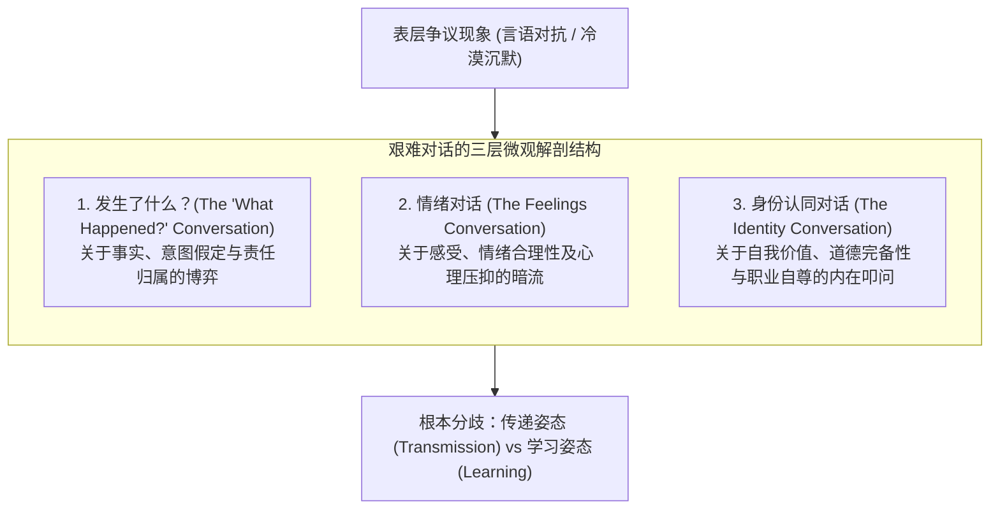
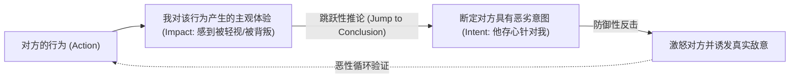
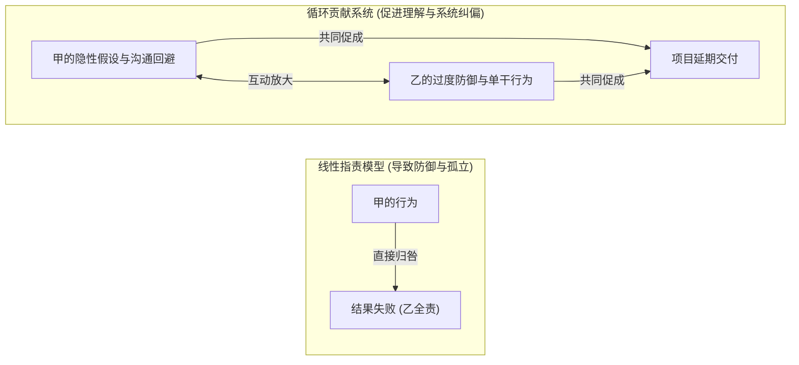
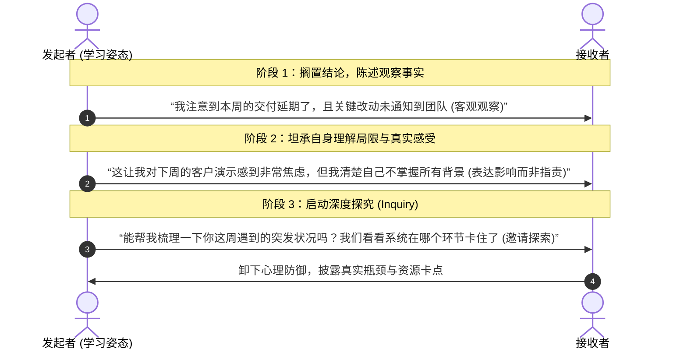

# Lec 1 艰难对话的解构：哈佛三层对话模型与学习姿态转向 (The Three Conversations & The Learning Stance)

> MIT Sloan 15.288 · Tough Conversations · 艰难对话

## TL;DR

- 艰难对话的微观解剖揭示，任何高风险沟通都同时并发着三层结构：“发生了什么”对话、情绪对话与身份认同对话。
- 绝大多数沟通破裂源于“发生了什么”维度的三大认知陷阱：真相假定（执着于客观唯一性）、意图归因谬误（以自身伤害反推对方恶意）和指责陷阱。
- 彻底化解对抗的关键，在于将单向审判的“责任归咎（Blame）”重构为关注因果交互的“系统贡献（Contribution）”。
- 实现范式转变的行动支点，是从试图说服并灌输观点的“传递姿态”彻底转向探究对方世界模型的“学习姿态”。

## 艰难对话的本质：为什么技术理性往往在沟通中失效

在现代高复杂度组织中，管理者经常面临具有高度张力的情境：向上级指出战略实施的重大缺陷、向资深核心成员传达低于预期的绩效评级、或者处理团队内部因文化背景差异导致的信任裂痕。在这些情境下，技术专家和商学院毕业生往往倾向于调用其擅长的数据、逻辑和事实证据试图“赢得争辩”。然而，这种做法几乎不可避免地导致对方防御、反弹甚至关系彻底破裂。

哈佛谈判项目（Harvard Negotiation Project）核心学者 Douglas Stone、Bruce Patton 和 Sheila Heen 的实证研究表明：**艰难对话之所以艰难，不在于信息传递的技术难度，而在于表面争议之下潜伏的情感洪流与身份认同威胁**。无论对话主题是代码架构分歧、晋升名额竞争还是跨部门权责冲突，人际交互的底层始终由三层对话交织驱动：

::: definition 艰难对话 (Difficult Conversation)
艰难对话是指任何涉及潜在冲突、高人际风险（Interpersonal Risk）、高情绪负荷以及对个体自我形象构成威胁的面对面或正式互动。其核心特征在于：对话结果无法通过单向信息通报达成，必须通过双方重构认知共识才能解决。
:::

许多沟通者在发起艰难对话时，预设采取的是**传递姿态（The Transmission Stance）**——其潜意识假设是：“我掌握着事实真相，我的目标是向对方清晰传达我的结论并说服对方接受”。这种姿态必然诱发防御反应。要解开死结，必须向**学习姿态（The Learning Stance）**转向：承认双方各执局部事实，目标不是裁决胜负，而是共同拼合完整的现实图景。

## “发生了什么”对话的三大认知陷阱

在“发生了什么”这一维度上，沟通双方通常围绕三个要素发生剧烈摩擦：事实认定、对方意图推测以及责任归属。人类在应对不确定性和人际威胁时普遍存在的认知偏差，使得该维度充斥着三大结构性陷阱：

### 1. 真相假定（The Truth Assumption）

参与冲突的双方往往坚信自己的感知代表客观真实。然而在复杂组织中，每个人所获得的信息都是局部且经过滤镜筛选的：

::: theorem 观察-解释分离定理
任何冲突中的个体陈述，都不是纯粹的“事实”，而是“有限观察数据”经由个人“隐含假设与价值规则”加工后的“主观解释”。两个理性且完全诚实的人，在观察同一事实片段时，完全可能基于不同的背景知识和经历得出截然相反的结论。
:::

::: example 信息不对称导致的真相冲突
工程主管张强认为产品经理李敏“不可理喻”，因为李敏要求在版本发布前最后一周临时变更支付接口。张强坚信的事实是：“临近封版改动核心底层逻辑是极端危险的违规操作”。  
然而李敏坚信的事实是：“合规部门刚收到央行最新合规通报，若不上线新接口，App 上架次日就会被应用商店全网下架”。双方各自握着无可辩驳的事实，却在未交换上下文之前互相判定对方“缺乏专业素养”。
:::

### 2. 意图归因谬误（The Intention-Impact Gap）

在艰难对话中，最致命的认知短路是将**自身的受挫感受（Impact）**直接等同于**对方的主观动机（Intent）**。

社会心理学中的基本归因错误（Fundamental Attribution Error）在此处被极度放大：当我们受到负面影响时，我们倾向于归因于对方的恶意、冷酷或能力缺陷；而当我们对他人造成负面影响时，我们则归因于环境所迫或良苦用心。

::: pitfall 意图审判的毁灭性
“你根本不在乎这个项目”、“你就是在故意边缘化我”——这种以意图审判开场的对话，必然迫使对方放弃倾听，将全部认知资源投入自我辩护。意图是隐藏在他人大脑内部的黑箱，我们无法直接观察意图；唯一能观察的是行为本身及我们自身的感受。把推论当事实，是对话破裂的最快路径。
:::

### 3. 指责陷阱（The Blame Trap）

指责的本质是法庭审判式的追责思维：“这到底是谁的错？谁应该被谴责甚至惩罚？”在管理情境中，追逐过错会产生三大破坏性后果：
- **诱发本能防御**：面对指责，任何个体的第一本能是隐瞒信息、推卸责任、掩盖真相。
- **掩盖系统缺陷**：将系统性流程漏洞简化为特定个人的品格或态度问题。
- **割裂未来导向**：指责永远着眼于过去的定罪，而无法产生面向未来的建设性行动。

## 从责任归咎到系统贡献（Contribution System）

化解指责陷阱的核心武器，是建立**系统贡献系统（Contribution System）**。贡献与归咎存在本质差异：

| 维度 | 责任归咎 (Blame) | 系统贡献 (Contribution) |
|---|---|---|
| **核心问题** | “是谁搞砸了这件事？谁该受罚？” | “我们双方各自做了或没做什么，共同催生了这一现状？” |
| **思维取向** | 单向、线性裁决；非黑即白 | 循环互构、系统动力学；承认多元因果 |
| **情绪副产物** | 羞耻感、防御抗拒、敌意升级 | 心理安全感、探究意愿、协作修复 |
| **时间视角** | 倒退式（锚定过去，追索责任） | 前瞻式（理解当下因果，设计未来机制） |

::: insight 贡献系统不是“各打五十大板”的伪中庸
读者常产生误解：强调双方都有贡献，是不是意味着受害者也要承担加害者的责任？绝对不是。  
贡献系统绝不否认权责边界（例如违纪、违法必须有明确的法律和纪律问责）。贡献系统的真正价值在于**还原因果交互全貌**。即使某方承担 90% 的执行责任，另一方在前期沟通中的沉默、期望界定不清或反馈滞后，也是导致系统崩溃不可或缺的输入变量。理解自身的贡献，是重新夺回局面控制权的唯一方式——因为你无法改变他人，你唯一能直接调整的只有自己的行为输入。
:::

### 贡献分析的四大常见隐性盲区

在复盘自身对冲突的贡献时，管理者往往忽视以下四种不显眼但极具破坏力的贡献方式：

1. **彻底的回避与隐忍（Avoiding）**：将不满藏在心里不发一言，直到情绪累积到临界点爆发；对方在长达数月的时间里完全没有获得纠偏信号。
2. **不可接近的高冷姿态（Being Unapproachable）**：通过冷漠的表情、紧绷的日程或轻蔑的微表情，向团队释放“不要拿问题来打扰我”的威慑气场。
3. **角色与期望错位（Role Confusion）**：在未达成书面契约的情况下，自顾自地假定对方应当知晓某种默认规则。
4. **权力差距造成的单向阻断（Power Gap Blindness）**：作为上级，未意识到下属在权力威压下天然不敢主动质疑，却将下属的沉默误判为“全员赞同”。

## 转换沟通姿态：从对抗走向双向探究

从传递姿态走向学习姿态，并不是软弱妥协，而是一种高阶的认知战术。它要求沟通者在脑海中完成底层操作系统的升级：

要实现这种对话深度，必须在进入对话前完成三项认知准备：
1. **停止预判对方意图**：承认对方的行为对其自身而言是合理的，探寻其行为背后的合理性逻辑。
2. **绘制双方贡献地图**：在纸上列出“我做了什么促成了这个问题”、“对方做了什么促成了这个问题”。
3. **准备从“第三人故事”切入**：不从自己的主观受害者视角开场，而是从一个中立调解员能同时认同的客观中立事实开场（详见第 6 讲实战演练）。
