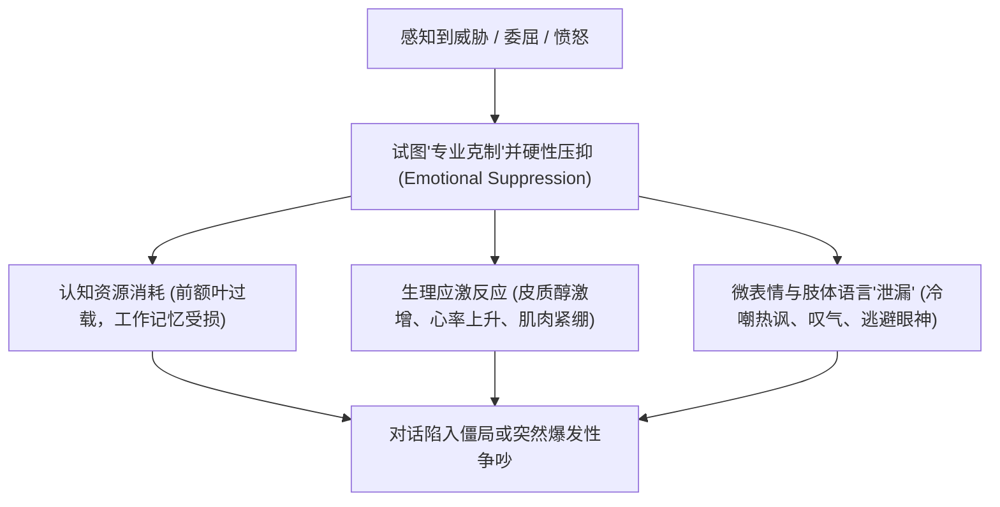
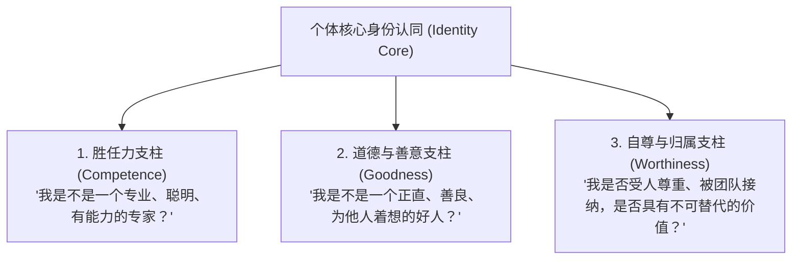
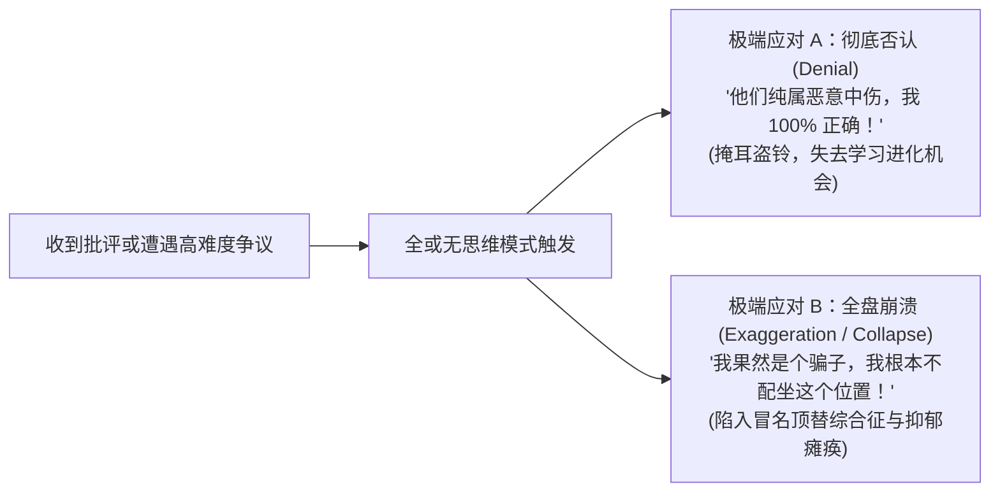
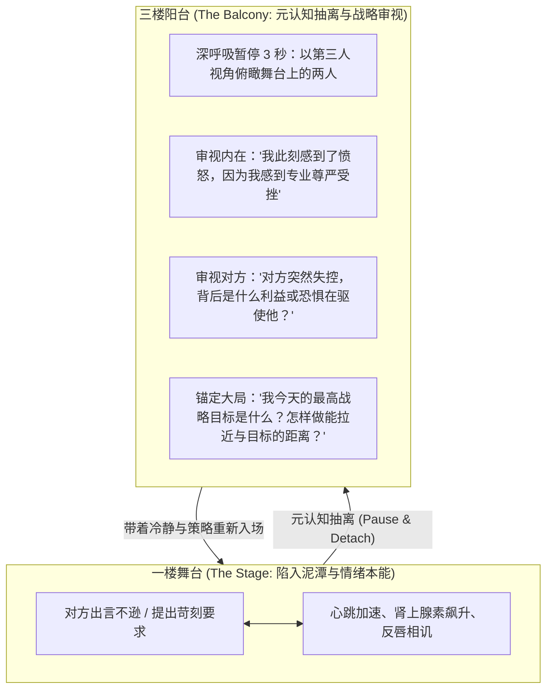

# Lec 2 情绪动力学与身份认同防御：心理韧性的底层机制 (Feelings & The Identity Conversation)

> MIT Sloan 15.288 · Tough Conversations · 艰难对话

## TL;DR

- 情绪并非理智沟通的干扰噪音，其本身就是艰难对话的核心内容；压抑情绪无法消除冲突，只会导致情绪通过肢体与微表情破坏性泄漏。
- 身份认同对话关乎个体的三大存在性底线：“我是否胜任？”、“我是否正直善良？”以及“我是否值得尊重？”。
- 面对负面反馈，“全或无（All-or-Nothing）”的二元认知陷阱会迫使个体在“彻底否认事实”与“自我价值崩溃”之间极端摇摆。
- 应对身份防御的核心策略是构建包含自身局限性的“复合型身份认同”，并借助“去阳台（Go to the Balcony）”的元认知抽离技术重获情绪掌控权。

## 情绪对话的实质：理性至上神话的破产

传统商业文化和工程技术组织长期崇尚一种“专业主义神话”：即认为工作场所应当是纯粹理性的，优秀的职场人应当“把情绪留在门外”，“只看数据和逻辑”。然而现代神经科学与组织行为学实证早已证实：**情绪与理性并非对立的两极，情绪本质上是人类大脑对环境威胁与利益相关度的首要评估系统**。

在艰难对话中，试图绕过情绪直接解决“业务问题”，就如同在发动机过热冒烟时仅仅用胶带贴住报警灯。

::: definition 情绪对话 (The Feelings Conversation)
情绪对话是指在人际互动过程中，双方感知到的愤怒、恐惧、委屈、嫉妒、羞耻或脆弱等情感体验的总和。未被清晰识别和恰当表达的情绪，会反向扭曲双方对事实的解释与对意图的归因，成为阻断理性解决问题的最强大壁垒。
:::

### 情绪压抑与泄漏的系统性代价

当个体试图压抑负面情绪时，人类生理机能决定了这种努力必然伴随沉重的代价：

1. **认知带宽被严重剥夺**：斯坦福大学心理学家 James Gross 的实验表明，刻意压抑情绪的受试者，其注意力和记忆力会出现断崖式下跌，在对话中无法准确捕获对方的关键信息。
2. **破坏性身体泄漏**：未被言说的情绪不会凭空蒸发，它会化为刺耳的语调、紧抿的嘴角、防御性的交叉双臂或极具侵略性的沉默（Passive-Aggressive Silence），向对方传递强烈的敌意信号。
3. **情绪是需求的唯一信使**：每一种强烈的情绪背后，都对应着未被满足的核心心理诉求（例如：愤怒往往源于边界被践踏；伤心源于失去联结；焦虑源于失去控制权）。

## 身份认同对话：三大核心支柱与威胁感知

为什么一句看似轻微的同事质疑（如：“这份报告的数据你交叉验证过了吗？”），有时会引发强烈的生理应激甚至暴怒反击？

答案在于：**表面上讨论的是数据，底层的潜意识雷达却感知到了“身份认同（Identity）”的生死存亡威胁**。哈佛谈判项目将维系个体心理稳定的核心支柱提炼为三大基本叩问：

当外部反馈触及这三大支柱时，大脑的边缘系统（尤其是杏仁核）会产生与面对物理猛兽袭击时完全相同的神经激活——**杏仁核劫持（Amygdala Hijack）**。在此状态下，负责逻辑分析和长远规划的前额皮质血液灌注骤减，个体被“战、逃、僵（Fight, Flight, Freeze）”的原始生存本能彻底接管。

## “全或无”认知黑白化陷阱

个体在面对身份认同威胁时，极易跌入**全或无（All-or-Nothing）**的二元思维陷阱：

::: theorem 身份全或无陷阱 (The All-or-Nothing Syndrome)
个体将复杂的自我形象简化为非黑即白的单极评判：要么我彻底完美无瑕，要么我一无是处、全盘失败；要么我无可指责，要么我就是虚伪卑鄙之徒。在二元世界观下，任何微小的负面反馈都等同于对自我人格的全面否定。
:::

全或无思维必然导致两种截然相反但同样具有破坏性的极端应对机制：

::: pitfall 完美主义面具的脆断
许多在名校和顶尖企业脱颖而出的精英管理者，极易依赖单一维度的“胜任力（Competence）”支撑整个自我价值体系。一旦某个重大项目失利或遭遇严厉公开批评，其心理防线会在瞬间脆断。为了防御这种脆断，他们往往演化出极具攻击性的傲慢与专横，拒绝承认任何过失，最终在团队中制造严重的寒蝉效应。
:::

## 构建复合型身份认同与心理接地

打破全或无怪圈的唯一解药，是在平日里主动撕掉单一完美的标签，构建更具弹性的**复合型身份认同（Complex Identity）**。

### 1. 接纳多维人性的复杂悖论

成熟的职场心理韧性，建立在对自我复杂度的诚实接纳上。复合型身份认同由一系列健康的“同时性事实”组成：
- *“我是一名卓越的架构师，**与此同时**，在某些新兴技术栈上我仍是初学者，完全可能做出错误的选型评估。”*
- *“我始终秉持对团队的善意，**与此同时**，我刚刚情急之下的话确实伤害了下属的尊严。”*
- *“这个项目确实失败了，**与此同时**，这次失败丝毫不能抹杀我过去为公司创造的巨大商业价值。”*

### 2. 心理接地技术（Psychological Grounding）

在进入高风险对话前，运用“心理接地”演练稳固自我重心：

::: example 心理接地四步自问练习
1. **剥离行为与本质**：我的这个行为确实不恰当，但这不代表我整个人是个糟糕的人。
2. **审视过去的抗挫历史**：我曾克服过更严峻的危机，我有能力从这次争议中汲取营养。
3. **放弃控制他人的妄念**：对方有权产生误解甚至愤怒，他们的反应并不由我单方面决定，我只需守住我自己的专业与诚实底线。
4. **澄清对话初衷**：我开启这场对话不是为了证明自己是正确的，而是为了搞清楚事实并修复合作关系。
:::

## 应对情绪劫持：William Ury 的“去阳台”策略

哈佛谈判项目联合创始人 William Ury 提出了著名的**“去阳台（Go to the Balcony）”**元认知策略。阳台代表着一个高于舞台的鸟瞰视角：

::: insight “去阳台”不是逃避，而是战略性心理换弹
很多技术人误以为“克制情绪”意味着逆来顺受。恰恰相反，“去阳台”是最具进取性的战术选择。当你任由本能反击时，你的行为已经被对方的情绪所遥控；只有抽离到阳台，你才重新掌握了战局的主动权。在会议桌上，一句冷静的“这是一个非常重要且复杂的议题，建议我们各自喝杯水休息五分钟，五分钟后我们针对核心数据逐条拆解”，往往比任何激烈的辩白都更能体现真正的领袖威信。
:::
