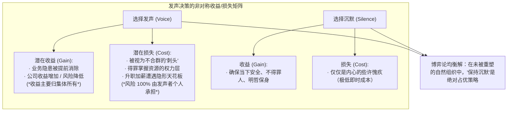
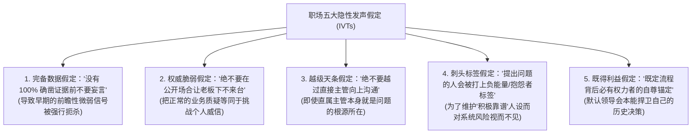
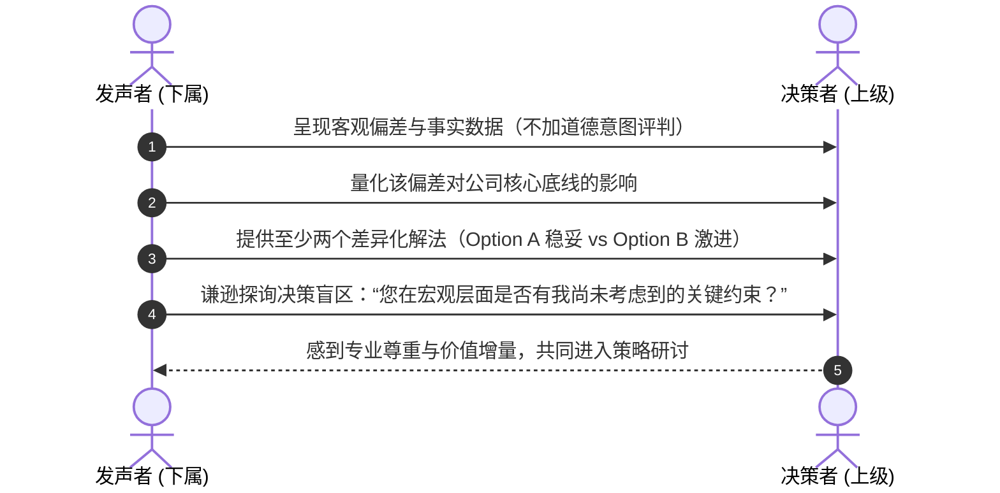

# Lec 3 组织中的发声困境：心理安全感与隐性发声理论 (Psychological Safety & Implicit Voice Theories)

> MIT Sloan 15.288 · Tough Conversations · 艰难对话

## TL;DR

- 员工发声（Employee Voice）具有天生的结构性非对称性：发声收益多归组织所有，而潜在人际代价（边缘化、被视为刺头）却由个人独自承担。
- Amy Edmondson 的实证研究证明，心理安全感不是降低考核标准的“好好先生”文化，而是团队成员确信“不会因暴露脆弱或承担人际风险而遭报复”的共同认知。
- James Detert 与 Edmondson 揭示的“隐性发声理论（IVTs）”表明，员工体内普遍预装了五大潜意识自审查脚本，哪怕在宽容的领导面前也会不自觉保持沉默。
- 破解组织沉默不能仅靠口头鼓励，管理者必须通过主动展示认知脆弱性、明确将发声与组织目标对齐、制度化反应回路来重写团队心理契约。

## 组织沉默的代价与发声的非对称风险

在波音 737 MAX 飞行控制系统漏洞、安然财务舞弊、富国银行虚假账户等重大商业悲剧中，后续调查无一例外地发现：**早在一线危机全面爆发的数月乃至数年前，技术工程师或前线业务人员就已经敏锐发现了致命缺陷，但他们最终都选择了沉默**。

组织行为学调查显示，超过 85% 的职场员工曾至少一次在面对公司重大业务失误或潜在伦理风险时，强行咽回了到嘴边的真话。

::: definition 员工发声 (Employee Voice)
指员工基于对组织利益或业务改善的善意，自发向上级或团队公开发表具有建设性的意见、隐患预警、反直觉创新想法或对既定决策的质疑。其特征在于其属于“裁量性行为（Discretionary Behavior）”——员工没有法律或契约义务必须发声，闭嘴通常是最安全的自保选择。
:::

为什么理性人普遍倾向于自我审查？因为在人性的效用天平上，发声行为面临着**不可逆的风险非对称性（Asymmetric Risk of Voice）**：



## Amy Edmondson 的团队心理安全感机制

哈佛商学院教授 Amy Edmondson 在医疗团队失误率的实证研究中，偶然发现了一个违背直觉的现象：表现更优秀的高效医疗团队，其报告的医疗差错数量反而显著多于平庸团队。深度调查揭示，高效团队并非犯错更多，而是**更敢于公开报告并讨论错误**。Edmondson 据此提出了现代组织管理最重要的理论支柱之一——**心理安全感（Psychological Safety）**。

::: definition 心理安全感 (Psychological Safety)
团队成员共同持有的一种信念，即该团队对于“承担人际风险（Interpersonal Risk-Taking）”是绝对安全的。在具有高度心理安全感的场域中，没有人会因为提出未成熟的想法、指出上级逻辑漏洞、承认技能短板或提出尖锐疑问而遭遇贬低、冷嘲热讽或暗中打击。
:::

### 破除对心理安全感的两大常见误解

```mermaid
flowchart LR
    subgraph 误解 1["误解 1：心理安全感等于'无原则的舒适与溺爱'"]
        direction TB
        M1["错把安全感当成降级要求、逃避冲突、不谈业绩考核"]
    end
    subgraph 澄清 1["科学实证澄清"]
        direction TB
        C1["心理安全感不是消灭分歧，而是让团队敢于直面冲突，开展高烈度的认知争辩 (Task Conflict)"]
    end
    误解 1 -.-> C1
```

Edmondson 构建的经典两维矩阵明确指出：只有当心理安全感与高绩效考核标准同时并存时，团队才能真正迈入**高绩效学习区（Learning Zone）**：

| 考核标准 \ 心理安全感 | 低心理安全感 (Low Safety) | 高心理安全感 (High Safety) |
|---|---|---|
| **高考核标准 (High Accountability)** | **焦虑瘫痪区 (Anxiety Zone)**<br>恐惧犯错、数据造假、相互甩锅 | **高绩效学习区 (Learning Zone)**<br>勇于发声、敏捷纠错、彻底协同 |
| **低考核标准 (Low Accountability)** | **冷漠区 (Apathy Zone)**<br>出工不出力、彻底躺平、人走茶凉 | **舒适区 (Comfort Zone)**<br>一团和气、回避困难对话、平庸无为 |

## James Detert 与隐性发声理论（Implicit Voice Theories）

许多企业高管在员工调研中感到困惑：“我从来没有惩罚过提意见的员工，我的办公室大门永远向所有人敞开，为什么大家开会时还是集体失语？”

弗吉尼亚大学达顿商学院教授 James Detert 与 Amy Edmondson 在发表于《Academy of Management Journal》的里程碑式研究中解答了这一谜题：**阻碍发声的不仅是当下的现实威胁，更是员工在长期社会化历程中固化在大脑深处的“隐性发声理论（Implicit Voice Theories, IVTs）”**。

::: theorem 隐性发声理论 (Implicit Voice Theories, IVTs)
员工脑海中无意识储存的关于“在组织中何时发声是不安全或不恰当的”一整套不证自明的预设脚本。这些脚本如同操作系统底层的隐藏驱动，不受当前直属领导实际品格的完全支配，会自动在面临层级差异时触发防御性自审查。
:::

实证研究梳理出跨行业职场中最普遍的五大隐性发声假定：



::: pitfall 开放门政策的认知幻觉
“My door is always open”常常是管理者最懒惰的借口。对下属而言，穿过长廊、推开办公室木门、坐在高管对面的每一步，都在高声警报 IVTs 的危险信号。只要高管坐在椅子上等待下属“主动上门”，隐性发声脚本就会确保绝大多数关键风险永远被阻隔在门外。
:::

## 跨越权力落差的上行发声策略

对于需要跨越层级向高位者发声（Upward Voice）的个体而言，除了寄希望于组织文化，自身必须掌握一套化解对方防卫的**战略发声技巧**：

### 1. 战略框架对齐（Strategic Framing with Purpose）

切勿以个人偏好或部门抱怨开场，必须将发声议题牢牢锚定在对方最高优先级的战略诉求上：

::: example 向上发声的话术对比
- ❌ **引发防御的个人抱怨式**：“我们技术部觉得市场部的发布节奏太快了，我们天天加班顶不住，代码质量已经无法控制了。”  
- ✅ **战略意图对齐的高阶发声式**：“李总，我知道公司本季度的核心目标是确保支付转化率提升 15%。根据近两周的压测日志，我观察到如果继续沿用当前未经解耦的数据库架构，流量峰值时系统出现雪崩宕机的风险高达 60%。为了确保季度转化率目标万无一失，我梳理了两个渐进式解耦方案，想向您请教评估哪种更符合业务节奏。”
:::

### 2. 区分抱怨与建设性发声（Constructive Framing）

优秀的向上发声者从不只带着问题进门，而始终遵循“**观察事实 $\to$ 风险量化 $\to$ 备选方案梯队 $\to$ 探寻决策考量**”的四联步：



::: insight 发声不是赌气，而是为权力层提供认知冗余
向上发声最容易陷入的心理误区是“自怜式正义感”——觉得自己在孤身对抗体制。高明的高管深知，高位者往往面临严重的信息遮蔽，他们本能的防御多半源于对未知风险的焦虑失控感。当你将发声包装成“帮他防范黑天鹅”并附带操作方案时，你不是在制造麻烦，而是在成为不可或缺的智囊。
:::
