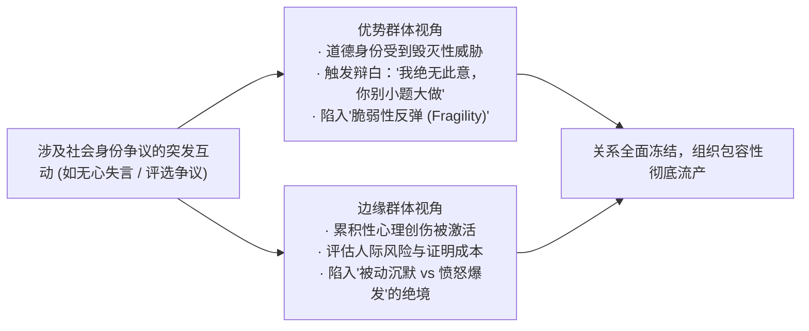
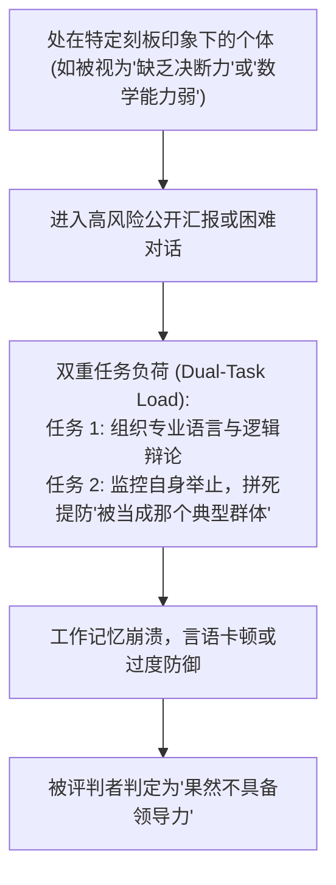
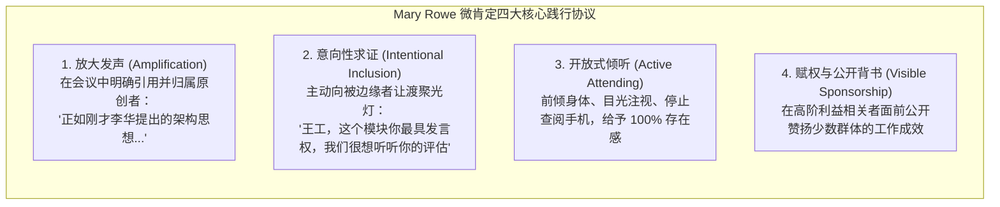

# Lec 4 敏感议题与社会身份：微不公、特权与刻板印象威胁 (Social Identity, Race, Gender & Micro-inequities)

> MIT Sloan 15.288 · Tough Conversations · 艰难对话

## TL;DR

- 职场中涉及种族、性别、文化及社会身份的对话之所以高度敏感，源于双方身份认同的极度脆弱与特权盲区的剧烈碰撞。
- MIT 监察专员 Mary Rowe 开创性提出的“微不公（Micro-inequities）”，揭示了日常微小轻慢、隐性打断和注意力剥夺在长期累积下的毁灭性破坏。
- Claude Steele 的“刻板印象威胁（Stereotype Threat）”表明，处于污名化压力下的群体在对话中承受着额外的认知负荷，极易引发失语与过度防御。
- 走出“假装看不见差异”的色盲盲区，管理者应通过有意识地践行“微肯定（Micro-affirmations）”与多样性整合学习范式，重构跨身份认同的安全对话场域。

## 敏感议题的痛点：为何种族、性别与社会身份引发剧烈防御？

在 MIT 15.288 的教学实践中，Kara Blackburn 指出：当代商业管理者最恐惧、最容易回避的对话，往往不是单纯的商业合同纠纷，而是**交织着种族、性别、性取向、国籍与阶层等社会身份（Social Identity）的敏感议题**。

当日常协作中出现不当言论或疑似偏见时，对话双方往往同时陷入剧烈的身份防御：
- **多数派/优势群体（Majority）的恐惧**：极度害怕被贴上“种族歧视者”、“性别歧视者”或“冷血特权者”的道德污名，从而采取强烈的否认、辩解或彻底疏离（“我还是少惹他们为妙”）。
- **少数派/边缘群体（Minority）的疲惫**：长期承受微小冒犯，既担心发声会被指责为“玻璃心”、“过度敏感”、“玩弄受害者牌”，又对组织能否公正处理深感怀疑。

## Mary Rowe 与微不公（Micro-inequities）理论

在 MIT Sloan 讲授 15.667 谈判课程、并担任 MIT 监察专员（Ombudsperson）长达数十年的 Mary Rowe 教授，于 1973 年首次正式提出了**“微不公（Micro-inequities）”**这一颠覆性概念。

::: definition 微不公 (Micro-inequities)
指在日常工作交往中，人们通过不易察觉的微表情、肢体疏离、语气语调、隐蔽遗漏或微小差别待遇，向特定群体（通常因性别、种族、年龄、残障或背景被视为'异类'）传达的贬低、排除、不尊重或无视。其单次发生往往极其短暂且难以固证，但长年累月会形成“千刀万剐（Death by a thousand cuts）”的系统性排斥效应。
:::

### 职场微不公的典型具象表现

1. **会议认知隐形（Cognitive Invisibility）**：当女性或少数族裔成员提出某个关键构想时，会议室一片寂静无人回应；5 分钟后一位资深白人男性用稍加修饰的词汇重复同一观点，却赢得全场赞誉（“Idea Appropriation”）。
2. **语境打断与言论微缩（Interruptive Diminution）**：统计表明，女性专家在高管会议中被无端打断发言的频率是同资历男性的两倍以上。
3. **惊讶式赞美（Surprise Praise）**：“没想到你作为非名校背景/少数族裔，英语居然讲得这么地道！”——表面是表扬，本质预设了该群体的低能力基线。
4. **归属感剥离与边缘指派**：在非正式关键社交（高尔夫、私密饭局）中被习惯性略过，在任务分配中总被分派给非核心、无可见度的“行政保姆型工作”。

::: pitfall “这不过是件小事”的特权盲区
微不公最阴险之处在于其单次的“可抵赖性（Plausible Deniability）”。当受害者指出“你刚才开会打断了我三次”时，打断者极易辩解“我只是赶时间，你怎么这么敏感？难道大家交流还不能插话了？”。这种辩解将系统性的不公异化为受害者的“心理性格缺陷”，进一步加剧了二次心理伤害。
:::

## Claude Steele 的刻板印象威胁（Stereotype Threat）

斯坦福大学社会心理学家 Claude Steele 在其里程碑著作《Whistling Vivaldi》中揭示：**处在社会负面刻板印象阴影下的群体，在面临高要求沟通与绩效评估时，其神经认知系统承受着常人难以想象的隐性内耗**。

::: theorem 刻板印象威胁 (Stereotype Threat)
当个体处于可能验证自身群体负面刻板印象的情境中时，大脑会自发启动高警觉监测机制（Hyper-vigilance）。这种由恐惧被评判而引发的心理应激，会直接抢占个体的“工作记忆容量（Working Memory）”与前额叶执行功能，导致其在对话中表现失常，进而具有讽刺意味地反向“印证”了原初的刻板偏见。
:::

在 15.288 的对话模拟中，许多少数群体学员反馈，他们在向白人高管指出流程问题前，大脑中要反复过滤上百遍遣词造句，竭力避免显得“有攻击性（Angry Black Woman / Aggressive Outsider）”，这种巨大的精神沉没成本构成了职场最隐蔽的隐形税。

## 谈论特权与社会身份时的心理防卫模式

当管理者试图在团队内开启关于平等与身份认同的讨论时，往往面临三类典型的防卫性死局：

### 1. “色盲假定”（The Color-blind Fallacy）

管理者常自豪地宣称：“在我们部门，我不看肤色也不看性别，我只看能力和产出！”  
哈佛与 MIT 的研究表明，**“色盲主义”实质是优势群体的一种认知懒惰与特权庇护**。假装看不见差异，等于否认了边缘群体在日常中所真实遭遇的制度性偏见与微不公摩擦。它关闭了倾听受挫经验的通道。

### 2. 脆弱性反弹（Fragility & Defensiveness）

当被指出言论存在微不公时，管理者本能地感到道德完备性受损，迅速启动受害者反转：
- *“我做了这么多支持多样性的工作，你居然认为我是歧视者？这太让我寒心了！”*  
这种反应迅速将聚光灯从“受害者的伤痛”转移到了“管理者的委屈”上，迫使下属反过来安慰领导，使真正的对话戛然而止。

## 微肯定（Micro-affirmations）与包容性对话环境的建立

Mary Rowe 指出，如果微不公是日积月累的毒素，那么**微肯定（Micro-affirmations）**就是中和毒素、重建心理安全的活性解药。

::: definition 微肯定 (Micro-affirmations)
指在日常微观互动中，有意识地给予他人认可、信任、尊重和归属感的细微言行。微肯定不仅能修复遭受微不公侵蚀的人际纽带，还能有效阻断刻板印象威胁的触发。
:::

### 职场微肯定的四大落地行为协议

::: insight 从多样性消耗转向多样性整合学习
Robin Ely 与 David Thomas 提出的“多样性整合与学习范式（Integration-and-Learning Perspective）”强调：真正的包容性，绝不是为了合规指标搞人头拼盘（Numbers Game），也不是把所有人同化为“主流白人男性商业文化”的标准模板。  
卓越的管理者将员工不同的文化根基、性别视角和生活经历，视为组织洞察外部世界盲区的**战略传感器**。在这种文化下，关于社会身份的艰难对话不再是“谁冒犯了谁”的道德审判，而是“我们如何借助彼此独特的视角，共同看清复杂系统的全貌”。
:::
