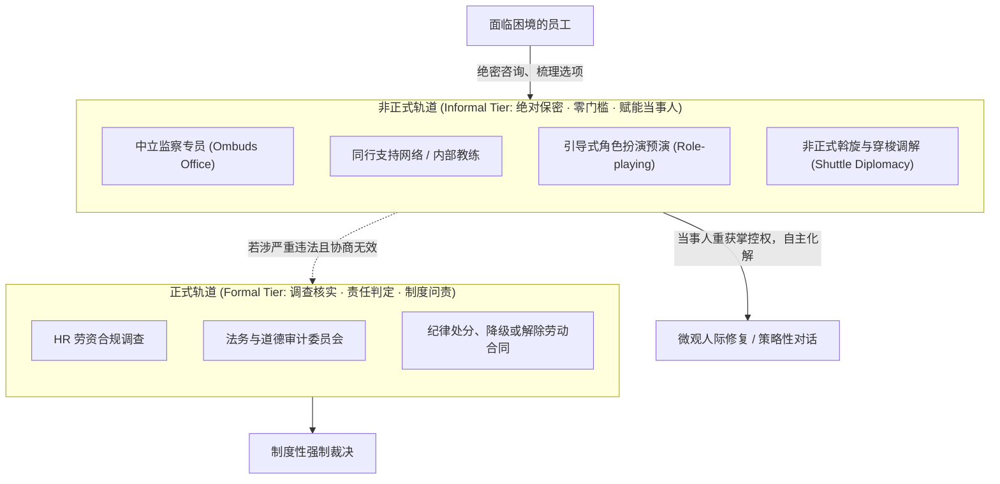

# Lec 5 冲突动力学与博弈策略：MIT 15.667 谈判与利益协同 (Conflict Dynamics & Negotiation Strategies)

> MIT Sloan 15.288 · Tough Conversations · 艰难对话

## TL;DR

- 冲突并非需要被彻底消灭的病态现象，其本质是未被对齐的价值主张与资源稀缺；Thomas-Kilmann 矩阵（TKI）提供了五种策略风格的情境适配逻辑。
- 化解敌对博弈的核心技术，是将表面坚不可摧的“立场（Positions）”穿透拆解为深层隐蔽的“底层利益（Interests）”，从而开辟整合性价值创造空间。
- 应对职场“有毒/粗暴型人格（Abrasive Personalities）”，必须恪守“非人际化认知”、“事实硬边界”与“结果导向脱敏”三项铁律。
- MIT 监察专员 Mary Rowe 的制度设计证明，健康的组织必须建立涵盖非正式咨询（Ombuds）与正式调查的多层级零门槛争议解决系统。

## 冲突的双维模型：Thomas-Kilmann 冲突处理风格矩阵（TKI）

在 MIT Sloan 经典的 15.667《谈判与冲突管理》（Negotiation and Conflict Management）课程中，Mary Rowe 教授开宗明义地指出：**人际冲突是组织运转中的自然物理摩擦**。当不同部门承载着差异化的 KPI、不同的专业视角和有限的预算时，冲突的产生不仅不可避免，而且往往是驱动组织进化的必要张力。

Kenneth Thomas 与 Ralph Kilmann 构建的 **TKI 冲突模式矩阵**，基于两个核心维度刻画了个体应对分歧的行为模式：
1. **坚定性（Assertiveness）**：个体试图满足自身利益的诉求强度；
2. **合作性（Cooperativeness）**：个体试图满足对方利益的意愿强度。

```mermaid
quadrantChart
    title Thomas-Kilmann 冲突应对模式矩阵 (TKI)
    x-axis 低合作性 (Low Cooperativeness) --> 高合作性 (High Cooperativeness)
    y-axis 低坚定性 (Low Assertiveness) --> 高坚定性 (High Assertiveness)
    quadrant-1 合作型 (Collaborating)<br>双赢求解 · 深度整合
    quadrant-2 竞争型 (Competing)<br>零和博弈 · 权威决断
    quadrant-3 回避型 (Avoiding)<br>战术撤退 · 冷却搁置
    quadrant-4 迁就型 (Accommodating)<br>牺牲自利 · 维护关系
```

| 应对风格 | 行为特征 | 最佳适用情境 | 滥用的破坏性代价 |
|---|---|---|---|
| **竞争型 (Competing)** | “以我为准”；调动权力、规则与逻辑强推 | 紧急危机事件；关乎合规或生命安全的非对称底线原则 | 摧毁团队信任，扼杀下属发声意愿，形成独裁孤岛 |
| **合作型 (Collaborating)** | “双赢探究”；整合双方深层利益，创造新选项 | 议题对双方均具极高战略价值；需要全员发自内心承诺 | 认知与时间成本极高；在零和琐事中易造成决策瘫痪 |
| **妥协型 (Compromising)** | “各退一步”；快速均分利益或折中解决 | 时间紧迫；双方势均力敌且无法达成完美合作时的次优解 | 产生“平庸妥协”，双方均不满意，留下未根治隐患 |
| **回避型 (Avoiding)** | “暂时搁置”；战术性转移焦点或冷却情绪 | 冲突处于情绪过热临界点；议题微不足道且解决成本过高 | 问题在暗中发酵，被边缘者感到被抛弃与被漠视 |
| **迁就型 (Accommodating)** | “你说了算”；主动让步，牺牲自身利益 | 发现自己确实错了；该议题对对方价值远大于对自身价值 | 形成习惯性讨好人格，自身被持续工具化与边缘化 |

::: insight 优秀管理者的“风格流动性”
低段位的管理者往往被固定在自身的性格偏好中（例如：技术专家常习惯性倾向于“回避”或“非黑即白的竞争”）。高阶领导者将 TKI 视为一个高尔夫球包：面对合规违法必须抽出一号木铁杆（竞争）；面对跨部门架构革新必须换用切杆开展精细探究（合作）；面对下属家庭突发变故的主动加班要求则需换用推杆（迁就）。情境适配能力决定了冲突管理的天花板。
:::

## 剥离立场（Positions）直击底层利益（Interests）

哈佛谈判项目（Harvard Negotiation Project）最核心的公理，是**严格区分立场与底层利益**：

::: theorem 立场与利益分离定理 (Fisher & Ury)
- **立场（Position）**：是沟通者在谈判桌上公开发表、坚决捍卫的“具体要求与口头主张”（“我要什么”）。立场通常是刚性的、排他的、易陷入零和僵局的。
- **利益（Interest）**：是驱动沟通者提出上述立场的“底层动机、恐惧、渴望、需求与价值观”（“我为什么想要”）。
在表面相互对立、势不两立的立场之下，往往潜藏着大量重叠、相容乃至能够相互补充的潜在利益。
:::

### 穿透冰山的结构化解析

在商业博弈中，人们本能地将精力消耗在捍卫自己的具体方案（立场）上。例如“采购价格必须降 10%”或者“项目必须延期三周”。当双方在立场上互不相让时，博弈就变成了单纯的意志力拔河，必然伴随着两败俱伤或关系破裂。

管理者要实现突破，必须像地质学家勘探一样，向下穿透表面坚硬的岩层。探寻底层利益的三个黄金问题是：
1. **“促使你坚持这个时间节点/方案的核心驱动因素是什么？”**（探寻正向渴望）
2. **“如果我们在这个维度做出调整，你最担心发生什么灾难性后果？”**（探寻负向恐惧）
3. **“除了这个特定的方案，还有哪些其他路径能够满足你对稳定性的关切？”**（拓展解决空间）

```mermaid
flowchart TD
    subgraph WaterSurface["水面之上：势不两立的'立场僵局' (Zero-Sum)"]
        P1["业务总监：'下周一系统必须全量上线，一天都不能拖！'"] 
        <-->|"直接撞车"| 
        P2["运维总监：'未经双重灾备测试，绝不允许发布，必须推迟两周！'"]
    end

    subgraph DeepWater["水面之下：可协同创造的'多维利益图谱' (Positive-Sum)"]
        P1 --> I1["业务总监的底层利益：<br>· 向董事会证明 Q3 战略承诺兑现<br>· 抢先竞争对手建立市场第一印象<br>· 避免销售团队本月奖金落空"]
        P2 --> I2["运维总监的底层利益：<br>· 防范因宕机引发的 P0 故障通报与全员问责<br>· 确保自身团队免于周末无休救火崩溃<br>· 保障核心交易数据的绝对一致性"]
    end

    I1 & I2 --> Solution["整合性破局方案：<br>下周一举行小流量灰度发布会并签署公关通稿 (满足业务方承诺)；<br>核心交易链路延期切换并由双倍外包支持压测 (满足运维安全利益)"]
```

通过这一层利益拆解，谈判从一场“谁向谁低头”的权力较量，转变为一场“如何同时满足双方核心利益”的系统设计工程师会议。双方不再互为对手，而是变成了并肩作战、共同对付复杂约束条件的同盟者。这种转变是所有高难度商业协作达成共识的基石。

## 应对“困难人物”与有毒沟通模式（Abrasive Personalities）

在现实职场中，管理者经常被迫面对具有**粗暴攻击性、自恋控制欲或被动攻击倾向（Passive-Aggressive）**的困难人物。在 15.667 案例库中，Mary Rowe 将此类互动提炼出三大防御与拆解铁律：

### 1. 去人际化与情绪解耦（De-personalization）

必须在认知层面建立一道防火墙：**对方的咆哮、冷嘲热讽或人身攻击，是他自身心理焦虑、控制欲失控与无能狂怒的投射，这与你个人的本质价值毫无关系**。一旦你将攻击理解为针对个人的羞辱，你就会立刻落入对方的情绪泥潭，丧失智力优势。

### 2. 设立行为红线与即时刹车（Boundary Setting）

::: example 面对情绪失控者的结构化边界划定
当某位高管在会议上拍桌子并进行人身攻击（“你们这帮技术人员脑子全进水了！”）时：
- ❌ **低阶反应 1（反击）**：“你怎么能这么说话？你懂不懂尊重人？！”（矛盾彻底激化）
- ❌ **低阶反应 2（顺从）**：低头沉默、瑟瑟发抖、任由对方霸凌。（助长霸凌行为）
- ✅ **高阶专业边界划定**：“张总，我非常理解当前项目延期让你承受了巨大的交付压力（*同理情绪*）。但是，拍桌子和人身攻击无法帮我们挽回哪怕一行代码的进度（*指出行为破坏性*）。我愿意坐下来和您逐条梳理重构排期，前提是我们要在一个基于事实讨论的专业语境下进行。我们休息十分钟，十分钟后我们回到白板前重新审视甘特图（*坚定刹车并指明未来规则*）。”
:::

### 3. 结果导向与事实固化（Paper-trailing）

面对极具操纵性的困难人物，永远不要依赖口头默契。在每一次交锋后，必须在 1 小时内通过正式邮件发送会议纪要（“基于我们刚才达成的讨论，后续双方权责如下……”），并抄送关键利益相关人，利用制度公开性消解其暗箱翻盘的空间。

## Mary Rowe 争端解决系统设计（Dispute Resolution Systems）

Mary Rowe 在 MIT 担任 40 余年监察专员的实战经验表明：一个组织如果只有单一的“正式投诉渠道（Formal Complaint Channel）”（如直属领导举报或法务调查），其冲突解决机制注定是失败的。

::: theorem 零门槛多轨争议解决原理 (Mary Rowe)
面对骚扰、微不公或严重人际摩擦，绝大多数当事人并不希望立即引发对抗性的“正式调查”或开除对方；他们首要的需求是**在绝对保密、无报复风险的前提下，寻求中立第三方帮助自己理清思路并掌握自主权**。因此，健康的组织必须建立正式渠道与非正式渠道并存的“零门槛系统（Zero-Barrier System）”。
:::



Mary Rowe 的这一制度构想，为当代科技与商业企业提供了宝贵启示：给员工提供一个不设防的“倾听哨所（Listening Post）”，在矛盾刚处于火星阶段时就予以疏导，是防范组织系统性崩盘的最经济途径。
