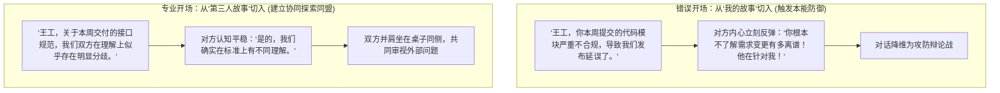
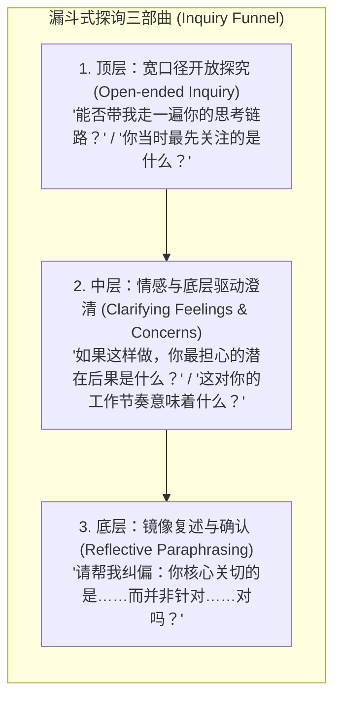
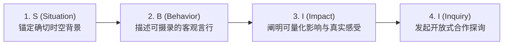
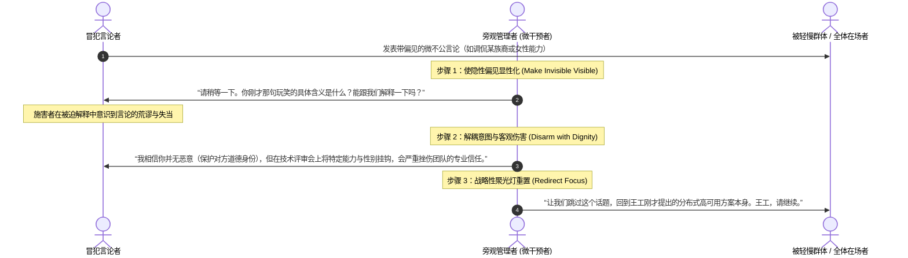

# Lec 6 职场发声实战工具箱：开场、探询、向上发声与微干预 (The Speaking Up Action Toolkit)

> MIT Sloan 15.288 · Tough Conversations · 艰难对话

## TL;DR

- 艰难对话的成败往往由前 30 秒决定；运用“第三人故事（The Third Story）”中立开场，能够彻底规避防御陷阱并建立双向探究同盟。
- 践行“探询优于主张”的沟通哲学，通过漏斗式提问与镜像复述，在不放弃自身立场的前提下充分听懂对方的世界模型。
- 抛弃虚伪的“三明治反馈法”，全面拥抱清晰有力的改进版“SBI-I 模型”（情境-行为-影响-探询）。
- 目睹职场微不公与偏见言行时，熟练运用旁观者“微干预四步协议”，将隐蔽冒犯透明化，打破组织默许沉默。

## 第三人故事开场法（The Third Story Framework）

在 15.288 的模拟演练中，Kara Blackburn 反复强调：**绝大多数艰难对话之所以在开场 30 秒内就走向崩溃，是因为发起者习惯性地从“自身的故事（My Story）”切入**。

::: definition 第三人故事 (The Third Story)
指站在一个完全中立、客观且没有利益冲突的第三方观察者（例如敏锐且具共情力的法官或外部顾问）的视角，来描述当前存在的争议或状态。第三人故事的核心原则是：**用双方都能毫无异议接受的客观事实，来定义彼此之间存在着“不同的认知与期望”**。
:::

### 第三人故事的三步落地脚本

1. **描述分歧本身，而非评价某方是非**：用“我们对于……持有不同的看法/期望”作为起点；
2. **坦承自身视角与感受的局限性**：明确表明自己并不掌握全部上下文；
3. **发出平等真诚的探究邀请**：“我想了解你的考量，同时也想把我的顾虑向你说明，看看我们能否找到合力点”。

::: example 第三人故事开场实战范例
- **场景**：下属小张未经批准擅自修改了客户汇报方案，导致主管感到权威受损。
- ❌ **“我的故事”开场**：“小张，你为什么私自改动方案？你眼里还有没有团队纪律？”
- ✅ **“第三人故事”开场**：“小张，关于昨天发给客户的方案版本，我们显然在‘修改权限的审批边界’以及‘应对客户紧急诉求的自主裁量权’上，存在着不同的理解。我知道你当时面临客户的催促，而我这边在把控整体战略连贯性。我想和你花二十分钟对齐一下各自的考虑，一起明确后续类似情境的协同机制。”
:::

## 探询优于主张：积极倾听与漏斗式提问

在艰难对话中，初级管理者往往陷入“拼命表达、反复解释、试图让对方听懂”的误区。然而，**倾听才是对话中最具威慑力与转化力的战略武器**。

::: theorem 倾听的非赞同定理
在冲突沟通中，“倾听并复述对方的观点”，绝不等于“同意或赞同对方的立场”。倾听的唯一目的是向对方传递一个关键信号：**“我完整接收到了你的信息与感受，在你的世界模型里，你的反应是真实的。”**只有当对方确认自己已被充分听见，其防御机能才会解除，从而腾出认知带宽来倾听你的主张。
:::

::: pitfall 伪装成问题的隐蔽攻击
管理者常把指责包装在问句中，例如：“你当时难道就没想到系统会崩溃吗？”、“你觉得这样做合适吗？”。这种修辞性问句（Rhetorical Questions）实质是带有道德优越感的审判。真正的探询问题，答案必须是未知的，且发问者发自内心地抱有好奇心。
:::

## 结构化反馈：升级版 SBI-I 模型

许多企业推崇所谓的“三明治反馈法（Sandwich Technique）”——先夸两句，再提批评，最后再鼓励两句。在 15.288 课堂上，这一技巧被彻底批判：它虚伪、不可信，并且下属在听到第一句赞美时就已经在精神紧绷地等待“那个但是（But）”的降临。

取而代之的是高度客观、透明且极具赋能性的 **SBI-I 模型**：

| 阶段 | 核心任务与话术规则 | 实战示范表达 |
|---|---|---|
| **S (情境)** | 明确具体时间、地点与会议，不使用模糊的概括词（如“你总是……”、“你经常……”） | “在今天上午 10 点的技术评审会上……” |
| **B (行为)** | 严格局限于外部摄像机能够记录的客观动作，禁止使用任何形容词或意图评价 | “……当李工汇报架构图时，你打断了他四次，并在他解释时翻看了手机。” |
| **I (影响)** | 诚实陈述该行为对团队、业务及自身造成的客观结果与心理体验 | “……这导致李工后半段的核心风险提示没有机会说完，同时让我感到我们团队内部缺乏对技术同行的基本尊重。” |
| **I (探询)** | 立即交出话语权，探询对方当时的背景与考量 | “……我想停下来听听你当时的考虑：是当时有哪些信息让你觉得需要立即打断吗？” |

## 旁观者微干预（Micro-interventions）协议

在涉及种族、性别或社会身份的微不公（Micro-inequities）发生时，最普遍的悲剧是**旁观者集体失语（The Bystander Silence）**。心理学中的“旁观者效应”在组织中表现为一种群体麻木：当不当言论或歧视性玩笑出现时，每个人都在暗中观察他人的反应，而沉默往往被现场所有在场者解读为“默许与认可”。事后调查显示，绝大多数在场者并非认同该言论，而是陷入了“我不知道该如何既指出错误、又不引发毁灭性对抗”的战术无助。

为了打破这种集体沉默，哥伦比亚大学 Derald Wing Sue 教授与 MIT 监察专员 Mary Rowe 联合提炼出了实战**微干预四步协议（Micro-interventions Protocol）**。微干预不是一场道德大批判，而是一组经过精密设计的外科手术式语言程序，其目标是在保护所有人基本尊严的前提下，迅速恢复现场的专业秩序：

1. **使隐性偏见显性化（Make the Invisible Visible）**：利用中立提问剥开言论外壳，迫使潜意识偏见暴露在理性审视之下；
2. **解除武装并解耦意图（Disarm the Statement）**：肯定对方可能并无主观恶意，但严肃指出该言论产生的客观不良影响；
3. **重置聚光灯（Redirect Focus）**：果断终止偏见话题的发酵，将团队注意力重新引向专业议程；
4. **会后跟进与同盟支持（Post-incident Follow-up）**：会后单独与被轻慢的成员沟通，提供情感支持与肯定，同时与发言者进行非防御性的闭门辅导。

微干预的关键，在于**即时性与非防御性**。越早介入，制止毒性蔓延的成本就越低；越能将焦点锚定在行为而非人格，对方的心理防御就越弱。管理者如果在现场保持沉默，就等于在团队中盖章认证了某种轻慢文化的合法性；而果断而有策略的微干预，正是管理者树立心理安全感与道德领导力最关键的微观试金石。

## 艰难对话全流程行动清单与复盘矩阵

为帮助管理者系统复刻 15.288 的核心作业训练，特制备以下行动自查清单与复盘矩阵：

### 1. 战前准备清单 (Pre-Conversation Checklist)

- [ ] **意图与影响解耦**：我是否在未获证据前，就假定了对方是出于恶意或懒惰？
- [ ] **自我贡献梳理**：我自身在这场困局中做了什么（或沉默了什么），促成了现状？
- [ ] **身份锚定落地**：如果对方在对话中质疑我的能力或人品，我能否保持冷静而不崩溃？
- [ ] **第三人故事开场**：我的第一句话能否让一个中立观察者心悦诚服地认同？

### 2. 战后复盘矩阵 (Debrief & Reflection Matrix)

| 评估维度 | 核心自问与反思指标 | 自身得分 (1-5) | 后续改进承诺 |
|---|---|---|---|
| **情绪掌控度** | 我是否出现了心跳加速、插话辩白的生理劫持？是否成功“去了阳台”？ | | |
| **探询主张比** | 整场对话中，我倾听与提问的时间是否超过了 50%？ | | |
| **身份保护度** | 我是否守住了对方的自尊，没有在言语中进行道德审判？ | | |
| **协议清晰度** | 双方是否针对未来建立了具备可验证指标的行动承诺？ | | |

::: insight 艰难对话是终身打磨的肌肉记忆
没有人在离开课堂的那一刻就能成为冲突大师。每一次心跳加速的犹豫，每一个想咽回肚子的发声契机，都是神经回路重塑的微观战场。勇于发声（Speaking Up）的意义，不仅在于解决眼前的一个 Bug 或争取一次绩效公道，更在于向整个系统宣告：**你是一个具有完全道德自主权与专业尊严的合作者**。这种力量，正是卓越领导力的真正源泉。
:::
