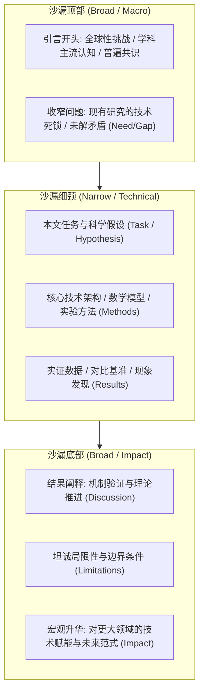
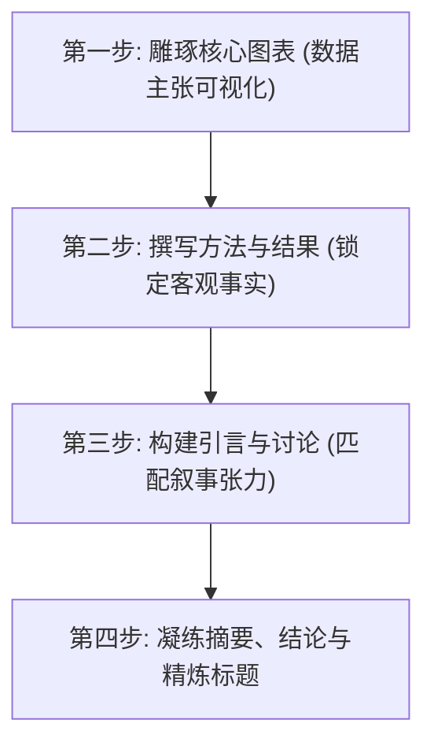
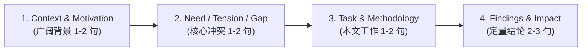

# Lec 1 学术沟通战略与论文叙事架构（Academic Communication Strategy and Paper Structure）

> **授课教师**：Prof. JoAnne Yates（MIT Sloan） ｜ **内容来源**：MIT Comm Lab CommKit  
> **核心附件**：[Paper-writing-checklist.pdf](./attachments/Paper-writing-checklist.pdf)（MIT 论文自查清单）

## TL;DR

- 顶级学术论文的本质不是实验日志的机械陈列，而是引导受众从已知走向未知的高密度结构化叙事。
- 经典“沙漏模型（Hourglass Model）”要求论文以宽广学科背景破题，收窄聚焦于技术机理与实验推导，最终重返宏观理论与工程影响。
- 写作顺序存在显著的反直觉规律：最科学的高效写作次序是“核心图表 $\to$ 方法与结果 $\to$ 引言与讨论 $\to$ 摘要与标题”。
- 规范摘要（Abstract）必须严格闭环四大要素：宏观背景、核心矛盾/知识缺口、本文方案与定量结论/学术影响。

## 学术写作的第一性原理：受众、目的与知识诅咒

在开始落笔撰写学术论文之前，多数研究者常犯的致命错误是将论文视为个人研究工作的“日记（Laboratory Diary）”。麻省理工学院沟通实验室（MIT Comm Lab）开宗明义地指出：**学术论文是一种说服性文体（Persuasive Writing），其唯一目标是在同行评审与读者心中建立坚实的科学可信度（Credibility）并促成知识采纳**。

### 破解“知识诅咒（The Curse of Knowledge）”

认知心理学研究表明，一旦人们深入掌握了某一领域的专门知识，就极难想象“缺乏这些背景知识的人是如何思考的”。这种认知偏差被称为“知识诅咒”：
- **作者视角**：耗费两年调试通过的代码、筛选出的 50 组超参数、排除掉的 30 种错误方案，在作者脑海中历历在目；
- **审稿人与读者视角**：评审人平均只有 30~60 分钟审阅一篇投稿，读者通常只在 Google Scholar 检索关键词后匆匆浏览摘要与图表。

为了打破这一屏障，学术写作必须从“自我中心式输出”彻底切换为“受众中心式设计”。作者必须在正文第一句话之前明确三大前置问题：
1. **谁是我的核心读者（Target Audience）**？（是同子领域的 10 位专家、整个系所的大同行、还是具备交叉背景的工业界工程师？）
2. **本研究的唯一核心主张（Core Takeaway / Message）是什么**？（如果读者读完全文只能记住一句话，那句话是什么？）
3. **为什么现在需要解决这一问题（Urgency & Significance）**？

::: definition 知识诅咒（The Curse of Knowledge）
一种认知偏差，指沟通者在与他人交流时，不自觉地假定对方拥有与自己完全相同的背景信息、专业知识和上下文语境，从而省略关键逻辑前提与定义，导致信息接收方产生严重的理解障碍。
:::

## 论文宏观叙事模型：经典“沙漏架构（Hourglass Structure）”

自然科学与工程技术领域的顶级期刊与会议论文（如 Nature、Science、IEEE/ACM 汇刊）普遍遵循一套高度收敛的叙事拓扑——**沙漏架构（Hourglass Model）**。

### 沙漏架构的三阶段能量转换

1. **从宏观到微观（Zooming In）**：论文从全行业共同关心的重大科学挑战或工程痛点出发，逐步剥洋葱式地收窄焦点，直到精确锚定一个目前尚未被完全解决的具体微观缺口（Research Gap）；
2. **极致严谨的技术细颈（The Narrow Waist）**：在方法与结果部分，论文进入高度专业化的垂直深度。此时应屏蔽泛泛的宏观抒情，使用精确的数学定义、无歧义的算法伪代码、对照严格的实验基准（Baselines）与置信区间，为论断提供不可辩驳的硬核证据；
3. **从微观重返宏观（Zooming Out）**：在讨论与结论部分，视野重新放大。作者不能仅简单重复实验数字，而必须回答高阶问题：“这个具体技术突破对更广泛的计算机系统/经济机制/材料设计意味着什么？它能否推翻过去的传统假设？”

::: insight 深入见解：沙漏为什么能够说服评审人？
审稿人通常由一名该细分方向的“小同行”与两名大领域的“大同行”组合而成。  
沙漏顶部的宏观背景是大同行赖以评估论文**重要性（Significance）**的依据；中间的细颈是小同行用于检验**技术正确性（Soundness & Rigor）**的战场；底部的宏观升华则决定了论文能否被顶刊顶会评为具有**广泛学术影响力（Broad Impact）**。缺失顶部的论文会被拒为“增量微小的小修小补”，缺失底部的论文会被批为“仅具有工程调参价值的局部技巧”。
:::

## 科学写作反直觉规律：最有效率的写作次序

几乎所有学术新手都会按照阅读次序来撰写论文：先写标题和摘要，再写引言，最后写结果。MIT Comm Lab 指出，**按阅读次序写作是导致论文反复难产、结构断裂的元凶**。

最科学、最具工程迭代效率的写作次序如下表所示：

| 推荐步骤 | 撰写模块 | 核心工作内容 | 认知决策目标 |
|:---:|---|---|---|
| **Step 1** | **核心图表与数据表（Figures & Tables）** | 整理所有最终实验数据，绘制高精度自明性图表 | 确立论文的核心事实支撑点；图表是全文骨架 |
| **Step 2** | **方法与结果（Methods & Results）** | 撰写实验设置、算法定义、对照组表现与数据解读 | 记录客观技术事实，这一部分最不易受叙事偏差影响 |
| **Step 3** | **引言与讨论（Intro & Discussion）** | 搭建前后的问题漏斗，提出矛盾并升华结果理论意义 | 根据已确立的真实结果，反向推导最匹配的科学故事线 |
| **Step 4** | **结论、摘要与标题（Conclusion, Abstract & Title）** | 凝练 200 字摘要，萃取最抓人眼球的学术贡献 | 全文定稿后的极度浓缩，确保摘要主张与正文事实 100% 严丝合缝 |

::: pitfall 写作陷阱：先写引言导致的故事脱节
在科研攻关过程中，最终实验结果往往与最初设想的假说存在偏差。若先写完引言，作者往往会潜意识地“强行削足适履”，试图让数据去迎合过时的叙事设想，或者在引言中许下了宏大诺言却在结果中无法兑现。先确立图表与结果，才能保证引言提出的“问题”被后文的方法“精准击中”。
:::

## 摘要（Abstract）的四部曲解构与写作模版

摘要是绝大多数读者和审稿人决定是否精读全文、甚至是否直接给初审分数的“门面”。一个标准的 150~250 词学术摘要必须包含且仅包含以下四个逻辑组件：

### 摘要四大组件解析表

| 序号 | 模块名称 | 解决的核心疑问 | 典型引导词与句式 |
|:---:|---|---|---|
| **1** | **广阔背景与动机（Context）** | 该领域为何至关重要？社会/学术共识是什么？ | *"Recent advances in [field] have enabled..."* ｜ *"[Topic] is critical for..."* |
| **2** | **核心需求与矛盾（Need / Gap）** | 现有方法面临什么阻碍？为什么过去方案失效？ | *"However, existing approaches suffer from..."* ｜ *"Despite this success, it remains challenging to..."* |
| **3** | **本文任务与方案（Task & Method）** | 本文提出了什么新原理、系统或算法？ | *"Here, we propose [System Name], a novel framework that..."* ｜ *"To address this limitation, we develop..."* |
| **4** | **定量结论与影响（Findings & Impact）** | 取得了何种量化突破？带来了什么深远影响？ | *"Empirical evaluations show a [X]% speedup over baseline..."* ｜ *"These results demonstrate that..."* |

::: example 顶会高水平论文摘要四步剖析
**[Context]** 分布式深度学习系统依赖参数服务器在大量计算节点间高频同步梯度。  
**[Need]** 然而，随着模型规模突破千亿参数，节点间的网络带宽摩擦成为吞吐量的首要瓶颈，现有梯度压缩算法在大规模并行时普遍遭受严重的精度发散。  
**[Task]** 本文提出了 `Aether`，一种结合动量自适应量化与非对称拓扑感知的稀疏通信协议，在数学上证明了其非凸优化环境下的收敛上界。  
**[Findings & Impact]** 在包含 256 块 GPU 的跨机房集群基准测试中，`Aether` 在保持模型精度损失低于 0.1% 的同时，将网络通信开销削减了 84%，端到端训练吞吐量提升了 2.7 倍，为超大模型在异构网络环境下的经济化训练提供了新范式。
:::

## 论文全生命周期质量自查清单（Checklist）

在将手稿提交同行评审之前，建议作者对照 MIT Comm Lab 提供的官方自查标准逐项核验：

- [ ] **题目（Title）**：是否包含研究领域、核心方法与最具区分度的创新特性？是否剔除了 *"A Novel Approach to..."* 等无意义废话？
- [ ] **摘要（Abstract）**：是否能在没有正文支持的情况下完全被独立理解？四大要素（背景、矛盾、方案、量化战果）是否齐全？
- [ ] **引言最后一段**：是否有明确的主张型清单，总结本文的 3~4 项核心科学贡献？
- [ ] **图表独立性（Self-Contained）**：一个读者在只看图表和 Caption 的情况下，能否掌握本研究 80% 的核心结论？
- [ ] **相关工作（Related Work）**：是否做到尊重同行？是客观阐述其他方案的适用边界，还是情绪化贬低先前研究？
- [ ] **可复现性（Reproducibility）**：实验软硬件环境、数据集划分、超参数设定与统计显著性检验是否详尽交代？
- [ ] **格式规范**：详细对照配套参考附件 [Paper-writing-checklist.pdf](./attachments/Paper-writing-checklist.pdf) 完成格式与文风终审。
