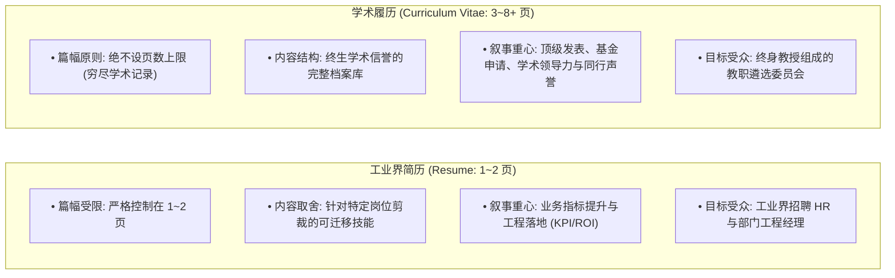
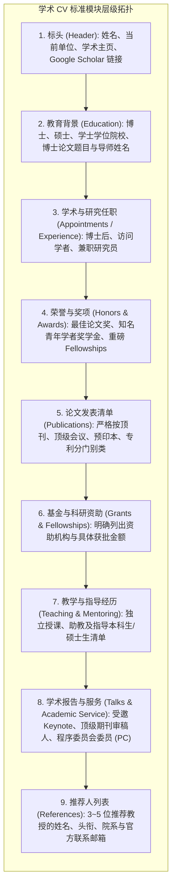
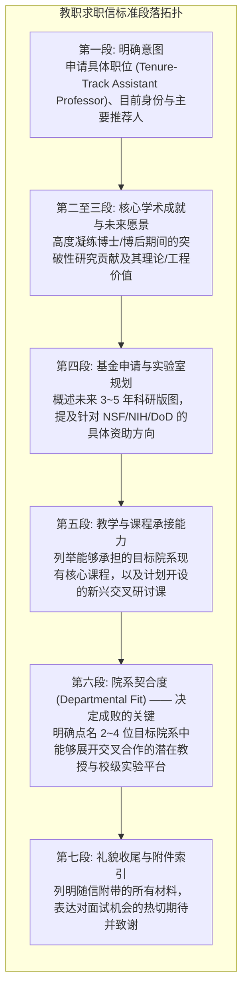

# Lec 10 学术履历（CV）与教职求职信精要（Academic CV vs. Resume and Faculty Cover Letter）

> **授课教师**：Prof. JoAnne Yates（MIT Sloan） ｜ **内容来源**：MIT Comm Lab CommKit 与 MIT CAPD  
> **核心附件**：[Arvind-Satyanarayan-CV-Annotated.pdf](./attachments/Arvind-Satyanarayan-CV-Annotated.pdf) ｜ [Malte-Schwarzkopf-CV-Annotated.pdf](./attachments/Malte-Schwarzkopf-CV-Annotated.pdf) ｜ [EE-faculty-cover-letter-annotated.pdf](./attachments/EE-faculty-cover-letter-annotated.pdf) ｜ [resume-action-verbs.pdf](./attachments/resume-action-verbs.pdf)

## TL;DR

- 学术履历（CV）与业界简历（Resume）存在本质鸿沟：业界简历是 1~2 页精选技能成果清单，学术 CV 则是无页数上限、忠实记录全部学术成就的“学术生涯全景录”。
- 规范学术 CV 遵循严格的逆时间顺序与模块层级：个人信息 $\to$ 教育背景 $\to$ 顶刊顶会发表清单（必须区分第一作者与同行评审级别） $\to$ 获奖资助 $\to$ 教学经历 $\to$ 推荐人。
- 善用 MIT 官方强动词库（Action Verbs），用量化数字与高冲击力词汇替换“负责……”等平庸句式。
- 教职求职信（Faculty Cover Letter）是整个求职包的“执行摘要（Executive Summary）”，必须在 1.5~2 页内精准阐述学术愿景，并明确点出目标院系的合作契合点（Departmental Fit）。

## CV 与 Resume 的本质分流：学术界与工业界的不同法则

在博士毕业求职季节，许多研究生常犯的灾难性错误是：直接将应聘 Google 或麦肯锡的 1 页 Resume，稍作修改投递给名校教职招聘委员会（Faculty Search Committee）；或者将长达 6 页的学术 CV 投递给工业界 HR。

麻省理工学院职业发展中心（MIT CAPD）与 Comm Lab 明确界定了两者的核心分野：

在教职评审委员会眼中，CV（Curriculum Vitae，拉丁语意为“生涯的航程”）是评判候选人学术深度的骨架。任何对论文发表的隐瞒、删减或合并，都会被委员会视作缺乏自信或学术不诚实。

::: definition 学术履历（Curriculum Vitae, CV）
一份全面、详尽且按严格学术规范编排的官方学术资历档案，用于求聘高校教职、博士后、评定终身教职及申报重大学术奖项。它详尽记录学者毕生的受教育历史、发表记录、研究基金、教学经历、受邀学术报告及共同体服务。
:::

## 顶尖学者 CV 的经典模块解剖学

参考 MIT 助理教授 Arvind Satyanarayan 与 Brown 大学助理教授 Malte Schwarzkopf 的真实求职简历，一份无可挑剔的学术 CV 必须遵循以下模块次序：

### 撰写学术 CV 的五大黄金铁律

1. **发表清单的分类与高亮规则**：
   - 严禁将顶级同行评审期刊（Refereed Journals）、旗舰会议（Refereed Conferences）与未经同行评审的 arXiv 预印本、自费工作坊摘要混杂在一起；
   - 必须设立清晰的二级标题分别罗列；
   - 在所有作者名单中，**将自己的姓名用粗体加下划线显式高亮**；若属于共同一作（Co-first authors），必须在文末用星号 `*` 明确注明 *"Authors contributed equally"*；
2. **格式与排版的一致性（Consistency）**：
   - 全文日期格式（如 `Sep 2024` 或 `09/2024`）、期刊简称斜体规则、字号与段落间距必须通篇像素级一致；
   - 避免花哨的多栏排版，采用单栏流式布局，保证无论在任何 PDF 阅读器中打印均无乱码或排版错位；
3. **善用 MIT CAPD 官方强动词库**：
   - 描述科研项目与领导经历时，坚决弃用平庸的 *"Worked on..."*、*"Helped with..."*；
   - 查阅配套附件 [resume-action-verbs.pdf](./attachments/resume-action-verbs.pdf)，采用高阶动词：
     - **创新类**：*Conceptualized, Formulated, Engineered, Synthesized*；
     - **量化类**：*Accelerated, Slashed, Maximized, Optimized*；
     - **领导类**：*Orchestrated, Headed, Mentored, Spearheaded*。

## 教职求职信（Faculty Cover Letter）：打开申请包的钥匙

如果说 CV 是骨架，那么教职求职信（Cover Letter）就是整套求职材料的**灵魂向导（The Executive Summary and Roadmap）**。招聘委员会主席在初筛数百份申请时，通常只花 2 分钟阅读 Cover Letter，以此决定是否有必要深入查阅厚达 40 页的完整申报材料。

### 求职信的篇幅与核心结构

求职信长度必须严格控制在 **1.5 至 2 页之间**（采用学校官方信头抬头抬头，如 MIT Department Letterhead，行距 1.15，底部带有正式手写电子签名）。短于 1 页显得诚意不足，长于 2.5 页则会因冗长而被疲惫的委员会成员直接忽略。在视觉排版上，必须维持边距在 1 英寸左右，段落之间空一行，行文语气必须兼具学术自信与严谨自持，体现出准助理教授的成熟姿态。

求职信不是简单地将 CV 改写成流水账散文，而是以最高密度的笔墨串联起过去、现在与未来的学术逻辑弧线。每一段落都承担着明确的战略职能：首先开门见山确认申请岗位，接着展示最具含金量的代表性科研突破，随后展现未来开辟独立实验室的蓝图与争取国家级重大科研资助的现实规划，紧接着陈述本科生与研究生核心课程教学担当，最终落在深度量身定制的院系跨学科协同契合度上。

这种紧凑而有张力的结构能够确保即便评委只有一分钟时间快速扫读，也能按照标准的视觉动线迅速抓取申请人的核心亮点与竞争壁垒。同时，申请人必须确保信中所提及的所有未来设想，均在后续的研究陈述与教学陈述中有翔实的论证支撑，形成前后咬合的严密证据链。

### 致命误区：千篇一律的模板海投（Generic Cover Letter）

招聘委员会的教授们一眼就能看出一封求职信是否是群发的无脑模板：

::: pitfall 致命陷阱：缺乏深度定制的假契合
很多申请人在求职信末尾只机械地替换了校名：*"I would love to join University X because of its great students and excellent faculty."*  
这种空洞的套话会被委员会直接扔进碎纸机。优秀的申请人必须深入研读目标院系的主页、了解其近三年的重大研究战略规划，并精准阐明协同效应：  
> *"My research in non-convex optimization perfectly bridges the theoretical expertise of Prof. Alice in your Operations Research group with the clinical imaging applications spearheaded by Prof. Bob at the Medical School."*
:::

## 真实教职申请档案深度对照精读

在配套归档的附件库中，收录了三份极具含金量的麻省理工学院真实教职申请材料：
1. [Arvind-Satyanarayan-CV-Annotated.pdf](./attachments/Arvind-Satyanarayan-CV-Annotated.pdf)：展示了顶级人机交互与数据可视化学者如何将数百项成果、开源工具与受邀学术演讲组织得井井有条，重点研读其在获奖项与出版物分类上的精妙排版；
2. [Malte-Schwarzkopf-CV-Annotated.pdf](./attachments/Malte-Schwarzkopf-CV-Annotated.pdf)：分布式系统方向青年学者的 CV 典范，展示了系统工程类成果（如大型开源系统、Linux 内核补丁与工业界部署案例）如何转化为顶尖学术资本；
3. [EE-faculty-cover-letter-annotated.pdf](./attachments/EE-faculty-cover-letter-annotated.pdf)：由 MIT Comm Lab 资深导师全文批注的工程教职求职信，高亮标出了各段落如何实现向目标院系抛出“投名状”与展示“不可替代独特价值”。

## 我的理解：求职信是一份面向未来同事的合作邀约

::: insight 深入见解：招聘委员会不是在招“超级学生”，而是在招“未来三十年的同事”
许多博士生在写求职信时，依然把自己定位为一个向老师汇报成绩的“学生（Student）”，通篇充斥着渴望获得指导的稚气。  
然而，Tenure-Track 助理教授的招聘本质是**平等的合伙人招募**。系里看重的是：你是否具备独立获取数百万科研基金并维持一个 10 人课题组运转的企业家精神？你来到系里后能否为现存学科短板遮风挡雨？你开设的课程能否为系里带来充沛的生源与口碑？  
在求职信中展现出从容不迫的学术独立性、清晰的学术建制视野以及对目标院系未来发展的建设性担当，是打动资深教授委员会的最强心力。
:::
