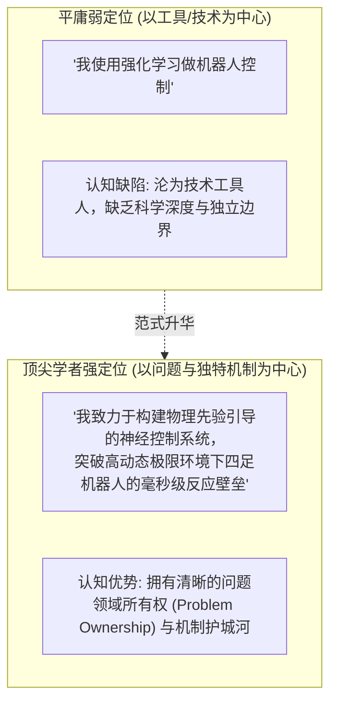
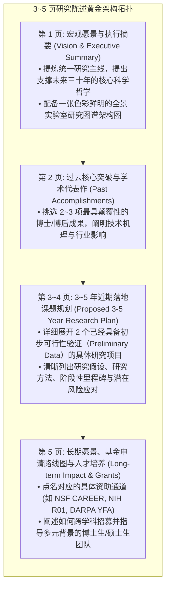
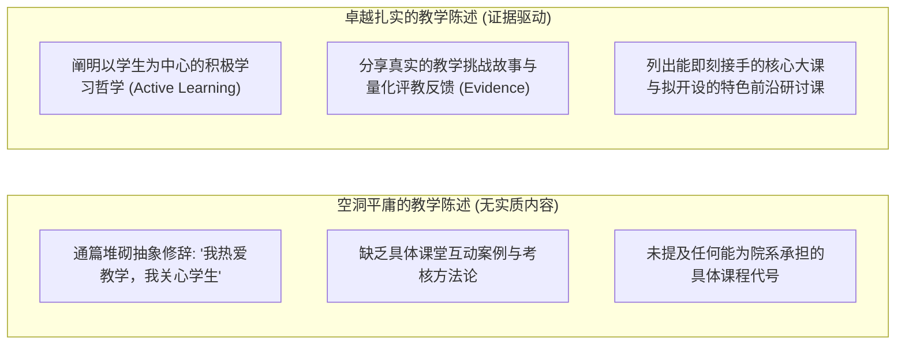

# Lec 11 研究陈述、教学陈述与个人学术定位（Research Statement, Teaching Statement, and Personal Branding）

> **授课教师**：Prof. JoAnne Yates（MIT Sloan） ｜ **内容来源**：MIT Comm Lab CommKit  
> **核心附件**：[Amy-Zhang-research-statement-annotated.pdf](./attachments/Amy-Zhang-research-statement-annotated.pdf) ｜ [Elena-Glassman-research-statement-annotated.pdf](./attachments/Elena-Glassman-research-statement-annotated.pdf) ｜ [Mike-Carbin-teaching-statement-annotated.pdf](./attachments/Mike-Carbin-teaching-statement-annotated.pdf) ｜ [Teaching-Statement-annotated-example-1.pdf](./attachments/Teaching-Statement-annotated-example-1.pdf) ｜ [Tej-Chajed-Branding-Statement.pdf](./attachments/Tej-Chajed-Branding-Statement.pdf)

## TL;DR

- 研究陈述（Research Statement）绝非博士论文工作总结，而是向招聘委员会呈递的“未来独立实验室商业计划书（Business Plan）”。
- 规范研究陈述严格遵循“宏观研究愿景（1 页） $\to$ 过往代表性突破（1 页） $\to$ 3~5 年近期资助课题蓝图（2 页） $\to$ 10 年远景与基金申请策略（1 页）”的标准架构。
- 教学陈述（Teaching Statement）必须平衡“教学哲学理念”与“具体课程落地能力”，明确给出能够即刻接手的院系既有核心课与拟自主开设的特色研讨课清单。
- 个人学术品牌（Personal Branding）要求学者摆脱“技术工具使用者”的被动身份，将自身锚定为“运用独创方法论解决特定重大科学命题”的学科引军者。

## 个人学术品牌（Personal Branding）：确立唯一的学术身份锚点

在教职评审委员会的案头上，往往堆积着来自全球顶尖名校的数百份博士后简历。招聘教授们在关上会议室大门闭门研讨时，每个人只有一句话的时间向同事推荐候选人：*“那个做深度学习的候选人”* 毫无辨识度；而 *“那个通过神经符号推理彻底解决分布式系统死锁验证的年轻学者”* 则会瞬间被所有人牢记。

MIT Comm Lab 与 15.289 强调，打造个人学术品牌（Personal Branding）的第一步，是撰写一份高度精炼的**学者定位陈述（Branding Statement）**。

参考威斯康星麦迪逊大学助理教授 Tej Chajed 的真实定位范例 [Tej-Chajed-Branding-Statement.pdf](./attachments/Tej-Chajed-Branding-Statement.pdf)，一份成熟的学术品牌必须清晰回答三个问题：
1. **你的核心战场是什么（Your Problem Domain）**？
2. **你的标志性独特方法论是什么（Your Signature Approach）**？
3. **你的工作将如何重新定义该领域的技术范式（Your Long-term Vision）**？

::: definition 学者个人品牌（Academic Branding）
学者在学术共同体内形成的、具有高度区分度的专业认知资产。它将学者的名字与某一重大科学问题或独创方法论深度绑定，使同行在提及该领域的前沿挑战时，首选联想到该学者的理论机制与技术主张。
:::

## 研究陈述（Research Statement）：未来实验室的商业计划书

在完整的教职申请包中，研究陈述（通常为 3~5 页）是决定终身教授们是否给你发出飞赴现场面试邀请（On-site Flyout）的最硬核文件。

评委们在审阅研究陈述时的首要考量是：**这位申请人是否已经完全脱离了博士导师的阴影，是否具备独立定义前沿科研课题、组建实验室并持续斩获重大国家级科研基金的战略眼光？**

### 撰写研究陈述的四大战略准则

1. **第一页必须包含一张高质量的“全景实验室愿景图（Vision Graphic）”**：  
   正如华盛顿大学 Amy Zhang 在其真实陈述 [Amy-Zhang-research-statement-annotated.pdf](./attachments/Amy-Zhang-research-statement-annotated.pdf) 中所示，一张居中放置的结构框图，直观展现了底层核心理论如何向上支撑三大并行的应用课题支柱，使评委在 30 秒内俯瞰其未来 5 年的完整蓝图；
2. **明确区分“过去成果”与“未来计划”**：  
   很多初学者的研究陈述有 80% 的篇幅都在复述博士论文。这是致命错误！**过去的工作最多只能占 1~1.5 页，其余 60%~70% 的篇幅必须完全属于未来**；
3. **近期课题必须具备初步可行性（Feasibility & Preliminary Data）**：  
   3~5 年规划绝不能是虚无缥缈的科幻畅想。必须给出作者已经开展的前期概念验证实验、小规模跑分或理论引理，向评委证明“一旦我的实验室开张，博士生到位，该项目在 6 个月内就能产出第一批顶级论文”；
4. **务实的科研基金规划（Funding Roadmap）**：  
   必须具体点名国家级资助计划的具体专项名称（例如：NSF CISE Directorate 的哪个 Program、NIH 的哪个研究组）。这向委员会展示你深谙学术资金运转的残酷现实。

## 教学陈述（Teaching Statement）：教学哲学与课程落地

在研究型大学中，很多申请者对教学陈述（Teaching Statement / Philosophy，通常为 1.5~2 页）敷衍了事，随意抄袭网上的空洞套话。殊不知，在教职遴选的第二轮评议中，**教学陈述往往是决定两名科研实力相当的候选人谁能最终拿到 Offer 的关键胜负手**。

### 教学陈述的核心模块编排

参考 MIT 教授 Mike Carbin 的优秀示范 [Mike-Carbin-teaching-statement-annotated.pdf](./attachments/Mike-Carbin-teaching-statement-annotated.pdf) 以及样板 [Teaching-Statement-annotated-example-1.pdf](./attachments/Teaching-Statement-annotated-example-1.pdf)：

1. **第一部分：核心教学哲学（Teaching Philosophy）**  
   阐明你信奉的教学理念（如建构主义学习观、基于项目的探究式教学 Project-Based Learning），并具体描述你在课堂上如何落实该理念（例如：如何在 50 人的大班中通过实时投票系统打破单向讲授）；
2. **第二部分：实证教学经验与反思（Teaching Experience & Reflection）**  
   讲述一个真实的教学故事：你在担任助教或导师期间，面对一名在某个概念上严重卡壳的学生，你如何设计启发性问题帮助他跨越思维障碍；列出量化的历史评教得分（如 4.8/5.0）或学生的匿名正面评价引用；
3. **第三部分：课程承担承诺（Course Offerings Checklist）——委员会最关心的务实板块**：
   - **现有基础核心课（Ready to Teach Immediately）**：明确列出目标大学课程代码（如 *“I am fully prepared to teach CS 101 Introduction to Programming, CS 350 Operating Systems, or ECE 420 Distributed Computing”*）；
   - **拟创设前沿研讨课（New Courses to Develop）**：提出一门结合自身最新科研前沿的跨学科研究生高阶研讨课大纲，阐明其对吸引优秀博士生源的独特价值；
4. **第四部分：多元包容性与个性化指导（Mentoring & Inclusion）**  
   说明你如何指导来自不同文化、种族与学术背景的本科生与弱势群体进入科研之门。

## 真实名校教职申请陈述范本精读

在本讲归档的真实附件中，包含了全球顶级学府工程教职申请的标杆范例：
- [Amy-Zhang-research-statement-annotated.pdf](./attachments/Amy-Zhang-research-statement-annotated.pdf)：人机协作与社会化计算领域的研究陈述巅峰之作，展示了如何将复杂的人文社会科学关怀与硬核算法工程天衣无缝地交织在同一份愿景中；
- [Elena-Glassman-research-statement-annotated.pdf](./attachments/Elena-Glassman-research-statement-annotated.pdf)：哈佛大学助理教授的跨学科研究陈述，展示了跨学科学者如何向传统计算机系委员会严谨证明自己研究的不可替代性；
- [Mike-Carbin-teaching-statement-annotated.pdf](./attachments/Mike-Carbin-teaching-statement-annotated.pdf)：MIT 教授在教学陈述中展示了如何将硬核的形式化程序验证（Formal Verification）教学设计为循序渐进的启发式探究实验。

## 我的理解：陈述是学术人格的立体投影

::: insight 深入见解：在文字中流淌出学术领导力（Leadership）
青年学者在准备申请材料时，最容易犯的心态缺陷是“防御性自卑”：生怕自己某一句话不够学术，于是大量使用被动语态和晦涩词汇把自己包裹起来。  
然而，顶尖研究陈述与教学陈述在字里行间所流淌出的，是一种**极其笃定、从容且充满激情的学术领导力**。你是在向未来的同事们描绘一幅他们未曾看见但极其壮丽的科学图景。当评委读完你的材料，心中升起的不是“这篇论文写得不错”，而是“我迫不及待地想看到这个年轻人加入我们系、把这个宏伟蓝图变成现实”时，你的申请就已经赢下了决定性的一局。
:::
