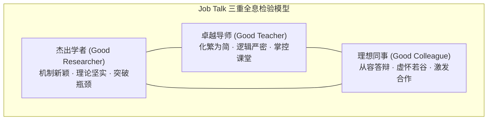
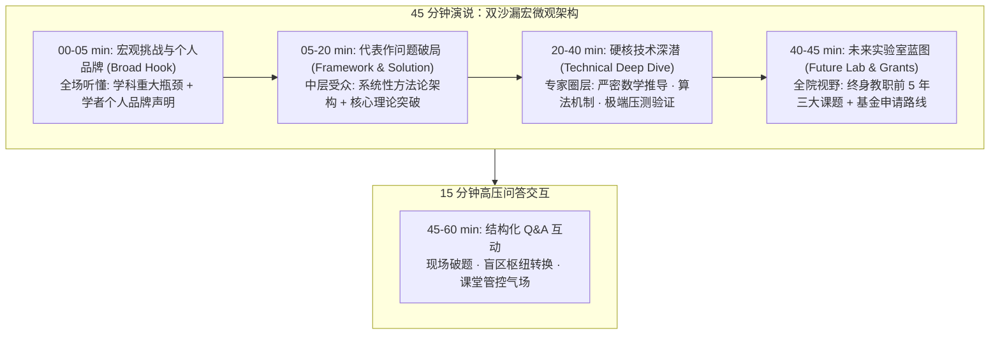
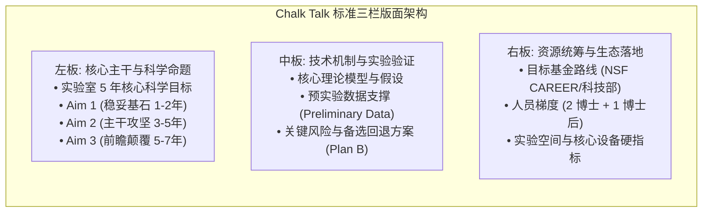

# Lec 12 教职求职演讲与学术面试全通关（Faculty Job Talk and Academic Interviewing Process）

> **授课教师**：Prof. JoAnne Yates（MIT Sloan） ｜ **内容来源**：MIT Comm Lab CommKit & OCW Session 10  
> **核心附件**：[EE-faculty-cover-letter-annotated.pdf](./attachments/EE-faculty-cover-letter-annotated.pdf) ｜ [Arvind-Satyanarayan-CV-Annotated.pdf](./attachments/Arvind-Satyanarayan-CV-Annotated.pdf) ｜ [Amy-Zhang-research-statement-annotated.pdf](./attachments/Amy-Zhang-research-statement-annotated.pdf) ｜ [OCW_15289_Oral_Presentations.pdf](./attachments/OCW_15289_Oral_Presentations.pdf)

## TL;DR

- 教职求职演讲（Faculty Job Talk）是决定全天面试成败的最核心公开环节，其本质不是汇报博士论文，而是向全系证明你同时具备顶尖研究深度、引人入胜的教学表达与成熟谦和的未来同事风范。
- 45 分钟演说遵循“双沙漏时空架构”：前 5 分钟宏观科学痛点与个人品牌锚定，15 分钟代表作机制破局，20 分钟硬核技术深潜，5 分钟未来五年独立实验室规划与基金路线，预留 15 分钟高压问答。
- 白板演练（Chalk Talk）聚焦无幻灯片裸考，在黑板前临场推导未来五年三大科研项目的基金申请逻辑、博士生梯队配置与实验室核心设备预算。
- 全天候单对单面谈（1-on-1s）需根据系主任、资深教授、青年教职及研究生代表因人制宜切换沟通语境，全程展现学术独立性、合作诚意与充沛精力和职业素养。

## 教职演讲（Job Talk）的本质与三重评判维度

当候选人受邀参加校园现场面试（On-site Campus Visit）时，意味着其书面申请材料已通过同行网评，进入院系排名前 3~5 名的最终决选圈。在这个阶段，求职演讲（Job Talk）是全系唯一向所有教职员工、博士后及研究生完全公开的展示平台。

与学术会议口头报告（参见 [lec5.md](./lec5.md)）不同，Job Talk 的受众背景具有极大的异质性：台下既有本细分领域的世界级宗师，也有相近但不同方向的教授，更有完全不懂你具体方向的本科生与行政评委。

MIT Comm Lab 指出，聘用委员会通过 Job Talk 考察候选人的三大核心能力：
1. **杰出学者（Good Researcher）**：证明你解决的科学问题足够重大且极其艰难，你的创新范式具备长期统治力与前沿突破性；
2. **卓越教师（Good Teacher）**：证明你能将极度抽象晦涩的专业知识，深入浅出地解释给不同背景的学者与跨学科学生，具备承担全系核心课程教学的能力；
3. **理想同事（Good Colleague）**：在面对高压挑衅或尖锐质疑时，能够从容不迫地进行建设性探讨，展现未来三四十年作为系内同僚的合作潜质与亲和力。

::: definition 教职演讲（Faculty Job Talk）
候选人面向招聘院系全体师生所作的 45~60 分钟公开学术演讲。它系统呈现候选人过往最具代表性的开创性学术成果，展示其面向未来的独立科学愿景，并作为院系评估候选人研究深度、课堂教学水平、逻辑思辨能力与学术文化契合度的决定性考场。
:::

## 45 分钟双沙漏型演讲结构与时间控制

教职演讲绝不能超时。任何超时拖堂都会导致教授提前退场赶去上课、压缩问答时间，并在评委会心中留下“缺乏时间管理能力与课堂控制力”的致命印象。

MIT 官方推荐严格执行 **75% 时间法则**：在 1 小时的标准场地时段内，正式演说严格控制在 **45 分钟**，坚决预留 **15 分钟** 进行高压答辩（Q&A）。

### 1. 前 5 分钟：宏观引言与个人品牌定调（Broad Motivation & Brand）
- **抓取全场注意力**：用全学科共识的重大现实挑战或理论困境开场，杜绝从第一张幻灯片就开始堆砌公式与技术缩写；
- **个人学术品牌锚定**：明确声明自己的“学者定位（Branding Statement）”（参见 [lec11.md](./lec11.md)），清晰宣告：“我是致力于通过独创机制解决该重大瓶颈的学者”；
- **全场路线图导航**：给出一张全局路线图幻灯片，并在后续多段转折中反复作为章节导航（Outline slide）点亮当前位置。

### 2. 05~20 分钟：核心代表作框架与系统机制
- **由广入深**：聚焦 1~2 项代表作，严禁贪多罗列博士阶段的所有琐碎论文；
- **现有技术瓶颈对比（State of the Art vs. Your Innovation）**：用直观图表并排对比过往主流路线为何失效，你的全新机制为何能够突破物理或理论极限；
- **系统总览图（Architecture Overview）**：用清晰的自明性图表（参见 [lec4.md](./lec4.md)）阐明理论模型的输入、变换机制与预期输出。

### 3. 20~40 分钟：硬核技术深潜与极限验证（Technical Deep Dive）
- **折服领域专家**：这是展现学术厚度与硬核实力的关键 20 分钟。必须深入到具体的核心算法伪代码、关键引理推导或具有说服力的实验消融验证；
- **保持外行联结**：即使深入技术细节，每讲完一个子模块，必须用 1~2 句话总结其物理意义，确保非本细分领域的教授能把握其逻辑链条；
- **面对失败的诚实度**：客观展示系统的边界条件（Failure modes 与 Edge cases），体现严谨求实的科学态度。

### 4. 40~45 分钟：未来五年独立研究蓝图与基金路线（Future Work & Grants）
- **摆脱导师阴影**：彻底从“过去的执行者”转变为“未来的实验室主任（PI）”；
- **结构化课题规划**：具体规划 2~3 个相互支撑的独立科研方向（例如：近期 1~2 年可立即出成果的高胜率项目、中期 3~5 年攻坚重大突破的主干项目、远期 5~7 年高风险高回报前瞻项目）；
- **资助渠道落地**：点明拟申报的国家自然科学基金、科技部重点研发计划或 NSF CAREER、DARPA、工业界资助专项。

::: example 真实优秀 Job Talk 范式解构
MIT EECS 教授 Fadel Adib（无线感知与物联网先驱）在求职演讲中展现了卓越的架构艺术：
1. **宏观愿景**：开场 3 分钟用生动直观的视频展示“穿墙识人（See Through Walls）”的技术构想，瞬间点燃全场各专业教授的兴趣；
2. **前沿对比**：清晰绘制雷达系统与传统计算机视觉的极限对比图，点明高频信号在微弱生物体表反射中的信噪比物理困境；
3. **技术硬核**：深入深潜至微秒级飞行时间（ToF）逆滤波算法与呼吸心跳微动特征提取公式，折服现场信号处理专家；
4. **统一路线图**：贯穿全场使用统一的色彩与架构总图反复回溯，使所有听众始终清楚当前内容在宏观蓝图中的精确坐标。
:::

## 高压现场问答（Q&A）应对策略与心理防御机制

求职演讲的问答环节绝非演说的附带结语，而是考核未来同行智识交锋的真正试金石。

### 1. 结构化答辩四步协议（LISTEN 循环）
1. **全神贯注倾听（Listen with respect）**：绝不打断提问者，耐心听完最后一句，眼神保持诚恳接触；
2. **重述并拆解问题（Paraphrase & Dissect）**：向全场重述问题要点，确保后排听众知晓，并争取 3~5 秒思考时间（*“您问的核心是当环境信噪比降至 -10dB 时，该算法的收敛速度是否会指数级衰减，这是一个非常切中要害的工程极限问题……”*）；
3. **锚定核心机制回答（Address the mechanism）**：直奔核心机制，给出明确论据，不顾左右而言他；
4. **闭环确认（Confirm satisfaction）**：回答完毕后通过眼神或简短确认（*“请问这是否回答了您的疑问？”*）将主导权平稳交接。

### 2. 四大极限挑战场景应对脚本

| 挑战场景 | 现场诱因 | 心理陷阱 | 推荐应对脚本与破局机制 |
| :--- | :--- | :--- | :--- |
| **连环深钻专家** | 领域大牛试图考校你的理论底线 | 产生被冒犯感或恐慌失措 | “这正是我们在推导定理 2 时面临的最大边界约束。正如第 18 页所示，当 $k \to \infty$ 时，我们通过柯西不等式构造了紧致上界……” |
| **霸占话筒者** | 个别听众发表长篇大论争夺主导权 | 陷入无休止争论，耽误其他人提问 | “您提出的多智能体博弈视角极具前瞻性。为了保证其他老师的提问时间，我非常期待在下午的单对单面谈或晚宴中向您深入请教细节。” |
| **直击盲区无知** | 被问及完全没有做过的实验或新领域 | 强行不懂装懂、胡乱编造数据 | “坦率地说，我们目前尚未在液氮极低温环境下验证过该器件；但我根据其半导体载流子迁移率推测可能会出现量子隧穿效应。这是一个极具价值的后续探索方向，感谢您的宝贵建议！” |
| **挑衅与敌意** | 评委直接质疑课题价值或理论原创性 | 情绪失控、防卫过当、反唇相讥 | “非常感谢您的直率指正。以往文献确有类似思路，但本工作的核心突破在于将计算复杂度从指数级降至多项式级。如果您有进一步关注的对比基线，我们很乐意在会后共同分析。” |

### 3. 备用幻灯片库（Backup Slides）的设计原则
在主幻灯片放映结束的致谢页之后，候选人应根据前期模拟试讲（Dry run）准备 **15~30 张备用幻灯片（Appendix Slides）**：
- 关键数学引理的详细推导；
- 更多控制变量实验与消融实验的完整图表；
- 系统搭建所用的精密硬件型号参数与芯片选型对比；
- 建立主 PPT 与备用页之间的双向超链接（Hyperlinks），一旦触发该类问题，能以秒级速度优雅调出数据证据。

## 白板演练（Chalk Talk）：无幻灯片裸考的科研蓝图

在许多顶尖研究型大学（如 MIT、哈佛、斯坦福、加州理工），除了公开 Job Talk，招聘委员会还会单独设立一场 60~90 分钟的**闭门白板演练（Chalk Talk）**。

在 Chalk Talk 中，候选人被剥离掉所有精心制作的动画、图表和 PPT 幻灯片，仅凭两支粉笔（或白板笔）在黑板上面向 5~10 位资深教授，临场勾勒未来独立实验室的科研立项蓝图。

::: pitfall 白板演练的三大常见翻车点
1. **板书混乱无章**：从黑板正中间随手写起，字迹潦草重叠，擦了写、写了擦，导致讨论 20 分钟后黑板变成一团乱麻，评委无法捕捉全局框架；
2. **将 Chalk Talk 变成公式默写**：背诵大量繁杂的数学推导，却讲不清楚立项的科学动机（Why this? Why now? Why you?）；
3. **缺乏备选方案（No Plan B）**：当教授质疑“如果你的核心假设前提被实验推翻怎么办”时，候选人陷入僵局。成熟 PI 必须当场展现完善的风险对冲策略与备选实验路径。
:::

## 全天候单对单面谈（1-on-1s）与院系生态沟通

现场面试是一场长达 12 小时的综合马拉松考核。从早上 8 点与系主任共进早餐，到全天与 8~10 位教授逐一进行 30~45 分钟闭门长谈，再到傍晚与招聘委员会全体成员共进晚宴，候选人必须时刻保持充沛的精力和职业专注度。

### 单对单面谈对象沟通矩阵

在单对单面谈前，候选人必须提前研读每位面谈教授的近期代表论文与实验室主页，针对不同身份的考官采取差异化沟通策略：

| 面谈对象 | 考官核心关切 | 候选人核心沟通要点与提问清单 | 绝不可触碰的禁忌 |
| :--- | :--- | :--- | :--- |
| **系主任 (Dept Chair)** | 院系战略学科布局、教学资源覆盖、能否通过终身教职评审 | 强调自己能承担的基础核心课；了解院系未来 5 年学科拓展规划；咨询实验室物理空间规划。 | 过早过细地逼问启动经费具体金额；抱怨过往导师或学校平台。 |
| **资深正教授 (Senior Faculty)** | 候选人是否有长远学术野心、能否联合申请千万元级重大中心课题 | 探讨与该教授代表性工作的理论接口；探讨联合培育博士生的可能性；虚心请教终身教职晋升经验。 | 在资深教授面前好为人师、班门弄斧；对该领域的经典奠基文献一无所知。 |
| **青年教职 (Junior Faculty)** | 真实科研生活质量、系内政治氛围、行政杂务负荷、青年教师扶持 | 询问真实的启动经费消耗速度、研究生招生生源质量、资深教授是否提供实质性指导（Mentorship）。 | 追问八卦系内派系斗争；流露出脆弱抱怨或极度焦虑的情绪。 |
| **研究生/博士后代表** | 候选人是否具有同理心、未来实验室指导风格是放羊还是微观管理 | 了解学生对院系课程难度的真实反馈；分享自己的博士科研成长心得；展现包容、开明、激励型的导师形象。 | 摆教授架子居高临下；将学生视为低廉劳动力的功利表态。 |

## 我的理解：从答辩学生到独立学术创始人的蜕变

::: insight 学术求职的风险投资人逻辑（VC Pitch Paradigm）
许多求职博士生常犯的最大认知偏差，是把教职面试当成了“扩大版的博士毕业答辩”。

在博士毕业答辩中，委员会是阅卷老师，考核的是你过去是否完成了既定任务；而在教职面试中，全系教授实质上是**风险投资机构（Venture Capital）的合伙人**，院系愿意为你投入数百万元的启动资金（Startup Package）、数千平米的实验空间以及长达 6 年的终身教职考核期（Tenure Track），他们真正关心的唯一问题是：**“投资你这个人，在未来 5~10 年内能否成长为该赛道的独角兽级科学领袖？”**

因此：
1. **学术成果是专利储备**：过往代表作只是证明你拥有扎实过硬的方法论基础；
2. **研究陈述是商业计划书**：Chalk Talk 与未来规划证明你具备独立发现全新战略制高点的前瞻视野；
3. **Job Talk 是路演路标**：它展示你不仅能技术攻坚，更能用极具感染力的表达汇聚学生团队、赢得工业界赞助与国家基金评委的青睐。
4. 只有完成这种从“被动执行的学生”到“具备战略格局的独立学术创始人”的心理蜕变，你才能在整场面试中散发出自信而谦逊的成熟光芒。
:::
