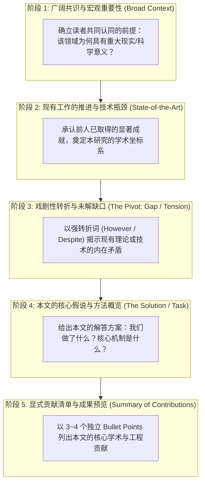
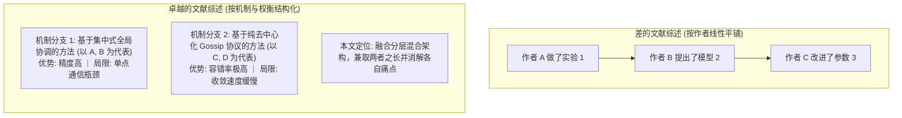

# Lec 2 论文引言与文献综述撰写（Writing the Introduction and Literature Review）

> **授课教师**：Prof. JoAnne Yates（MIT Sloan） ｜ **内容来源**：MIT Comm Lab CommKit  
> **核心附件**：[JournalIntro-annotated-1.pdf](./attachments/JournalIntro-annotated-1.pdf) ｜ [JournalIntro-Argosy.pdf](./attachments/JournalIntro-Argosy.pdf) ｜ [JournalIntro-Karaoke.pdf](./attachments/JournalIntro-Karaoke.pdf)

## TL;DR

- 引言是学术论文最关键的论辩战场，必须在有限篇幅内迅速建立研究合法性与紧迫性。
- 经典“倒金字塔/漏斗模型（Funnel Model）”通过“已知共识 $\to$ 矛盾转折（However） $\to$ 未知缺口 $\to$ 本文方案 $\to$ 贡献清单”五阶段实现渐进聚焦。
- 文献综述切忌写成机械的“学者流水账”，而应以概念与机制主题为轴心，客观阐述不同流派的边界条件与技术死角。
- 引言末尾必须给出条理分明、具备可检验性的贡献清单（Summary of Contributions），向审稿人直观亮出学术增量。

## 倒金字塔漏斗模型：引言的五步论证链

麻省理工学院沟通实验室（MIT Comm Lab）将高水平学术论文的引言剖析为一个标准的**倒金字塔漏斗模型（The Funnel Model）**。其核心任务是：从一个广泛被学界接受的宏观真理出发，严丝合缝地推导至一个极其具体的科学问题，并最终落在本文提出的解决方案上。

### 漏斗模型的各阶段操作要领

1. **第一段：建立认知锚点（Common Ground）**  
   引言第一句话决定了论文的受众宽度。如果第一句话就堆砌高度垂直的缩写和极狭窄的子问题，70% 的大同行审稿人会瞬间丧失阅读兴趣。应当从一个被全学科广泛承认的趋势或长期目标切入。
2. **第二段：文献综述与前沿推展（Literature Continuum）**  
   阐明为了解决上述宏观目标，学界已经做出了哪些主流探索。此处要展示作者对领域脉络的全面掌控，为后续指出矛盾做足铺垫。
3. **第三段：引入戏剧性张力（The Pivot & Tension）**  
   这是整篇引言的灵魂所在。通常以强转折副词（如 *However, Nevertheless, Despite these advances*）开头，明确指出：即使前人方案非常优秀，在某一关键特定场景下依然会发生崩溃或缺乏理论保证。
4. **第四段：本文方案的高阶鸟瞰（Executive Summary of Proposed Approach）**  
   用 2~3 个精炼段落，阐明本文提出的核心直觉与系统框架。此处不展开繁琐的数学推导，而是用富有表现力的学术语言解释“为什么我们的方法能够跨越前述瓶颈”。
5. **第五段：凝练贡献点（Contributions Statement）**  
   作为引言的收尾，使用醒目的排版格式（如序号或无序列表），向审稿人直白呈递本研究的原创性增量。

::: definition 漏斗模型（The Funnel Model）
学术引言写作中的一种经典结构范式，指文章开篇从宏观学术背景切入，逐步收紧讨论范围，通过文献前沿与现有局限性的推演，精确聚焦于一个特定的科学未知领域，最后引出本文具体研究方案与贡献的递进式论证结构。
:::

## 核心转折：如何精准界定与表述“研究缺口（Research Gap）”

引言能否通过顶刊小同行的苛刻审视，90% 取决于其对“研究缺口（Research Gap）”的界定是否令人信服。

许多青年学者在界定缺口时常犯两类典型错误：
- **错误 A（无病呻吟）**：*"To our knowledge, no one has applied Algorithm X to Dataset Y before."*（没有人做过并不代表这件事情有价值，可能只是因为这样做毫无理论意义）；
- **错误 B（恶意贬低）**：*"Previous studies by Author Z are totally flawed and incorrect."*（引发同行的强烈防御心理，且显得极其不专业）。

::: insight 深入见解：优雅界定研究缺口的“三步借力法”
MIT Comm Lab 推荐采用客观、建设性的学术修辞来界定缺口：  
1. **肯定前人前提**：先肯定已有方法在其设定的经典假设下非常成功（例如：在强凸优化或同质网络环境中表现优异）；  
2. **指出边界失效**：指出随着应用场景向复杂真实世界演进（例如：非凸优化、异步异构节点、极度稀疏通信），前人方案的内在假设不再成立，导致算法复杂度呈指数级爆炸或精度发散；  
3. **引出核心洞见**：顺理成章地引出本文针对这一新变量或新摩擦所设计的专门机制。这种修辞既充分尊重了学术前人，又展示了本文研究水到渠成的历史必然性。
:::

### 常用研究缺口引导句式对比表

| 表达动机 | 较差的业余表达（避免使用） | 专业、客观的高水准表达（推荐使用） |
|---|---|---|
| **算法瓶颈** | *"Method A is very bad and slow."* | *"While Method A achieves high accuracy in ideal settings, its computational overhead scales quadratically with network size, rendering it intractable for real-time systems."* |
| **理论未解** | *"Nobody proved this theorem."* | *"Despite extensive empirical validation, the underlying convergence rate under non-convex constraints remains theoretically uncharacterized."* |
| **实验局限** | *"Previous experiments tested only small datasets."* | *"Prior evaluations have largely focused on controlled benchmarks, leaving the robustness against non-stationary distributions largely unexplored."* |

## 文献综述撰写哲学：从“学者名录”升华为“概念矩阵”

文献综述（Literature Review / Related Work）不仅出现在独立章节中，其精简版也是引言前两段的核心基石。

很多初学者将文献综述写成了机械的“学者点名录”：
> *Smith (2018) did X. Then, Jones (2019) proposed Y. Recently, Wang (2021) designed Z.*

这种以“人名和时间”为维度的流水账极其平庸，缺乏任何批判性思考。MIT 15.289 与 CommKit 倡导**以“科学概念、机制流派与技术权衡”为维度的概念矩阵综述法**。

在概念矩阵中，文献综述的每一小节或每一段落的中心句（Topic Sentence）应当是一个**技术主张（Assertion）**，而非作者人名：
- *"Existing approaches to distributed consensus generally fall into two broad architectural paradigms: leader-based coordination and quorum-based gossip protocols."*
- 随后将各路学者的论文作为支持该主张的证据自然引用在括号内，并重点对比不同流派在延迟、能耗、安全性之间的**帕累托权衡（Pareto Trade-offs）**。

## 贡献清单（Contributions Statement）的提炼艺术

引言的最后一段通常是决定审稿人评分倾向的关键点。一个优秀的贡献清单应当兼具**理论深度、技术新颖性与实证冲击力**。

建议将贡献归纳为 3~4 条，每条由一个加粗的主张引导词开头：

::: example 顶刊规范贡献清单范式
- **理论分析（Theoretical Framework）**：我们在数学上建立了首个考虑拜占庭网络延迟的异步随机梯度下降连续时间动力学模型，严格证明了在任意有界扰动下模型收敛的充要条件。
- **机制与算法设计（Algorithm Design）**：提出了 `FastSync` 协议，利用动态拓扑分区与自适应动量量化，将跨节点参数同步的每轮通信开销从 $\mathcal{O}(N^2)$ 降低至 $\mathcal{O}(N \log N)$。
- **开源系统实现（System Implementation）**：在 Rust 中从零构建了工业级异步通信引擎，已全面兼容 PyTorch 分布式接口并向社区完全开源。
- **多维度实证验证（Empirical Evaluation）**：在跨越三个大洲的 128 节点异构云集群上展开了全面测试，基准测试表明在 ResNet-50 与 LLaMA-7B 训练中平均吞吐量提升 2.3 倍，且没有引发任何精度损失。
:::

## 真实名校论文引言批注研读指南

在本课程归档的三个真实附件中，展示了不同工科领域的引言典范，建议在写作时作为对照标杆精读：
1. [JournalIntro-annotated-1.pdf](./attachments/JournalIntro-annotated-1.pdf)：逐句拆解了一篇典型顶级论文引言的漏斗推进过程，用高亮色彩标出了从 Broad Context 到 The Pivot 的精准跳变；
2. [JournalIntro-Argosy.pdf](./attachments/JournalIntro-Argosy.pdf)：系统架构与计算机网络方向的优秀引言样板，展示了如何清晰阐明极其复杂的大规模系统工程痛点；
3. [JournalIntro-Karaoke.pdf](./attachments/JournalIntro-Karaoke.pdf)：偏理论与算法创新的引言样板，示范了如何严谨地定义数学问题边界并阐明理论对工程实践的指导意义。
