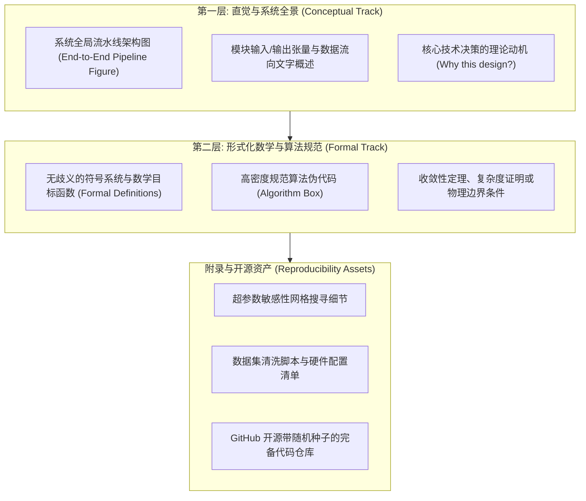
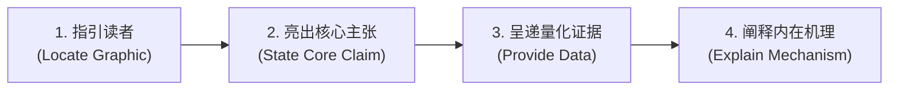
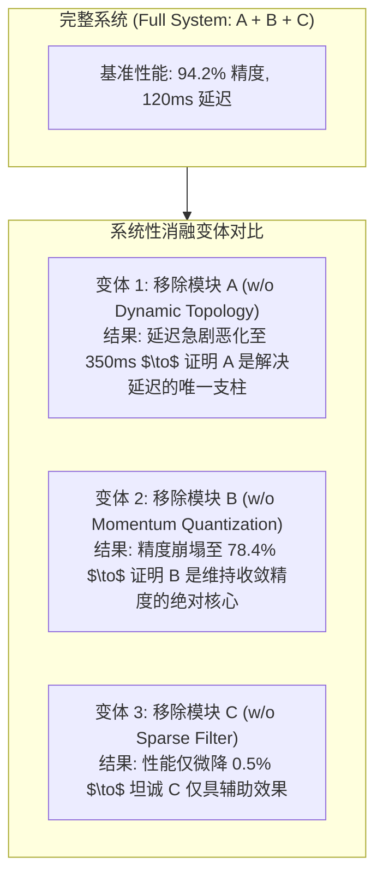

# Lec 3 研究方法、实验结果与批判性讨论（Methods, Results, and Discussion）

> **授课教师**：Prof. JoAnne Yates（MIT Sloan） ｜ **内容来源**：MIT Comm Lab CommKit  
> **核心附件**：[JournalMethods-Isola.pdf](./attachments/JournalMethods-Isola.pdf) ｜ [JournalResults-annotated-1.pdf](./attachments/JournalResults-annotated-1.pdf) ｜ [JournalResults-Isola.pdf](./attachments/JournalResults-Isola.pdf) ｜ [JournalDiscussion-annotated-1.pdf](./attachments/JournalDiscussion-annotated-1.pdf) ｜ [JournalDiscussion-CS.pdf](./attachments/JournalDiscussion-CS.pdf)

## TL;DR

- 方法（Methods）部分的首要职责是保障科学可复现性，应遵循“高阶系统流水线总览 $\to$ 形式化算法/数学定义 $\to$ 工程实现细节”的分层递进结构。
- 结果（Results）部分应摒弃被动式标签，全面采用“主张型小标题（Active Assertive Subheadings）”，并通过“导引、主张、数据证据、机理解释”四步法实现图文深度协同。
- 消融实验（Ablation Studies）是现代工科论文的定海神针，用于精确因果归因，证明每一个创新模块的独立不可或缺性。
- 讨论（Discussion）是拔高学术高度的核心阵地，需对反直觉异常现象进行深度归因，并主动坦诚局限性（Limitations），将潜在审稿漏洞转化为展现学术严谨性的加分项。

## 方法章节（Methods）：兼顾直觉理解与绝对可复现性

在工程、计算机科学与实证科学中，方法章节是小同行审稿人检验论文“技术过硬度（Soundness）”的主考场。很多作者在写方法时容易走向两个极端：要么沉溺于几千行繁琐的工程调参代码中，让读者完全抓不住技术核心直觉；要么过于云山雾罩，隐瞒关键前提，导致同行完全无法复现。

麻省理工学院沟通实验室（MIT Comm Lab）提倡**“双层分流法（Two-Track Approach）”**：

### 方法部分的撰写黄金准则

1. **从宏观架构图开篇**：方法章节的第一段必须配有高质量的端到端系统架构图（如 Phillip Isola 在经典 Pix2Pix 论文 [JournalMethods-Isola.pdf](./attachments/JournalMethods-Isola.pdf) 中的模型结构图），文字应清晰描述数据从源头输入、流经各个处理单元、最终生成预测结果的完整拓扑；
2. **不仅交代“做了什么”，更要解释“为何如此（Rationale）”**：例如，在描述网络损失函数时，不要仅仅列出公式，必须用文字阐明：“我们在标准 $\mathcal{L}_2$ 重建损失中额外引入了全变差（Total Variation）正则项，其物理动机在于惩罚高频网格伪影，从而在缺乏密集标注时强制保持图像边缘的平滑连续性”；
3. **主次分明，善用附录（Judicious Use of Appendix）**：主文本仅保留最具创新性、最能决定算法生死的关键公式与设计，将长篇累牍的参数枚举、证明引理与硬件环境置于附录，避免打断核心技术论证的阅读流畅度。

::: definition 可复现性标准（Reproducibility Standard）
学术研究中方法描述的完备程度标准，即一个未曾参与该项目的同领域合格研究生，仅根据论文正文及公开发布的代码、数据与实验说明，能够独立搭建起相同的实验环境并获得与论文报告在统计显著性范围内一致的测量结果。
:::

## 结果章节（Results）：主张型标题与图文深度互锁

结果章节绝非仅仅是将实验图表和表格贴在文档中，然后用干瘪的几句话说“图 3 展示了我们的准确率”。**优秀的结果展示是数据驱动的说服性叙事**。

### 采用主张型小标题（Active Assertive Subheadings）

将传统的结果小标题与主张型小标题进行对比，其信息传递效率有云泥之别：

| 传统被动式标题（避免使用） | 现代主张型小标题（强烈推荐） |
|---|---|
| `## 5.1 准确率评估` | `## 5.1 FastSync 在千卡集群上缩短 43% 训练时间且保持零精度损失` |
| `## 5.2 吞吐量测试` | `## 5.2 面对高网络丢包率，自适应动量压缩使通信吞吐量稳固提升 2.8 倍` |
| `## 5.3 敏感性分析` | `## 5.3 当批大小扩展超过 8192 时，梯度稀疏化优势最为显著` |

主张型小标题直接将该实验所支撑的**科学主张（Claim）**提炼为标题，审稿人即便只快速浏览小节目录，也能在 10 秒钟内精准捕获所有核心实验发现。

### 图文协同“四步导引法（Four-Step Presentation Loop）”

在结果段落内部，文字与图表必须遵循标准的主张-证据闭环。MIT 15.289 与 CommKit 总结为四步循环法：

::: example 实验结果图文协同四步法范例
**[1. 指引读者]** 如图 4 所示，我们在不同节点规模下对 `Aether` 与三个主流基线协议进行了端到端延迟评测。  
**[2. 核心主张]** 实验结果证实，`Aether` 能够近乎完全消除大规模分布式训练中常见的“长尾拖后腿（Straggler）”延迟瓶颈。  
**[3. 量化证据]** 当集群规模从 32 节点扩大至 256 节点时，基线协议 `Ring-AllReduce` 的 p99 延迟急剧飙升了 310 毫秒，而 `Aether` 的 p99 延迟仅轻微增加 22 毫秒，在最大集群规模下实现了 3.4 倍 的通信加速比。  
**[4. 机理解释]** 这一性能优势源于本文所设计的非对称拓扑感知机制：系统能够动态监测慢节点的队列积压，并自适应降低其同步权重，从而阻断了单点硬件性能波动向全集群的链式传染。
:::

## 消融实验（Ablation Study）：现代科研的硬核试金石

如果提出的新算法或系统包含模块 A、模块 B 和模块 C，最终系统的整体性能提升究竟是模块 A 发挥了关键作用，还是仅仅由于模块 C 的调参红利？

在顶会与顶刊评审中，审稿人最常提出的质疑就是：“论文表现很好，但创新点究竟是哪一个在起作用？”**消融实验（Ablation Study）是回答这一质疑的唯一科学手段**。

::: theorem 消融实验的因果归因定理
通过逐一剔除（Drop）或替换（Replace）系统中的关键组件，消融实验构造了严谨的反事实对比（Counterfactual Analysis）。只有当实验清晰展示“每拿掉一个组件，系统相应指标均发生明确可解释的退化”时，作者关于“这些机制是本文核心贡献”的主张才能在因果层面上确立。
:::

## 讨论章节（Discussion）：升华理论高度与坦诚局限性

许多初学者常常将讨论（Discussion）写成结果（Results）的简单同义词重述，白白错失了整篇论文最能展现学术深度的篇章。

### 结果与讨论的本质分工

- **结果部分（Results）**：客观回答“**发生了什么（What happened?）**”——报告数据、统计检验、曲线走势；
- **讨论部分（Discussion）**：深入回答“**这意味着什么（What does it mean?）**”——剖析物理机理、与学术共同体现存理论进行对话、揭示意外反常现象背后的深层规律。

### 主动陈述局限性（Limitations）是最高级的学术防御

许多作者担心在论文中写下自身工作的不足会导致论文被拒。然而，MIT 教授的一致共识是：**不写局限性，才一定会导致论文被拒**。

审稿人都是身经百战的行业专家，他们一定能在字里行间找出潜在漏洞：
- **被动遭遇**：如果作者隐瞒局限性，审稿人会认为“作者未能意识到这一严重缺陷”或“作者故意隐瞒欺骗”，进而以“技术漏洞”为由直接给出拒稿（Reject）；
- **主动陈述**：如果作者在讨论章节专门设立小节，主动深入分析当前方法在某些边界条件下的不足，审稿人的心理评价会瞬间转变为“作者对该问题的理解极其深刻且严谨”，甚至在审稿意见中高度赞赏作者的科学诚实度。

::: insight 深入见解：撰写局限性的“三部曲防御公式”
1. **精准界定边界（Acknowledge with Precision）**：明确指出当前算法在超大规模图网络或高动态拓扑下会面临内存显存瓶颈；  
2. **阐明根本成因（Explain the Root Cause）**：解释这不是实现层面的代码缺陷，而是受制于底层稠密矩阵运算的内在数学限制；  
3. **指出未来化解路径（Chart the Path Forward）**：展望引入分块近似或稀疏注意力机制等后续研究方向。这样，局限性就不再是当前论文的死穴，反而成为了启发学术社区后续研究的开放性课题。
:::
