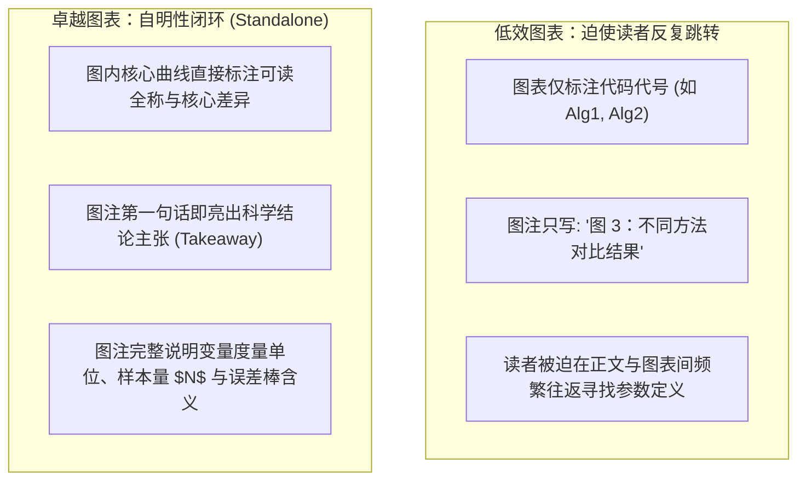
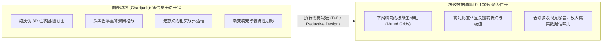
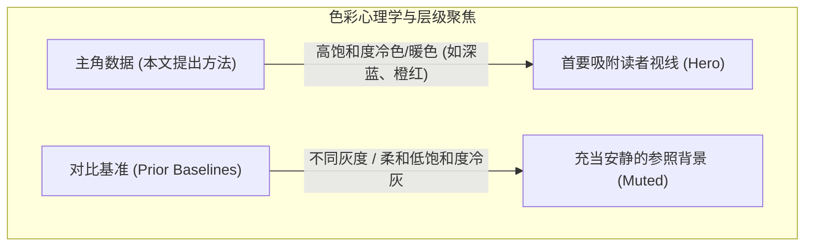
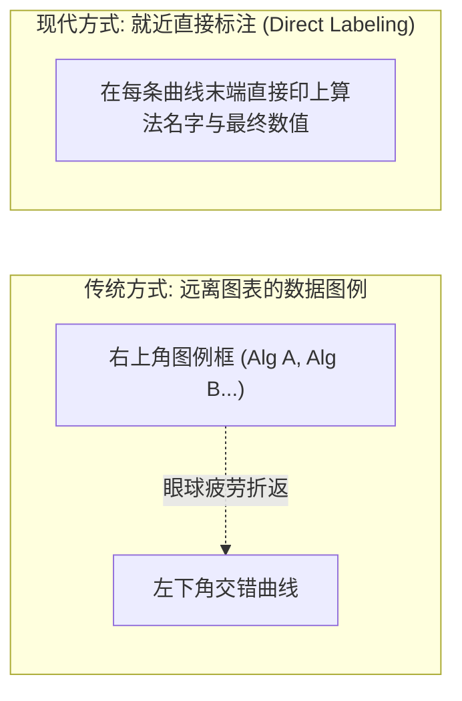

# Lec 4 学术图表设计与科研数据可视化（Figure Design and Visual Communication）

> **授课教师**：Prof. JoAnne Yates（MIT Sloan） ｜ **内容来源**：MIT Comm Lab CommKit  
> **核心附件**：[FigureDesign-EE.pdf](./attachments/FigureDesign-EE.pdf) ｜ [FigureDesign-CS.pdf](./attachments/FigureDesign-CS.pdf)

## TL;DR

- 图表是学术论文阅读频次最高的视觉核心，必须严格满足“自明性原则（Standalone Readability）”，使读者脱离正文亦能通过图表及图注捕获完整科学结论。
- 遵循爱德华·塔夫特（Edward Tufte）的“数据-油墨比（Data-Ink Ratio）”法则，无情剔除伪 3D、过重背景网格与装饰性边框等“图表垃圾（Chartjunk）”。
- 视觉层级必须通过颜色对比突出“主角数据（Hero Data）”，对比基准线应采用灰度弱化，且全篇论文中同一算法标签的颜色与线型必须保持绝对一致。
- 坚持色盲友好（Colorblind-Friendly）的无障碍配色哲学，杜绝红绿单一对比；优先采用就近直接标注（Direct Labeling）替代割裂的独立图例框。

## 图表设计的第一法则：绝对自明性（Standalone Readability）

在学术论文的快速阅读场景中（例如在顶会现场翻阅预印本或审稿人进行 15 分钟初筛），读者的眼球轨迹往往直接从标题、摘要跳跃到图表。麻省理工学院沟通实验室（MIT Comm Lab）确立的最高军规是：**图表与图注（Caption）必须构成一个自洽的、可独立理解的信息单元**。

### 优秀图注（Caption）的三段式结构

一个自明性图注绝不仅仅是给图表起一个名字，它本身就是一篇微型论文摘要：
1. **主张型标题句（Declarative Takeaway Sentence）**：图注第一句话用黑体字清晰宣告该图证明的核心科学事实；
2. **实验语境与坐标定义（Context & Axes）**：简要说明输入数据、实验设置、X 轴与 Y 轴的具体物理/算法含义及单位；
3. **符号与视觉编码解构（Visual Encodings & Uncertainty）**：解释不同线型、标记符号与填充色，明确交代误差棒（Error Bar）代表标准差（SD）、标准误（SE）还是 95% 置信区间。

::: example 自明性图注对比
**差的图注**：  
*Figure 4: Performance comparison of different algorithms.*（读者完全不知道谁比谁好，也不知道评测指标是什么）  
**优秀的自明性图注**：  
**Figure 4: FastSync reduces parameter synchronization latency by 62% under high network packet loss.** Comparison of end-to-end latency across four synchronization protocols on a 128-GPU heterogeneous cluster as packet loss rate varies from 0% to 5%. Data points represent the median of 10 independent runs; error bars denote the 95% confidence interval. Blue solid line corresponds to our proposed `FastSync`, showing near-constant latency, while gray dashed lines denote baseline algorithms (`Ring-AllReduce` and `BytePS`).
:::

## 塔夫特法则与数据-油墨比（Data-Ink Ratio）

现代信息设计奠基人爱德华·塔夫特（Edward Tufte）在其经典著作中提出了著名的**数据-油墨比原则**：

$$
\text{Data-Ink Ratio} = \frac{\text{用于直接展示核心数据的有效油墨量}}{\text{绘制整张图表所耗费的总油墨量}}
$$

::: pitfall 视觉噪音陷阱：伪 3D 渲染与过度网格
许多初学者习惯使用 Excel 或科研软件的默认模版，画出带有三维倾斜视角、阴影和厚重灰色背景的柱状图。  
伪 3D 视角不仅毫无信息量，反而由于透视投影关系扭曲了数据在平面上的几何投影高度，给审稿人带来严重的人为视觉欺骗感。学术图表必须坚持平面投影、干净背景与极轻量网格。
:::

## 视觉层级与色彩哲学：聚焦“主角数据（Hero Data）”

一张优秀的学术图表在视觉上应该具有鲜明的**主角与配角（Visual Hierarchy）**。

在科研实验中，通常包含本文提出的新方案（主角）以及 3~5 个行业既有基准（配角）。如果给每一条基准线都赋予鲜艳的高饱和度色彩，整张图表会沦为眼花缭乱的调色板。

### 色彩运用的三大铁律

1. **色盲友好与无障碍性（Colorblind-Friendly Accessibility）**：全球约 8% 的男性和 0.5% 的女性患有红绿色盲（Deuteranopia/Protanopia）。若仅依赖红线与绿线区分胜负，色盲审稿人将完全无法阅读。必须采用感知均匀且色盲安全的配色方案（如 `viridis`、`cividis`、`ColorBrewer` 方案），并辅以线型（实线、虚线、点划线）与点标记（圆点、方块、三角）的双重编码；
2. **全局色彩语义一致性（Global Semantic Consistency）**：若在图 1 中将本文方法标记为深蓝色、基线标记为浅灰色，那么在图 3、图 5、乃至表 2 中，**必须通篇保持深蓝色代表本文方法、浅灰色代表基线**。中途任意调换配色语义是对读者认知耐心的极大侮辱；
3. **黑白打印友好度（Grayscale Legibility）**：很多资深审稿人仍保持打印黑白纸质论文批注的习惯。在定稿前，将屏幕转化为黑白灰度模式检查图表：如果转为灰度后曲线完全粘连在一起无法分辨，说明该图必须立刻重新设计。

## 标签布局优化：就近直接标注 vs 独立图例框

在传统的科研绘图中，软件往往自动在右上角生成一个独立的图例框（Legend Box）。读者为了阅读图表，眼球必须在图例与数据曲线之间反复做高速折返跑（Eye-Tennis），极易引发认知疲劳。

::: theorem 就近直接标注优势（Direct Labeling Heuristic）
将算法名称或数据标签直接印在曲线末端、柱状图上方或散点簇旁边，能彻底消灭多余的图例框。  
这种就近标注将读者的认知负荷降低至最低水平，使读者在看到数据终点的瞬间直接完成“身份确认与性能认知”。
:::

## 我的理解：图表作为学术信任的底层契约

::: insight 深入见解：图表质量与科学严谨性的映射假说
在顶尖国际学术圈中，资深审稿人和顶级学者往往存在一种心智捷径（Heuristic Shortcut）：**图表制作的粗糙程度往往与底层研究工作的严谨程度高度正相关**。  
如果一篇论文的图表存在字体模糊、坐标轴单位缺失、红绿刺眼冲突、字体大小不一等低级设计失误，审稿人会本能地怀疑：“作者连公开呈现的核心图表都如此敷衍，其在实验控制、代码运行和数据统计上又隐藏了多少不易察觉的疏漏？”  
相反，一张设计精良、对比克制、遵循塔夫特法则的自明性图表，不仅向读者传递了数据事实，更无声地向学术界宣告了研究团队对科学真理的敬畏之心与对工艺水准的极致追求。图表设计绝非纯粹的审美点缀，它直接定义了学术论文的信誉底线。
:::

## 真实工科图表修改实战批注

在配套归档的两个真实附件中，展示了 MIT 研究生在指导下完成图表重塑的全过程：
- [FigureDesign-EE.pdf](./attachments/FigureDesign-EE.pdf)：电子工程领域电路图与时域波形图的经典修改案例，展示了如何通过整理连线拓扑与调整标注字体，使原本杂乱无章的工程图瞬间变得赏心悦目；
- [FigureDesign-CS.pdf](./attachments/FigureDesign-CS.pdf)：计算机系统与算法方向的评测图表修改示范，详尽对比了消减冗余网格、统一配色方案与采用直接标注法前后的鲜明视觉对比。
