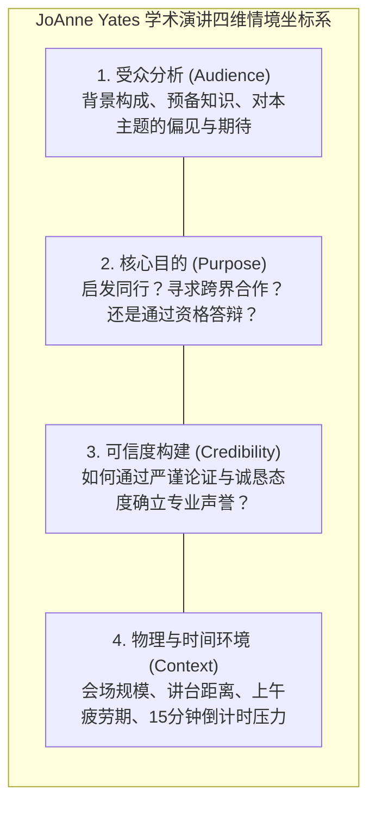
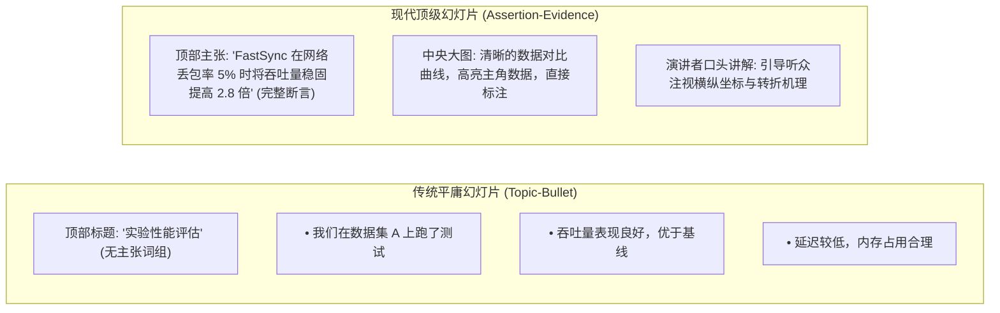
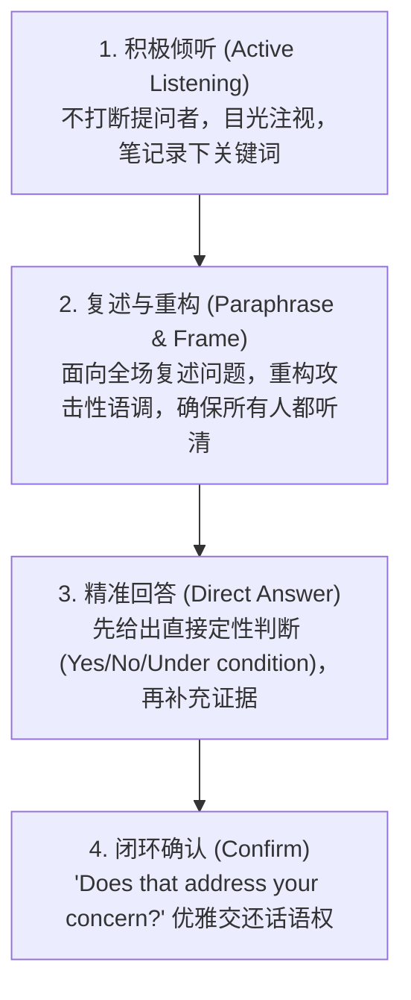

# Lec 5 学术会议口头报告与幻灯片设计（Oral Presentations and Slide Design）

> **授课教师**：Prof. JoAnne Yates（MIT Sloan） ｜ **内容来源**：MIT 15.289 官方讲义与 MIT CommKit  
> **核心附件**：[OCW_15289_Oral_Presentations.pdf](./attachments/OCW_15289_Oral_Presentations.pdf) ｜ [OCW_15289_Oral_Assignment.pdf](./attachments/OCW_15289_Oral_Assignment.pdf)

## TL;DR

- 学术口头演讲不是宣读论文，而是面向听众认知工作记忆的实时现场引导，其信息传递容量仅有书面文本的三分之一。
- 颠覆传统“词组标题 + 满屏文字圆点”的幻灯片范式，全面推行“主张-证据（Assertion-Evidence）”模型：顶部陈述完整科学论断，中央以自解释视觉图表充当证据。
- 口头表达的节奏与身体语言直接影响学术可信度，应保持平稳目光交流（Eye Contact）并彻底戒除低头念稿的自我孤立行为。
- 问答环节（Q&A）是展现学者风度与敏捷思维的关键战场，严格执行“倾听-复述重构-精准回答-确认反馈”四步应对协议。

## 学术演讲的情境战略分析：Yates 四维坐标系

MIT Sloan 教授 JoAnne Yates 在其核心讲义 [OCW_15289_Oral_Presentations.pdf](./attachments/OCW_15289_Oral_Presentations.pdf) 中明确提出，一次成功的学术演讲始于对**交际情境（Communication Situation）**的系统解构。演讲者在打开 PowerPoint 制作第一张幻灯片前，必须精确校准四大战略维度：

### 口语沟通与书面沟通的本质鸿沟

读者在阅读打印论文时拥有完全的控制权：可以随时暂停、回溯重读前文定义或仔细比对图表。然而在口头演讲中，**听众的时间线是被演讲者单向强制推移的**：
- 听众无法回放你上一分钟讲过的生僻缩写；
- 认知心理学表明，人类大脑的语音处理通道与视觉文字阅读通道在工作记忆（Working Memory）中高度互斥：当幻灯片上布满密密麻麻的文字段落时，听众要么专心阅读文字而完全听不见演讲者在说什么，要么听取语音而视线迷失。

::: definition 认知负荷理论（Cognitive Load Theory in Presentations）
在学术口头报告中，听众的瞬时工作记忆容量极其有限（通常仅能同时维持 3~4 个新概念）。当幻灯片视觉信息与演讲者口头语音发生冗余冲突（如幻灯片投影整段文字而演讲者逐字朗读）时，会产生外生认知负荷（Extraneous Cognitive Load），导致信息接收效率出现断崖式下跌。
:::

## 幻灯片设计革命：主张-证据模型（Assertion-Evidence Model）

麻省理工学院与宾夕法尼亚州立大学（Michael Alley）共同倡导的**“主张-证据模型（Assertion-Evidence Framework）”**，彻底终结了学术界泛滥的“低效子弹头列表（Bullet-point Wall of Text）”。

### 主张-证据模型的核心要素

1. **顶部主张栏（The Assertion）**：
   - 彻底摒弃 *"Introduction"*、*"Methods"*、*"Experimental Results"* 这类缺乏信息量的范畴性词组；
   - 撰写一句简短但语法完整的陈述句（通常不超过两行），直接说出这一页幻灯片要证明的**核心科学主张**；
2. **正文证据区（The Visual Evidence）**：
   - 绝对禁止使用文字要点（Bullet Points）填充幻灯片中央；
   - 仅放置能够直接支撑顶部主张的视觉证据：高清实验图表、高对比度算法对比框图、实物实验照片或关键方程式；
   - 任何必要的辅助文字（如坐标轴注解、关键数值标注）必须紧贴视觉图形，实现视觉一体化。

::: example 主张-证据幻灯片设计对比
**差的设计**：  
标题：*Cache Performance*  
正文：  
- *We measured L1 and L2 cache miss rates.*  
- *Our replacement policy is better than LRU.*  
- *Benchmark results show improvement.*  
**主张-证据设计**：  
标题（主张）：*动态局部性感知的缓存替换策略使 L2 缺失率降低 38%*  
正文（证据）：中央放置 SPEC CPU 跑分的对比柱状图，高亮显示新策略在内存密集型任务中的巨大压降，其余基线全部采用淡灰柱显示。
:::

## 演讲现场交付艺术：节奏、目光与非语言交流

在学术演讲中，内容质量是硬实力，但交付技巧（Delivery）决定了内容能否跨越讲台被评委完全吸收。JoAnne Yates 教授总结了学术报告的现场交付心法：

### 1. 结构性路标（Signposting）与过渡

在论文中，章节标题为读者提供了视觉路标；在口头演讲中，演讲者必须充当“口语导航员”。在进入每一个新议题时，明确给出结构性过渡句：
- *"Now that we have established the theoretical convergence bound, let us turn to empirical evaluations on real-world clusters."*
- *"This unexpected latency spike leads directly to our second key question: why did the distributed locks fail?"*

### 2. 目光交流（Eye Contact）的“灯塔法则”

很多学者由于紧张，容易盯着投影幕布、讲台笔记本屏幕或天花板念稿。这种行为向听众传递了极其不自信的潜意识信号：
- 采用“灯塔式扫描（The Lighthouse Technique）”：将整个会场划分为左、中、右三个区域，每次与某一位观众对视完整的一句话（约 3~5 秒），然后平稳转向下一个区域；
- 当发现某一位资深学者微微点头时，与其建立目光连接，这能显著降低自身的肾上腺素焦虑并建立现场共鸣。

### 3. 控制语速与拥抱战略性停顿（The Power of Pause）

初学者最容易犯的毛病是由于担心超时而像机关枪一样快速扫射文字。
- 当抛出一个震撼人心的核心实验结论或展示关键反转图表后，**必须刻意保持 2~3 秒的绝对沉默（Strategic Pause）**；
- 给听众的大脑留出消化视觉信息与重构心智模型的物理时间。

## 问答环节（Q&A）：专业声誉的终极考验

在学术会议或教职答辩中，很多演讲者的报告准备得天衣无缝，却在最后的问答环节彻底崩盘。MIT 15.289 制定了一套应对 Q&A 的**四步标准防御协议**：

### 应对极端挑战的策略锦囊

| 棘手提问场景 | 错误反应（引发对抗） | 高情商学者级应对策略 |
|---|---|---|
| **恶意挑衅或尖锐质疑** | 情绪激动，直接回怼提问者不懂算法 | *"That is a profound observation. Indeed, in unconstrained environments, that vulnerability exists. However, in our system, constraint X bounds this risk by..."* |
| **完全答不上来的致命问题** | 强词夺理、胡编乱造数据试图糊弄过关 | *"We haven't tested that specific edge case yet. My intuition suggests that mechanism Y would apply, but that is precisely the open question we plan to explore next."* |
| **提问者发表长篇大论不问问题** | 茫然等待其说完，全场气氛冷场尴尬 | 礼貌切入：*"Thank you for this valuable context on [Topic]. To connect your insight to our work, the core implication for our model is..."* |

## 我的理解：演讲是思维的催化剂而非复印机

::: insight 深入见解：从“展示自我”跃迁至“服务受众”
许多研究生将学术演讲视为对自己科研成就的“自豪汇报（Showing Off）”，甚至潜意识里认为“把大家讲得越听不懂，就显得我越聪明、研究越深奥”。这是极其幼稚的学术不成熟表现。  
顶尖学者与平庸学者的本质区别在于：**顶尖学者拥有极高的“概念降维能力”**。他们能够把极其复杂的微分方程和底层系统架构，翻译成连跨学科本科生都能听懂的物理直觉与核心因果图景。一场卓越的学术演讲不是展示演讲者知道得有多深，而是让全场听众在走出会议室的瞬间，感觉自己变得更加聪明了。
:::
