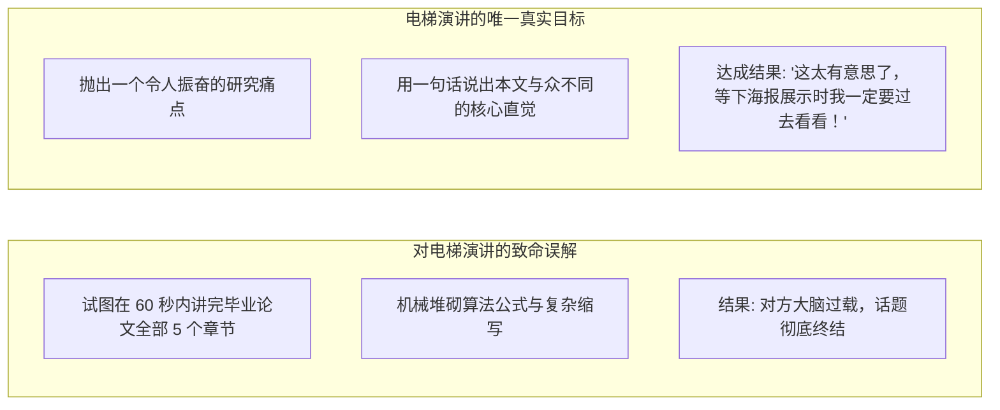
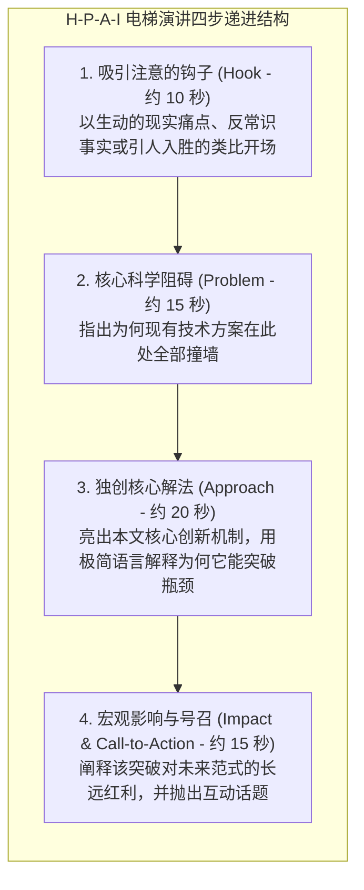
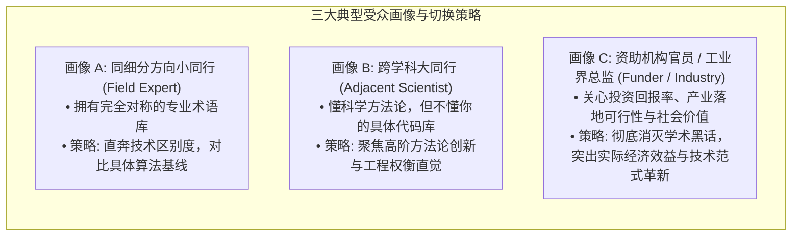

# Lec 6 电梯演讲与研究速递（Elevator Pitch and Research Summaries）

> **授课教师**：Prof. JoAnne Yates（MIT Sloan） ｜ **内容来源**：MIT 15.289 官方研讨与 MIT CommKit  
> **演练场景**：学术会议茶歇搭讪、电梯偶遇系主任、基金会官员走廊交流、博士后求职初筛

## TL;DR

- 电梯演讲（Elevator Pitch）是在 30~90 秒内向对话者清晰传达自身科研价值的高密度即兴沟通工具，其终极目标不是灌输全部技术细节，而是引发后续深度交谈的兴趣。
- 掌握经典“四步钩子模型”：吸引注意的痛点切入（Hook） $\to$ 未解问题与矛盾（Problem） $\to$ 核心独创方案（Approach） $\to$ 宏观现实影响（Impact）。
- 建立动态受众适配心智，能够针对“同领域小同行”、“跨学科大同行”与“非技术公众/资助官员”三类截然不同的对话者，毫秒级切换叙事颗粒度。
- 结尾必须包含优雅的行动号召（Call to Action），通过开放性提问将单向陈述转化为高质量学术社交对话。

## 电梯演讲的本质：争取“下一张咖啡桌”的入场券

在学术界最令人扼腕的场景莫过于：一位年轻学者在国际顶会茶歇区偶遇了自己仰慕已久的学科宗师或顶尖名校系主任。对方友善地问了一句：*“What are you working on these days?”*  
多数博士生要么陷入惊慌失措的语无伦次，要么从自己显存溢出、调参报错的代码细节开始絮絮叨叨，导致对方在 20 秒内眼神飘忽，礼貌性地借故离开。

麻省理工学院沟通实验室（MIT Comm Lab）与 15.289 强调：**电梯演讲的成败，不在于你说了多少，而在于对方听进去了多少**。

电梯演讲的本质是一枚**学术钩子（The Intellectual Hook）**。它的唯一使命是激发对话者的好奇心，为双方创造一个交换联系方式、相约后续喝咖啡或详阅正式论文的契机。

::: definition 电梯演讲（The Elevator Pitch）
一种在极短时限内（通常为 30 到 90 秒，即一次乘坐电梯的时间）对个人学术研究或创新成果进行的口头概述，旨在以通俗严谨的语言迅速阐明研究的重要性、核心方法与深远影响，促成更深层次的学术或职业合作。
:::

## 核心结构：四步递进式叙事框架（H-P-A-I Model）

一个标准的 60 秒顶尖学术电梯演讲，必须在严密的逻辑闭环内包含以下四个模块：

### 四步框架的展开细节与台词设计

1. **第一步：抛出钩子（Hook）**  
   拒绝使用平庸的 *"Hi, my name is Bob and I am a 4th year PhD student studying algorithms."* 开场。  
   采用**基于矛盾或巨大代价的场景切入**：*"Every time you train a large language model like GPT, data centers burn millions of dollars in electricity simply waiting for GPUs to synchronize."*
2. **第二步：界定阻碍（Problem）**  
   精准指出瓶颈的物理本质：*"The root bottleneck isn't raw computing power, but communication: traditional protocols require every server to wait for the slowest machine in the cluster."*
3. **第三步：独创机制（Approach）**  
   给出你的破局钥匙（避免陷入具体超参数）：*"My research develops an asynchronous, topology-aware coordination protocol that allows fast nodes to keep training while selectively dropping redundant gradient updates."*
4. **第四步：量化影响与收尾号召（Impact & Call-to-Action）**  
   用量化数字锁定成果，并优雅收尾：*"We managed to double training speeds without sacrificing a single percent of accuracy. Are you guys currently running into similar network latency limits in your distributed systems?"*

## 三类受众的动态自适应调整（Audience Adaptation）

同一位学者、同一项研究，面对不同的对话者时，电梯演讲的词汇库与叙事重心必须动态切换。MIT Comm Lab 将学术对话者划分为三大画像：

### 三种受众演练对照表

| 维度 | 画像 A：细分领域专家（小同行） | 画像 B：系所大同行（跨学科学者） | 画像 C：资助官员 / 业界主管 |
|---|---|---|---|
| **核心提问** | *"How is this different from Ring-AllReduce?"* | *"What general algorithmic insight did you discover?"* | *"Why should our foundation fund this project?"* |
| **语言风格** | 高密度专业术语、具体数学收敛性条件 | 概念型类比、强调系统性设计权衡 | 宏观现实影响、经济价值、产业可行性 |
| **示范用词** | *"Gradient sparsity, non-convex Lyapunov bound, p99 latency"* | *"Trade-off between communication frequency and model stability"* | *"Cutting AI computing costs by half, speeding up medical breakthroughs"* |
| **常见死穴** | 讲得太空泛，显得自己没有技术硬实力 | 狂抛黑话缩写，导致对方听不懂假装礼貌 | 沉迷在代码细节中，完全解释不清社会价值 |

## 现场非语言交付心法与避坑指南

电梯演讲往往发生在非正式场合（走廊、展台、电梯间、冷餐会），因此**非语言层面的自信度与身体语言占据了 50% 的第一印象**。

### 1. 身体姿态与声音能量

- **站姿稳健**：双脚与肩同宽，重心平稳，避免单腿抖动或身体前后摇晃（摇晃会向对方无意识地传递焦虑不安）；
- **微笑与眼神聚焦**：保持真诚温和的微笑，目光平视对方双眼，展现对自身科研成果的由衷热爱与自豪；
- **声线投影（Voice Projection）**：在嘈杂的会议茶歇大厅中，深呼吸用腹部发力，吐字清晰坚实，语速稳定在每分钟 130~150 词。

### 2. 戒除“学术黑话遮羞布”

::: pitfall 致命陷阱：用复杂黑话掩盖思维混乱
初学者常常误以为使用越多生僻的名词，自己就越显得专业。  
理查德·费曼（Richard Feynman）曾提出著名的费曼技巧：**如果你不能向一个聪明的外行用简单直白的大白话讲清楚一件事情，说明你自己根本没有真正理解它**。电梯演讲是检验学者思维清晰度的终极照妖镜。
:::

## 我的理解：电梯演讲是学术职业生涯的加速器

::: insight 深入见解：机会永远留给有准备的 60 秒
在学术界的漫长征途上，重大合作契机、教职内推名额甚至数百万美元的专项科研资助，往往并非诞生在正式的圆桌评审室，而是诞生在电梯关门的瞬间、学术晚宴排队取餐的片刻，或是研讨会走廊上的偶遇。  
平庸的研究者永远在等待“正式汇报”，而顶尖的学术领袖随时随地在脑海中备有针对不同人群的 30 秒、60 秒与 3 分钟精粹版本。将自己数年的科研心血打磨成一把锋利、优雅、能在 1 分钟内直击人心的学术飞刀，这是每一位学者走向学术成熟的必修基本功。
:::
