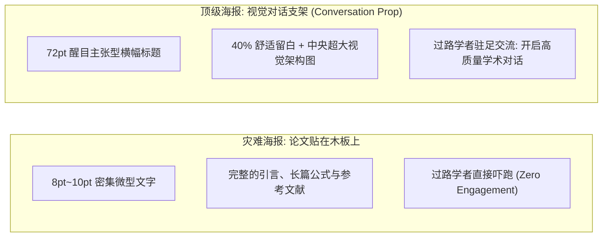
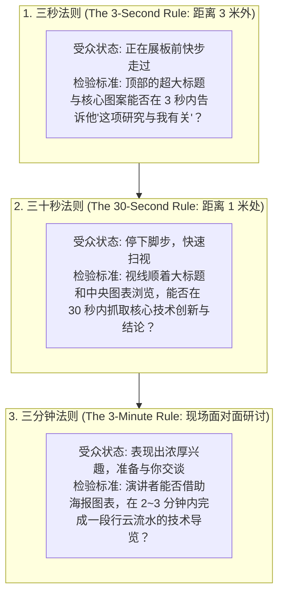
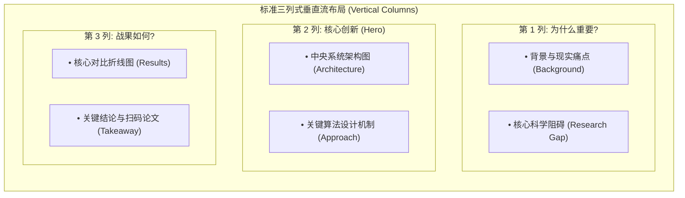

# Lec 7 学术壁报设计与现场互动交流（Scientific Poster Presentations）

> **授课教师**：Prof. JoAnne Yates（MIT Sloan） ｜ **内容来源**：MIT 15.289 官方研讨与 MIT CommKit  
> **核心附件**：[Poster-MARC2014.pdf](./attachments/Poster-MARC2014.pdf)（MIT 经典学术壁报实战范例）

## TL;DR

- 学术壁报（Scientific Poster）绝非打印粘贴在展板上的微缩版论文，而是一份辅助现场即兴学术交谈的“多媒体互动视觉展台”。
- 严格遵循“三秒-三十秒-三分钟”分层注意力法则：3 秒通过主干标题留住过路观众，30 秒传递核心图表结论，3 分钟完成定制化口语漫游。
- 版面布局必须采用规范的垂直列流式排版（Vertical Columns），留白率维持在 30%~40%，并以中央视觉锚点（Centerpiece Figure）作为视觉引力场。
- 展台交流是一场主动的双向互动，通过礼貌探寻访客背景（“您主要做哪一块方向？”），灵活剪裁口头讲解的深浅度。

## 壁报的本质定位：从“静态纸页”转向“对话支架”

在绝大多数国际顶级学术会议（如 NeurIPS、ICML、SIGMOD、IEEE 会议）中，海报展示单元（Poster Session）占据了会议日程的半壁江山。海报展厅通常人声鼎沸、啤酒咖啡香气弥漫，数百名学者摩肩接踵地在狭窄的展板过道间穿梭。

多数研究生制作的海报惨遭冷落，其根本病灶在于**错误的媒介认知**：
- **灾难性做法**：将已经发表的 8 页 PDF 论文直接复制粘贴，用小四号字填满整个 48x36 英寸的展板，包含长达数百字的引言段落、繁琐的公式推导与密集的参考文献列表；
- **真实观众体验**：过路学者端着咖啡路过展板，放眼望去是一堵密不透风的纯黑白文字墙，没有任何人愿意站在嘈杂的展厅中花 10 分钟费劲阅读微雕文字，只能加快脚步匆匆避开。

麻省理工学院沟通实验室（MIT Comm Lab）深刻指出：**学术海报是一份视觉展台（Visual Display for Conversation），海报上的图形是你在向访客交谈时用手指引的道具**。海报自身不需要交代每一个细节，缺失的细节本就应当由站在展板旁边的你用口语来实时填补。

::: definition 学术壁报（Scientific Poster）
一种在学术会议海报专场中使用的视觉展示媒介，旨在通过高度精炼的排版布局、醒目的图表可视化与结构化主张，在远距离快速吸引同行注意力，并为现场面对面的即兴学术深度研讨提供直观支撑。
:::

## 注意力分层法则：三秒、三十秒与三分钟

展厅中观众的注意力是分层释放的。MIT Comm Lab 总结了著名的**“3-30-3 分层响应机制”**：

### 1. 三秒阶段：主干标题的革命

很多学者的海报标题平庸至极：*"A Novel Machine Learning Framework for Image Segmentation"*。  
顶尖学者会采用**主张型结论标题**，并在 3 米外清晰可见：  
> **"Pix2Pix: 将图像翻译时间缩短 90% 的条件对抗生成网络"**  
标题字号必须在 **72pt 至 90pt** 之间，确保在拥挤的过道中一眼可辨。

### 2. 三十秒阶段：视觉锚点（Visual Anchor）

海报的视觉重心必须是一张能够讲出完整故事的**中央主干大图（Centerpiece Figure）**。无论是系统流水线、实物显微镜照片还是关键对比折线图，它必须占据整张海报面积的至少三分之一，充当视觉引力场。

### 3. 三分钟阶段：口语导览路线

海报的内容组织必须预先编排好一条平滑的口语导览路线，使演讲者能够自然地指着展板从左上角引导至右下角。

## 布局设计美学：纵向列流式与留白艺术

设计一张赏心悦目的海报，必须遵循平面设计的底层规律。

### 排版与视觉层级的四大军规

1. **坚持纵向列流式阅读（Vertical Flow）**：
   - 人类的视觉阅读习惯是“在同一列内从上往下阅读，读完一列再跳到下一列”；
   - 严禁设计跨越多个列的水平蛇形绕道（Zig-zag Flow），这会彻底打乱读者的心理阅读预期；
2. **留白率保持在 30%~40%**：
   - 留白（White Space）不是浪费面积，而是给读者的眼睛提供喘息空间；
   - 一张塞得过满的海报在心理学上会直接传递“焦虑、压迫与缺乏重点”的消极信号；
3. **字号阶梯规范（Font Hierarchy）**：
   - **大标题（Title）**：72 ~ 90 pt（粗体，无衬线字体如 Arial, Helvetica）；
   - **分节大标题（Headings）**：36 ~ 48 pt；
   - **正文要点（Body Text）**：24 ~ 32 pt（绝对不能小于 22 pt，否则站立阅读需费力眯眼）；
   - **图注与标注（Captions）**：18 ~ 24 pt；
4. **彻底消灭整段文字**：
   - 正文一律采用简明短语和无序列表（Bullet points），每行不超过 8~10 个单词；
   - 用图表和带标签的流程图替代一切可以用视觉呈现的文字。

## 展板前的社交艺术：主动破冰与分层导览

在海报展示专场，很多作者拘谨地双手抱胸站在展板一角，甚至低头刷手机，等待观众“主动发问”。这种被动姿态往往让感兴趣的观众望而却步。

### 1. 黄金破冰第一句：探寻受众背景

当一名学者在你的海报前驻足超过 3 秒、目光扫过大标题时，微笑点头主动出击：
- *"Hi! Would you like a two-minute overview of our work on distributed training?"*（给出明确的时间预期，消除对方担心被长篇大论纠缠的顾虑）；
- 如果对方点头表示同意，紧接着询问其背景：*"Just so I can tailor the talk, are you more on the systems side or the algorithms side?"*

### 2. 依据背景动态调整导引脚本

- **若对方是小同行**：跳过宽泛的引言，手指直接指向第 2 列的核心机制图：*"Awesome! Then let’s jump straight to our async gradient protocol. You know how stragglers kill throughput in Ring-AllReduce..."*；
- **若对方是跨学科大同行**：从第 1 列的宏观挑战切入，用生动类比阐明问题本质。

### 3. 数字化闭环：名片与 QR 码

在海报的右下角，印上一个高对比度的黑白 QR 码（包含预印本论文 PDF、GitHub 开源仓库以及交互式演示 Demo 链接），并在展台备齐名片：
- 当对方表现出浓厚兴趣且时间有限时：*"I see you have another poster to catch. Feel free to scan this QR code for our full code release, and here is my card. Let’s definitely grab a coffee later!"*

## 我的理解：海报是学术社交的实体社交网络

::: insight 深入见解：海报展区是青年学者最平等的发声舞台
在学术会议的大会口头报告中，发言机会往往被资深教授、院士与大会特邀讲者占据。  
但海报专场是一个完全民主化的学术集市：无论你是图灵奖得主还是刚入学一年的博士一年级新生，大家的展板尺寸完全一样，彼此近在咫尺。一场充满激情、互动自如的海报展示，往往能为你赢得人生第一篇论文被学界泰斗正面引用的契机，甚至当场敲定未来的博士后 Offer。珍惜海报前的每一分钟，它是你在国际学术共同体中点亮个人坐标的黄金节点。
:::
