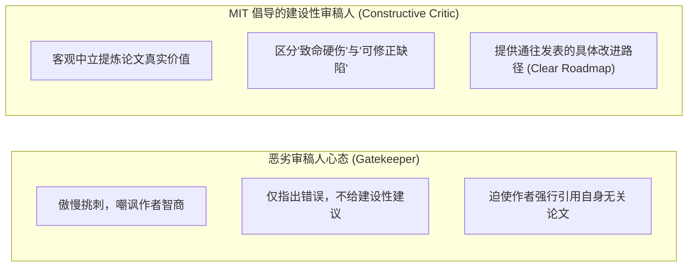
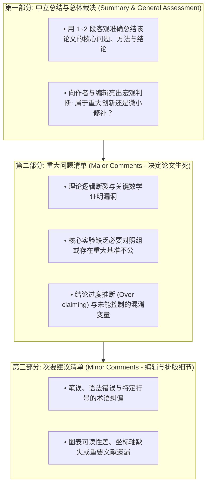
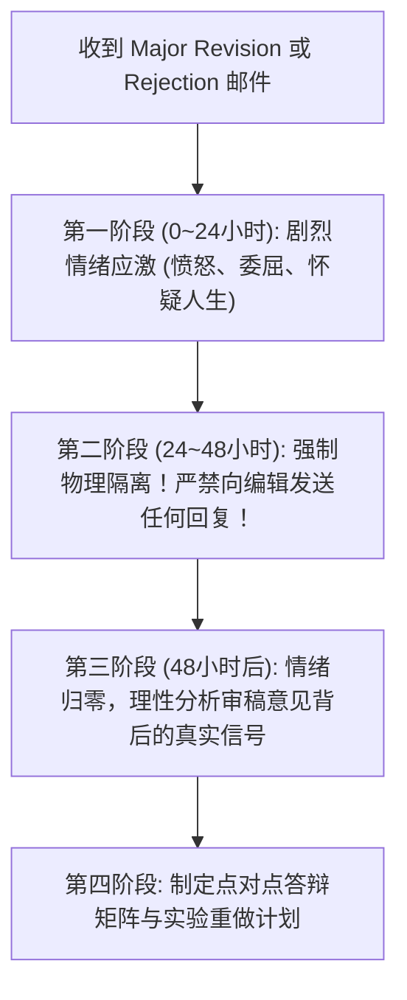
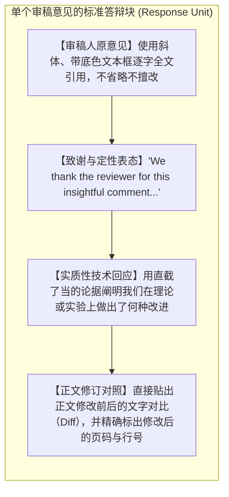

# Lec 8 期刊同行评审与审稿意见答辩（Writing Peer Reviews and Responding to Reviewers）

> **授课教师**：Prof. JoAnne Yates（MIT Sloan） ｜ **内容来源**：MIT 15.289 官方教学随笔与顶级期刊规范  
> **核心附件**：[OCW_15289_Writing_Peer_Reviews.pdf](./attachments/OCW_15289_Writing_Peer_Reviews.pdf) ｜ [OCW_15289_Peer_Review_Assignment.pdf](./attachments/OCW_15289_Peer_Review_Assignment.pdf)

## TL;DR

- 同行评议（Peer Review）是维系现代学术大厦的自我净化机制，审稿人的最高境界是充当“建设性协作者（Constructive Critic）”而非居高临下的挑刺看门人。
- 规范的同行审稿报告必须严谨遵循“中立综述与宏观判断 $\to$ 决定生死的重大缺陷（Major Comments） $\to$ 细节与笔误修正（Minor Comments）”三段式拓扑。
- 遭遇严苛退修或拒稿时，作者必须恪守“48 小时心理冷静法则”，绝不在情绪激荡时向期刊主编发送抗议邮件。
- 撰写修改说明与答辩书（Response to Reviewers）时，严格执行“致谢感激 $\to$ 原文逐字引用 $\to$ 精准回应 $\to$ 呈现正文具体修订位置”的标准矩阵格式，实现礼貌而坚定的专业说服。

## 同行评议的学术生态地位：从义务到声誉资本

MIT Sloan 教授 JoAnne Yates 在其备受赞誉的教学论文 [OCW_15289_Writing_Peer_Reviews.pdf](./attachments/OCW_15289_Writing_Peer_Reviews.pdf) 中开篇指出：**同行评审过程——无论是作为审稿人评审他人手稿，还是作为作者接受审稿人严苛检验——是学术界不可分割的双向呼吸**。

很多青年学者往往将期刊审稿视为无偿占用宝贵科研时间的“无偿苦役”。然而，学术社会的深层激励机制表明：
1. **建立与顶级期刊编辑的信任纽带**：一名能够按时交付客观、深刻且富有建设性审稿报告的年轻学者，会迅速在顶级期刊主编（Editor-in-Chief）和副主编（Associate Editor）心目中建立极高的专业声誉，这为后续自身论文的送审与职业晋升积累了不可估量的无形资产；
2. **把握学科最前沿脉搏**：审稿使你能在成果公开发表前的 6~12 个月率先窥见全球同行的最新研究雏形，直击其核心缺陷与创新灵感；
3. **换位思考的反哺效应**：只有当你亲自扮演过审稿人、体会过阅读一篇混乱手稿时的抓狂心境，你才能在自己撰写论文时精准避开所有容易被同行“一枪毙命”的陷阱。

::: definition 建设性审稿（Constructive Peer Review）
一种秉持严谨求实与学术善意的同行评议范式，审稿人不仅严格评估论文的科学正确性与创新度，更致力于指出论证逻辑中的盲点，并为作者提供具体、可操作的理论推导补强方案或补充实验设计建议，帮助作者将有潜力但存在缺陷的工作提升至发表水准。
:::

## 规范审稿报告的解剖学：标准三段式架构

一份受顶级期刊编辑高度赞赏的高质量审稿报告，通常由三大部分构成：

### 1. 第一部分：中立总结（Summary of the Manuscript）

永远不要一上来就罗列缺点！第一段必须以高度中立、尊重的语调，向作者表明：“**我已经完全读懂了你的论文，并且准确理解了你的核心科学追求**”。  
- 简要复述论文试图解决的问题、采用的方法与主要实验发现；
- 给出总体评价：指出该论文最有价值的闪光点在哪里，以及阻碍其立即发表的核心理论/实验障碍是什么。

### 2. 第二部分：重大缺陷（Major Comments）

这是决定手稿去留（Accept / Revise / Reject）的核心依据。将重大问题编号列出（Major Point 1, 2, 3...）：
- 每一个重大问题必须遵循“**指出具体漏洞 $\to$ 阐明其破坏结论的机制 $\to$ 提供补救操作建议**”三步走；
- 避免含糊其辞的批评（如 *"The methodology is weak"*），必须明确写出：*"In Section 3.2, Equation 4 assumes error terms are i.i.d., which violates the spatial autocorrelation inherent to your dataset. To fix this, I recommend the authors consider using a spatial Newey-West correction..."*。

### 3. 第三部分：次要细节（Minor Comments）

详细标明具体的页码、段落与行号（Page 4, Line 15），帮助作者润色文字、纠正符号下标混乱或补全必要文献。

::: pitfall 审稿伦理雷区：强推私货引用
在国际顶级期刊学术伦理规范中，严禁审稿人为了个人学术引用率（H-index）强行要求作者引用自己无关的论文。除非某篇文献是证明该方法缺陷或优先权不可绕过的里程碑工作，否则滥用审稿特权强推引文属于严重的学术不端行为。
:::

## 遭遇拒稿后的心理复原与“48 小时冷静期”

任何学者的科研生涯都是伴随着堆积如山的拒稿信（Rejections）成长起来的。面对审稿人看似严苛甚至“完全没读懂”的尖锐审稿意见，作者的第一本能反应通常是愤怒、屈辱和强烈的反驳冲动。

MIT Sloan 课程制定了铁律般的**“48 小时冷静法则”**：

::: insight 深入见解：为什么审稿人“没读懂”依然是作者的责任？
作者在读到一条显然错误的审稿意见时，最常说的一句话是：“这个审稿人太蠢了，我明明在第 4 页提过这个概念，他居然还质疑我！”  
然而，JoAnne Yates 教授指出：**审稿人是整个学术共同体的抽样代表**。如果一位极其聪明、受过严格同行训练的审稿人都会误解你的某句话，这就意味着未来公开发表后，全世界成千上万的普通读者有 80% 的概率也会在这里产生同样的误解。  
审稿人的“误读”不是他的愚蠢，而是作者在表述逻辑、排版或过渡上留下歧义的警示灯。聪明的作者会利用审稿人的误解，全面重构该章节的阐述，直到连心不在焉的读者也绝不可能误读。
:::

## 审稿意见答辩书（Response to Reviewers）的编制黄金矩阵

当获得大修（Major Revision）或小修（Minor Revision）机会时，答辩信（Rebuttal / Response Letter）的质量直接决定了论文最终能否跨越发表门槛。

一份无可挑剔的答辩书必须采用**点对点网格矩阵（Point-by-Point Matrix）**结构，并严格保持以下四部曲格式：

### 答辩书撰写的五项基本原则

1. **绝对的学术谦逊与专业风度（Utmost Professional Courtesy）**：即使审稿人的语气非常粗暴无礼，作者的回复也必须字字珠玑、端庄得体；
2. **答辩信必须自洽独立（Self-Contained Response）**：不要让审稿人在答辩信与几十页的修改后正文之间疲于奔命。任何在正文中所做的修改，**必须将修改后的整段文字直接复制粘贴在答辩信中**，并用高亮或下划线标出改动之处；
3. **当面回应，绝不打太极（Direct Confrontation）**：如果审稿人要求补做一个极其耗时的新对比实验，作者要么老老实实做完实验并呈递数据，要么用严谨的理论和客观物理边界证明为何该实验在当前设定下不适用。严禁顾左右而言他、试图用文字游戏蒙混过关；
4. **与审稿人产生学术分歧时的优雅反驳艺术**：  
   - 先肯定审稿人担忧的合理性：*"We completely agree with the reviewer that in setting X, phenomenon Y is a valid concern."*  
   - 随后通过引入额外的理论推导或数学反例，严谨阐明当前论文所针对的场景 Z 与 X 存在根本区别：*"However, as formalised in Assumption 2, our system operates under boundary condition Z, where..."*；
5. **对主编的总结陈词（Letter to the Editor）**：答辩信最前页应附有一封致主编的正式信函，系统提炼本轮大修所做的三大核心突破（如：补做了 3 个核心基线实验、重构了引言、修正了定理证明），向主编展现作者令人肃然起敬的修订诚意。
