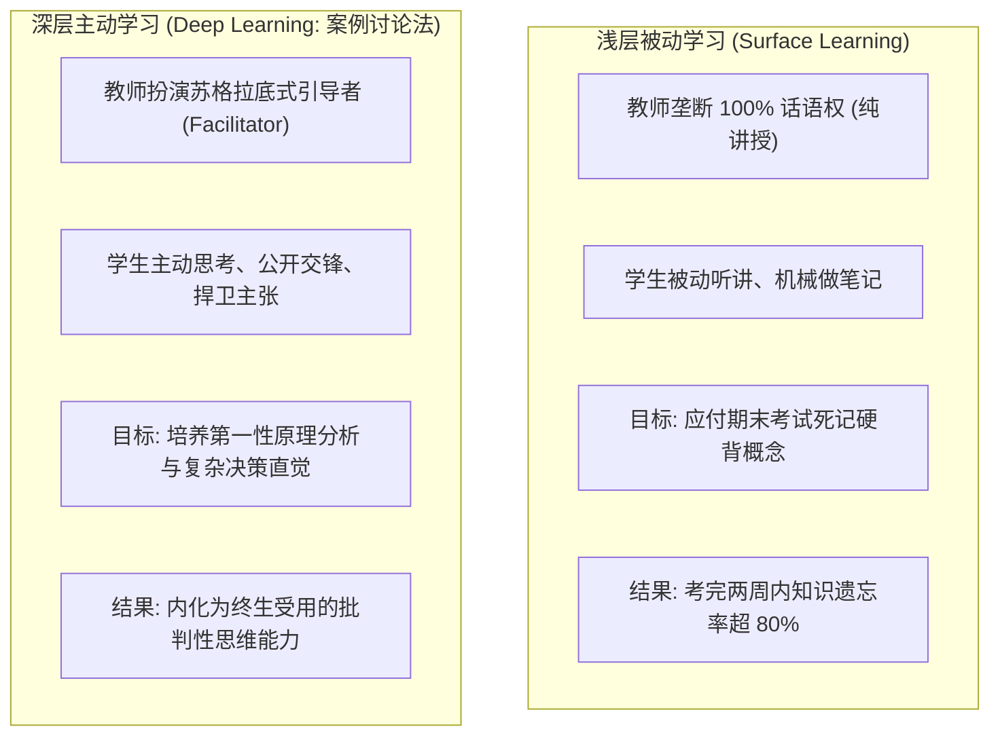
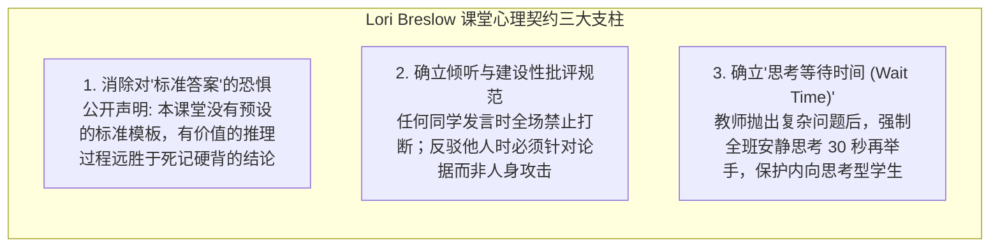
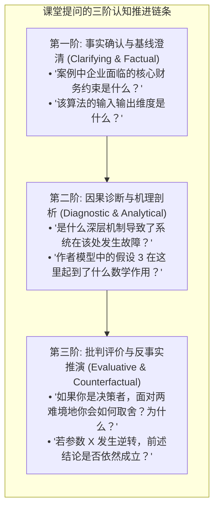
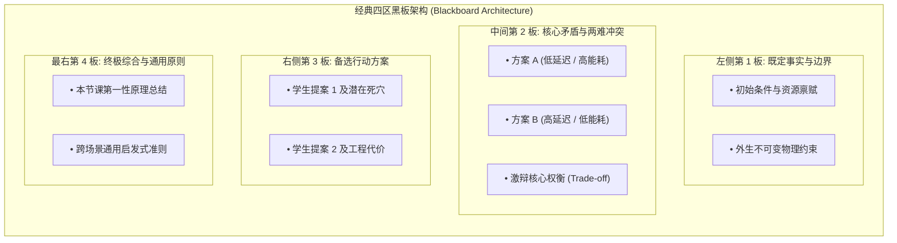

# Lec 9 学术教学与课堂讨论引导（Teaching for Academics: Leading Discussions and Case Method）

> **授课教师**：Prof. JoAnne Yates（MIT Sloan） ｜ **内容来源**：MIT 15.289 经典教学研讨与哈佛/斯隆案例教学法  
> **核心文献**：C. Roland Christensen, *"The Discussion Teacher in Action: Questioning, Listening, and Response"*; Lori Breslow, *"Contracts in the Classroom"*; Paul Rhem, *"Deep vs. Surface Approaches to Learning"*.

## TL;DR

- 青年学者在从“纯研究者”向“大学教师”转型的过程中，必须完成从“单向灌输式讲授”向“苏格拉底式互动引导”的心智跃迁。
- 建立开课第一天的“课堂心理契约（Classroom Contract）”，明确发言规则、心理安全感与相互倾听规范，是消除课堂冷场的制度基石。
- 掌握基于布鲁姆认知层级（Bloom's Taxonomy）的“提问三阶金字塔”：事实澄清型 $\to$ 因果诊断型 $\to$ 批判评价与反事实推演型。
- 经典案例教学法（Case Method）要求掌握“黑板空间架构学（Blackboard Architecture）”，通过对全班分散观点的动态归纳与综合，引导学生自主涌现高阶洞见。

## 学术职业的第二支柱：从研究者到授课教师的角色转换

在顶尖研究型大学中，教职评估与终身教职（Tenure）评审虽然以学术发表为主导，但在招聘面试（Job Market）以及日常教学评估中，**教学能力往往拥有一票否决权**。招聘委员会绝不敢聘用一位科研虽强但在讲台上毫无亲和力、无法驾驭本科生与 MBA 课堂的自闭型学者。

MIT Sloan 管理学院将“课堂讨论引导（Discussion Leadership）”列为 15.289 的核心训练模块。学术教学绝非将论文正文机械投影在幕布上念给学生听，其核心挑战在于：**如何激发学生的深层主动学习（Deep Learning），将课堂转变为一个充满思想激荡的知识共创工坊**。

::: definition 深层学习（Deep Approach to Learning）
一种旨在探究知识底层意义、内在逻辑联系与批判性应用的教育哲学。学生在此模式下不仅仅是信息的被动接收者，而是在教师的结构化问题引导下，主动将新概念与先前认知结构整合，解决非结构化复杂现实挑战。
:::

## 课堂契约理论：布雷斯洛（Lori Breslow）环境构建法

MIT 教学中心名誉主任 Lori Breslow 指出，许多年轻助教与新晋助理教授在初次走上讲台时，最恐惧的噩梦是：**抛出一个精心准备的问题，全场陷入长达数十秒的死一般沉默（Dead Air）**。

### 为什么学生会选择沉默？

学生在课堂上的沉默，绝大多数情况下并不是因为“学生不知道答案”，而是因为**缺乏心理安全感（Psychological Safety）**：
- 学生害怕自己的回答被教授公开否定，显得自己很愚蠢；
- 学生害怕因言辞不当被同龄人嘲笑或排斥；
- 课堂没有建立清晰的发言游戏规则，学生不知道“什么样的回答是受鼓励的”。

在学期第一堂课的前 15 分钟，明智的授课者会与全班共同敲定这份**课堂契约（Classroom Contract）**。一旦学生意识到哪怕回答出现逻辑偏差也会被教授温柔转化为全班的启发性反例，课堂的发言互动率便会呈指数级攀升。

## 提问的艺术：克里斯滕森（C. Roland Christensen）三阶金字塔

哈佛商学院案例教学之父 C. Roland Christensen 在经典随笔中指出：**讨论型教师的核心武器不是他的答案，而是他精心调谐的提问链条（The Questioning Sequence）**。

结合布鲁姆认知分类法（Bloom's Taxonomy），讨论型课堂的提问必须遵循自下而上的“三阶金字塔”推进：

### 课堂提问技巧实战要领

1. **第一阶问题用来“建立信心与全员对齐”**：在讨论开始时，绝对不要直接抛出宏大且空泛的哲学问题（如 *"What do you think of this paper?"*），这必定导致冷场。应从人人都能轻易回答的事实性问题起步，唤醒课堂发音器官；
2. **第二阶问题用来“引爆认知冲突”**：当两名同学对某一现象给出不同解释时，教师迅速将矛盾挑明：*"Notice that Alex thinks latency is bound by memory bandwidth, while Sarah argues it is blocked by lock contention. Where is the tipping point between these two explanations?"*；
3. **第三阶问题用来“实现知识迁移”**：将课堂讨论从特定的纸面案例，升华到跨行业、跨领域的通用决策法则。

## 黑板架构学（Blackboard Architecture）：即时思维的外化与结构化

在案例讨论与互动型研讨课中，黑板或白板（Chalkboard / Whiteboard）不是教师随手涂鸦草稿纸，而是一份**全班集体智慧的动态思维导图**。

优秀教师在课前就已经在笔记本上规划好了整块黑板的**版面分割协议（Blackboard Layout）**：

### 黑板管理的三大铁律

1. **分类归纳而非机械记录**：学生在发言时通常语言碎散、缺乏条理。教师绝不能逐字照抄学生的碎话，而应在脑海中将其瞬间解码，精炼为具有学术严谨度的 2~3 个核心关键词，并准确写在相应的黑板分区内；
2. **视觉留存与思维复盘**：被写上黑板的文字是全班后续论辩的锚点。绝不要过早擦拭黑板！在课程最后 5 分钟，教师指着四块黑板串讲全场同学的发言逻辑，能让全班学生感受到强烈的知识成就感；
3. **肢体空间站位**：写板书时切忌长时间背对全班（将后背完全暴露给学生会瞬间切断课堂凝聚力），应当侧身站立，一边书写一边保持余光感知全场反应。

## 极端课堂局面的化解心法

| 棘手课堂场景 | 常见错误处理 | 顶尖学者的化解策略 |
|---|---|---|
| **抛出问题后陷入死寂沉默** | 教师忍受不了沉默，直接自己说出答案（彻底破坏后续互动） | 保持微笑与眼神探询，等待整整 10 秒；若仍无人发言，降低提问阶梯：*"Let's break this down. Before we decide what to do, who can remind us what happened at Step 2?"* |
| **个别强势学生垄断全场话语** | 任由其滔滔不绝，其他学生彻底沦为旁观者 | 身体转向其他区域，礼貌切断：*"Thank you, David, for mapping out that perspective. Now I want to hear specifically from the back row: how would a systems engineer respond to David's plan?"* |
| **学生给出了显然荒谬的错误回答** | 当场直斥其非：*"No, that is completely wrong."*（瞬间摧毁心理安全感） | 提取其合理元素，转化为教学切片：*"That is an intriguing intuition. If condition X held, you would be absolutely right. But what happens to that logic once temperature drops below zero?"* |

## 我的理解：教学是反哺科研的最强试金石

::: insight 深入见解：在讲台上重新发现科研第一性原理
物理学大师理查德·费曼曾强调，教学与科研从来不是非此即彼的精力消耗，而是深度共生的循环。  
当你在黑板前面对几十双清澈而挑剔的眼睛时，所有在论文中被复杂的数学推导和代码混淆所掩盖的逻辑漏洞，都会被学生直击本质的朴素提问瞬间戳破。那些能把案例教学讲得深入浅出、让全班掌声雷动的学者，其在论文引言写作、同行答辩以及教职面试中的表现也必定出类拔萃。教学是学者终生锤炼“降维解释能力”的最强熔炉。
:::
