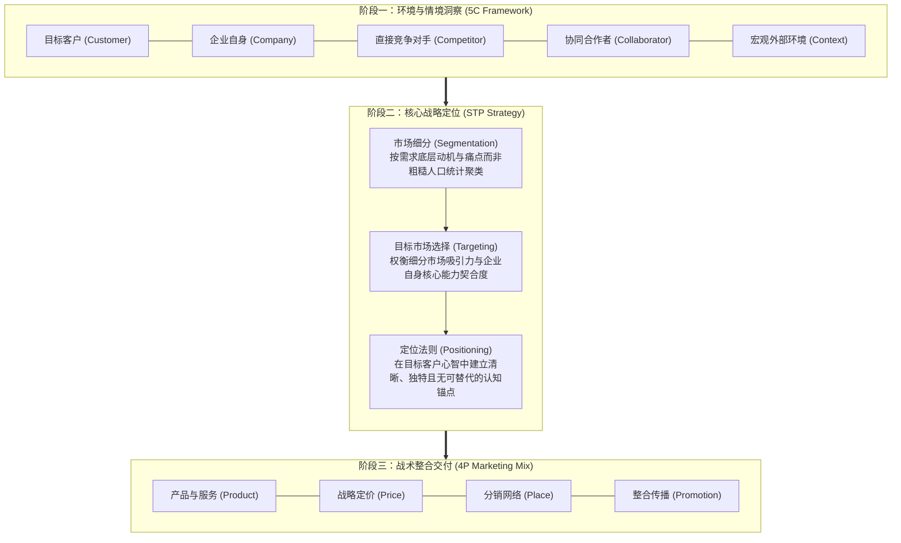
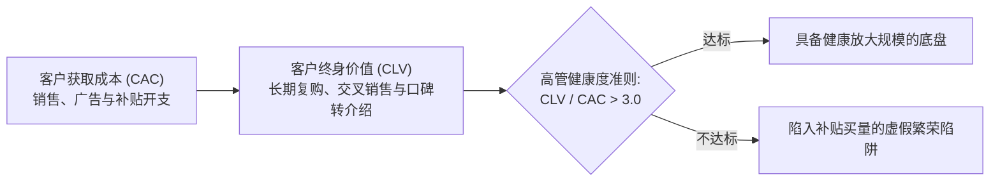
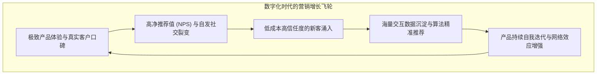

# Lec 18 营销管理总结与高管决策框架 (Marketing Management Conclusion & Executive Framework)

> MIT Sloan 15.732 · Marketing Management · 总结讲义

## TL;DR

- 构建高管营销决策的一体化战略罗盘：5C 环境分析 → STP 战略定位 → 4P 战术执行组合。
- 确立“客户终身价值”（CLV）与“客户资产”（Customer Equity）作为衡量营销 ROI 的终极财务标尺。
- 剖析数字化与平台经济对传统营销漏斗的重构：从线性“认知-购买”走向全生命周期共创与网络效应飞轮。
- 提炼面向最高管理层的战略定力准则：在战术喧嚣中坚守独特的差异化护城河与核心客户价值主张。

## 营销全景罗盘：从环境洞察到战术执行

在经历了 17 次课时的经典案例探讨与专题讲授之后，我们需要穿透具体的渠道操作与广告案例，建立高管视角下的结构化营销决策罗盘。营销绝非零散的广告投放或销售激励，而是一个高度自洽、步步为营的系统工程。任何脱离宏观环境与自身能力的定位，都会沦为纸上谈兵；任何缺乏清晰定位指引的战术 4P 动作，都只能陷入同质化的价格肉搏。高管的核心使命，在于确保从环境扫描、战略定位到战术交付的整条逻辑链条紧密咬合，形成无可撼动的战略协同力：

::: definition 5C-STP-4P 闭环逻辑
- **5C 负责回答“我们在哪里”**：全面评估客户未被满足的痛点、竞争格局的薄弱环节与合作者生态；
- **STP 负责回答“我们要去向何方”**：决定为谁服务、不为谁服务，以及如何在客户认知中建立制高点；
- **4P 负责回答“我们如何到达”**：产品交付价值，定价捕获价值，渠道流通价值，促销沟通价值。
:::

## 客户资产与终身价值模型（Customer Lifetime Value, CLV）

传统财务会计倾向于将营销支出全部计入当期费用（SG&A），导致管理层在业绩承压时本能地削减营销预算。现代营销管理要求高管建立**客户资产（Customer Equity）**投资模型：

$$CLV = \sum_{t=0}^{T} rac{(p_t - c_t) 	imes r_t}{(1 + d)^t} - AC$$

其中：
- $p_t - c_t$ 为客户在第 $t$ 期贡献的毛利润；
- $r_t$ 为第 $t$ 期的客户留存率（Retention Rate）；
- $d$ 为资本贴现率（Discount Rate）；
- $AC$ 为初始客户获取成本（Acquisition Cost, CAC）。

::: pitfall 仅盯获客量而忽视留存率的“漏桶效应”
许多由风投资本驱动的企业将 80% 营销预算砸向前端拉新买量（CAC 飙升），却对产品体验不佳导致的糟糕留存率（$r_t < 20\%$）视而不见。正如菲利普·科特勒所言：“留住一位老客户的成本只是获取一位新客户的五分之一。”没有高留存率支撑的规模扩张，无异于向一个千疮百孔的漏桶里疯狂注水。
:::

## 数字化重构：从线性漏斗到增长飞轮

在互联网与数据驱动时代，传统的 AIDA 线性销售漏斗（Attention → Interest → Desire → Action）正在被**动态增长飞轮（Growth Flywheel）**所取代：

在飞轮模型中，客户不仅是交易的终点，更是驱动企业下一轮增长的最核心发动机。

::: insight 营销的终极境界是让销售变得多余
管理大师彼得·德鲁克曾留下跨越时代的论断：“**营销的目的，在于充分深入地理解客户，使产品或服务完全适合客户的需求，从而使销售成为多余**。”企业最高管理层的终极使命，不是招募一支庞大的狼性销售军团去强推平庸的产品，而是从顶层战略出发，将独特的客户洞见融入产品基因与组织肌理之中，让商业价值的交换自然而然地发生。
:::
