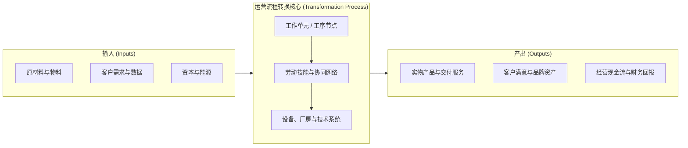
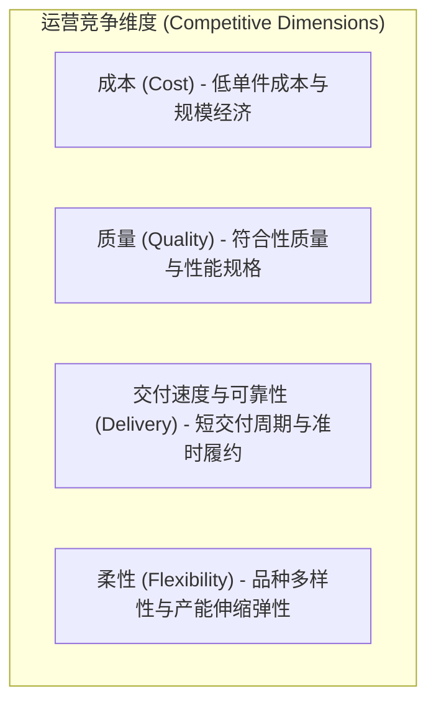

# Lec 1 运营流程架构与战略竞争优势 (Operations Strategy & Process Architecture)

> MIT Sloan 15.734 · Introduction to Operations Management · 主讲 Prof. Jérémie Gallien

## TL;DR

- 运营管理的本质是将劳动、资本、物料与信息等投入，以可预测且经济的方式转化为满足客户需求的产品与服务。
- 确立运营系统的三大核心底层度量指标：在制品库存 $I$、流转速度/产出率 $R$ 与流程耗时/流转时间 $T$。
- 企业战略的成败取决于“战略匹配度”（Strategic Fit）——运营能力必须与目标客户群体的价值主张严格协同。
- 识别“资格要素”（Order Qualifiers）与“制胜要素”（Order Winners），避免盲目追求单项运营指标而牺牲全局盈利。

## 运营流程的系统观：投入、资源与产出

在现代企业高管视野中，运营绝非局限于车间制造或客服中心的事务性执行，而是企业交付客户价值与建立持续竞争壁垒的底层机制。

任何业务系统均可抽象为由**投入（Inputs）**、**流程资源（Resources）**与**产出（Outputs）**构成的转换黑箱：

::: definition 运营管理核心三要素
1. **流转单元（Flow Unit）**：在流程中流转的具体实体。在离散制造中是零部件或成品；在医院是挂号患者；在金融服务中是一笔贷款审批卷宗。
2. **流程网络（Process Network）**：流转单元经历的一系列活动节点与缓冲区（Buffers）。
3. **流程资源（Resources）**：在流程执行中被消耗但不会物理整合进流转单元的生产要素，主要指人力工时与设备机器。
:::

## 核心流程度量指标（Core Process Metrics）

评估任何运营流程的运行状态，必须依赖三个基础物理量：

1. **产出率 / 流转速率（Throughput Rate, $R$）**：单位时间内流程产出合格流转单元的数量（如 件/小时、单/天）。在稳态下，产出率受制于流程瓶颈的产能与外部市场需求率的较小值。
2. **流转时间（Flow Time, $T$）**：一个流转单元从进入流程起点到离开流程终点所经历的全部时间，包含实际加工时间与排队等待时间。
3. **在制品库存（Inventory / Work-in-Process, $I$）**：处于流程边界内的所有流转单元总数（包括正在被处理和在各缓冲区等待的单元）。

::: example 金融贷款流程的度量诊断
某商业银行小微企业抵押贷款部门每月平均接收 1,200 笔申请。经审计，一笔申请从初审至放款平均经历 15 个工作日（假设每月 20 个工作日，即 0.75 个月）。
若流程处于稳态运行，该信贷部门在任何时点积压处理中的卷宗数量为：
$$I = R \times T = 1{,}200 \text{ 笔/月} \times 0.75 \text{ 月} = 900 \text{ 笔}$$
大量积压不仅占用信贷额度，更导致客户因漫长等待流失至互联网敏捷借贷机构。
:::

## 战略匹配与竞争维度（Strategic Fit）

Wickham Skinner 在《制造是战略缺失的环节》（Manufacturing - Missing Link in Corporate Strategy）中指出：不存在适用于所有商业模式的“万能最优工厂”。运营系统必须在以下四大竞争维度之间进行战略取舍（Trade-offs）：

::: pitfall 盲目追求局部指标的伪优化
许多制造业高管常犯的经典错误是“单纯考核设备利用率”。为了拉高昂贵冲压机的利用率，工厂连续数周大批量生产单一型号零件，导致海量中间库存积压，库房爆满。当市场需求转向新型号时，旧物料被迫折价报废，最终全流程的持有成本与呆滞损失远超局部利用率节省的折旧。
:::

::: insight 战略意图与运营契约
运营战略的核心不是“把所有事情都做好”，而是建立明确的“运营契约”（Operational Contract）：明确哪些是获得市场准入资格的“资格要素”（Order Qualifiers，如及格的交付合格率），哪些是决定客户最终下单支付溢价的“制胜要素”（Order Winners，如极致的交期速度或深度个性化定制）。企业的资源配置必须向制胜要素形成不对称倾斜。
:::
