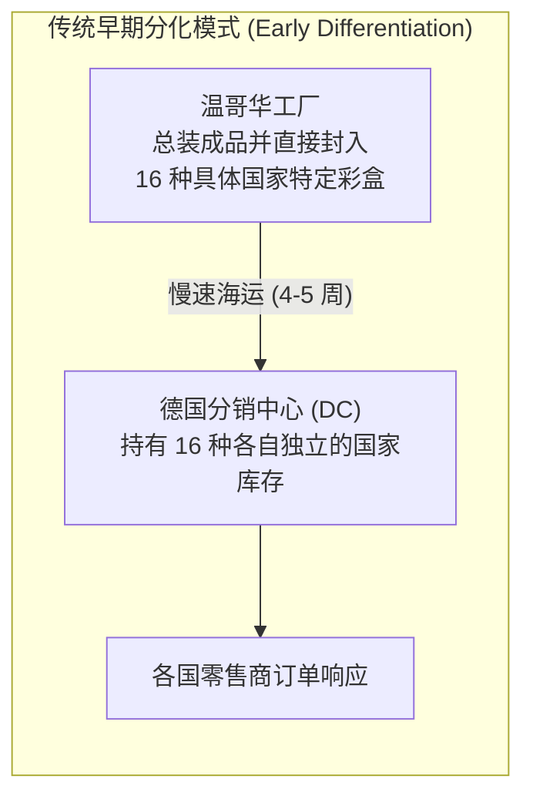
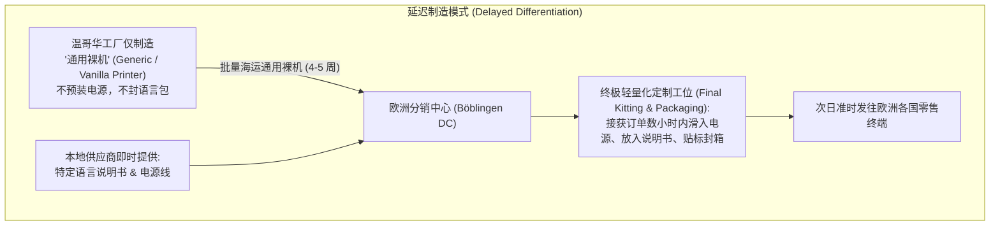

# Lec 10 惠普 DeskJet 案例：延迟制造与模块化通用设计 (HP DeskJet Postponement)

> MIT Sloan 15.734 · Introduction to Operations Management · 主讲 Prof. Jérémie Gallien

## TL;DR

- 剖析惠普（Hewlett-Packard）DeskJet 打印机供应链全球本地化膨胀的经典困境。
- 拆解多国语言包、电源制式差异与漫长海运周期叠加产生的跨国库存积压与缺货并存乱象。
- 确立供应链战略最具革命性的武器：延迟制造（Postponement / Delayed Differentiation）。
- 阐明产品模块化通用设计与物流网络重构的协同机制，量化安全库存与总运营成本的几何级骤降。

## 全球化扩张下的欧洲分销泥潭

1980 年代末，惠普公司（HP）在温哥华工厂成功研发出极具市场颠覆性的台式喷墨打印机 DeskJet。产品因卓越的打印品质与亲民价格在全球迅速爆发。

然而，在欧洲市场（由德国伯布林根 Böblingen 分销中心 DC 负责统筹交付），惠普遭遇了惨烈的供应链滑铁卢：
- 欧洲各国由于语言、插头标准与法律监管不同，存在多达 **16 种不同国家规格的 DeskJet 衍生型号**（如法语版、德语版、英国版、西班牙版等）；
- 核心差异在于：不同的内置电源模块（110V vs. 220V）、不同插头电源线，以及厚重的本地语言使用手册；
- 打印机在温哥华出厂时，便由流水线组装并封装成特定国家的最终零售彩盒；
- 从温哥华工厂通过海运经巴拿马运河抵达德国鹿特丹港，再陆运至 Böblingen DC，海运前置期长达 **4–5 周**！

### 乱象：各型号严重短缺与爆仓同时上演

欧洲分销中心常常面临冰火两重天的荒谬绝境：
- 德国市场需求暴涨，德语版 DeskJet 全面断货，大型零售商因断供发出严厉索赔；
- 与此同时，法国与英国市场需求低于预期，法语版与英国版打印机在仓库堆积如山，仓库爆满不得不外租临时库房；
- 虽然仓库里堆着成千上万台机器，但因为电源和说明书不同，德国分销中心**无法拿法语版去满足德国客户**！若在欧洲强行拆箱返工置换，开箱损耗成本与二次包装人工费极其高昂。
- Böblingen DC 被迫常年压制高达数千万美元的超额安全库存，但全欧洲客户交付服务水平依然徘徊在令人难以接受的 90% 甚至更低。

## 革命性重构：延迟制造（Postponement）

面对欧洲分销中心数千万美元的库存包袱与客户抱怨，惠普内部爆发了激烈的战略辩论。传统的物流改善方案无外乎增加安全库存或租用更多仓储空间，但这些方案无一例外会推高营运资金占用。惠普供应链专家 Laura Rock Kopczak 与 Brent Cartier 提出了颠覆性的战略重构方案：**延迟制造（Postponement）**，又称**延迟分化（Delayed Differentiation）**。该方案不再试图去提高对各个不可预测小国家的预测准确度，而是从系统架构层面彻底消除分化。

### 核心设计原则

延迟制造的核心思想，是将“产品形态分化为具体国别规格的时间点”，从最初的大规模生产制造环节（北美温哥华工厂），尽可能向后推迟到最靠近客户最终订单的环节（欧洲区域分销中心）。在传统模式下，产品出厂即定型；而在延迟制造模式下，出厂的只是没有任何文化与电气特性的通用中间体。通过在物流网络的最末端完成最终的差异化配置，系统将不可预测的多国随机需求在长途运输干线上汇聚为稳定的单一总量需求，从而以最小的库存沉淀撬动极高的现货服务水平：

## 技术与产品架构协同改造

要实现延迟制造，纯粹依靠物流调整是不可能的，必须依托**产品架构（Product Architecture）的工程再设计**：
1. **电源外置化与通用化设计**：重新设计 DeskJet 内部主板，取消原本焊接在机器深处的内部电源，将其改造为外挂式模块（类似笔记本电脑的电源适配器）；
2. **免工具卡扣式包装设计**：彩盒包装重新设计为预留侧面滑槽，使分销中心的操作工只需在外部滑动，即可在数秒内塞入对应的本地电源与说明书，无需拆解机身主结构；
3. **分销中心轻量化组装（DC Localization）**：Böblingen DC 从单纯的托盘吞吐仓库，升级为具备初级包装与定制能力的柔性配送中枢。

## 卓越的经济学量化回报

实施延迟制造后，惠普获得了惊人的供应链改善红利：

| 评估指标 | 传统模式（温哥华早期封箱） | 延迟制造模式（欧洲 DC 终极组装） | 改善幅度与收益来源 |
| :--- | :--- | :--- | :--- |
| **安全库存持有金额** | 约 $3,800 万美元 | 降至约 $2,300 万美元 | **立即释放 $1,500 万美元沉淀现金**（利用风险池化效应） |
| **客户服务水平（准时交付率）**| 约 92% | 飙升至 **98% 以上** | 彻底消灭因型号结构性错配导致的缺货 |
| **国际海运立方利用率** | 较低（彩盒含大量空气缓冲泡沫）| 提升约 20% | 裸机高密度纸箱集装箱海运，显著降低海运费 |
| **清仓折价与退货返工成本** | 每年约数百万美元 | 几乎降为零 | 避免了滞销国别机器的拆箱返工损耗 |
| **新增本地定制成本** | $0 | 每台仅增加微量手工组装费（<$2）| 远远低于库存削减与运费节约的收益 |

::: definition 延迟制造的三种经典形式
1. **时间延迟（Time Postponement）**：产品制造完成，但不提前分销推送到零售终端，而是集中放在中央大仓，待收到订单后用快速空运精准直达。
2. **形态延迟（Form Postponement）**：物料保持在通用的未分化中间状态，直到收到特定订单才完成最后一道工序（如 Benetton 先织白毛衣再按流行色染色、漆料店在基础白漆中现场调色）。
3. **空间延迟（Spatial Postponement）**：将总装工序物理剥离至消费地所在的分销中心或终端门店（如 Dell 电脑按订单装配、HP DeskJet）。
:::

::: pitfall 忽视上游研发与下游供应链的割裂
许多跨国企业的研发部门只考核“硬件采购 BOM 成本”，为了省下 50 美分的电源芯片成本，往往选择将电源焊死在主板内部，却对下游供应链因此产生数千万美元的库存积压与跨国运输浪费视而不见。延迟制造的推行，必须由最高经营层打破研发、制造与物流之间的部门深井。
:::

::: insight 架构设计是运营敏捷的终极杠杆
HP DeskJet 案例证明了现代供应链管理的核心真理：**最优秀的供应链优化不在物流网络里，而在产品图纸上**。当产品被设计成由独立、模块化、标准化的通用构建块构成时，运营系统便天然获得了对抗全球不确定性的免疫力。高管应当学会用“可制造性与可分销性设计（Design for Supply Chain）”的视角审视每一个研发决策。
:::
