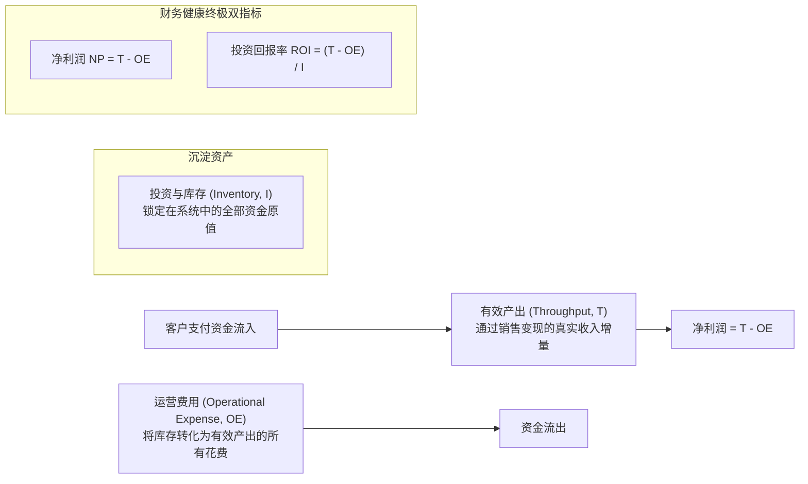
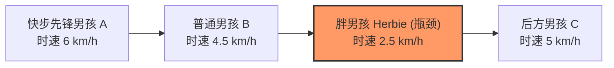
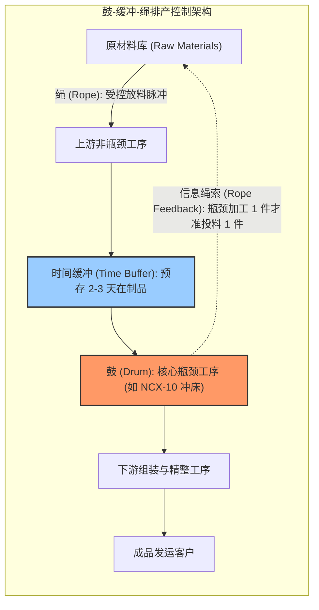
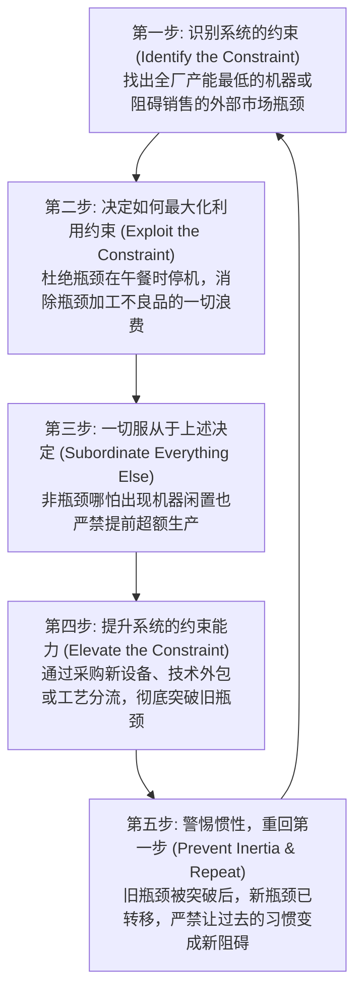

# Lec 11 《目标》（The Goal）：约束理论（TOC）与瓶颈管理 (Theory of Constraints & The Goal)

> MIT Sloan 15.734 · Introduction to Operations Management · 主讲 Prof. Jérémie Gallien

## TL;DR

- 梳理高德拉特（Eliyahu Goldratt）企业管理小说《目标》所阐述的约束理论（Theory of Constraints, TOC）。
- 用“有效产出会计”（Throughput Accounting）重构传统成本会计的误区：界定有效产出 $T$、投资库存 $I$ 与运营费用 $OE$。
- 掌握“鼓-缓冲-绳”（Drum-Buffer-Rope, DBR）排产控制系统，以瓶颈为节拍锚定全厂流动。
- 掌握约束理论五大聚焦步骤（Five Focusing Steps），实现从车间局部优化向全局协同突破的持续跃迁。

## 企业的终极目标与传统成本会计的破产

在制造业与现代服务企业中，厂长与高管每天都被淹没在纷繁复杂的指标汇报中：机器利用率、工人工时效率、单件吸收成本、库存资产净值。以色列物理学家兼管理大师高德拉特在《目标》一书中开门见山提出了终极追问：**企业的真正目标是什么？**

答案只有一个：**现在以及未来持续不断地赚取利润（Make Money）**。

传统管理会计（Standard Cost Accounting）推行“全成本分摊法”（Absorption Costing），将机器折旧和厂房租金等固定成本人为摊薄到每一件在制品中。这种做法制造了一个巨大的道德风险陷阱：**车间只要拼命开工制造零件（哪怕堆在库房无人问津），报表上的单件生产成本就会被摊低，从而在账面上凭空“创造”纸面虚假利润**。

高德拉特提出了由三大物理概念构成的**有效产出会计（Throughput Accounting）**：

::: definition 有效产出会计三大度量基石
1. **有效产出（Throughput, $T$）**：系统通过**实际销售**产生现金流入的速率。注意：未卖给客户而在仓库堆积的产成品，有效产出为零！
   $$T = 	ext{销售收入} - 	ext{完全变动原材料成本}$$
2. **投资与库存（Inventory / Investment, $I$）**：系统为准备投入销售而购买并沉淀在内部的全部资金（含原材料、在制品采购成本、厂房机器设备，仅按采购原值计算，严禁计入人工增值分摊）。
3. **运营费用（Operational Expense, $OE$）**：系统为了将库存转化为有效产出而付出的全部支出（包括全员工资、租金、电力、折旧等固定支出）。
:::

企业的全部运营决策，必须严格检验其对这三个指标的联合影响：目标是**最大化 $T$，同时持续压缩 $I$ 与 $OE$**。

## 徒步童子军隐喻与统计波动的累积

在小说中，主人公 Alex Rogo 带领童子军徒步登山的故事形象揭示了制造业流动的本质困境：
- 队伍中每名小男孩的行走速度各不相同（代表工序产能差异）；
- 走在队伍中间的胖男孩 Herbie 走路最慢，背着沉重的背包（代表系统瓶颈工序）；
- 行走受地形起伏影响（代表随机变异与工序波动）。

当队伍前进时，前方走得快的孩子不断向前拉开距离，而后方的人受制于 Herbie 无法超车。结果队伍首尾跨度被拉长到数公里（相当于流水线上在制品库存 $I$ 暴增数倍），而整支队伍到达山顶营地的时间（流转时间 $T_{	ext{flow}}$）完全由最慢的 Herbie 决定！

Alex 的顿悟在于：**必须将 Herbie 调整到队伍的最前列，并由全体队员分担分装他背包里的沉重物料（卸载瓶颈负荷）**。全队的行进节奏由此被约束锁定，队伍紧密相连，零拥堵到达终点。

## 鼓-缓冲-绳控制系统（Drum-Buffer-Rope, DBR）

在离散制造车间，TOC 推行了著名的 DBR 生产控制架构：

1. **鼓（Drum）**：系统的瓶颈资源是全厂的心脏。瓶颈的运行节拍就是全厂必须遵从的鼓点，所有主生产排程（Master Schedule）必须严格围绕瓶颈的日历可用工时展开编制。
2. **缓冲（Buffer）**：瓶颈停机 1 小时，全厂损失 1 小时产出且永不可逆。因此，必须在瓶颈工位前建立专用的**时间缓冲（Time Buffer）**（例如提前 48 小时到达物料），确保上游哪怕发生断电停机或设备检修，瓶颈前方永远有充足工单等待加工，绝不停机。
3. **绳（Rope）**：连接瓶颈与产线入口的虚拟信息绳索。严格禁止上游工序为了刷工时效率而随意投料；只有当瓶颈消耗了 1 个工单并发出拉动信号时，产线入口才被允许释放等量的原材料投产。

## 持续改善的五大聚焦步骤（Five Focusing Steps）

高德拉特指出，任何管理体系如果不聚焦，就会陷入无休止的资源内耗。TOC 确立了指导企业变革的五步迭代闭环：

::: pitfall “让所有机器与员工持续忙碌”的毒丸
工厂里最有害的陈腐观念莫过于“看见工人站着闲聊就觉得管理失败”。在 TOC 哲学中，**非瓶颈工序的利用率不应由自身能力决定，而应严格由瓶颈的节奏决定**。强制要求非瓶颈保持 100% 负荷，除了在车间地面堆积成山的报废与占款在制品，对最终将货物交付客户赚取真金白银毫无裨益。
:::

::: insight 约束是管理者的聚光灯
复杂的企业系统往往包含数千名员工与数万个零件，高管极易陷入细节汪洋大海。约束理论最伟大的贡献在于提供了一种极致的认知减负：**在任何特定时刻，决定系统整体产出上限的物理瓶颈通常只有 1–2 个**。高管无需试图搞定所有事情，只要将 90% 的战略聚焦度与资源砸在当前的核心约束上，就能以最小的力矩撬动全系统的指数级增长。
:::
