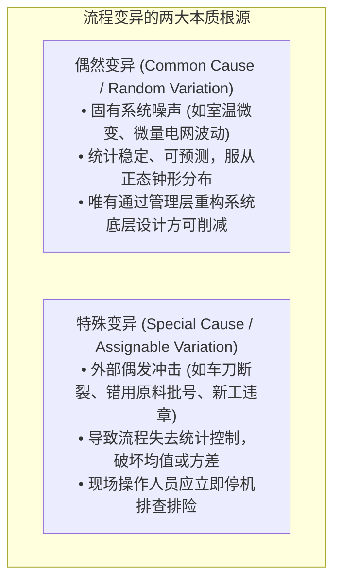
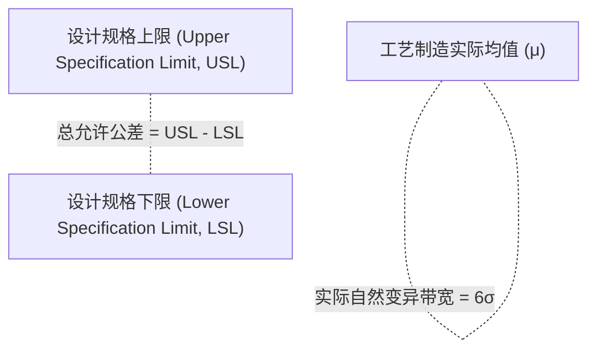
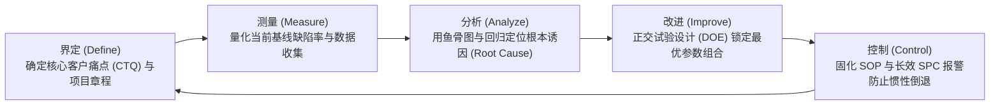

# Lec 12 质量管理：统计过程控制（SPC）与六西格玛 DMAIC (Quality Management: SPC & Six Sigma)

> MIT Sloan 15.734 · Introduction to Operations Management · 主讲 Prof. Jérémie Gallien

## TL;DR

- 区分工业波动的两大根源：不可避免的“偶然原因变异”（Common Cause）与必须根除的“系统原因变异”（Special Cause）。
- 掌握休哈特统计过程控制图（SPC Control Charts）的数理边界与受控判据。
- 严密计算过程能力指数（$C_p, C_{pk}$），厘清制造公差与统计分布离散度的对应关系。
- 剖析六西格玛管理哲学及其 DMAIC 持续改善闭环，量化质量成本（Cost of Quality）在预防与失误之间的结构重组。

## 变异的哲学：休哈特与戴明的洞察

在工业时代早期，企业习惯在流水线末端设立庞大的检验科，通过“筛出坏零件并报废”来保证出厂品质。现代质量之父休哈特（Walter Shewhart）与戴明（W. Edwards Deming）指出：**质量是制造出来的，不是检验出来的；事后挑选不良品是极度昂贵的管理无能**。

任何制造或服务流程必然存在输出波动。波动按其内在机理严格划分为两类：

::: definition 统计受控状态（In Statistical Control）
一个生产或业务流程若消除了所有的“特殊原因变异”，仅仅在“偶然原因变异”的固有系统边界内运行，该流程被称为处于**统计受控状态**。受控流程并不必然意味着产出 100% 达标，但其质量输出具备了统计学上的高度可预测性。
:::

## 统计过程控制（SPC）与控制图构造

休哈特控制图利用数理统计的 $3\sigma$ 原则，为流程建立运行安全边界：

### 均值-极差控制图（$ar{X}-R$ 图）数学构建

对连续工序进行定时小样本抽样（每次抽取样本容量 $n = 4 \sim 5$ 件，共抽取 $m$ 组）：
1. **$ar{X}$ 图（监控流程中心均值漂移）**：
   $$	ext{CL} = ar{ar{X}} = rac{1}{m} \sum_{i=1}^m ar{X}_i, \quad 	ext{UCL} = ar{ar{X}} + A_2 ar{R}, \quad 	ext{LCL} = ar{ar{X}} - A_2 ar{R}$$
2. **$R$ 图（监控流程内部离散离差波动）**：
   $$	ext{CL} = ar{R} = rac{1}{m} \sum_{i=1}^m R_i, \quad 	ext{UCL} = D_4 ar{R}, \quad 	ext{LCL} = D_3 ar{R}$$
   （$A_2, D_3, D_4$ 为由样本量 $n$ 决定的标准工程系数）。

::: pitfall 混淆“控制界限”与“规格公差”
运营新手的致命错误是将 SPC 图上的**控制界限（UCL / LCL，代表机器能做出的实际波动）**，与客户图纸给定的**规格公差限（USL / LSL，代表客户期望的要求）**混为一谈。控制限完全由工序的历史统计标准差算得，与客户规格毫无数学关联。
:::

## 过程能力指数（Process Capability: $C_p$ 与 $C_{pk}$）

即便一个流程处于绝对的统计受控状态，如果其固有变异带宽大于客户允许的公差，依然会源源不断产出不良废品。

### 1. 潜在过程能力指数 $C_p$（衡量波动宽度）
$$C_p = rac{	ext{客户允许公差范围}}{	ext{系统自然波动宽度}} = rac{	ext{USL} - 	ext{LSL}}{6\sigma}$$
- $C_p < 1.0$：过程能力严重不足，即使完全对准中心，也必定持续产出次品；
- $C_p = 1.33$：传统工业合格基准线（允许公差是实际自然离散度的 1.33 倍）；
- $C_p \ge 2.0$：六西格玛制造卓越标准。

### 2. 实际过程能力指数 $C_{pk}$（修正中心偏移）
实际制造中，均值 $\mu$ 往往偏离规格中心点（Offset）：
$$C_{pk} = \min \left( rac{	ext{USL} - \mu}{3\sigma}, rac{\mu - 	ext{LSL}}{3\sigma} 
ight) = C_p (1 - k)$$
其中 $k = rac{|\mu - 	ext{Target}|}{(	ext{USL} - 	ext{LSL})/2}$ 代表中心偏移系数。$C_{pk}$ 永远小于等于 $C_p$。唯有当 $C_{pk} \ge 1.33$ 时，生产线才能被准许大批量交付。

## 六西格玛哲学与 DMAIC 改善循环

1980 年代摩托罗拉（Motorola）副总裁 Bill Smith 提出、后由通用电气（GE）杰克·韦尔奇推向顶峰的**六西格玛（Six Sigma）**，将质量标准推向了统计极限：

::: definition 六西格玛极限品质
在允许长周期内工艺均值发生 $1.5\sigma$ 典型漂移的前提下，达到六西格玛标准意味着产品的缺陷率不超过 **3.4 PPM（每百万次机会仅 3.4 个缺陷）**，即一次合格率高达 99.99966%。
:::

### DMAIC 闭环方法论

## 质量成本模型（Cost of Quality, CoQ）

企业高管常误以为“提高质量必然推高制造成本”。朱兰（J. M. Juran）的质量成本框架打破了这一迷思：

| 质量成本类别 | 典型发生项目 | 传统粗放工厂占比 | 六西格玛标杆工厂占比 |
| :--- | :--- | :--- | :--- |
| **预防成本（Prevention）** | 开展 DFMA 设计评审、供应商先期开发、员工质量培训 | 仅占 5%–10% | **大幅跃升至 50% 以上** |
| **鉴定成本（Appraisal）** | 实验室破坏性抽检、全检工人工资、计量仪器校准 | 约占 20%–25% | 优化至 20% 左右（依靠自动化在线检测） |
| **内部故障（Internal Failure）** | 车间工序废品丢弃、返修重熔、产线因不良停线窝工 | 约占 30%–40% | **断崖式压降至 < 5%** |
| **外部故障（External Failure）** | 客户退换货索赔、三包召回召回诉讼、品牌口碑毁灭 | 约占 30%–40% | **几乎完全归零** |

::: insight 质量是成本杀手，而非成本负担
将预防成本增加 1 美元（如做好公差分配设计），往往能在后端消灭 10 美元的内部返工损耗与 100 美元的外部召回灾难。现代六西格玛的终极要义，不是为了追求实验室里的完美主义，而是通过消灭变异，消除隐藏在工厂组织内部最庞大的“隐形废品工厂（Hidden Factory）”，将营运资本效率拉升至极致。
:::
