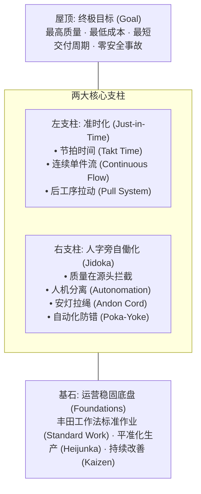
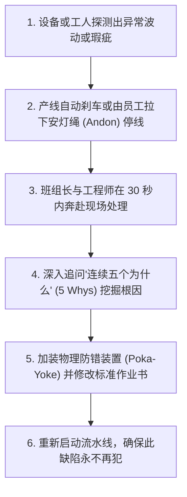
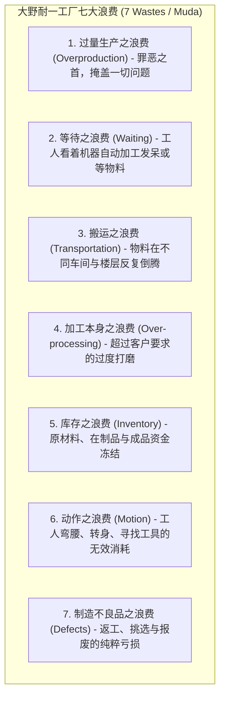

# Lec 13 丰田生产方式（TPS）：精益生产、自动化与杜绝七大浪费 (Toyota Production System)

> MIT Sloan 15.734 · Introduction to Operations Management · 主讲 Prof. Jérémie Gallien

## TL;DR

- 解构世界工业制造的最高殿堂：丰田生产方式（TPS）与精益生产（Lean）框架。
- 剖析支撑 TPS 大厦的两大核心支柱：准时化（Just-in-Time, JIT）与人字旁自働化（Jidoka）。
- 掌握安灯系统（Andon）、防错机制（Poka-Yoke）以及赋予一线员工拉停整条流水线权力的底层管理信任。
- 深度拆解大野耐一确立的工厂“七大浪费”（Muda），建立以单件流（One-piece Flow）为核心的流动模型。

## 战后废墟中的运营奇迹：丰田之屋（TPS House）

二战结束后，日本汽车工业面临内需狭小、资本极度匮乏、原材料严重依赖进口的残酷现实。丰田汽车社长丰田喜一郎与生产副社长**大野耐一（Taiichi Ohno）**意识到：全盘照搬美国福特式大批量、重资产流水线必死无疑。丰田必须探索一种能在多品种、小批量、极低资本占用下依然实现极致成本与品质的新型制造范式。

丰田管理层认识到，日本既没有美国那样数百万辆规模的单一车型本土大市场，也没有资金去承担大面积报废和多余库存。企业必须把每一分钱、每一平方米土地、每一名工人的动作都压榨出真实的客户价值。经过数十年沉淀，这一思想被提炼为世界闻名的“**丰田生产方式之屋（TPS House）**”。这座大厦生动地展现了精益体系的结构稳固性：屋顶代表终极商业目标，两大支柱是驱动系统运转的承重墙，而平准化作业与持续改善则是保障整座大厦在风浪中岿然不动的坚实地基：

## 支柱一：准时化生产（Just-in-Time, JIT）

JIT 的核心信条极其简练：**在需要的时候，按需要的量，生产需要的产品**。

1. **节拍时间（Takt Time）**：源自德语的“指挥棒节拍”。代表市场客户购买产品的节奏速度：
   $$	ext{Takt Time} = rac{	ext{每日净有效生产可用工作时间}}{	ext{每日客户平均订单需求量}}$$
   流水线上的每一道工序，必须严格根据 Takt Time 来设计作业组合，既不允许比节拍快（避免产出过剩），也不允许比节拍慢（避免导致断供）。
2. **连续单件流（One-piece Flow）**：传统批量制造是将 100 件零件装满一个周转箱，整箱推向下一工序。丰田通过彻底消除换模时间（SMED 快速换模法，将冲压机换模从 4 小时压缩到 3 分钟以内），实现工序间仅保留“1 件在制品”的单件无缝交接，将全厂制造流转时间削减 90% 以上。

## 支柱二：人字旁自働化（Jidoka）

在日语汉字中，丰田故意在普通的“自动化”左边加上了一个“亻”（单人旁），称为“自働化”（Autonomation），即**赋予机器以人类的智慧与判断力**。

::: definition 安灯拉绳（Andon Cord）的管理革命
在丰田的工厂里，每一位普工头顶都悬挂着一根连接中央警报灯箱的黄黑相间拉绳（Andon Cord）。任何一线工人只要发现零件装配受阻或扭矩扳手不达标，都有权力、更有**义务**立刻拉下警报绳，强制整条汽车装配流水线瞬间停运！在传统西方福特制工厂，擅自让流水线停机是会被当场开除的严重失职；而在丰田，如果一名工人发现了隐患却任由不良品流入下一道工序，才是最不可饶恕的背叛。
:::

::: example 防错机制（Poka-Yoke）的典型设计
- **数控接插件异形倒角**：工人在插入安全气囊传感器线束时，插头被设计成不对称物理梯形，反向绝对无法插入，从物理机构上彻底抹杀了人为误操作的可能。
- **光电感应拣料料盒**：装配某型号发动机需要特定螺栓，只有当工人右手伸入正确的零件箱时，料盒上方的光电开关才会熄灭绿灯，否则发出蜂鸣声并锁死后续气动枪气压。
:::

## 宣战：消灭制造系统中的“七大浪费”（Muda）

大野耐一将不产生增值的活动称为“Muda”（无駄/浪费），并总结了工业界经典的七大浪费：

大野耐一尤其强调：**过量生产（Overproduction）是七大浪费之首**。因为一旦过量生产，就会引发搬运、占用周转箱、需要额外仓储面积、雇佣叉车司机，更致命的是它让管理层对质量隐患产生麻痹，让所有问题在庞大的库存掩护下安然沉睡。

::: pitfall “形似神不似”的工具主义模仿
许多欧美及中国制造企业派管理团队赴日本丰田考察，回国后在车间地面画满黄线、贴满看板卡片并组织晨会喊口号，却往往以失败告终。原因在于他们复制了精益的“工具表象”，却缺乏 TPS 最底层的“对一线工人的尊重与授权”。如果一线员工拉停产线会遭到绩效扣罚，那么无论引进多少张看板卡，企业也永远无法孕育出自我进化的改善文化。
:::

::: insight 现地现物（Genchi Genbutsu）与反身性治理
丰田生产方式对现代企业高管最震撼的启示在于**管理认知的反身性**。管理大师大野耐一常年要求新入职的高管“在车间地板上用粉笔画一个直径 1 米的圆圈，站在圈内闭嘴观察流水线连续站立 8 小时”。唯有真正践行“现地现物（Genchi Genbutsu）”，跳出办公室精美的 Excel 报表与 PPT 叙事，亲眼目睹物料与人在物理时空中的流转摩擦，高管才能领悟系统真实运转的脆弱与壮美。
:::
