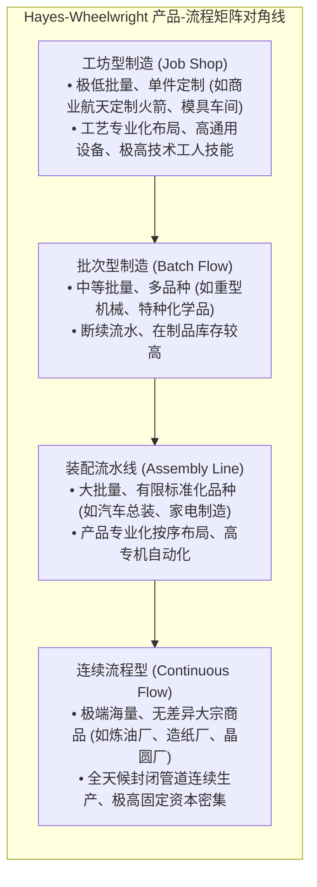
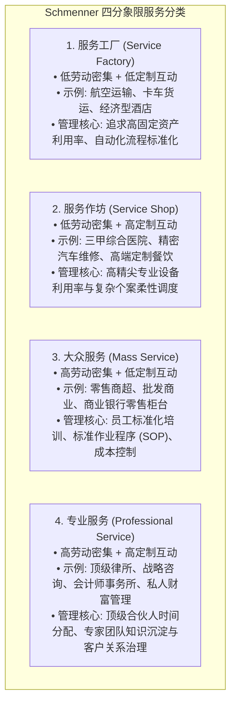
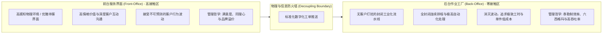

# Lec 14 服务与制造流程设计原则 (Process Design Principles)

> MIT Sloan 15.734 · Introduction to Operations Management · 主讲 Prof. Jérémie Gallien

## TL;DR

- 掌握哈佛商学院 Hayes-Wheelwright“产品-流程生命周期矩阵”，确立制造模式与产品形态的对角线匹配原则。
- 引入 Schmenner“服务流程矩阵”，依据劳动密集度与客户互动/定制程度诊断服务业态。
- 掌握服务运营的核心重构武器：前台（Front-office）与后台（Back-office）的物理与逻辑解耦。
- 剖析制造系统跨入“定制化规模生产”（Mass Customization）的技术条件与组织重塑路径。

## 制造流程光谱：Hayes-Wheelwright 矩阵

1979 年，哈佛商学院 Robert Hayes 与 Steven Wheelwright 提出了现代运营战略最重要的结构模型之一：**产品-流程矩阵（Product-Process Matrix）**。

这一模型深刻揭示了产品结构与工艺流程结构之间的内在匹配机理。工业生产从本质上并不存在孤立的最优流程，一个对于航天飞机零件极为高效的工坊，若拿来组装家用吸尘器就会彻底破产；反之，一条极其先进的自动化流水线，如果面对频繁变动的非标订单，也将陷入停滞。模型阐明：随着产品生命周期演进（从定制单件走向标准化海量大宗），企业的制造流程架构必须同步沿着主对角线发生演化。在这一动态演进的光谱上，工序的灵活性逐步让位于刚性效率，通用的机床逐步被高度专用的自动化设备取代，工人从依靠个人手艺的工匠逐步转变为监控精密流程的操作员：



### 偏离对角线的两大致命战略陷阱

在企业经营实践中，许多管理层往往由于贪图短期的订单诱惑，或者盲目迷信先进设备，导致组织不知不觉中偏离了对角线安全走廊。偏离对角线意味着企业的制造成本结构与所面对的市场竞争要素发生结构性断裂。无论偏向左下角还是右上角，都会使企业在竞争中遭受不可承受的惩罚——要么是成本居高不下无法抵御大厂的降价冲击，要么是流程僵化无法应对市场的个性化转移：

```text
                  产品结构 (Product Structure)
                低产量、单件定制       高产量、高度标准化
         ┌───────────────────────┬───────────────────────┐
流程结构 │     ★ 对角线健康匹配   │      陷阱 A:          │
工坊型   │ (Job Shop / 高柔性)   │  “工艺过于柔性，      │
(Jumbled)│  高单件成本/高溢价    │   无法支撑规模成本”   │
         ├───────────────────────┼───────────────────────┤
流程结构 │      陷阱 B:          │     ★ 对角线健康匹配  │
连续流水 │  “重资产锁定刚性产线，│ (Continuous / 极低成本)│
(Line)   │   无法应对小批量定制” │   规模经济统治市场    │
         └───────────────────────┴───────────────────────┘
```

::: pitfall 对角线漂移迷失
企业在扩张中最容易出现的战略失衡是“组织欲望与物理流程的脱节”：销售团队为了做大规模，向客户承诺提供个性化深度定制（将产品结构拉向左端）；但工厂内部却依然运行着为极高产量而设计的刚性流水线（流程结构仍在右端）。结果导致流水线为了应对小订单频繁停机换模，交期无限拉长，成本剧烈失控，两头不讨好。
:::

## 服务运营的拓扑学：Schmenner 服务流程矩阵

与实物制造相比，服务运营具有两大独特性质：**无形性（Intangibility）**与**生产与消费的同时发生性（Simultaneity）**。

制造企业的物理产品在离开车间后才被消费，因而可以设立质检台将次品拦下；但服务业的产出即刻被客户体验，任何流程瑕疵都会立即演变为真实的客户投诉。为了帮助服务企业高管诊断自身的运营模式，Roger Schmenner 依据两个核心维度构建了经典的**服务流程矩阵（Service Process Matrix）**：
1. **劳动密集度（Labor Intensity）**：资本设备成本与人力成本的比例；
2. **客户互动与定制化程度（Interaction & Customization）**：服务过程中客户干预与个性化定制的深度。通过这两个维度的交叉组合，清晰划分出四类性质迥异的服务形态：



## 服务流程重构之刃：前台与后台解耦（Front-Office vs. Back-Office）

服务业效率提升最经典的管理范式跃迁，是由 Chase (1978) 提出的**顾客接触理论（Customer Contact Approach）**：



::: example 零售银行与现代医院的前后台解耦实践
- **商业银行零售业务**：过去客户申请房贷，需要坐在柜台看业务员缓慢录入资料、复印身份证、逐行核对征信，客户等待极其焦躁，柜员也因客户在场压力极大容易录错。现代银行彻底实施解耦：前台只负责微笑验证身份并扫描基础证件（高接触区，3 分钟走人）；随后所有征信核查、抵押物估值、自动化风控跑批全部打包切入后台中央集中作业中心（零接触工业化工厂），全天候批量处理，成本压降 80%。
- **白内障眼科流水线（印度 Aravind 眼科医院）**：将昂贵眼科手术医生的时间视为绝对瓶颈。手术室配备双手术床，护士团队在前台完成全部麻醉、消毒与眼皮固定准备工作；主刀医生完成前一位病人的晶体置换手术后，仅需转身 180 度即可立即操作下一位已准备好的病人，医生单日手术量从传统 10 例飙升至 60 例以上，成本降为西方医院的 1/10。
:::

::: insight 组织架构与流程拓扑的同构性
企业高管在规划业务板块时，最常犯的错误是将前台人才放去管后台流程，或让后台思维统摄前台接触。前台追求的是“有效性（Effectiveness）”与客户体验峰值，容忍适当的等待冗余；后台追求的是“效率（Efficiency）”与极致利用率。高管的责任是清晰划定两者的边界隔离带，让流水线的归流水线，让温情的归温情。
:::
