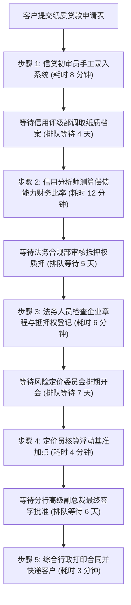
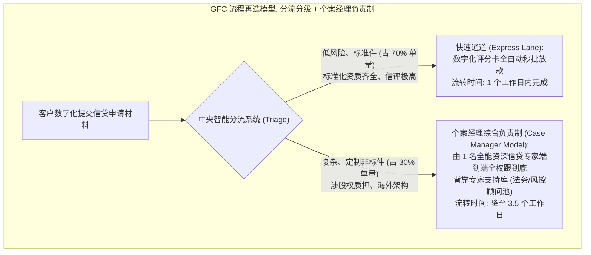

# Lec 15 环球金融公司案例：知识型金融服务流程再造 (Global Financial Corp.)

> MIT Sloan 15.734 · Introduction to Operations Management · 主讲 Prof. Jérémie Gallien

## TL;DR

- 剖析白领知识型服务流程中的典型流转弊病：环球金融公司（Global Financial Corp.）中小企业信贷业务危机。
- 揭示“加工时间与流转时间严重脱节”的惊人事实：22 个工作日的漫长审批中，实际增值作业仅 33 分钟。
- 运用迈克尔·哈默企业流程再造（BPR）理念，打破职能部门深井，确立“个案经理负责制”（Case Manager Model）。
- 实施分流分类（Triage）机制，运用数字化评分卡分流简单标准件与复杂高风险件。

## 商业信贷部门的瘫痪危机

环球金融公司（Global Financial Corp., 简称 GFC）是一家全美领先的跨国金融服务机构，其核心盈利板块之一是为年营收在 500 万至 5,000 万美元的中型企业提供商业信贷与设备租赁融资。

在 1990 年代中期的激烈竞争中，GFC 遭遇了严峻的客户流失：
- 销售代表抱怨：从向潜在借款客户拿到财报申请表，到最终授信放款，平均耗时长达 **22 个工作日（整整 1 个多月）**！
- 超过 40% 的优质借款企业因为无法忍受漫长等待，在审核中途直接撤回申请，投奔审批只需 1 周的区域敏捷商业银行；
- 与此同时，信贷部门的员工普遍疲惫不堪，加班费激增，信贷员声称人手严重不足，强烈要求管理层扩充 30% 人手。

## 流程审计诊断：令人震惊的增值比（Value-Add Ratio）

运营咨询顾问团队进入 GFC 后，对连续 500 笔贷款申请卷宗进行了全流程轨迹追踪与工时测算。审计结果震惊了最高管理层：

### 工时解构统计

- **流程总流转时间（Flow Time, $T$）**：平均 22 个工作日（以每日 8 小时计，共 **10,560 分钟**）；
- **全流程实际增值加工时间（Touch Time / Processing Time）**：
  $$8 + 12 + 6 + 4 + 3 = \mathbf{33 	ext{ 分钟}}！$$
- **流程增值效率（Process Efficiency）**：
  $$	ext{Value-Add Ratio} = rac{33 	ext{ 分钟}}{10{,}560 	ext{ 分钟}} pprox \mathbf{0.31\%}！$$

在长达 22 天的漫长等待中，**99.7% 的时间卷宗只是静静躺在各个部门的进件蓝塑料框（In-basket）里排队吃灰**，或者在楼层之间的内部邮件收发室穿梭！

### 职能深井与返工死循环（Functional Silos）

漫长的工期不仅是排队问题，更由组织割裂引起：
1. **部门割裂与交接损耗**：每个部门（初审、风控、法务、定价）都是独立的职能王国。每个人在拿到卷宗的前 5 分钟，都必须重新阅读数十页背景材料以重建对该客户的认知，造成巨额认知预热浪费；
2. **缺乏全流程责任人**：当客户致电询问“我的贷款审批到哪一步了”时，销售代表在系统里根本查不到卷宗在谁桌上，只能尴尬回复“正在各部门例行审核中”；
3. **返工黑洞**：若法务在第 15 天发现借款人少填了一张子公司股权穿透表，卷宗会被直接退回到起点重新补正，导致整个 22 天的排队流程从头再来一遍！

## 业务流程再造（BPR）：迈克尔·哈默框架的应用

GFC 管理层引入了迈克尔·哈默（Michael Hammer）在《企业再造》（Reengineering the Corporation）中倡导的激进思想：**不是在现有低效的职能流水线上贴膏药，而是彻底将旧流水线推倒重来！**

### 核心变革支柱

1. **确立个案经理负责制（Case Manager Model）**：废除工序流水线。对于复杂非标件，指定一名全能型信贷官（Case Manager）作为该客户的唯一终身接口，该信贷官拥有初审、财务评估与常规法律排查的综合授权；若遇极其罕见的问题，个案经理作为内部客户向法务专家池发起即时咨询，彻底消灭纸质公文流转；
2. **分流分级（Triage）机制**：借鉴战地医院急诊分诊原理。70% 的低风险标准申请（如优质老客户续贷、抵押充足的小额授信）直接切入“自动化评分卡快车道（Fast Track）”，完全免除人工审批，当日自动放款；将宝贵的高管人力资源全部集中释放给 30% 的复杂战略大客户；
3. **端到端 IT 工作流底座支撑**：建立数字化电子进件系统，所有部门在同一实时电子卷宗上协同批注，彻底消灭物理纸质档案流转。

## 变革成效与启示

流程再造上线 6 个月后，GFC 的运营表现发生了根本性逆转：
- 商业信贷平均交付周期从 **22 个工作日直接暴跌至 3.5 个工作日**；
- 优质借款申请撤件流失率从 40% 骤降至不足 5%；
- 在未增加 1 名全职员工的前提下，部门年度授信放款总额跃增了 **300%**；
- 员工士气与工作成就感大幅提升，从机械重复单个工序的流水线螺丝钉，成长为掌控全生命周期的复合型金融顾问。

::: pitfall 数字化只是催化剂，不是灵丹妙药
许多金融机构盲目投入数亿元采购昂贵的数字化审批软件，却依然保留着原有的“8 道审批、层层签字”职能架构。哈默对此的经典警世名言是：“**如果你只是将一个原本愚蠢的官僚流程实行自动化，你得到的唯一结果就是一个以光速运行的愚蠢官僚系统**。”流程再造的核心永远是权责关系与组织架构的重构，技术只是这趟列车的轨道。
:::

::: insight 知识工作流动的“隐形工厂”治理
工厂流水线上的在制品积压肉眼可见（成箱堆叠在地面阻碍通道），因此极其容易引发管理层警觉；而在投行、律所、银行、软件研发等知识密集型企业中，在制品是“**看不见的**”——它们是未回复的邮件、未审核的 PR 代码、未签字的电子审批单。高管必须学会将利特尔法则与流动思想引入知识管理，通过控制并行项目上限（Limit WIP）与消除交接界面，释放组织内部巨大的隐形沉淀财富。
:::
