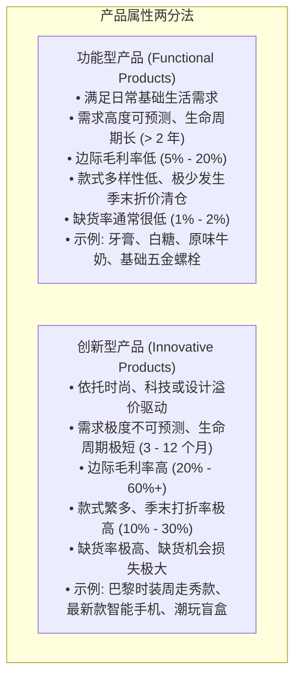
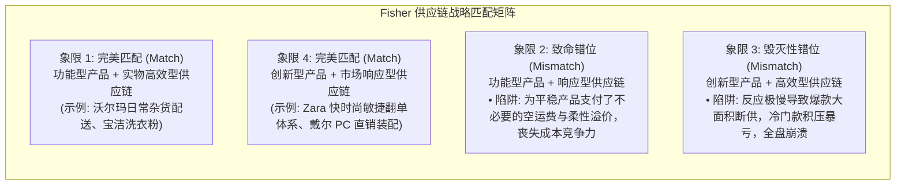
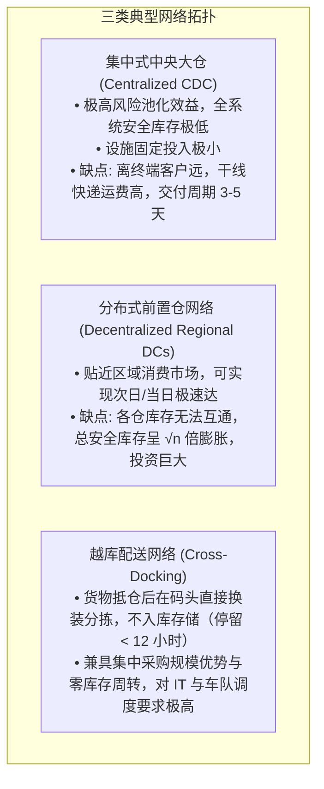

# Lec 16 供应链网络设计与战略匹配 (Supply Chain Network Design)

> MIT Sloan 15.734 · Introduction to Operations Management · 主讲 Prof. Jérémie Gallien

## TL;DR

- 掌握供应链战略奠基之作：沃顿商学院 Marshall Fisher“产品属性与供应链战略匹配模型”。
- 严密划分两大产品阵营：需求可预测的“功能型产品”（Functional）与波动剧烈的“创新型产品”（Innovative）。
- 厘清两套供应链拓扑体系：以低成本和规模利用率为核心的“实物高效型供应链”（Efficient） vs. 以速度和柔性为核心的“市场响应型供应链”（Responsive）。
- 剖析错位配置（Mismatch）所引发的灾难性后果，阐述分销网络层级与多层级跨国网络优化路径。

## 根本性追问：你的产品需要什么样的供应链？

在 1997 年发表于《哈佛商业评论》的里程碑论文中，Marshall Fisher 教授指出：许多跨国企业供应链投资数百亿美元引进先进系统却收效甚微，根本原因在于**供应链的物理设计与产品本身的需求属性发生了灾难性的战略错位（Strategic Mismatch）**。

企业高管在规划供应链时，常常一上来就陷入对仓储选址、运输卡车调度、RFID 电子标签或 ERP 软件选型的琐碎技术细节讨论。然而，如果底层战略方向南辕北辙，技术上的精致优化只会加速企业的亏损。设计供应链的第一步，绝非讨论仓库建在哪里或采购什么软件，而是深入解构产品在市场终端面临的**需求物理特征**：究竟是可预测的稳态日用品，还是波诡云谲的潮流创新物料：

## 两大对立的供应链战略范式

针对两种完全不同的产品属性，企业必须构建两套截然相反的供应链网络：

| 战略维度 | 实物高效型供应链（Physically Efficient） | 市场响应型供应链（Market-Responsive） |
| :--- | :--- | :--- |
| **首要目标** | 以最低的单件成本供应可预测的需求 | 快速响应无法预测的需求以最小化缺货与呆滞 |
| **制造聚焦** | 保持极高的产能利用率（追求 90%+） | 储备缓冲冗余产能以吸收需求尖峰 |
| **库存战略** | 尽可能压缩周转库存，追求极致周转率 | 在关键节点部署安全库存以缓冲缺货风险 |
| **提前期战略** | 只要不增加成本，缩减交付时间并非首选 | **不惜代价全力压缩交付提前期**（缩短前置期即缩短预测迷雾）|
| **供应商选择** | 核心看单件报价与批量符合性质量 | 核心看速度、柔性、敏捷翻单能力与协同研发 |
| **产品设计原则** | 最大化零部件标准化与大批量制造经济 | 模块化设计、延迟制造以延迟最终形态分化 |

## Fisher 战略匹配矩阵与象限错位

基于上述分析，Fisher 构筑了一个著名的二维匹配检验矩阵。这个矩阵就像一面透视镜，能迅速诊断出一家跨国企业的供应链究竟是处于和谐健康的价值共振状态，还是深陷在自相矛盾的内耗泥潭之中：

::: pitfall 创新型产品误配高效型供应链的惨剧
最常见的企业悲剧发生在**象限 3**：一家消费电子或时装企业，明明身处瞬息万变的创新红海中，管理层却由传统成本会计思维统治。为了降低 5% 的采购单件成本，他们强行将订单下达给交期长达 6 个月的远洋低工价工厂，并要求每次满载整船起运。结果，当货物经过数周海运漂洋过海抵达时，流行趋势早已灰飞烟灭，高额的存货折价清仓将全部企业利润洗劫一空。
:::

## 现代多层级分销网络设计（Distribution Network Topology）

在物理网络拓扑层面，供应链设计必须在“设施成本、库存持有成本、运输成本与客户交付响应时间”之间进行全局平衡：

::: insight 供应链战略是企业最高战略的物理映射
供应链绝非孤立的物流部门职责，而是企业核心竞争优势的物质实体。如果企业的品牌定位是“平价大宗（如名创优品、Costco）”，其供应链体系必须冷酷无情地追求端到端每一个环节的成本压榨与高负荷周转；如果企业的定位是“极致尊贵与个性定制（如奢侈品、高阶定制医疗）”，其供应链就必须毫不犹豫地牺牲部分资产利用率，以充足的柔性产能换取响应速度。战略匹配是运营卓越的第一法则。
:::
