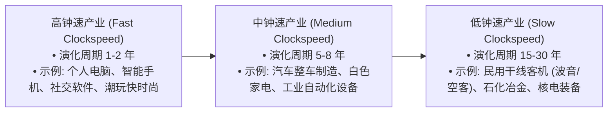
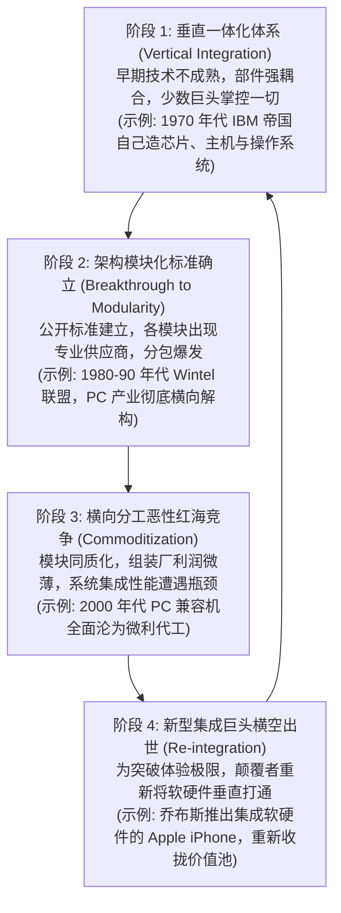

# Lec 17 产品设计、可制造性与价值链钟速 (Product Design, DFM & Clockspeed)

> MIT Sloan 15.734 · Introduction to Operations Management · 主讲 Prof. Jérémie Gallien

## TL;DR

- 掌握麻省理工斯隆管理学院 Charles Fine 教授的经典理论：产业钟速（Clockspeed）与价值链动态演化。
- 剖析产品架构的两极：高度优化的“集成型架构”（Integral） vs. 敏捷解耦的“模块化架构”（Modular）。
- 理解“双螺旋模型”（Double Helix）：行业在垂直一体化与横向模块分工之间周而复始的演化规律。
- 确立面向制造与装配的设计（DFMA）原则，从产品图纸源头决定 80% 的运营成本与供应链复杂度。

## 钟速理论：竞争优势的临时性

在麻省理工经典名著《钟速理论》（Clockspeed: Winning Industry Control in the Age of Temporary Advantage）中，Charles Fine 教授指出：**任何竞争优势本质上都是暂时的（Temporary Advantage）**。不同行业以不同的“演化时钟速度”向前飞奔：

产业钟速决定了企业的战略半衰期。高钟速行业的高管如果试图建立“永久性的护城河”，注定会被下一波架构浪潮淘汰。高管的核心使命，是在当前钟速下动态配置组织能力。

## 产品架构二元论：集成型 vs. 模块化

产品设计图纸不仅定义了物理结构，更直接决定了整条供应链的组织拓扑：

### 两种架构的战略与供应链权衡

| 战略维度 | 集成型产品架构（Integral） | 模块化产品架构（Modular） |
| :--- | :--- | :--- |
| **产品性能表现** | 极高（突破物理极限的最优能量利用） | 次优（因通用接口产生冗余体积与热耗损）|
| **供应链网络结构** | 封闭、高度专有的一体化协同网络 | 开放、全球分散、可插拔的横向分包网络 |
| **研发与换代速度** | 牵一发而动全身，整车换代研发周期长 | 允许各模块并行独立迭代，研发速度极快 |
| **进入壁垒与利润池** | 极高（专利壁垒与系统工程协同暗知识） | 易被下游白牌代工厂低成本山寨侵蚀，陷入价格战 |

## 产业演进的双螺旋定律（The Double Helix）

在商业史的长河中，战略咨询顾问们常常断言“未来必然属于开放的模块化生态，任何试图垂直一体化掌控一切的巨头都将灭亡”。然而，历史的发展往往以出人意料的方式嘲弄这种单维度的线性思维。Fine 教授在深入考察计算机、汽车、电信与半导体产业百年变迁后，揭示了一个震撼的工业演化规律：产业并非单向走向模块化，而是在**纵向垂直一体化**与**横向模块化分工**之间呈现螺旋往复的周期性运动。这种演化背后存在着深刻的经济学引力：一体化带来极致体验但推高组织官僚成本，模块化催生全球协同但导致利润被公版方案摊薄。两股力量周而复始地塑造着产业格局：

## 面向制造与装配的设计（DFMA 原则）

在传统制造企业中，工程师画完图纸后直接“扔过墙（Over-the-wall）”给工艺车间，车间常常抱怨零件无法冲压或工人双手无法触及螺栓孔。

Boothroyd-Dewhurst 创立的 **DFMA（Design for Manufacture and Assembly）** 确立了源头防呆法则：

::: definition DFMA 黄金设计三大铁律
1. **最小化零件总数（Minimize Part Count）**：通过注塑一体成型或冲压复合成型，将原本 20 个螺钉拼接的钣金件合并为 1 个整体结构件。零件少 1 个，图纸少 1 张，采购订单少 1 个，库存料号少 1 种，装配工位少 1 个，潜在故障点少 1 个！
2. **免紧固件自卡扣装配（Snap-fit Assembly）**：杜绝螺钉、螺母、垫片与胶水粘合，大量运用弹性卡扣。装配动作仅需工人单手单向垂直下推（Z 轴压装），消除翻转与专用扳手操作。
3. **几何防呆自对齐（Self-aligning & Self-locating）**：零件边沿设计导向倒角，即使工人盲操作也能自动滑入预定卡槽，消灭微调找正时间。
:::

::: example 福特汽车仪表盘 DFMA 改造
福特汽车某款轿车仪表盘线束原包含 145 个离散部件与 38 颗不同规格螺钉，总装需要 4 名工人耗时 12 分钟拧螺丝。推行 DFMA 重新设计后：
- 将仪表骨架注塑模具重新集成，零件总数压缩到 26 个（骤减 82%）；
- 全部改用高韧性尼龙免工具卡扣；
- 装配工位由 4 人减至 1 人，装配时间从 12 分钟降至 2.5 分钟；
- 紧固失效导致的行车异响索赔投诉直降 90%，单车直接制造成本节约超过 40 美元。
:::

::: insight 成本的 80% 在研发图纸绘制完毕时已经注定
运营管理最震撼的高管共识在于：**当一款新产品的三维 CAD 架构图最终冻结并签发时，其未来全生命周期中 80% 的直接制造成本、物流仓储费用与质量返修风险已经被死死锁死在图纸之中**！后期的车间精益改善、看板拉动或采购供应商压价，充其量只能在剩余 20% 的空间里做小修小补。高管若想真正建立成本护城河，必须将最资深的制造与供应链专家在 Day 1 派驻进研发核心团队，在源头完成战略阻截。
:::
