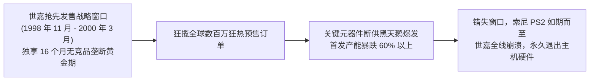
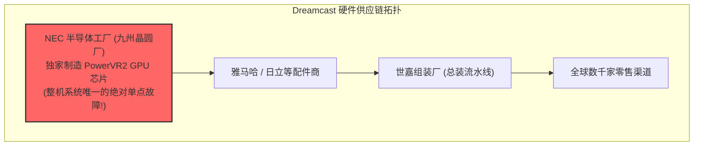
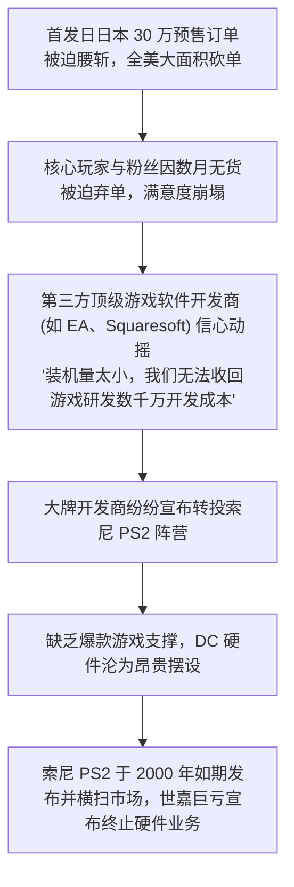

# Lec 18 世嘉 Dreamcast 案例：关键器件断供与供应链崩溃 (Sega Dreamcast Case)

> MIT Sloan 15.734 · Introduction to Operations Management · 主讲 Prof. Jérémie Gallien

## TL;DR

- 解构主机游戏产业史上最悲壮的商业滑铁卢：世嘉（Sega）旗舰主机 Dreamcast 的断崖式溃败。
- 剖析跨国前沿高科技硬件在“先发抢跑窗口期”面临的生死竞速。
- 深度拆解核心图形芯片（NEC PowerVR2）半导体良品率雪崩引发的单一关键供应商断供危机。
- 阐明单一独家供货（Single-sourcing）的致命脆弱性，建立前沿元器件量产爬坡（Ramp-up）风险审计规范。

## 先发制人的战略豪赌：Dreamcast 的诞生

1998 年底，老牌游戏巨头世嘉公司（Sega）推出了凝聚其全部技术精髓的划时代 128 位游戏主机——**Dreamcast（简称 DC）**。

在当时的游戏主机产业格局中，竞争具有极强的“赢家通吃网络效应”：
- 索尼（Sony）跨时代的 PlayStation 2（PS2）已宣布在研发中，但预计要到 2000 年春季才能面世；
- 世嘉若能在 1998 年 11 月率先在日本本土发售，抢先建立数百万级装机量底座，就能锁定全球顶级第三方游戏开发商的独家阵营，彻底反超索尼；
- 市场反响极度狂热：在日本预售阶段，玩家订单突破 **30 万台**，全美意向预售量更创下历史新高。这本是一场注定载入史册的辉煌反击战。

## 致命阿喀琉斯之踵：NEC 图形芯片良品率雪崩

Dreamcast 拥有当时惊艳业界的街机级三维画面渲染能力，这完全依赖于其搭载的核心图形处理器——**PowerVR2（代号 CLX2）芯片**。

出于成本与技术独家性考量，世嘉做出了一个致命决策：**将 PowerVR2 芯片的硅晶圆制造全部独家外包给日本电气（NEC）单一供应商代工**。

### 0.25 微米制程量产爬坡的灾难

在试产阶段，NEC 提供的工程样品芯片表现卓越。然而，当发售前夕世嘉要求 NEC 将月产芯片紧急拉升到 50 万片甚至 100 万片时，半导体制造物理法则露出了残酷獠牙：
1. **0.25 微米制程工艺不稳定**：NEC 晶圆厂在新型深亚微米光刻与金属层淀积工艺上遭遇了严重的缺陷密度超标；
2. **良品率（Wafer Yield）断崖式跌穿**：整张晶圆经划片测试后，合格的芯片比例竟然**不足 20%–30%**！大量硅晶圆由于寄生电容击穿和逻辑门短路沦为废品；
3. **产能兑现率仅为承诺的三分之一**：在 1998 年 11 月日本首发当周，NEC 最终交付给世嘉的可用合格芯片不足预期量的 40%。

## 供应链崩溃引发的商业连锁雪崩

核心 GPU 芯片的断供，直接触发了不可逆的系统性商业多米诺骨牌：

在最关键的发售前 6 个月黄金窗口内，世嘉的流水线因为等待一片小小的 NEC 芯片长期半开工停滞，每日眼睁睁看着数万名狂热拥趸空手离开零售店。到 1999 年秋季 NEC 终于解决晶圆良品率瓶颈时，索尼庞大的宣发机器已经启动，历史的窗口彻底永久关闭。

世嘉因此背负了逾千亿日元的巨额债务，不得不接受大川功会长数亿美元个人私产注资勉强救急，最终在 2001 年 1 月正式宣布退出一切家用游戏主机研发与制造，彻底沦为单纯的游戏软件开发商。

## 供应链高管的惨痛教训

世嘉 Dreamcast 的悲剧在商学院运营管理史上具有教科书级的警示意义：

| 战略失误维度 | 世嘉的错误做法 | 现代卓越供应链的对冲标准 |
| :--- | :--- | :--- |
| **供应商布局** | 独家单一来源（Sole Sourcing），无任何备份工厂 | **双源或主辅源布局（Dual Sourcing）**，如主厂 70% + 备用厂 30% |
| **量产爬坡审计（Ramp-up）** | 仅听取供应商口头乐观汇报，未深入晶圆车间核查真实良品率数据 | 派遣常驻驻厂工艺工程师（Resident Engineer），进行严格的统计良品率爬坡应力测试 |
| **架构容错设计** | 主板接口与芯片高度焊死，完全无法兼容其他厂商图形芯片 | 采用模块化通用总线，预留备选引脚定义与跨芯片抽象层软件驱动 |
| **合同与激励契约** | 仅签订常规采购单，未包含激进的良品率对赌与断供违约巨额罚则 | 设立产能保留契约（Capacity Reservation）与供应链风险共担资金池 |

::: pitfall “先发优势”死于“运营断链”
许多战略学者与科技创业家极度推崇“先发优势（First-mover Advantage）”，认为只要理念超前、时间卡位早就能克敌制胜。但 Dreamcast 案例无情地揭示：**商业战略上的“先发优势”，如果没有深厚扎实的“卓越运营交付能力”作为支撑，不仅无法转化为市场胜势，反而会演变成透支品牌信誉、替后发竞争对手教育市场的昂贵悲剧**。
:::

::: insight 关键元器件是网络系统的生死命门
在离散装配系统中，整机由数百个零件构成，遵循极端的“短板理论（O-Ring Principle）”：**哪怕 99% 的螺钉、外壳和线束都已经备齐在仓库里，只要缺少了那枚关键的 1% 核心芯片，整机的产出率就是绝对的零**。高管必须对整条物料清单（BOM）进行地毯式地缘与工艺脆弱性排查，识别出所有潜在的“单点故障（Single Point of Failure）”，并建立常态化应急冗余对冲机制。
:::
