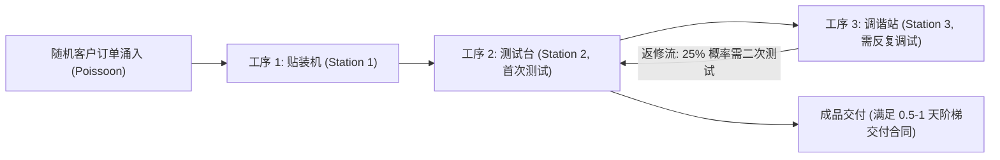
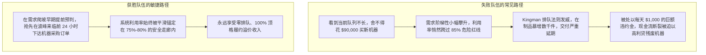
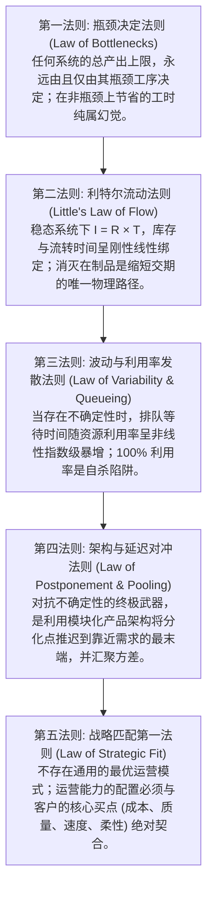

# Lec 19 运营管理前沿总结与 Littlefield 仿真复盘 (Operations Simulation & Strategic Synthesis)

> MIT Sloan 15.734 · Introduction to Operations Management · 主讲 Prof. Jérémie Gallien

## TL;DR

- 深度复盘麻省理工斯隆管理学院著名的 Littlefield Technologies 离散事件工厂仿真沙盘。
- 拆解高阶动态运营博弈中的四大核心决策杠杆：设备扩建时机、批次大小（Lot Sizing）、排队调度规则与阶梯服务水平合同（SLAs）。
- 提炼贯穿本课程的“运营五大基础法则”，完成从离散工具到全局架构的认知整合。
- 确立卓越运营（Operational Excellence）作为企业底层护城河与穿越周期生存基石的终极定位。

## Littlefield 工厂沙盘：随机世界中的全息博弈

在 15.734 课程中，所有 MBA/EMBA 同学团队接管了一座名为 **Littlefield Technologies** 的虚拟数字高科技高频电路板（PCB）组装工厂。

工厂内部由三类昂贵的核心工业设备构成：
- **工序 1（Board Stuffing）**：电路板表面贴装机；
- **工序 2（Testing）**：高精度综合电子测试台；
- **工序 3（Tuning）**：微调与调谐工作站。

工厂面临由中央计算机实时驱动的真实随机订单流（服从泊松到达与指数服务时间分布），团队需要在 7x24 小时连续数天的真实对抗中，做出动态资本预算与排产调度决策，目标是**最大化工厂最终的累积现金储备（Cumulative Cash Balance）**。

## 模拟沙盘的核心运营教训复盘

在数十支高管队伍的同台竞技中，许多团队在初期迅速破产，而少数团队斩获了数百万美元的累积利润。其背后的分水岭在于对四个关键杠杆的理解：

### 1. 产能扩建的时间窗口（Capacity Investment Timing）

在仿真运行中，工厂面临阶梯式增长的订单量。每台新设备购置成本高达 $90,000，且从下单到工厂就位需要 14 天的漫长交付提前期。管理团队在面对产能瓶颈时的决策时机，直接拉开了平庸与卓越的差距。许多队伍因为舍不得沉没资金，总是等到机器彻底堵死才匆忙下单，结果深陷违约泥潭；而顶尖队伍则基于对到达率斜率的先验测算，始终将产能建设保持在适度超前的位置：

### 2. 批次大小的非线性权衡（Lot Sizing Trade-offs）

工厂允许设置每批次加工电路板的数量（如 20 件 vs. 60 件）：
- **大批次（Lot Size = 60）**：减少了机器换批调试准备时间，整机名义产能极大；但大批次意味着下游工位必须等待前一个批次全部完成才能启动，流转时间（Flow Time）拉长，在制品库存膨胀；
- **小批次（Lot Size = 20）**：大幅加快了流转单元在工序间的穿透速度，交付极其敏捷；但若换模时间过长，小批次会吞噬宝贵的机器有效工时。
- **最优策略**：非瓶颈工位采用超小批次以保流速，瓶颈工位（通常是返修率高的 Station 2）保持适度优化批次以保产能。

### 3. 优先级排队规则的魔力（Scheduling & Priority Rules）

在 Station 2（测试台），同一台机器既要处理来自 Station 1 的新电路板，又要处理来自 Station 3 返修送回的旧电路板：
- **普通 FIFO（先进先出）**：机械按排队先后处理，返修板与新板混合堆积；
- **优先处理返修板（Priority to Station 3 Re-tests）**：由于返修板距离最终出厂仅差一步（接近变现阶段），根据有效产出理论，**优先测试返修板能以最快速度将沉淀资金转化为现金流发货**，同时清空 Station 3 的阻塞缓冲区，全厂流转时间立即削减 35%！

## 运营管理五大底层普适法则（The 5 Laws of Operations）

在历经 19 次课时的案例解剖、理论推导与仿真博弈之后，我们能够穿透复杂的表象，提炼出掌控一切生产与服务组织的底层逻辑。贯穿整个 15.734 课程体系，所有复杂的商业现象最终收敛于五大物理公理。它们不仅是工厂车间的排产法则，更是高管在面对不确定性世界时审视全局的认知透镜。无论未来管理的对象是物理零部件、数据流、资本还是知识工作者，这五大定律都将持续发挥其不可动摇的决定性支配作用：

## 结语：卓越运营是企业最宽的护城河

在商业世界中，资本、技术与营销模式的扩散速度越来越快：
- 一项商业模式创新（如生鲜电商、共享出行），对手可以在 3 个月内完全抄袭；
- 一项专利技术，对手可以在 1 年内通过绕道研发规避；
- 唯有**深植于组织肌理之中的卓越运营体系（Operational Excellence）**，是任何竞品无法在一夜之间抄走的。

正如丰田生产方式、戴尔直销装配、台积电晶圆代工制造与亚马逊遍布全球的智能履约网络所展现的：真正的商业领袖不仅是仰望星空的战略家，更是脚踏实地的流程工程师。他们深刻理解系统内部每一个流转单元的摩擦力，懂得用数学与制度对抗熵增，将每一个平凡的微小改善（Kaizen），汇聚成穿越周期、坚不可摧的商业帝国。

::: insight 从知到行的运营终极升华
许多管理者学完运营课程后，容易将其窄化为“工厂排产工具”。然而，运营管理的本质不是关于机器，而是关于**在高度不确定性的约束世界中，如何设计一套能够自我纠偏、持续进化的复杂自适应系统**。无论是管理一家芯片工厂、治理一家三甲医院、调度一支跨国软件开发团队，还是规划个人一生的精力分配，五大运营法则永远是破除迷雾、洞穿本质的无上心法。
:::
