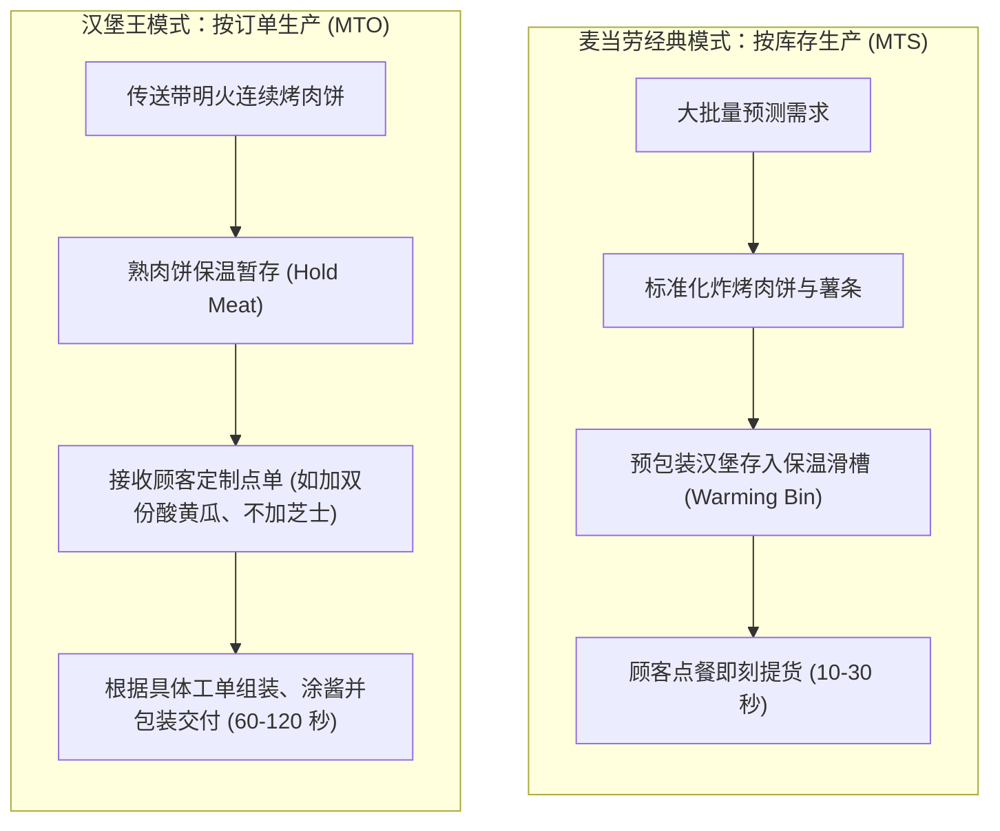

# Lec 2 麦当劳 vs. 汉堡王：标准化与定制化流程设计 (McDonald's vs. Burger King)

> MIT Sloan 15.734 · Introduction to Operations Management · 主讲 Prof. Jérémie Gallien

## TL;DR

- 对比快餐工业史上最经典的两大运营范式：按库存生产（MTS）与按订单生产（MTO）。
- 剖析麦当劳经典流水线通过保温槽实现“预测驱动与批量准备”，换取极致的出餐速度与低廉单位成本。
- 分析汉堡王“随心所欲”（Have It Your Way）通过传送带明火烤炉与装配定制，消除成品报废并满足个性化口味。
- 揭示解耦点（Decoupling Point）位置对交付周期、库存跌价风险与峰值拥堵波动的结构性影响。

## 商业战略驱动的流程分道

在 20 世纪下半叶的全球快餐竞争中，麦当劳（McDonald's）与汉堡王（Burger King）展示了两种基于截然不同客户价值主张的端到端流程架构。快餐行业表面上拼的是汉堡口味和广告营销，其底层的胜负手却完全取决于后厨流程架构的设计。麦当劳选择将所有的操作动作极致标准化、机械化，追求极低成本与闪电般的出餐速度；而汉堡王则试图在快餐框架内引入个性化选择，主打“随心所欲”的定制乐趣。这两种截然不同的战略主张，直接决定了两家企业从原料采购、设备选型、后厨空间动线到前台交付的完整拓扑设计。理解这两套流程的物理流转逻辑，是掌握现代离散制造与服务解耦技术的基础：

## 核心流程要素深度对比

两家巨头的核心运营指标对比，体现了精益流程设计的底层权衡：

| 运营维度 | 麦当劳（经典 Speedee 系统） | 汉堡王（Have It Your Way） |
| :--- | :--- | :--- |
| **生产驱动方式** | 按库存生产（Make-to-Stock） | 按订单装配（Assemble-to-Order / MTO） |
| **客户解耦点** | 成品保温滑槽（Finished Goods Buffer） | 半成品熟肉保温抽屉（Sub-assembly Buffer） |
| **设备核心特征** | 批量平底煎板（Griddle Batching） | 连续通过式明火链条炉（Conveyorized Broiler） |
| **交付时间（Cycle Time）**| 极短（15–30 秒直接取现货） | 较长（60–120 秒定制组装与微波提温） |
| **产品多样性** | 极低（严禁客户修改汉堡配料） | 高（按需组合，数万种可能搭配） |
| **损耗机制** | 保温槽超过 10 分钟必须整盒弃置 | 仅可能报废多烤的单张肉饼，组装无成品损耗 |
| **午餐高峰压力承受力** | 极强（依赖峰前提前积压库存平滑波峰） | 脆弱（组装台成为显著瓶颈，排队剧增） |

::: definition 客户订单解耦点（Customer Order Decoupling Point, CODP）
流程中从“基于预测生产（Push）”切换为“基于真实客户订单响应（Pull）”的物理交接点。CODP 越靠近流程前端，客户等待时间越短，但产成品库存报废与错配风险越高；CODP 越靠近流程后端，柔性与定制程度越高，但对各工序节拍一致性要求更为苛刻。
:::

## 麦当劳的转型困境与 Made-For-You 改革

随着 1990 年代消费者健康意识崛起与口味多样化，麦当劳经典的 MTS 模式遭遇双重打击：
1. **品质与温度感知劣化**：在保温槽放置 8-10 分钟的汉堡面包受水汽浸润软化，生菜变黄蔫萎，客户感知品质断崖式下滑。
2. **特殊定制成为流程灾难**：当顾客要求“不要洋葱”时，收银员必须跨过标准保温槽大声向后厨呼叫特殊制作，瞬间打乱煎板节拍，单件流打断导致整条柜台停滞。

麦当劳在 1998 年投入近 5 亿美元强行推行 **Made-For-You（为你而做）** 流程改造：拆除前台保温滑槽，引入快速保温柜（UHC）保存熟肉饼，引入快速加热电脑烤面包机（11 秒完成烘烤），将解耦点移至装配台。

::: pitfall 忽视工序波动引起的雪崩效应
麦当劳在推行 Made-For-You 初期遭遇了严重的全国性服务瘫痪。原因是管理层低估了午间 12:00–13:00 高峰期装配台的认知负荷：在 MTS 下，员工只需机械性重复打包标准汉堡；在 Made-For-You 下，员工必须在屏幕指示下核对每张小票的差异化调料要求。工时方差（Variance）激增直接导致出餐排队时间从 30 秒飙升至 3-5 分钟。
:::

::: insight 流程架构决定商业战略的生死边界
汉堡王的商业口号是“Have It Your Way”，其整个后厨硬件（明火连续链条机、多工位组装台）从 Day 1 起就是为这个口号而原生设计的；而麦当劳的硬件体系原生为“极致标准化与规模吞吐”而生。当麦当劳试图兼顾多样性时，必须付出昂贵的硬件置换与操作复杂度代价。流程设计一旦固化，就构成了企业战略最坚硬的骨骼。
:::
