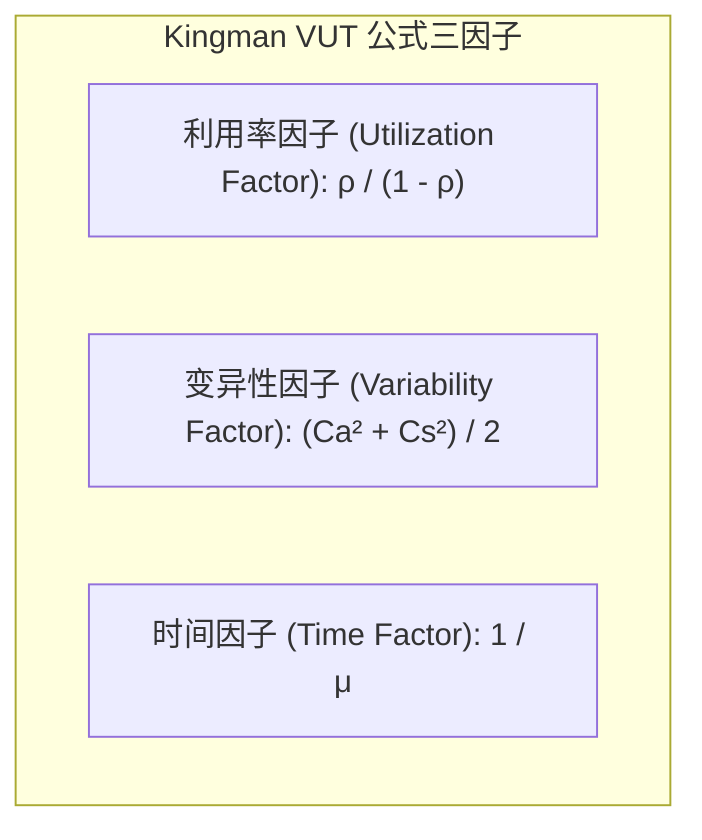

# Lec 3 产能分析、利特尔法则与排队论基础 (Capacity, Little's Law & Queueing)

> MIT Sloan 15.734 · Introduction to Operations Management · 主讲 Prof. Jérémie Gallien

## TL;DR

- 流程总产能受制于系统中处理能力最低的单一工序——瓶颈（Bottleneck）。
- 确立运营科学基石定理利特尔法则（$I = R 	imes T$），证明在制品库存、吞吐率与流转时间的普适稳态关系。
- 引入排队论中的 Kingman 近似公式，揭示在存在随机波动时，排队时间随资源利用率呈非线性指数级暴增。
- 指出“高利用率陷阱”：将设备利用率推向 100% 必然导致系统交付周期的无限延长与流程崩溃。

## 流程产能与瓶颈识别

任何生产与服务系统都由多个离散活动工序串联而成。

::: definition 工序产能与流程瓶颈
- **单工序节拍时间（Cycle Time, $CT_i$）**：工序 $i$ 完成单个流转单元所需的作业处理时间。
- **单工序产能（Capacity, $Cap_i$）**：单位时间内工序 $i$ 能完成的单元上限，$Cap_i = rac{1}{CT_i} 	imes (	ext{并发资源数 } c_i)$。
- **流程瓶颈（Bottleneck）**：整个流程中单工序产能最低（即单位单元加工耗时最长）的资源节点。流程总产能等于瓶颈工序产能：
$$	ext{Process Capacity} = \min_{i} \{ Cap_i \}$$
:::


在非瓶颈工序上投入巨额资本进行自动化改造，无法为整套系统带来哪怕 1 件的额外产出；系统的产出增加唯有通过扩大瓶颈工序的实际可用工时或消除瓶颈的非生产时间来实现。

## 运营管理第一公理：利特尔法则（Little's Law）

由麻省理工学院斯隆管理学院教授 John Little 于 1961 年严格证明：

::: theorem 利特尔法则 (Little's Law)
在长期稳态（Steady State）运行的任何系统中，平均在制品库存 $I$ 等于平均产出率 $R$ 与平均流转时间 $T$ 的乘积：
$$I = R 	imes T$$
:::

此公式具有极强的普适性：
1. **与系统内部具体结构无关**：无论系统内部是单队列、多队列、还是网状分支流程，公式均绝对成立。
2. **与到达与服务时间的概率分布无关**：无论是泊松分布、正态分布还是任意未知分布，均严格成立。
3. **适用于任意边界划分**：可以将公式应用于整条工厂流水线，也可以应用于单一机器工位，甚至应用于某款存货在库房的周转。

::: example 某急诊室周转率测算
某三甲医院急诊室平均每小时接收 24 名急重症患者（$R = 24$ 人/小时）。通过床位监测，任何时刻急诊室内平均有 72 名患者在留观或就诊（$I = 72$ 人）。
据利特尔法则，患者在急诊室的平均滞留时间为：
$$T = rac{I}{R} = rac{72 	ext{ 人}}{24 	ext{ 人/小时}} = 3.0 	ext{ 小时}$$
若管理层希望将患者滞留时间压缩到 1.5 小时，且患者流入率不变，急诊室内部积压的患者平均人数必须压降至：
$$I' = 24 	imes 1.5 = 36 	ext{ 人}$$
:::

## 排队论与利用率陷阱（The Utilization Trap）

很多运营经理执着于“消灭资源闲置”，希望将昂贵员工或机器的利用率（Utilization, $
ho$）拉满到 100%。排队论揭示了这种直觉的毁灭性后果。

对于单服务台排队系统（$M/G/1$），平均排队等待时间 $W_q$ 可由 **Kingman 近似公式（VUT 框架）** 表征：

$$W_q pprox \left( rac{
ho}{1 - 
ho} 
ight) 	imes \left( rac{C_a^2 + C_s^2}{2} 
ight) 	imes rac{1}{\mu}$$

其中：
- $
ho = rac{\lambda}{\mu}$：资源利用率（$\lambda$ 为到达率，$\mu$ 为服务率）；
- $C_a$ 与 $C_s$：到达间隔时间和服务时间的变异系数（标准差 / 均值）；
- $rac{1}{\mu}$：平均单件服务时间。



随利用率 $
ho$ 逼近 1，$rac{
ho}{1-
ho}$ 呈非线性渐近发散：

```text
利用率 ρ = 80%  -->  ρ / (1-ρ) = 0.80 / 0.20 = 4.0
利用率 ρ = 90%  -->  ρ / (1-ρ) = 0.90 / 0.10 = 9.0   (等待时间跃增 2.25 倍)
利用率 ρ = 95%  -->  ρ / (1-ρ) = 0.95 / 0.05 = 19.0  (等待时间跃增 4.75 倍)
利用率 ρ = 99%  -->  ρ / (1-ρ) = 0.99 / 0.01 = 99.0  (系统近乎无限阻塞)
```

::: pitfall 忽视波动下的 100% 利用率误区
如果到达率和服务时间完全确定（$C_a = 0, C_s = 0$），系统利用率达到 100% 时排队为 0。然而在真实商业世界（无论是打车叫车、医院看病还是服务器请求处理），变异系数永远非零。当运营经理强求把系统利用率压到 95% 以上时，微小的需求突增或机器小故障就会导致在制品排队长龙指数级炸开。
:::

::: insight 柔性与冗余产能的战略定价
在存在不确定性的环境中，“空闲产能”（Idle Capacity）不是管理者的罪恶，而是系统为吸收环境不确定性所必须预付的“保险费”。高管决策的核心不是消灭缓冲（Buffer），而是在“时间缓冲（让客户等待）”、“库存缓冲（持有高额在制品）”与“产能缓冲（保留适度冗余设备与人手）”三者之间找到总成本最低的最优组合。
:::
