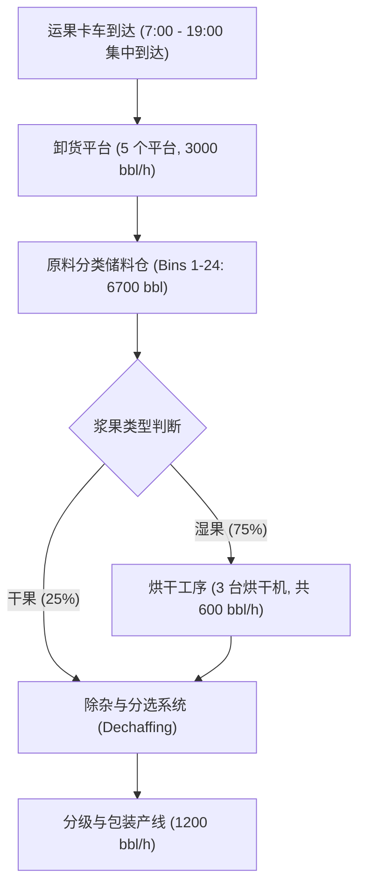
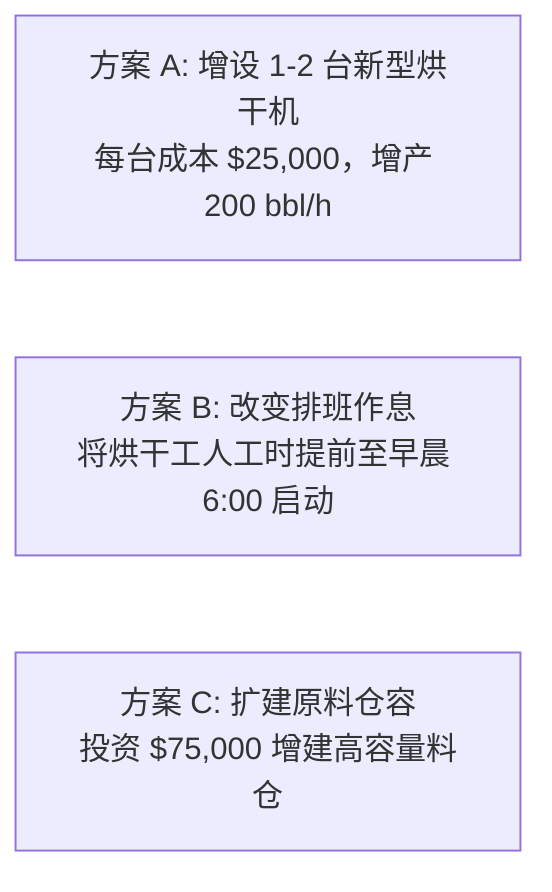

# Lec 4 国家蔓越莓合作社案例：瓶颈识别与流程平衡 (National Cranberry Cooperative)

> MIT Sloan 15.734 · Introduction to Operations Management · 主讲 Prof. Jérémie Gallien

## TL;DR

- 剖析哈佛与麻省理工商学院最具代表性的运营基石案例：国家蔓越莓合作社（NCC）1 号加工厂。
- 拆解干浆果（Dry Berries）与湿浆果（Wet Berries）双轨混合流下的非平稳峰值负荷。
- 通过严格的输入-产出累积曲线（Buildup Diagram），精确推算烘干工序（Drying）的产能瓶颈与卡车排队超时成本。
- 量化评估增添烘干机、加建原料储料仓与推迟工人轮班作息等不同资本开支方案的 ROI。

## 案例背景与核心运营危机

国家蔓越莓合作社（NCC）由数百名浆果种植农户联合创立。每年秋季收获期集中在 9 月至 12 月，为期约 15 周。由于机械化水采法的普及，湿浆果（Wet Berries）占比急剧飙升至总产量的 75% 以上。

湿果在水田中收获，果皮表面附着大量水分，必须在入库前经过**烘干机（Dryers）**彻底脱水，否则数小时内即会发酵霉烂。

在收获高峰期（如 10 月中旬），每天运送蔓越莓的自卸卡车在 1 号加工厂外排起数公里长龙。种植农户因等待数小时无法卸货而在工会会议上强烈抗议，合作社更面临巨额的卡车司机等待超时费（Demurrage & Overtime Charges）。

## 峰值日数据量化与输入输出平衡

以典型收获峰值日为例，工厂全天面临的总流入与设备参数如下：

- **全天总进果量**：18,000 桶（Barrels, bbl），其中湿果占 75%（13,500 bbl），干果占 25%（4,500 bbl）。
- **到达时间窗口**：卡车从早晨 7:00 开始集中到达，持续到晚间 19:00（12 个小时）。
- **平均进货速率**：
  $$	ext{Arrival Rate } R_{	ext{in}} = rac{18{,}000 	ext{ bbl}}{12 	ext{ 小时}} = 1{,}500 	ext{ bbl/小时}$$
  其中湿果到达速率为 $1{,}500 	imes 75\% = 1{,}125 	ext{ bbl/小时}$。

### 工艺流程各节点额定产能核算

1. **自卸卡车倾倒平台**：5 个卸货口，单口速率 600 bbl/h，总产能 $3{,}000 	ext{ bbl/h}$（充裕）。
2. **原料料仓容量**：24 个大仓，总储存容量 $6{,}700 	ext{ bbl}$。
3. **湿果烘干系统**：3 台烘干机，单台速率 200 bbl/h，总烘干产能仅为 **$600 	ext{ bbl/小时}$**！
4. **精选与包装系统**：总处理产能 $1{,}200 	ext{ bbl/小时}$。

::: definition 瓶颈的数学暴露
湿果的流入速率为 $1{,}125 	ext{ bbl/h}$，而全厂烘干产能仅为 $600 	ext{ bbl/h}$。
湿果每小时净堆积速率（Buildup Rate）：
$$\Delta R_{	ext{wet}} = 1{,}125 - 600 = 525 	ext{ bbl/小时}$$
料仓在清晨 7:00 为空，专用于湿果的料仓容量上限约为 $4{,}500 	ext{ bbl}$。
储料仓打满所需时间：
$$t_{	ext{overflow}} = rac{4{,}500 	ext{ bbl}}{525 	ext{ bbl/小时}} pprox 8.57 	ext{ 小时}$$
即在下午 **15:35 左右**，工厂所有湿果仓位彻底耗尽，后续到达的卡车被迫直接停在公路上作为临时移动料仓，排队危机彻底爆发！
:::

## 解决方案论证与资本支出评估

工厂副总裁 Hugo Schaefer 面临董事会提出的三项改善提案：

### 综合经济性量化核算

1. **加装第 4 台烘干机（资本开支 $25,000）**：
   - 烘干产能提升至 $4 	imes 200 = 800 	ext{ bbl/h}$；
   - 湿果净堆积速率降为 $1{,}125 - 800 = 325 	ext{ bbl/h}$；
   - 12 小时累计堆积湿果 $12 	imes 325 = 3{,}900 	ext{ bbl} < 4{,}500 	ext{ bbl}$（仓容上限）；
   - **结论**：料仓不再溢出！卡车在公路排队时间降为零，彻底消灭外包卡车等待罚款，当年节省加班费与罚金逾 $30,000，回收期不足 1 年。
2. **加装第 5 台烘干机（总投资 $50,000）**：
   - 烘干产能提升至 $1{,}000 	ext{ bbl/h}$，但此时精选包装产线（1,200 bbl/h 综合产能）将成为次级约束，边际贡献递减。
3. **将烘干工人早班提前至 6:00 起始**：
   - 边际成本几乎为零（仅需微量调整津贴），但无法改变全天累积差额，只能将料仓爆满时间推迟约 40 分钟，治标不治本。

::: pitfall 仓储扩容的资本错配
方案 C 提议“耗资 $75,000 加建更多储料箱”。增加料仓虽然能让卡车卸货，但并没有提高烘干瓶颈的产出率，反而让湿浆果在料仓内部滞留更久，果实霉变损耗率增加，且需要工厂在夜间通宵运转 16 个小时去消化积压库存，付出的工人夜班双倍工资极其高昂。
:::

::: insight 瓶颈产能提升的乘数效应
在重资产连续/半连续流程中，识别出核心瓶颈后的定向技术改造具有惊人的杠杆率。NCC 案例表明，运营经理切忌在非瓶颈（如卸货平台或仓储库位）上盲目堆砌固定资产。精准投资于真正的流动性卡点（烘干机），不仅消除了前端拥堵，更让后端包装流水线得以全负荷匀速吃饱，实现全厂经营利润的最大化。
:::
