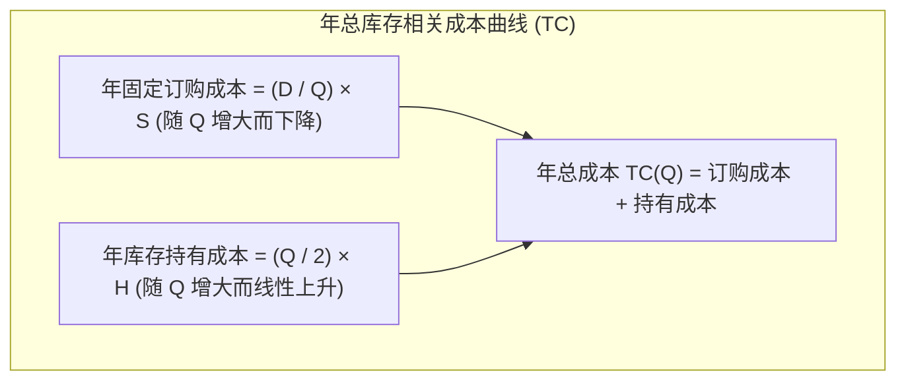

# Lec 6 库存管理：经济订货批量（EOQ）与报童模型 (Inventory: EOQ & Newsboy Model)

> MIT Sloan 15.734 · Introduction to Operations Management · 主讲 Prof. Jérémie Gallien

## TL;DR

- 掌握现代库存控制两大基础模型：确定性多周期经济订货批量（EOQ）与随机单周期报童模型（Newsvendor）。
- 推导 EOQ 经典公式，平衡固定订购/设置成本与资金仓储持有成本的二次方关系。
- 运用报童模型的关键比率（Critical Ratio, $CR$）精准裁定易腐、高时效或时尚类单次采购的最优备货量。
- 剖析安全库存（Safety Stock）与服务水平（Service Level）的非线性指数攀升规律。

## 为什么要持有库存：四类库存动机

在企业财务报表上，库存是占用营运资本的流动资产；在运营流程中，库存承担着不同战略功能：
1. **周转库存（Cycle Inventory）**：为了获取规模经济或克服固定下单成本而批量生产/采购产生的库存。
2. **安全库存（Safety Inventory）**：为缓冲供应商交付延迟或市场需求突发飙升等随机波动而持有的缓冲量。
3. **季节/平准库存（Seasonal Inventory）**：在平稳产能下为应对可预见的峰值需求（如空调夏季出货）提前堆积的存货。
4. **管道/在途库存（Pipeline Inventory）**：处于运输网络与流通环节中的物料（遵循利特尔法则 $I = R 	imes T_{	ext{lead}}$）。

## 确定性需求：经济订货批量（EOQ）

假设年需求量 $D$ 恒定且确定，每次订货的固定订购/换模成本为 $S$，单件商品采购成本为 $C$，单件年持有成本为 $H = i 	imes C$（$i$ 为年持有费率，通常占货值的 15%–30%）。

设每次订货批量为 $Q$，年订货次数为 $rac{D}{Q}$，平均在库周转库存为 $rac{Q}{2}$。

$$TC(Q) = rac{D}{Q} S + rac{Q}{2} H$$

对 $Q$ 求一阶导并令其为 0：
$$rac{dTC}{dQ} = -rac{D S}{Q^2} + rac{H}{2} = 0 \implies Q^* = \sqrt{rac{2DS}{H}}$$

::: theorem 经济订货批量 (EOQ) 性质
1. 最优批量 $Q^*$ 处，**年固定订购成本与年库存持有成本严格相等**。
2. 平方根法则（Square Root Rule）：需求量 $D$ 增长 4 倍，最优订货批量仅需扩大 2 倍，单件物料的平均库存持有成本随规模自然摊薄。
3. 成本曲线对 $Q$ 的敏感度具有极高的稳健性（Robustness）：即使 $Q$ 偏离最优值 20%，总成本上升幅度通常不足 2%。
:::

## 随机单周期需求：报童模型（Newsvendor Model）

适用于生命周期极短、没有多次补货机会且期末剩余物资面临大幅折价清仓的场景（如报纸、圣诞玩具、时装或机票酒店座位）。

### 边际经济权衡

设采购单价为 $C$，零售单价为 $P$，期末未售出单位的残值折价回收价为 $V$（$V < C < P$）。
- **缺货惩罚 / 少订损失（Cost of Underage, $C_u$）**：每少备一件商品损失的边际毛利：
  $$C_u = P - C$$
- **积压惩罚 / 多订损失（Cost of Overage, $C_o$）**：每多备一件商品造成的折价亏损：
  $$C_o = C - V$$

假设第 $Q$ 件商品刚好被市场买走的概率为 $P(D \ge Q) = 1 - F(Q)$。最优订货量 $Q^*$ 必须满足边际期望收益等于边际期望损失：

$$(1 - F(Q^*)) 	imes C_u = F(Q^*) 	imes C_o$$

整理得到著名的**关键比率（Critical Ratio, $CR$）**公式：

$$F(Q^*) = rac{C_u}{C_u + C_o} \implies Q^* = F^{-1} \left( rac{C_u}{C_u + C_o} 
ight)$$

::: example 某高档时装订货测算
某意大利大衣专柜采购一件大衣成本 $C = \$400$，当季售价 $P = \$1{,}000$。季末若未售出，只能送奥特莱斯以残值 $V = \$150$ 清仓。
市场需求预测服从正态分布 $D \sim N(\mu = 200, \sigma = 50)$。
计算两类成本：
$$C_u = 1{,}000 - 400 = \$600$$
$$C_o = 400 - 150 = \$250$$
关键比率（目标服务水平）：
$$CR = rac{600}{600 + 250} = rac{600}{850} pprox 0.706$$
查正态分布分位数表，$z_{0.706} pprox 0.54$。
最优备货量为：
$$Q^* = \mu + z 	imes \sigma = 200 + 0.54 	imes 50 pprox 227 	ext{ 件}$$
虽然期望需求只有 200 件，但由于缺货损失（$600）远大于滞销损失（$250），企业应当激进多订 27 件以捕获高毛利。
:::

::: pitfall 简单按“预测均值”订货的致命陷阱
大多数未经系统训练的采购经理习惯以“期望预测值”（即 200 件）作为采购单指标。如果毛利极高（$C_u \gg C_o$），按均值订货意味着放弃了 50% 概率下的巨额利润捕获；反之若商品毛利极其微薄而残值极低（$C_u \ll C_o$），按均值订货将直接导致大量存货烂在库房吞噬所有净利。
:::

::: insight 库存是组织内部协同缺陷的物理显化
丰田大野耐一曾将库存比喻为“水库的水位”：高水位掩盖了水库底部的暗礁——供应商不良品、机器频繁故障、冗长排班调整与销售预测虚假放大。库存管理的最高境界不是精准计算安全库存公式，而是持续推进“换模缩短（SMED）”以降低 $S$，消除不确定性降低 $\sigma$，从而抽干库存之水，迫使隐藏的流程瓶颈浮出水面被根治。
:::
