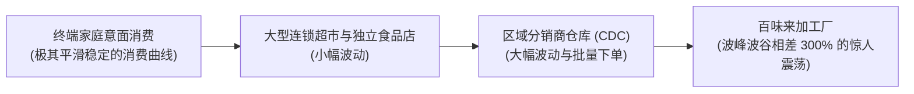
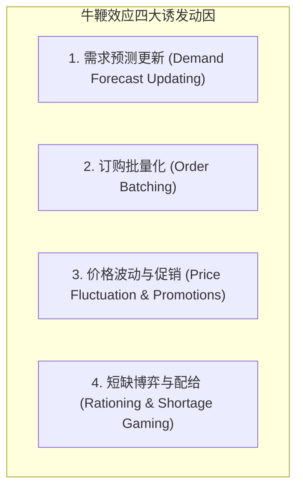
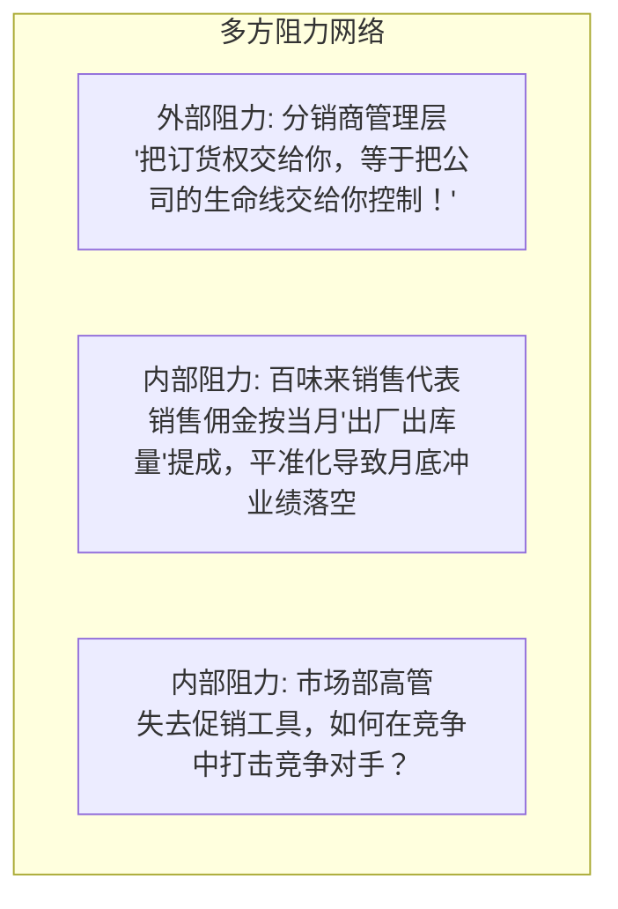

# Lec 7 百味来（Barilla）案例：供应链牛鞭效应与 VMI 协同 (Barilla Case Study)

> MIT Sloan 15.734 · Introduction to Operations Management · 主讲 Prof. Jérémie Gallien

## TL;DR

- 剖析全球意面龙头百味来（Barilla SpA）所遭遇的教科书级供应链牛鞭效应（Bullwhip Effect）。
- 解构终端消费者平稳日常消费与工厂端剧烈生产波动之间的巨大脱节。
- 深度拆解牛鞭效应四大底层驱动机制：需求预测修正、批量下单、价格折扣促销与短缺博弈配给。
- 剖析百味来推行准时化配送（JITD / VMI）所遭遇的内外部组织行为学阻力与治理化解之道。

## 意面帝国的运营悖论

百味来（Barilla）是意大利最大的面食与烘焙食品制造商，占据意大利国内 35% 以上的市场份额。其主打产品干燥面条（Dry Pasta）属于极其平稳的基础生活必需品：
- 意面保质期长达数年，不易腐烂；
- 意大利国民每周意面消费量高度平稳，几乎没有季节性突变；
- 然而，百味来制造工厂面临的分销商订货单却呈现出令人震惊的周期性暴涨暴跌！

工厂为了应对剧烈波动的订单，被迫常年维持极高的安全库存，频繁进行极其昂贵的加班突击生产，随后又面临多条产线停工放假的巨大窝工浪费。

## 牛鞭效应的四大物理动因（Lee, Padmanabhan & Whang 框架）

斯坦福大学 Hau Lee 教授在百味来等大量企业研究基础上，提炼出信息沿供应链向上传播时逐级放大的四大诱因：

1. **需求预测更新**：下游分销商如果观测到本周需求微增 5%，便会基于安全库存公式重新测算目标库存，向上游发出增加 15% 的补货订单；上游工厂看到 15% 的增长，误以为真实需求暴涨，进而将原材料采购量放大 30%。
2. **订购批量化**：为凑整卡车运输（Full Truckload, FTL）以降低物流费，分销商通常积攒数周需求一次性下单，导致需求在时间轴上形成脉冲式尖峰。
3. **价格促销与前推囤货（Forward Buying）**：百味来销售人员每季度推行周期性返利与特价促销。分销商趁低价集中囤积 3 个月的用量，随后数月停止下单，人为制造“人造繁荣与死寂周期”。
4. **配给博弈**：当产能紧张时，百味来按比例削减各分销商发货额（如仅供货 70%）。分销商洞悉规则后，索性将真实需求 1,000 箱虚报为 1,500 箱，导致上游工厂收到充满欺骗性的虚假需求信号。

## 破局之道：准时化配送（JITD / VMI）

百味来物流总监 Giorgio Maggiali 提出了颠覆性的解决方案——**准时化配送（Just-in-Time Distribution, JITD）**，即现代供应链管理中广泛应用的**供应商管理库存（Vendor-Managed Inventory, VMI）**：

::: definition JITD / VMI 核心机制
分销商不再向百味来下达具体采购订单。相反，分销商每日通过电子数据交换（EDI）向百味来同步自身的真实出库销售数据与当前库存水平；由百味来利用中央算法，全权决定“何时向分销商运送多少箱意面”，确保分销商库存始终维持在合理安全水位内。
:::

### JITD 方案的预期收益
- **对百味来**：消除了人造订单波动，工厂可以制定平准化生产计划（Heijunka），大幅降低成品安全库存与换模加班费。
- **对分销商**：大幅缩减自身仓库占地面积，资金占用减少，且由于百味来更懂自身补货节拍，分销商缺货率反而下降。

## 激烈的组织内部阻力与变革困境

然而，这套在数学逻辑上无可挑剔的方案，在百味来内部和外部遭遇了毁灭性的抵制：

::: pitfall 忽视激励不相容的“技术最优解”
JITD 早期遭遇停滞的根本原因不是系统算法或 IT 问题，而是**利益机制冲突（Incentive Misalignment）**。百味来的销售人员被考核的是短期推货量（Sell-in），而 JITD 的本质是控制发货匹配真实动销（Sell-through）。如果销售提成机制不改成基于终端消费者扫码出库，任何高科技供应链协同都无法推行。
:::

::: insight 供应链协同是契约与信任的制度重构
百味来案例向高管传达的最深层启示是：牛鞭效应表面是信息畸变，实则是供应链链条上各主体“各自理性决策所导致的集体灾难”。实施 VMI/JITD 不仅是架设一套数据接口，更是重塑整条链条上的权力与利润分配机制。唯有通过长效共赢契约（如提供服务水平保证、设立缺货补偿金、重构销售佣金）打消下游疑虑，信息透明才能转化为真实生产力。
:::
