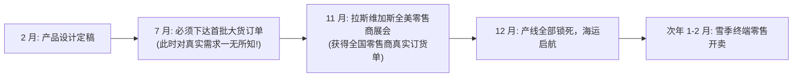
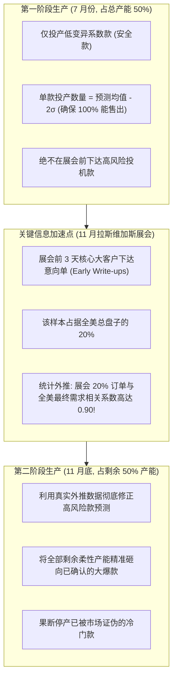

# Lec 8 奥博迈耶（Sport Obermeyer）案例：响应型供应链与预测风险对冲 (Sport Obermeyer)

> MIT Sloan 15.734 · Introduction to Operations Management · 主讲 Prof. Jérémie Gallien

## TL;DR

- 剖析高端滑雪服品牌奥博迈耶（Sport Obermeyer）如何化解极端时尚属性带来的高不确定性采购危机。
- 创新运用“专家预测分歧度”（Forecast Disagreement）量化单品需求风险，确立“安全款”与“投机款”分类标准。
- 设计“双阶段生产承诺机制”：在拉斯维加斯展会前利用早期微弱信号对冲风险。
- 构建兼顾低成本与高敏捷的“双轨采购网络”（中国内地保成本 vs. 香港保柔性快反）。

## 时尚冰雪世界的高风险博弈

奥博迈耶由工程师 Klaus Obermeyer 于科罗拉多阿斯彭创立，专营高端时尚滑雪运动服饰。其业务面临典型的时尚供应链挑战：
1. **产品生命周期极短**：滑雪服每年推陈出新，款式次年即告淘汰。
2. **极长的前置交付周期（Lead Time）**：从面料印染、拉链定制、跨国海运到零售上架，整个供应链耗时超过 10 个月。
3. **两难困境**：少生产一件热销款，损失高达 $40–$50 利润；多生产一件冷门款，季末只能以 40% 折扣大甩卖，甚至血本无归。

在 7 月份工厂排产时，距离真正的市场检验还有整整 4 个月。如何在这片不确定性迷雾中下达第一批上万件的生产指令？

## 创新量化：将“分歧”转化为统计方差

奥博迈耶管理层召集了来自设计、营销、采购与财务等部门的 6 位核心资深高管，组成预测评审委员会。要求每位委员对数十款滑雪夹克的未来年销量独立给出匿名预测。

数据分析展现了一个极具启发性的现象：
- 某些经典款（如黑色经典滑雪服）：6 位专家的预测高度集中（例如都在 950–1,050 件之间，均值 1,000，标准差仅 40）。
- 某些先锋撞色款（如霓虹紫拼接夹克）：专家分歧巨大（有人预测其为大爆款给 2,500 件，有人认为审美过于怪异仅给 200 件，均值 1,000，标准差高达 800！）。

::: definition 预测变异系数（Coefficient of Variation, $CV$）
$$CV = rac{	ext{标准差 } \sigma}{	ext{期望均值 } \mu}$$
奥博迈耶创新性地将“专家意见分歧的标准差”直接作为市场真实需求波动率的先验估计量！
- **低风险安全款（Low-risk Styles, $CV < 0.2$）**：市场确定性极高，无滞销风险。
- **高风险投机款（High-risk Styles, $CV > 0.6$）**：极端不确定，极易造成巨额过剩或严重脱销。
:::

## 双阶段生产决策与早期订单信号（Early Write-up）

奥博迈耶颠覆了传统的“一次性压宝式”生产，确立了**两阶段敏捷排产机制**。在传统的供应链运作中，企业往往在雪季开始前半年，凭着主观猜测一次性下达全部生产订单，将整年的经营命运押注在未经市场检验的预测上。奥博迈耶的重大突破在于将漫长的生产周期人为切分为两个阶段：第一阶段在信息完全缺失时仅利用安全边际保守试水，第二阶段则利用早期的微弱市场信号快速修正认知，将剩余产能精准投向真正的爆款。这种机制在不确定性的迷雾中架设了一道坚固的防火墙，彻底改变了高风险时尚行业的博弈规则：

## 全球双源采购布局（Dual Sourcing Strategy）

奥博迈耶合资建立了两个地理区位与能力迥异的代工基地：

| 采购与制造维度 | 中国内地合资工厂（中山/深圳） | 中国香港关联工厂 |
| :--- | :--- | :--- |
| **劳动力成本** | 极低（约为香港的 1/4） | 较高 |
| **最小起订量（MOQ）** | 极高（单款至少 1,200 件） | 极低（允许 300 件小批量敏捷翻单） |
| **前置响应时间** | 较长（通关与内陆运输较慢） | 极短（空运出海极度便捷） |
| **工人技术熟练度** | 擅长做大批量简单工艺 | 擅长多拉链、复杂撞色与极高技术难度款式 |
| **战略分工** | **基底吞吐源（Base Load）**：承接第一阶段全部安全款 | **敏捷响应源（Reactive Capacity）**：承接第二阶段急单翻单 |

::: pitfall 仅以“单件到岸成本”决策采购外包
许多跨国零售高管容易陷入“单位采购成本最低化”的单维思维，将全部订单压给中国内地或东南亚极低工价的工厂。但若工厂交付周期长达 6 个月且无法调整批次，一旦遭遇款式失销，50% 的存货折价清仓将轻而易举抹平全部劳动力成本节省。
:::

::: insight 柔性产能就是美式看涨期权
在现代供应链金融学视角下，香港工厂昂贵的工价本质上是奥博迈耶为“柔性”支付的**期权费（Option Premium）**。企业保留 30%–50% 的高柔性产能，相当于购买了一份在信息明朗后有权追加畅销款并终止滞销款的“实物看涨期权”。正是这套双轨对冲体系，让奥博迈耶在极高风险的滑雪服红海中连续数十年保持高资本回报率。
:::
