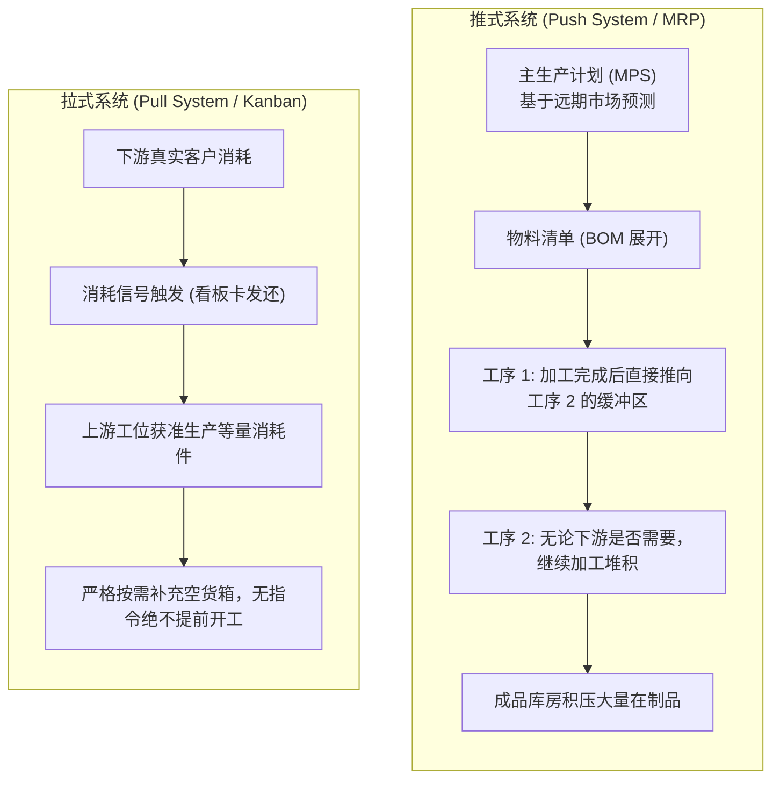
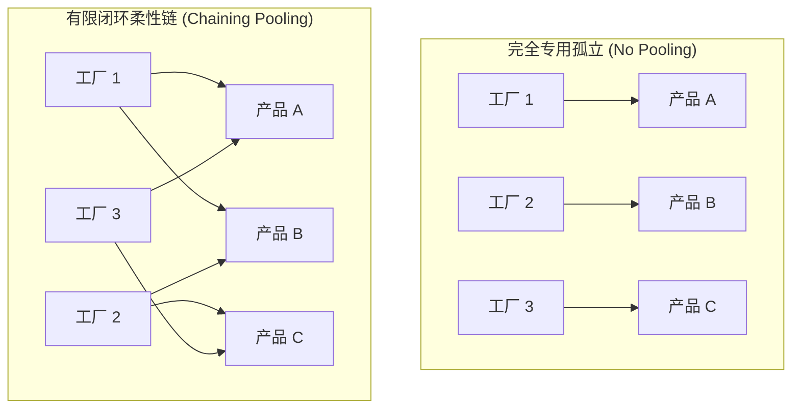

# Lec 9 生产控制系统：看板拉动机制与能力池化 (Production Control, Kanban & Pooling)

> MIT Sloan 15.734 · Introduction to Operations Management · 主讲 Prof. Jérémie Gallien

## TL;DR

- 深度对比现代生产控制两大范式：基于主生产计划的推式系统（MRP）与基于实际消耗的拉式系统（Kanban/JIT）。
- 推导看板（Kanban）容器数量的经典计算公式，揭示在制品上限对系统交付节拍的硬约束。
- 引入统计学“风险池化”（Risk Pooling）原理，量化多渠道需求合并后的方差缩减与安全库存优化。
- 剖析多技能跨界柔性产能（Flexible Capacity Pooling）在化解复杂多变市场需求中的倍增效应。

## 推式系统 vs. 拉式系统（Push vs. Pull）

生产控制系统的核心使命是回答两个基本问题：**何时生产？生产多少？**

### 两种范式的核心机理对照

| 维度 | 推式系统（Push / MRP） | 拉式系统（Pull / Kanban） |
| :--- | :--- | :--- |
| **生产触发信号** | 预测驱动（提前期倒排生产排程） | 需求驱动（下游工序消耗触发） |
| **在制品控制（WIP）** | 理论无上限，容易在瓶颈前积压成山 | **硬性上限（$WIP_{\max}$ 由看板卡总数物理锁定）** |
| **交期与流转时间** | 较长且不可控（易受排队队列膨胀干扰）| 极短且高度确定（利特尔法则约束） |
| **对不确定性的容忍** | 依赖高额安全库存与安全提前期吸收 | 依赖极短前置期与快速换模柔性吸收 |
| **适用业务环境** | 复杂多阶深层装配（如造船、航天、大型机械）| 重复性流水线制造与高度标准化作业 |

## 看板系统的运行物理学

看板（Kanban，日文原意为卡片或信号板）不仅是一种看板标识，更是一种**在制品库存授权机制**。工序只有在拿到附着于空料箱上的看板卡时，才被允许消耗原材料并启动机器。

### 循环看板总卡数计算公式

设工序的平均需求率为 $D$，生产与运输前置时间为 $L$（Lead Time），安全等待缓冲时间为 $S$，单个标准料箱容量为 $C$，管理者设定的系统安全冗余系数为 $lpha$（通常取 0.05–0.20）：

$$k \ge rac{D 	imes (L + S) 	imes (1 + lpha)}{C}$$

其中分子 $D 	imes (L + S) 	imes (1 + lpha)$ 代表系统在一个补货周期内可能遭遇的最大在制品需求量。

::: example 某汽车发动机总装线看板计算
某发动机缸体机加生产线，下游总装每小时消耗 $D = 80$ 件缸体。从机加工发令、锻件抓取、机加工切削到清洗检验入箱，平均提前期 $L = 2.5$ 小时，运输缓冲时间 $S = 0.5$ 小时。每个专用防震箱仅能容纳 $C = 20$ 件缸体。为应对可能出现的刀具磨损突发换刀，设置安全系数 $lpha = 10\%$。
计算所需维持运转的循环看板卡数：
$$k \ge rac{80 	imes (2.5 + 0.5) 	imes (1 + 0.10)}{20} = rac{80 	imes 3.0 	imes 1.10}{20} = rac{264}{20} = 13.2$$
向上取整，系统总共发放 **14 张看板卡**。
这意味着在整个机加工与总装之间，物理存在的最大缸体在制品数量被永远锁死在 $14 	imes 20 = 280$ 件之内！无论总装发生任何变故，在制品绝不会失控蔓延。
:::

## 风险池化与能力池化（Risk & Capacity Pooling）

在波动剧烈的市场中，对抗不确定性最优雅的数学武器是**统计独立事件的方差汇聚（Pooling）**。

### 1. 需求风险池化（Demand Risk Pooling）

假设企业在 $n$ 个独立地区各设有一座仓库，每个地区的需求服从独立同分布，均值为 $\mu$，标准差为 $\sigma$。
- **分散设仓（Decentralized）**：每个仓库需分别配置安全库存 $z 	imes \sigma$，全系统总安全库存为：
  $$SS_{	ext{decentralized}} = n 	imes z \sigma$$
- **集中设仓（Centralized / Pooled）**：将 $n$ 个仓库合并为一个中央物流中心，汇聚后的需求方差由于独立变量协方差为零：
  $$\sigma_{	ext{pooled}} = \sqrt{\sum_{i=1}^n \sigma^2} = \sqrt{n \sigma^2} = \sqrt{n} \sigma$$
  全系统所需总安全库存降为：
  $$SS_{	ext{centralized}} = z 	imes \sigma_{	ext{pooled}} = \sqrt{n} 	imes z \sigma$$

::: theorem 平方根安全库存节约法则
$$rac{SS_{	ext{centralized}}}{SS_{	ext{decentralized}}} = rac{\sqrt{n} z \sigma}{n z \sigma} = rac{1}{\sqrt{n}}$$
若将原本分散在 4 个独立大区的区域库合并为 1 个全国总仓（$n = 4$），在保持相同服务水平的前提下，**全系统安全库存立即可削减 50%（$1 / \sqrt{4} = 0.5$）**！
:::

### 2. 柔性能力池化（Capacity Pooling）

Jordan & Graves (1995) 提出了著名的**柔性链理论（Flexibility Chaining）**：

企业根本不需要斥巨资把每座工厂都改造成能生产所有产品的“完全超级柔性厂”；只需让每座工厂具备生产 2 种产品的局部交叉柔性，构成一个连通的“柔性闭环链”（Chaining），就能获取相当于 100% 全柔性系统 **90% 以上的能力池化效益**！

::: pitfall 忽视相关性导致池化失效
风险池化的数学前提是各变量“相互独立或负相关”（$
ho \le 0$）。若系统遭遇的是宏观系统性冲击（如全行业经济危机、跨国地缘冲突或疫情断链），各区域需求相关系数 $
ho 	o +1$，此时平方根法则彻底失效，集中设仓反而会导致“所有鸡蛋放在同一个被砸碎的篮子里”的灾难性断供。
:::

::: insight 约束的可见性与拉动管理哲学
拉式看板系统的灵魂不在于卡片，而在于它赋予了组织“强制暴露真实问题”的勇气。当管理者拿掉 1 张看板卡，系统在制品上限下降，流动变得紧绷。如果某一工位出现卡顿，整条产线会立刻停线报警（Andon）。推式系统通过堆积库存来假装天下太平，而拉式系统则主动拆除库存掩体，让每一个工艺瑕疵在阳光下无处遁形，驱动持续改善（Kaizen）。
:::
